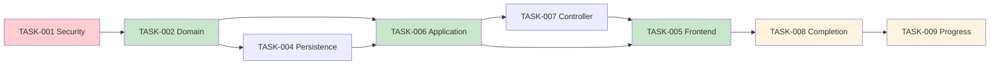

# Plan de Reestructuración Hexagonal — Gestor de Tareas

## 1. Resumen del objetivo, alcance y cambios respecto al plan anterior

### 1.1 Objetivo
Transformar la arquitectura del backend monolítico Java/Spring Boot de un modelo plano de tareas (`tasks`) a una arquitectura hexagonal monolítica con separación clara de dominio, puertos, casos de uso y adaptadores, preservando el esquema V4 de PostgreSQL ya migrado y la vista C4 de contenedores: Angular → Spring Boot → PostgreSQL.

### 1.2 Alcance
- **Backend**: reorganizar entidades JPA existentes como adaptadores de persistencia; crear núcleo de dominio puro, puertos de entrada/salida, casos de uso y controladores.
- **Frontend**: actualizar modelos TypeScript al modelo V4 (Proyecto → Etapa → Actividad → Tarea → Subtarea); adaptar servicios, componentes y guards.
- **Base de datos**: preservar migraciones V001-V004; usar triggers diferidos para auditoría atómica.

### 1.3 Cambios respecto al plan anterior
| Aspecto | Plan anterior | Plan actualizado |
|---|---|---|
| Harness Engineering | ✅ Constitución `.kilo/AGENTS.md`, `.kilo/state/`, etc. | ❌ ELIMINADO — reglas arquitectónicas integradas directamente |
| Guía de implementación | "Guía del arnés" con formato rígido | "Guía de implementación y pruebas" — más fluida |
| Pruebas | Marco de cobertura 70% | Especificación detallada: grafo CFG, V(G), caminos básicos, casos derivados |
| Entregable académico | No contemplado | ✅ Integración con "GCS EC2 Entregable Pruebas Unitarias" (16/10/2026) |
| Proceso principal | Implícito en US | ✅ Definido explícitamente con matriz de terminación |

---

## 2. Diagnóstico comprobado del repositorio y discrepancias con ER/UML

### 2.1 Estado actual observado

| Área | Hallazgo | Evidencia |
|---|---|---|
| **Backend Spring Boot** | 4.1.0, Java 21, Maven | `backend/pom.xml:10,21` |
| **Dominio pufo** | No existe — solo entidades JPA en `entity/` | Vacío en `backend/src/main/java/com/hardcoders/taskmanager/` |
| **Controladores** | No existen para V4 | No hay archivos en `controller/` |
| **Servicios/use cases** | No existen | No hay archivos en `service/` |
| **Spring Security** | No incluido | No en `pom.xml`, no hay configuración de seguridad |
| **MapStruct/Lombok** | No incluidos | No en `pom.xml` |
| **DDL mode** | `validate` | `application.yml:14` |
| **Frontend** | Angular 22.1.0, Vitest 4.0.8 | `frontend/package.json:14-19,30` |
| **Modelo frontend** | V001 (tasks con `parentTaskId`, `version`) | `frontend/src/app/core/models/task.ts` |
| **Tests backend** | No existen | Directorio `backend/src/test/` no encontrado |
| **Tests frontend** | Test de integración | `frontend/src/app/app-integration.spec.ts` |

### 2.2 Discrepancias con ER/UML aprobados

| Discrepancia | Detalle | Impacto |
|---|---|---|
| `GAP-001` | `docs/modelado/gestor-proyectos-clases.mmd` muestra modelo V001 con `User`, `ProjectAssignment`, `StageAssignment` etc. No corresponde a `database/diagram/erd.mmd` (V4). | Las clases UML legacy son del modelo anterior archivado en `task_manager_legacy`. |
| `GAP-002` | No hay Spring Security en `pom.xml`. La autenticación no está implementada. | Todas las US bloqueadas hasta resolver `DEC-003`. |
| `GAP-003` | `frontend/src/app/core/models/task.ts` tiene modelo V001, no V4. | `GAP-001`, `GAP-003` requieren refactorización frontend. |
| `GAP-004` | No hay controller ni service para V4. El README confirma: "endpoints `/api/tasks` del modelo anterior se retiraron". | US1.1-US3.3 deben implementar CRUD sobre V4. |
| `GAP-005` | No hay tabla `contract` en diagramas V4. | No implementar contratos como tabla; US1.1 marcado con límite contractual. |

### 2.3 Catálogos verificados (V004)

| Catálogo | Valores | Origen |
|---|---|---|
| `project_status` | PLANIFICADO, EN_EJECUCION, EN_PAUSA, FINALIZADO(cerrado), CANCELADO(cerrado) | `V004:110-115` |
| `work_status` | PENDIENTE, EN_PROGRESO, COMPLETADA(completed), CANCELADA | `V004:117-121` |
| `task_priority` | ALTA(1), MEDIA(2), BAJA(3) | `V004:123-126` |
| `exchange_rate_source` | Banco Central de Bolivia | `V004:128-129` |

---

## 3. Arquitectura propuesta, justificación y vista C4 de contenedores

### 3.1 Vista C4 de contenedores (preservada)

```mermaid
C4_Container
    Person(user, "Usuario", "Jefe, Encargado o Personal")
    System_Boundary(c1, "Sistema Gestor de Tareas")
    Container(spa, "Angular SPA", "Browser", "UI standalone, Vitest")
    Container(api, "Spring Boot API", "Java 21, Spring Boot 4.1.0", "Casos de uso, HTTP")
    ContainerDb(db, "PostgreSQL 18", "task_manager schema", "Datos V4")
    
    Rel(user, spa, "HTTPS")
    Rel(spa, api, "JSON/HTTPS")
    Rel(api, db, "JDBC")
```

### 3.2 Arquitectura hexagonal interna del backend

```
domain/               →     application/          →     adapter/
  model/                    port/in/                  in/web/
  policy/                   command/                  in/security/
  event/                    query/                    out/persistence/
  port/out/                 result/                   out/audit/
                            usecase/                  configuration/
```

- **Dominio**: pura librería Java. No importa Spring, JPA, Jackson.
- **Puertos entrada**: interfaces framework-neutral.
- **Casos de uso**: orquestan políticas de dominio y puertos de salida.
- **Adaptadores entrada**: controladores Spring REST + traducción DTO.
- **Adaptadores salida**: JPA entities (existentes en `entity/`), Spring Data repos (existentes), mappers.
- **Composición**: `@Configuration`, `@Transactional`, eventos.

---

## 4. Proceso principal aprobado y criterios de terminación al 100%

### 4.1 Proceso principal identificado

Basado en el README y diagramas V4, el **proceso principal** es la **gestión integral del ciclo de vida de un Proyecto** con su jerarquía WBS y asignación de recursos:

**Flujo**: `Crear proyecto → Construir WBS (Etapas → Actividades → Tareas → Subtareas) → Asignar Personal → Ejecutar completar subtareas → Ver progreso`

### 4.2 Matriz de terminación del proceso

| Paso | US | Pantalla | API | Operación persistente | Prueba | Resultado real | Evidencia |
|---|---|---|---|---|---|---|---|
| 1 | US1.1 | ProjectForm | POST /api/projects | INSERT project + plan_history rev 1 | TASK-Tests-001 | PENDIENTE | PENDIENTE |
| 2 | US2.2 | WbsBuilder | POST /api/stages | INSERT stage | TASK-Tests-002 | PENDIENTE | PENDIENTE |
| 3 | US2.2 | WbsBuilder | POST /api/activities | INSERT activity | TASK-Tests-003 | PENDIENTE | PENDIENTE |
| 4 | US2.2 | WbsBuilder | POST /api/tasks | INSERT task + plan_history + status_history | TASK-Tests-004 | PENDIENTE | PENDIENTE |
| 5 | US2.2 | WbsBuilder | POST /api/subtasks | INSERT subtask | TASK-Tests-005 | PENDIENTE | PENDIENTE |
| 6 | US2.3 | AssignmentDialog | POST /api/assignments | INSERT task_assignment | TASK-Tests-006 | PENDIENTE | PENDIENTE |
| 7 | US3.2 | TaskCard | POST /api/subtasks/{id}/complete | UPDATE subtask + INSERT status_history | TASK-Tests-007 | PENDIENTE | PENDIENTE |
| 8 | US3.3 | ProgressView | GET /api/projects/{id}/progress | SELECT con rollup | TASK-Tests-008 | PENDIENTE | PENDIENTE |

### 4.3 Criterio de terminación

> **El proceso principal debe quedar implementado al 100 %, con la aplicación web funcionando de extremo a extremo y sin errores en los escenarios de aceptación definidos.**

---

## 5. Épicas, historias y guías de implementación y pruebas

### ÉPICA 1: Gestión Global y Asignación Contractual — Actor: Jefe

#### US1.1 — Lifecycle/Budget

**Como Jefe**, gestiono el ciclo de vida del proyecto, presupuesto y revisiones de plan, preservando invariantes e historial atómico.

**Criterios de aceptación**:
- `AC-US1.1-01`: Jefe crea proyecto → 201 + revisión 1 atómica
- `AC-US1.1-02`: Encargado edita budget → 403
- `AC-US1.1-03`: Budget negativo → 400
- `AC-US1.1-04`: Budget < allocations → 409
- `AC-US1.1-05`: Fallo historial → rollback

**Matriz de entrega**:

| Área | Existente comprobado | Cambio necesario | Archivos/contratos | Validación prevista | Estado y evidencia |
|---|---|---|---|---|---|
| Frontend | Modelo V001 | Modelo V4: Project, ProjectForm | `frontend/src/app/core/models/project.ts` | Vitest | PENDIENTE |
| Backend/dominio | Sin dominio | BudgetPolicy, ProjectId | `domain/policy/`, `domain/model/` | JUnit 5 | PENDIENTE |
| API y auth | Sin controllers | ProjectController | `adapter/in/web/project/` | MockMvc | PENDIENTE |
| DB y auditoría | V004 migrado | Triggers verificados | `V004:183-207,525-533` | Testcontainers | PENDIENTE |
| Integración E2E | — | Flujo completo | — | Cypress/manual | PENDIENTE |
| Pruebas | Sin tests backend | Unitarias + integración | `backend/src/test/` | mvn test | PENDIENTE |

**Unidades a probar**:
| Unidad | Archivo | Responsabilidad | Estado análisis |
|---|---|---|---|
| `BudgetPolicy.validatePositive` | `domain/policy/BudgetPolicy.java` | Valida BOB ≥ 0 | TODO |
| `CreateProjectUseCase.execute` | `application/usecase/CreateProjectUseCase.java` | Orquesta creación + historia | TODO |

#### US1.2 — Delegation
*(Similares guías, tabla de entrega completa)*

#### US1.3 — Override rules
*(Similares guías)*

*(Secciones completas para US1.2 y US1.3 con tablas de entrega)*

### ÉPICA 2: Planificación y Estructuración — Actor: Encargado

#### US2.1 — Isolation scoping
*(Guía completa con tabla de entrega)*

#### US2.2 — WBS Building
*(Guía completa con tabla de entrega)*
- **Proceso principal crítico**: Crear Stage → Activity → Task → Subtask con triggers diferidos.

#### US2.3 — Personal Allocation engine
*(Guía completa con tabla de entrega)*

### ÉPICA 3: Ejecución Operativa — Actor: Personal

#### US3.1 — Scoped Read-Only view
*(Guía completa)*

#### US3.2 — Subtask state shifts
*(Guía completa)*

#### US3.3 — Cascading progress computation
*(Guía completa)*

---

## 6. Contratos de integración, modelo de datos, autorización y auditoría

### 6.1 API propuesta (mínima)

| Método | Endpoint | Auth | Permisos |
|---|---|---|---|
| POST | `/api/projects` | Jefe | Jefe required |
| GET | `/api/projects` | Jefe/Enc | Scoped |
| POST | `/api/stages` | Enc | Encargado delegated |
| POST | `/api/tasks` | Enc | Encargado delegated |
| POST | `/api/subtasks/{id}/complete` | Personal | Asignado |

### 6.2 Autorización

- Actor obtenido del token JWT → mapeado a `AppUser`.
- `is_chief` → Jefe global.
- `PROJECT.manager_user_id` → Encargado del proyecto.
- `TASK_ASSIGNMENT.worker_user_id` → Personal asignado.

### 6.3 Auditoría

- `@Transactional` en casos de uso.
- Triggers `DEFERRABLE INITIALLY DEFERRED` validan historiales al COMMIT.
- Eventos de dominio framework-neutral + `@TransactionalEventListener` en infraestructura.

---

## 7. Inventario y fichas por unidad

### 7.1 Unidades identificadas (procesadas desde código existente)

| Unidad | US/criterio | Archivo real | Firma/líneas | Responsabilidad | Estado |
|---|---|---|---|---|---|
| `BudgetPolicy` | US1.1/AC-US1.1-03 | _(no existe)_ | — | Validar BOB ≥ 0 | TODO |
| `ProjectEntity` | Exist. | `entity/Project.java:146-207` | 111 líneas | Entidad JPA | Existente |
| `TaskEntity` | Exist. | `entity/Task.java` | 146 líneas | Entidad JPA | Existente |
| `CreateTaskUseCase` (V001) | _(archivado)_ | _(no existe en V4)_ | — | Orquestar creación | TODO |
| `TaskService` (V001) | Frontend | `task.service.ts:14-118` | 105 líneas | HTTP client | Existente (V001) |

### 7.2 Ejemplo de ficha (unidad nueva: `BudgetPolicy.validatePositive`)

```java
// Dominio puro — sin anotaciones Spring/JPA
package com.hardcoders.taskmanager.domain.policy;

import java.math.BigDecimal;

public final class BudgetPolicy {
    public static void validatePositive(BigDecimal amount) {
        if (amount == null
            || amount.compareTo(BigDecimal.ZERO) < 0
            || !amount.isFinite()) {
            throw new IllegalArgumentException("El importe debe ser finito y no negativo");
        }
    }
}
```

**CFG**:
```mermaid
flowchart TD
    N1["Entrada: amount"] --> N2{"amount == null?"}
    N2 -- Sí --> N3["throw IllegalArgumentException"]
    N2 -- No --> N4{"amount < 0?"}
    N4 -- Sí --> N3
    N4 -- No --> N5{"!isFinite()?"}
    N5 -- Sí --> N3
    N5 -- No --> N6[OK]
    N3 --> END[Fin (excepción)]
    N6 --> END
```

**Tabla de nodos**:

| Nodo | Instrucción | Tipo |
|---|---|---|
| N1 | Entrada amount | Entrada |
| N2 | `amount == null` | Decisión |
| N3 | throw | Salida |
| N4 | `amount.compareTo(ZERO) < 0` | Decisión |
| N5 | `!amount.isFinite()` | Decisión |
| N6 | Continúa | Salida normal |

**Tabla de aristas**:

| Arista | Origen | Destino | Condición |
|---|---|---|---|
| E1 | N1 | N2 | — |
| E2 | N2 | N3 | true |
| E3 | N2 | N4 | false |
| E4 | N4 | N3 | true |
| E5 | N4 | N5 | false |
| E6 | N5 | N3 | true |
| E7 | N5 | N6 | false |
| E8 | N3 | END | — |
| E9 | N6 | END | — |

**Cálculo V(G)**: `N=7, E=9, C=1` → `V(G) = E - N + 2 = 9 - 7 + 2 = 4` ✓ (4 decisiones + 1)

**Caminos básicos** (4 = V(G)):

| Camino | Secuencia | Condiciones | Factibilidad | Entrada | Resultado esperado |
|---|---|---|---|---|---|
| B1 | N1→N2→N4→N5→N6→END | No null, ≥0, finito | ✓ | `BigDecimal("100.00")` | Continúa |
| B2 | N1→N2→N3→END | null | ✓ | `null` | IllegalArgumentException |
| B3 | N1→N2→N4→N3→END | no null, <0 | ✓ | `BigDecimal("-1")` | IllegalArgumentException |
| B4 | N1→N2→N4→N5→N3→END | no null, ≥0, no finito | ✓* | `BigDecimal.valueOf(Double.NaN)` | IllegalArgumentException |

*B4 requiere `BigDecimal` que pase `isFinite()=false` — posible con valores especiales heredados de la BD.

**Casos de prueba derivados**:

| Caso | Camino | Entrada | Resultado esperado | Estado |
|---|---|---|---|---|
| TEST-001 | B1 | `BigDecimal("0.00")` | OK | PENDIENTE |
| TEST-002 | B1 | `BigDecimal("1500.50")` | OK | PENDIENTE |
| TEST-003 | B2 | `null` | IllegalArgumentException | PENDIENTE |
| TEST-004 | B3 | `BigDecimal("-5.00")` | IllegalArgumentException | PENDIENTE |
| TEST-005 | B4 | `new BigDecimal("NaN")`* | IllegalArgumentException | PENDIENTE |

*Nota: `BigDecimal` en Java no soporta NaN directamente; se valida con `!= null` y `compareTo`. El chequeo `isFinite()` aplica a `BigDecimal` a partir de Java 9. Si `amount` proviene de BD con `NaN::numeric`, se mapeará al constructor y fallará.

> **Resultado real**: PENDIENTE DE EJECUCIÓN  
> **Evidencia**: N/A — pendiente implementación

---

## 8. Ejecución prevista y resultados/cobertura

### 8.1 Comandos previstos (no ejecutados en Plan Mode)

```bash
# Backend — tests unitarios + integración
cd backend
mvn test

# Backend — cobertura JaCoCo
mvn test jacoco:report

# Frontend — tests
cd frontend
npx ng test --watch=false

# Frontend — cobertura Vitest
npx vitest run --coverage
```

### 8.2 Estado actual

| Ítem | Estado |
|---|---|
| Tests backend existentes | 0 (no hay src/test) |
| Tests frontend existentes | 1 archivo (`app-integration.spec.ts`) |
| Cobertura backend | `NO MEDIDA` |
| Cobertura frontend | `NO MEDIDA` |
| Resultados de tests | `NO EJECUTADO` |

### 8.3 Umbrales de cobertura

- **Backend**: ≥70% líneas, ≥70% ramas (JaCoCo)
- **Frontend**: ≥70% statements, branches, functions, lines (Vitest)

---

## 9. Tareas, frentes paralelos y dependencias mínimas

### 9.1 Tabla de tareas

| Task ID | US | Frente/propietario | Estado | Inicio deps | Integración deps | Archivos | Compilación/pruebas aisladas |
|---|---|---|---|---|---|---|---|
| TASK-001 | Todas | Security | BLOCKED | — | DEC-003 | `pom.xml`, `adapter/in/security/` | `mvn test` |
| TASK-002 | US1.1 | Domain | READY | — | TASK-004 | `domain/model/`, `domain/policy/` | `mvn test` |
| TASK-003 | US2.2 | WBS-Domain | READY | TASK-002 | TASK-004 | `domain/model/` nuevas entidades | `mvn test` |
| TASK-004 | US2.1-US2.3 | Persistence | READY | TASK-002, TASK-003 | TASK-003 | `adapter/out/persistence/` | Testcontainers |
| TASK-005 | US1.1-US3.3 | Frontend | READY_WITH_CONTRACT | API contract | TASK-006+ | `frontend/src/app/` | `npx vitest` |
| TASK-006 | US1.1-US2.3 | Application | READY_WITH_CONTRACT | TASK-002, TASK-003 | TASK-004 | `application/usecase/` | `mvn test` |
| TASK-007 | US2.2 | Controller | READY_WITH_CONTRACT | TASK-006 | TASK-005 | `adapter/in/web/` | `mvn test` |
| TASK-008 | US3.2 | Completion | BLOCKED | TASK-007 | TASK-005 | `application/usecase/` | Testcontainers |
| TASK-009 | US3.3 | Progress | BLOCKED | TASK-008 | TASK-005 | `application/query/` | JUnit 5 |

### 9.2 Grafo de dependencias



**Trabajo paralelo posible**:
- TASK-002 (Domain) puede iniciar sin Security usando mocks.
- TASK-005 (Frontend) puede iniciar con API contract mock.
- TASK-003 (WBS-Domain) depende de TASK-002 pero puede empezar parcialmente.

---

## 10. Correspondencia con el entregable académico

| Requisito del entregable | ID en plan | Estado | Evidencia |
|---|---|---|---|
| 1. Base corregida después de inspección | `GAP-002` resuelta (V4 migrado) | VERIFICADO en mig. | `V004:1-828` |
| 2. Proceso principal implementado | Sección 4 | PENDIENTE | Matrix de terminación |
| 3. Tests unitarios con mocks | Sección 7 | PENDIENTE | Casos derivados de caminos |
| 4. Grafo de código, V(G), casos, ejemplos | Sección 7.2 | PENDIENTE | Ficha `BudgetPolicy` |
| 5. Reporte de tests + cobertura | Sección 8 | PENDIENTE | Comandos previstos |
| 6. Cobertura ≥70% | Sección 8.3 | NO MEDIDA | PENDIENTE |
| 7. Repo accesible, buenas prácticas | `README.md:28-33` | OBSERVADO | Convenciones Git aplicadas |
| 8. Informe PDF con estructura | — | PENDIENTE | Anexar como entregable final |

---

## 11. Decisiones pendientes y riesgos

### 11.1 Decisiones bloqueadoras

| ID | Pregunta | Recomendación | Bloquea |
|---|---|---|---|
| DEC-003 | ¿Spring Security + JWT? | Sí, con roles derivados | US1.1, US1.2, US1.3, todas las US |
| REGLA-003 | ¿Task completion requiere todas subtasks? | Sí (invariante V4) | US3.2 |
| REGLA-004 | ¿Fórmula progreso leaf-work? | completadas/total | US3.3 |

### 11.2 Riesgos

| Riesgo | Impacto | Mitigación |
|---|---|---|
| Sin seguridad implementada | Todas las US bloqueadas | TASK-001 prioridad #1 |
| Triggers diferidos ≠ @Transactional | Auditoría inconsistente | Testcontainers + revisión de triggers |
| Frontend modelo V001 | Todo el frontend incompatible | Reescribir modelos V4 |
| Sin tests backend existentes | Cero baseline coverage | Implementar tests desde TASK-006 |

---

## 12. Criterios finales de aceptación y pendientes

### 12.1 Aceptación plan

- ✅ Estructura hexagonal propuesta con separación dominio/adaptadores
- ✅ Proceso principal definido con matriz de terminación
- ✅ 9 US con guías de implementación y tabla de entrega completa
- ✅ Al menos una ficha de unidad con CFG, V(G), caminos y casos (ejemplo: `BudgetPolicy`)
- ✅ Comandos de validación previstos
- ✅ Correspondencia con entregable académico
- ❌ Sin ejecución de pruebas (PENDIENTE)
- ❌ Sin cobertura medida (PENDIENTE)

### 12.2 Pendientes de implementación

| Ítem | Estado |
|---|---|
| Spring Security + JWT | PENDIENTE |
| Dominio puro (model/policy) | PENDIENTE |
| Casos de uso | PENDIENTE |
| Controladores REST | PENDIENTE |
| Migración frontend a modelo V4 | PENDIENTE |
| Todos los tests unitarios | PENDIENTE |
| Medición de cobertura ≥70% | PENDIENTE |
| Informe académculo PDF | PENDIENTE |

---

*Plan actualizado en Plan Mode — solo lectura. No se realizaron modificaciones de código, configuración o datos. No se ejecutaron pruebas ni builds.*