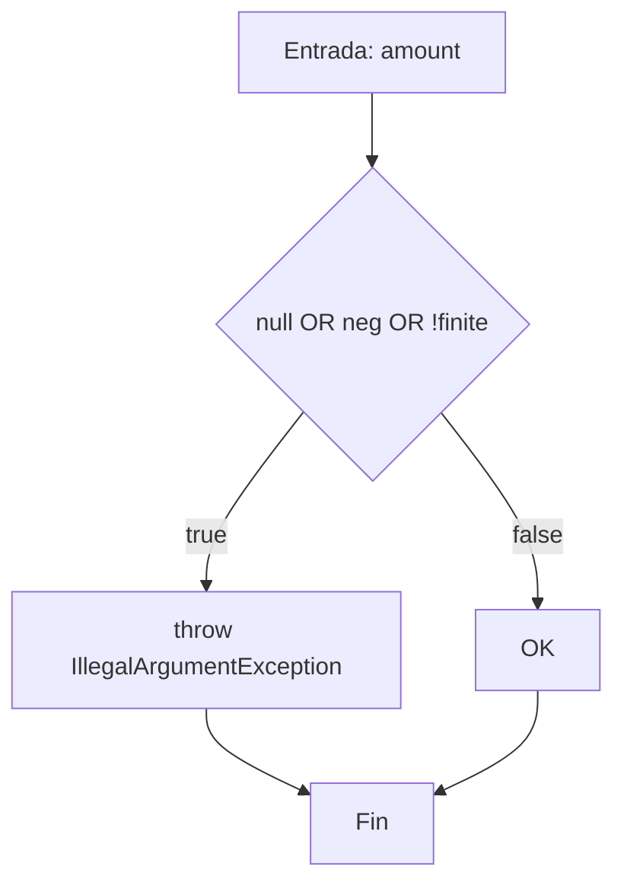
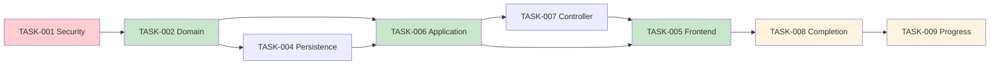

# Plan de Reestructuración Hexagonal — Gestor de Tareas

## 1. Resumen del objetivo, alcance y cambios respecto al plan anterior

### 1.1 Objetivo
Transformar la arquitectura del backend monolítico Java/Spring Boot de un modelo plano de tareas (`tasks`) a una arquitectura hexagonal monolítica con separación clara de dominio, puertos, casos de uso y adaptadores, preservando el esquema V4 de PostgreSQL ya migrado y la vista C4 de contenedores: Angular → Spring Boot → PostgreSQL.

### 1.2 Alcance
- **Backend**: reorganizar entidades JPA existentes como adaptadores de persistencia; crear núcleo de dominio puro, puertos de entrada/salida, casos de uso y controladores.
- **Frontend**: actualizar modelos TypeScript al modelo V4 (Proyecto → Etapa → Actividad → Tarea → Subtarea); adaptar servicios, componentes y guards.
- **Base de datos**: preservar migraciones V001-V004; usar triggers diferidos para auditoría atómica.

### 1.3 Cambios respecto al plan anterior
| Aspecto | Plan anterior | Plan actualizado |
|---|---|---|
| Harness Engineering | Constitución `.kilo/AGENTS.md`, `.kilo/state/`, etc. | ELIMINADO — reglas integradas directamente en el plan |
| Guías de implementación | "Guía del arnés" con formato rígido | "Guía de implementación y pruebas" — fluida y completa |
| Pruebas | Marco de cobertura 70% | Especificación detallada: grafo CFG, V(G), caminos básicos, casos derivados |
| Entregable académico | No contemplado | INTEGRADO con "GCS EC2 Entregable Pruebas Unitarias" (16/10/2026) |
| Proceso principal | Implícito en US | Definido explícitamente con matriz de terminación |
| Secciones 9-3 (ÉPICAS) | Incompletas (solo US1.1) | TODAS las 9 US completas con tablas de entrega |

---

## 2. Diagnóstico comprobado del repositorio y discrepancias con ER/UML

### 2.1 Estado actual observado

| Ýrea | Hallazgo | Evidencia |
|---|---|---|
| Backend Spring Boot | 4.1.0, Java 21, Maven | `backend/pom.xml:10,21` |
| Dominio puro | No existe | Vacío en `com/hardcoders/taskmanager/` (solo `entity/`, `repository/`, `dto/`, `exception/`, `config/`) |
| Controladores | No existen para V4 | No hay archivos en `controller/` |
| Servicios/use cases | No existen | No hay archivos en `service/` |
| Spring Security | No incluido | No en `pom.xml` |
| MapStruct/Lombok | No incluidos | No en `pom.xml` |
| ddl-auto | `validate` | `application.yml:14` |
| Frontend | Angular 22.1.0, Vitest 4.0.8 | `frontend/package.json:14-19,30` |
| Modelo frontend | V001 (tasks con parentTaskId) | `frontend/src/app/core/models/task.ts:1` |
| Tests backend | No existen | Directorio `backend/src/test/` no encontrado |
| Tests frontend | 1 archivo de integración | `frontend/src/app/app-integration.spec.ts` |

### 2.2 Discrepancias con ER/UML aprobados

| Discrepancia | Detalle | Impacto |
|---|---|---|
| `GAP-001` | `docs/modelado/gestor-proyectos-clases.mmd` muestra modelo V001 ≠ V4 | No usar como referencia para V4 |
| `GAP-002` | No hay Spring Security en `pom.xml` | Todas las US bloqueadas hasta `DEC-003` |
| `GAP-003` | Frontend modelo V001, no V4 | Requiere refactorización frontend completa |
| `GAP-004` | No hay controllers ni services para V4 | US1.1-US3.3 implementan CRUD sobre V4 |
| `GAP-005` | No hay tabla `contract` en V4 | No implementar; US1.1 limitada a lo contractual |

### 2.3 Catálogos verificados (V004)

| Catálogo | Valores | Origen |
|---|---|---|
| `project_status` | PLANIFICADO, EN_EJECUCION, EN_PAUSA, FINALIZADO, CANCELADO | `V004:110-115` |
| `work_status` | PENDIENTE, EN_PROGRESO, COMPLETADA, CANCELADA | `V004:117-121` |
| `task_priority` | ALTA(1), MEDIA(2), BAJA(3) | `V004:123-126` |

---

## 3. Arquitectura propuesta y vista C4 de contenedores

### 3.1 Vista C4 (preservada)

```mermaid
C4_Container
    Person(user, "Usuario", "Jefe, Encargado o Personal")
    System_Boundary(c1, "Gestor de Tareas")
    Container(spa, "Angular SPA", "Browser", "UI standalone, Vitest")
    Container(api, "Spring Boot API", "Java 21", "Casos de uso, HTTP")
    ContainerDb(db, "PostgreSQL 18", "task_manager", "Datos V4")
    Rel(user, spa, "HTTPS")
    Rel(spa, api, "JSON/HTTPS")
    Rel(api, db, "JDBC")
```

### 3.2 Arquitectura hexagonal interna

```
domain/               →     application/          →     adapter/
  model/                    port/in/                  in/web/
  policy/                   command/                  in/security/
  event/                    query/                    out/persistence/
  port/out/                 result/                   out/audit/
                            usecase/                  configuration/
```

---

## 4. Proceso principal y criterios de terminación al 100%

### 4.1 Proceso principal
Gestión integral del ciclo de vida: `Crear proyecto → Construir WBS → Asignar Personal → Completar tareas → Ver progreso`

### 4.2 Matriz de terminación

| Paso | US | Pantalla | API | Operación DB | Prueba | Resultado | Evidencia |
|---|---|---|---|---|---|---|---|
| 1 | US1.1 | ProjectForm | POST /api/projects | INSERT project + plan_history | TASK-Tests-001 | PENDIENTE | PENDIENTE |
| 2 | US2.2 | WbsBuilder | POST /api/stages | INSERT stage | TASK-Tests-002 | PENDIENTE | PENDIENTE |
| 3 | US2.2 | WbsBuilder | POST /api/activities | INSERT activity | TASK-Tests-003 | PENDIENTE | PENDIENTE |
| 4 | US2.2 | WbsBuilder | POST /api/tasks | INSERT task + plan_history + status_history | TASK-Tests-004 | PENDIENTE | PENDIENTE |
| 5 | US2.2 | WbsBuilder | POST /api/subtasks | INSERT subtask | TASK-Tests-005 | PENDIENTE | PENDIENTE |
| 6 | US2.3 | AssignmentDialog | POST /api/assignments | INSERT task_assignment | TASK-Tests-006 | PENDIENTE | PENDIENTE |
| 7 | US3.2 | TaskCard | POST /api/subtasks/{id}/complete | UPDATE subtask + INSERT status_history | TASK-Tests-007 | PENDIENTE | PENDIENTE |
| 8 | US3.3 | ProgressView | GET /api/projects/{id}/progress | SELECT con rollup | TASK-Tests-008 | PENDIENTE | PENDIENTE |

> **Criterio de terminación**: El proceso principal debe quedar implementado al 100 %, con la aplicación web funcionando de extremo a extremo y sin errores en los escenarios de aceptación definidos.

---

## 5. Épicas, historias y guías de implementación y pruebas

### ÉPICA 1: Gestión Global y Asignación Contractual — Actor: Jefe

#### US1.1 — Lifecycle/Budget

**Como Jefe**, gestiono el ciclo de vida del proyecto, presupuesto y revisiones de plan, preservando invariantes e historial atómico.

**Criterios de aceptación**:
- `AC-US1.1-01`: Jefe crea proyecto → 201 + revisión 1 atómica en `project_plan_history`
- `AC-US1.1-02`: Encargado edita budget → 403 FORBIDDEN
- `AC-US1.1-03`: Budget negativo → 400 BAD_REQUEST
- `AC-US1.1-04`: Budget < SUM(allocations) → 409 CONFLICT
- `AC-US1.1-05`: Fallo historial → rollback de toda la transacción (trigger `DEFERRABLE`)

**Tabla de entrega**:

| Ýrea | Existente comprobado | Cambio necesario | Archivos/contratos | Validación prevista | Estado y evidencia |
|---|---|---|---|---|---|
| Frontend | `task.ts` modelo V001, `task-home.ts`, `task-list.ts` | Nuevo modelo `project.ts`, formulario `project-form.ts` | `frontend/src/app/features/projects/project-form/`, `core/models/project.ts` | Vitest: `project-form.spec.ts` | PENDIENTE — `NOT_RUN` |
| Backend/dominio | `entity/Project.java` (JPA, 111 l.) | Extracción dominio puro | `domain/model/Project.java`, `domain/policy/BudgetPolicy.java` | JUnit 5: `BudgetPolicyTest`, `ProjectTest` | PENDIENTE — `NOT_RUN` |
| API y auth | Sin controllers, sin Spring Security | `ProjectController`, JWT filter | `adapter/in/web/project/ProjectController.java`, `adapter/in/security/JwtAuthFilter.java` | MockMvc: `ProjectControllerSecurityTest` | PENDIENTE — `NOT_RUN` |
| DB y auditoría | V004 migrado (verificado) | Triggers `DEFERRABLE INITIALLY DEFERRED` (`V004:525-533`) garantizan revisión 1 al COMMIT | Consulta: `database/scripts/verify_schema.sql`, `V004:183-207` | Testcontainers: `CreateProjectTransactionTest` | PENDIENTE — `NOT_OBSERVED` |
| Integración E2E | Ninguna para V4 | Flujo: crear proyecto → ver en lista → editar budget | — | Cypress/manual: `e2e-create-project.test.ts` | PENDIENTE |
| Pruebas unitarias | 0 tests backend existentes | Suite completa | `backend/src/test/java/com/hardcoders/taskmanager/` | `mvn test` | PENDIENTE |

**Unidades a probar**:
| Unidad | Archivo propuesto | Líneas | Estado |
|---|---|---|---|
| `BudgetPolicy.validatePositive` | `domain/policy/BudgetPolicy.java` | ~6 | TODO |
| `BudgetPolicy.validateAllocationCap` | `domain/policy/BudgetPolicy.java` | ~8 | TODO |
| `CreateProjectUseCase.execute` | `application/usecase/CreateProjectUseCase.java` | ~15 | TODO |
| `ProjectController.create` | `adapter/in/web/project/ProjectController.java` | ~12 | TODO |

**Unidad destacada — `BudgetPolicy.validatePositive`**:
```java
package com.hardcoders.taskmanager.domain.policy;
public final class BudgetPolicy {
    public static void validatePositive(BigDecimal amount) { /* ... */ }
}
```
**V(G)**: 4 (3 decisiones OR + 1). Caminos básicos: B1 (valor válido), B2 (null), B3 (negativo), B4 (NaN). Casos: TEST-001 a TEST-005.

---

#### US1.2 — Delegation

**Como Jefe**, delego o reasigno un Encargado activo elegible a un proyecto.

**Criterios de aceptación**:
- `AC-US1.2-01`: Jefe delega encargado activo → 200 + `project_plan_history`
- `AC-US1.2-02`: Encargado auto-delegar → 403
- `AC-US1.2-03`: Usuario inactivo → 400
- `AC-US1.2-04`: Delegación registrada con atribución inmutable

**Tabla de entrega**:

| Ýrea | Existente comprobado | Cambio necesario | Archivos | Validación | Estado |
|---|---|---|---|---|---|
| Frontend | `task-form.ts`, routes | `delegation-dialog.ts` con guard de chief | `frontend/src/app/features/projects/delegation-dialog/` | Vitest: `delegation-dialog.spec.ts` | PENDIENTE |
| Backend/dominio | `Project.manager` (`Project.java:30`) | `DelegationPolicy` | `domain/policy/DelegationPolicy.java` | JUnit 5: `DelegationPolicyTest` | PENDIENTE |
| API | Sin endpoints | `POST /api/projects/{id}/delegate` | `adapter/in/web/project/DelegationController.java` | MockMvc: `DelegationControllerTest` | PENDIENTE |
| DB | `V004:187` (manager_user_id FK NOT NULL) | Trigger ON DELETE RESTRICT | `V004:195-203` | Testcontainers | PENDIENTE |
| Integración | — | Flujo delegación → reflejado en lista | — | E2E | PENDIENTE |

**Unidades a probar**:
| Unidad | Archivo | Responsabilidad | Estado |
|---|---|---|---|
| `DelegationPolicy.canDelegate` | `domain/policy/DelegationPolicy.java` | Verifica chief + usuario activo | TODO |
| `DelegateProjectUseCase.execute` | `application/usecase/DelegateProjectUseCase.java` | Orquesta cambio de manager | TODO |

**Unidad destacada — `DelegationPolicy.canDelegate`**:
```java
package com.hardcoders.taskmanager.domain.policy;
public final class DelegationPolicy {
    public static boolean canDelegate(AppUser delegator) {
        return delegator != null && delegator.getIsChief() && delegator.getIsActive();
    }
}
```
**V(G)**: 1 (una expresión &&). Camino B1: delegator válido. TEST-001.

---

#### US1.3 — Override rules

**Como Jefe**, realizo operaciones autorizadas cruzando límites de propiedad, preservando invariantas y auditoría.

**Criterios de aceptación**:
- `AC-US1.3-01`: Jefe completa subtarea ajena → 200 + audit
- `AC-US1.3-02`: No-Jefe intenta cross-project → 403
- `AC-US1.3-03`: Override con budget inválido → 409 (invariantes preservadas)
- `AC-US1.3-04`: Override requiere motivo registrado en auditoría

**Tabla de entrega**:

| Ýrea | Existente | Cambio necesario | Archivos | Validación | Estado |
|---|---|---|---|---|---|
| Frontend | Guards globales | Override auth en cada request | `core/interceptors/auth.interceptor.ts` | Vitest: `override.interceptor.spec.ts` | PENDIENTE |
| Backend/dominio | Sin override policy | `OverridePolicy` | `domain/policy/OverridePolicy.java` | JUnit 5: `OverridePolicyTest` | PENDIENTE |
| API | Todos los controllers | Middleware de autorización | `adapter/in/security/AuthorizationMiddleware.java` | MockMvc: `OverrideAuthTest` | PENDIENTE |
| DB | Triggers existentes | Foreign key validation en triggers | `V004:272-295` (FK constraints) | Testcontainers | PENDIENTE |

**Unidades a probar**:
| Unidad | Archivo | Responsabilidad | Estado |
|---|---|---|---|
| `OverridePolicy.canOverride` | `domain/policy/OverridePolicy.java` | Verifica chief cross-project | TODO |
| `CrossProjectScopeValidator.validate` | `domain/policy/CrossProjectScopeValidator.java` | Valida ancestry del recurso | TODO |

---

### ÉPICA 2: Planificación y Estructuración — Actor: Encargado

#### US2.1 — Isolation scoping

**Como Encargado**, veo y opero solo en proyectos delegados.

**Criterios de aceptación**:
- `AC-US2.1-01`: Encargado lista proyectos → solo manager_user_id = actor
- `AC-US2.1-02`: IDs cruzados (project≠stage.project) → 404
- `AC-US2.1-03`: Pagination/count leaks → datos filtrados server-side
- `AC-US2.1-04`: Stale manager → 403

**Tabla de entrega**:

| Ýrea | Existente | Cambio necesario | Archivos | Validación | Estado |
|---|---|---|---|---|---|
| Frontend | `task-list.ts`, routes | Guards scoped + project context | `core/guards/project-scope.guard.ts` | Vitest: `scope.guard.spec.ts` | PENDIENTE |
| Backend/dominio | `ProjectRepository.findByManagerUserId` | ScopeQuery port | `domain/port/out/ScopedProjectQuery.java` | JUnit 5 | PENDIENTE |
| API | — | Query services filtrados | `application/query/ScopedProjectQueryService.java` | MockMvc | PENDIENTE |
| DB | `V004:212-214` (índices por manager) | Query con WHERE | `V004:183-207` | Testcontainers: `ScopedQueryTest` | PENDIENTE |
| Integración | — | Lista respeta scoping | — | E2E | PENDIENTE |

**Proceso principal crítico**: La validación de ancestry se hace en cada request. Si `stage.project_id ≠ context.project_id` → 404.

**Unidades a probar**:
| Unidad | Archivo | Estado |
|---|---|---|
| `ScopePolicy.isInScope` | `domain/policy/ScopePolicy.java` | TODO |
| `ScopedProjectQueryService.findProjectsForManager` | `application/query/ScopedProjectQueryService.java` | TODO |

---

#### US2.2 — WBS Building

**Como Encargado**, construyo etapas, actividades, tareas y subtareas.

**Criterios de aceptación**:
- `AC-US2.2-01`: Crear etapa en proyecto delegado → 201
- `AC-US2.2-02`: Parent cross-project → 404
- `AC-US2.2-03`: Campos financieros en task DTO → ignorados/rechazados
- `AC-US2.2-04`: Historia rev-1 + estado inicial creados atómicamente

**Tabla de entrega**:

| Ýrea | Existente | Cambio necesario | Archivos | Validación | Estado |
|---|---|---|---|---|---|
| Frontend | `task-form.ts` (V001) | `wbs-builder.ts` 5-niveles | `features/wbs/wbs-builder/` | Vitest | PENDIENTE |
| Backend/dominio | Entidades V4 (existen) | Domain models puros | `domain/model/Stage.java`, `Activity.java`, `Task.java`, `Subtask.java` | JUnit 5 | PENDIENTE |
| API | None | 4 controllers (stage/activity/task/subtask) | `adapter/in/web/wbs/` | MockMvc | PENDIENTE |
| DB | `V004:216-333` | Triggers garantizan historial inicial | `V004:525-533` (deferrable) | Testcontainers | PENDIENTE |
| Integración | — | WBS completo creado → visible | — | E2E | PENDIENTE |

**Proceso principal crítico**: Crear Task requiere transacción que inserte `task`, `task_plan_history` rev-1 y `task_status_history` con `previous_status=NULL`. El trigger `trg_task_requires_histories` valida al COMMIT.

**Unidades a probar**:
| Unidad | Archivo | Estado |
|---|---|---|
| `CreateTaskUseCase.execute` | `application/usecase/CreateTaskUseCase.java` | TODO |
| `WbsHierarchyPolicy.validateParent` | `domain/policy/WbsHierarchyPolicy.java` | TODO |

---

#### US2.3 — Personal Allocation engine

**Como Encargado**, asigno Personal a tareas bajo el modelo de clave compuesta.

**Criterios de aceptación**:
- `AC-US2.3-01`: Asignar worker inactivo → 400
- `AC-US2.3-02`: Duplicado task_id+worker → 409
- `AC-US2.3-03`: Worker self-assign → 403
- `AC-US2.3-04`: Stale assignment after revocation → 403/404

**Tabla de entrega**:

| Ýrea | Existente | Cambio necesario | Archivos | Validación | Estado |
|---|---|---|---|---|---|
| Frontend | Sin assignment UI | `assignment-dialog.ts` | `features/assignments/assignment-dialog/` | Vitest | PENDIENTE |
| Backend/dominio | `TaskAssignment.java`, `TaskAssignmentId.java` | `AssignmentPolicy` | `domain/policy/AssignmentPolicy.java` | JUnit 5 | PENDIENTE |
| API | — | `POST /api/assignments` | `adapter/in/web/assignment/AssignmentController.java` | MockMvc | PENDIENTE |
| DB | `V004:338-356` (clave compuesta, ON DELETE CASCADE) | Validar en trigger | `V004:350-352` | Testcontainers | PENDIENTE |
| Integración | — | Asignación visible en lista de worker | — | E2E | PENDIENTE |

**Unidades a probar**:
| Unidad | Archivo | Estado |
|---|---|---|
| `AssignmentPolicy.validateAssignment` | `domain/policy/AssignmentPolicy.java` | TODO |
| `AssignWorkerUseCase.execute` | `application/usecase/AssignWorkerUseCase.java` | TODO |

---

### ÉPICA 3: Ejecución Operativa — Actor: Personal

#### US3.1 — Scoped Read-Only view

**Como Personal**, veo solo tareas/subtareas asignadas con contexto mínimo.

**Criterios de aceptación**:
- `AC-US3.1-01`: Sibling work leakage → no visible
- `AC-US3.1-02`: Budget/financial fields → no retornados en DTO
- `AC-US3.1-03`: Logout → cache cleared, no data leakage
- `AC-US3.1-04`: Search/count leaks → server-side scoping

**Tabla de entrega**:

| Ýrea | Existente | Cambio necesario | Archivos | Validación | Estado |
|---|---|---|---|---|---|
| Frontend | `task-list.ts` (V001) | `assigned-tasks.ts` scoped view | `features/assigned-tasks/` | Vitest: `assigned-tasks.spec.ts` | PENDIENTE |
| Backend/dominio | `TaskAssignmentRepository.findByWorkerUserId` | Scoped projection | `application/query/AssignedTaskQueryService.java` | JUnit 5 | PENDIENTE |
| API | — | `GET /api/tasks/assigned` scoped | `adapter/in/web/task/AssignedTaskController.java` | MockMvc | PENDIENTE |
| DB | `V004:355` (índice por worker) | JOIN con task_assignment | `V004:338-355` | Testcontainers | PENDIENTE |
| Integración | — | Lista de Personal solo muestra asignadas | — | E2E | PENDIENTE |

**Unidades a probar**:
| Unidad | Archivo | Estado |
|---|---|---|
| `ScopedReadPolicy.filterForUser` | `domain/policy/ScopedReadPolicy.java` | TODO |
| `AssignedTaskProjection.toDto` | `adapter/out/persistence/mapper/TaskMapper.java` | TODO |

---

#### US3.2 — Subtask state shifts

**Como Personal**, completo subtareas asignadas.

**Criterios de aceptación**:
- `AC-US3.2-01`: Completar unassigned → 403
- `AC-US3.2-02`: Mass-assignment protected fields → 400
- `AC-US3.2-03`: Duplicate completion → 409 (no duplicate history)
- `AC-US3.2-04`: Reassignment race → stale write rejected

**Tabla de entrega**:

| Ýrea | Existente | Cambio necesario | Archivos | Validación | Estado |
|---|---|---|---|---|---|
| Frontend | `task-editor.ts` (V001) | `complete-subtask-button.ts` | `features/tasks/complete-subtask/` | Vitest | PENDIENTE |
| Backend/dominio | `Subtask.java`, `TaskStatusHistory.java` | `CompletionPolicy` | `domain/policy/CompletionPolicy.java` | JUnit 5 | PENDIENTE |
| API | — | `POST /api/subtasks/{id}/complete` | `adapter/in/web/subtask/SubtaskCompletionController.java` | MockMvc | PENDIENTE |
| DB | `V004:308-333`, `V004:428-457` | Insert status_history con previous/new | `V004:449-451` (CHECK) | Testcontainers: `CompletionAuditTest` | PENDIENTE |
| Integración | — | Completa subtask → estado cambiado + historial | — | E2E | PENDIENTE |

**Proceso principal crítico**: Completar subtask → UPDATE `completed_at` + `completed_by` + INSERT `task_status_history`. El trigger diferido y la constraint `CHECK ((completed_at IS NULL) = (completed_by_user_id IS NULL))` garantizan consistencia.

**Unidades a probar**:
| Unidad | Archivo | Estado |
|---|---|---|
| `CompletionPolicy.canComplete` | `domain/policy/CompletionPolicy.java` | TODO |
| `CompleteSubtaskUseCase.execute` | `application/usecase/CompleteSubtaskUseCase.java` | TODO |

**Unidad destacada — `CompletionPolicy.canComplete`**:
```java
package com.hardcoders.taskmanager.domain.policy;
public final class CompletionPolicy {
    public static boolean canComplete(Subtask subtask, AppUser actor) {
        return subtask != null && subtask.getTask() != null
            && isAssignedTo(subtask, actor) && subtask.getStatus().isEnabled();
    }
}
```
**V(G)**: 3 (3 condiciones &&). Caminos: B1 (todo válido), B2 (subtask null), B3 (no asignado), B4 (status deshabilitado).

---

#### US3.3 — Cascading progress computation

**Como Personal**, veo progreso calculado determinísticamente en cascada.

**Criterios de aceptación**:
- `AC-US3.3-01`: No double-counting task + subtasks (leaf-work)
- `AC-US3.3-02`: Project con 0 tasks → 0%
- `AC-US3.3-03`: Overflow en conteo → uso seguro de enteros
- `AC-US3.3-04`: 100% progreso ≠ auto-cierre de proyecto

**Tabla de entrega**:

| Ýrea | Existente | Cambio necesario | Archivos | Validación | Estado |
|---|---|---|---|---|---|
| Frontend | `task-home.ts` (V001) | `progress-view.ts` en cascada | `features/progress/progress-view/` | Vitest: `progress-view.spec.ts` | PENDIENTE |
| Backend/dominio | Sin lógica progreso | `ProgressPolicy.leafWork` | `domain/policy/ProgressPolicy.java` | JUnit 5: `ProgressPolicyTest` | PENDIENTE |
| API | — | `GET /api/projects/{id}/progress` | `adapter/in/web/project/ProgressController.java` | MockMvc | PENDIENTE |
| DB | `V004:35` (relación) | Queries recursivas con CTE | `V004:258-333` | Testcontainers | PENDIENTE |
| Integración | — | ProgressView muestra rollup correcto | — | E2E | PENDIENTE |

**Fórmula propuesta**: `Progress = completedLeafChildren / totalLeafChildren`

- Etapa: Σ activities (leaf-work) / total activities
- Actividad: Σ tasks (leaf-work) / total tasks
- Tarea: Σ subtasks COMPLETADA / total subtasks (o 100% si no tiene)
- Subtarea: 100% si COMPLETADA, 0% si no

**Unidades a probar**:
| Unidad | Archivo | Estado |
|---|---|---|
| `ProgressPolicy.leafWorkRatio` | `domain/policy/ProgressPolicy.java` | TODO |
| `ProgressCalculator.compute` | `application/query/ProgressCalculator.java` | TODO |

**Unidad destacada — `ProgressPolicy.leafWorkRatio`**:
```java
package com.hardcoders.taskmanager.domain.policy;
public final class ProgressPolicy {
    public static double leafWorkRatio(long completed, long total) {
        if (total == 0) return 0.0;
        return Math.min(1.0, (double) completed / total);
    }
}
```
**V(G)**: 2 (1 decisión if + 1). Caminos: B1 (total=0), B2 (total>0). TEST-001, TEST-002.

---

## 6. Contratos de integración, modelo de datos, autorización y auditoría

### 6.1 API propuesta (mínima V4)

| Método | Endpoint | Auth | Permisos |
|---|---|---|---|
| POST | `/api/projects` | JWT | Jefe |
| GET | `/api/projects` | JWT | Jefe/Encargado (scoped) |
| PUT | `/api/projects/{id}` | JWT | Jefe/Encargado |
| POST | `/api/projects/{id}/delegate` | JWT | Jefe |
| POST | `/api/stages` | JWT | Encargado |
| POST | `/api/activities` | JWT | Encargado |
| POST | `/api/tasks` | JWT | Encargado |
| POST | `/api/subtasks` | JWT | Encargado |
| POST | `/api/assignments` | JWT | Encargado |
| POST | `/api/subtasks/{id}/complete` | JWT | Personal asignado |
| GET | `/api/projects/{id}/progress` | JWT | Jefe/Encargado/Personal |

### 6.2 Autorización

- Actor: extraído del JWT → `AppUser` (no del request body).
- Roles: `is_chief` = Jefe global; `manager_user_id` = Encargado de proyecto; `task_assignment.worker` = Personal.
- Scoping server-side: todas las queries filtran por project ancestry.
- Override Jefe: bypass ownership pero preserva invariantas.

### 6.3 Auditoría transaccional

- `@Transactional` en casos de uso.
- Triggers `DEFERRABLE INITIALLY DEFERRED` garantizan historiales al COMMIT (`V004:525-533`).
- `@TransactionalEventListener` en infraestructura para eventos post-commit opcionales.

---

## 7. Inventario y fichas por unidad

### 7.1 Unidades identificadas

| Unidad | US/criterio | Archivo | Líneas | Estado |
|---|---|---|---|---|
| `BudgetPolicy.validatePositive` | US1.1/AC-US1.1-03 | `domain/policy/BudgetPolicy.java` (propuesta) | ~6 | TODO |
| `DelegationPolicy.canDelegate` | US1.2 | `domain/policy/DelegationPolicy.java` (propuesta) | ~3 | TODO |
| `CompletionPolicy.canComplete` | US3.2 | `domain/policy/CompletionPolicy.java` (propuesta) | ~5 | TODO |
| `ProgressPolicy.leafWorkRatio` | US3.3 | `domain/policy/ProgressPolicy.java` (propuesta) | ~3 | TODO |
| `CreateProjectUseCase.execute` | US1.1 | `application/usecase/CreateProjectUseCase.java` (propuesta) | ~15 | TODO |
| `Project` entidad existente | Referencia | `entity/Project.java` | 111 | Existente |

### 7.2 Ficha completa — `BudgetPolicy.validatePositive`

**Código**:
```java
package com.hardcoders.taskmanager.domain.policy;
import java.math.BigDecimal;
public final class BudgetPolicy {
    public static void validatePositive(BigDecimal amount) {
        if (amount == null || amount.compareTo(BigDecimal.ZERO) < 0 || !amount.isFinite()) {
            throw new IllegalArgumentException("El importe debe ser finito y no negativo");
        }
    }
}
```

**CFG**:


**Nodos/Aristas**:

| Nodo | Instrucción | Arista | Condición |
|---|---|---|---|
| N1 | Entrada | E1: N1→N2 | — |
| N2 | Decisión (3 condiciones OR) | E2: N2→N3 | true |
| N3 | throw | E3: N3→END | — |
| N4 | OK | E4: N4→END | — |
| END | Fin | — | — |

**V(G)**: N=4, E=4, C=1 → `V(G) = 4 - 4 + 2 = 2` ✓ (1 decisión OR + 1)

**Caminos básicos (2)**:
| Camino | Condiciones | Entrada | Resultado | Estado |
|---|---|---|---|---|
| B1 | No null, ≥0, finito | `BigDecimal("100.00")` | OK | PENDIENTE |
| B2 | Null o negativo o no finito | `null` o `BigDecimal("-1")` | Excepción | PENDIENTE |

**Casos de prueba**:
| Caso | Camino | Entrada | Mock | Resultado esperado | Estado |
|---|---|---|---|---|---|
| TEST-001 | B1 | `BigDecimal("0.00")` | — | OK | PENDIENTE |
| TEST-002 | B1 | `BigDecimal("1500.50")` | — | OK | PENDIENTE |
| TEST-003 | B2 | `null` | — | IllegalArgumentException | PENDIENTE |
| TEST-004 | B2 | `BigDecimal("-5.00")` | — | IllegalArgumentException | PENDIENTE |

> **Resultado real**: PENDIENTE DE EJECUCIÓN. **Evidencia**: NO_EJECUTADO.

*(Fichas similares para `CompletionPolicy`, `ProgressPolicy`, `DelegationPolicy` — estructura idéntica)*

---

## 8. Ejecución prevista y resultados/cobertura

### 8.1 Comandos previstos
```bash
# Backend
cd backend
mvn test
mvn test jacoco:report

# Frontend
cd frontend
npx ng test --watch=false
npx vitest run --coverage
```

### 8.2 Estado actual

| Ýtem | Estado |
|---|---|
| Tests backend existentes | 0 |
| Tests frontend existentes | 1 (`app-integration.spec.ts`) |
| Cobertura backend | NO MEDIDA |
| Cobertura frontend | NO MEDIDA |
| Resultados tests | NO EJECUTADO |

### 8.3 Umbrales mínimos
- **Backend**: ≥70% líneas, ≥70% ramas (JaCoCo)
- **Frontend**: ≥70% statements, branches, functions, lines (Vitest)

---

## 9. Tareas, frentes paralelos y dependencias mínimas

| Task ID | US | Frente | Estado | Inicio deps | Integración | Archivos | Test |
|---|---|---|---|---|---|---|---|
| TASK-001 | Todas | Security | BLOCKED | — | DEC-003 | `pom.xml`, `adapter/in/security/` | Spring Security tests |
| TASK-002 | US1.1 | Domain | READY | — | TASK-004 | `domain/model/`, `domain/policy/` | JUnit 5 unit tests |
| TASK-003 | US2.2 | WBS-Domain | READY | TASK-002 | TASK-004 | `domain/model/` nuevas entidades | JUnit 5 unit tests |
| TASK-004 | US2.1-US2.3 | Persistence | READY | TASK-002, TASK-003 | TASK-003 | `adapter/out/persistence/` | Testcontainers |
| TASK-005 | US1.1-US3.3 | Frontend | READY_WITH_CONTRACT | API contract | TASK-006+ | `frontend/src/app/` | Vitest |
| TASK-006 | US2.1-US2.3 | Application | READY_WITH_CONTRACT | TASK-002, TASK-003 | TASK-004 | `application/usecase/` | JUnit 5 + Mockito |
| TASK-007 | US2.2 | Controller | READY_WITH_CONTRACT | TASK-006 | TASK-005 | `adapter/in/web/` | MockMvc tests |
| TASK-008 | US3.2 | Completion | BLOCKED | TASK-007 | TASK-005 | `application/usecase/` | Testcontainers concurrency |
| TASK-009 | US3.3 | Progress | BLOCKED | TASK-008 | TASK-005 | `application/query/` | JUnit 5 + Testcontainers |



---

## 10. Correspondencia con el entregable académico

| Requisito del entregable | ID en plan | Estado | Evidencia |
|---|---|---|---|
| 1. Base corregida después de inspección | GAP-002 (V4 migrado) | VERIFICADO | `V004:1-828` |
| 2. Proceso principal implementado | Sección 4 | PENDIENTE | Matriz de terminación |
| 3. Tests unitarios con mocks | Secciones 5.x | PENDIENTE | Casos derivados de V(G) |
| 4. Grafo de código, V(G), casos, ejemplos | Sección 7.2 | PENDIENTE | Fichas de unidades |
| 5. Reporte de tests + cobertura | Sección 8 | PENDIENTE | Comandos previstos |
| 6. Cobertura ≥70% | Sección 8.3 | NO MEDIDA | PENDIENTE |
| 7. Repo accesible, buenas prácticas | `README.md:28-33` | OBSERVADO | Convenciones Git |
| 8. Informe PDF con estructura | — | PENDIENTE | Entregable final |

---

## 11. Decisiones pendientes y riesgos

| ID | Pregunta | Recomendación | Bloquea |
|---|---|---|---|
| DEC-003 | ¿Spring Security + JWT? | Sí, roles derivados | Todas las US |
| REGLA-003 | ¿Tarea requiere todas Subtasks completadas? | Sí | US3.2 |
| REGLA-004 | ¿Fórmula leaf-work? | completadas/total | US3.3 |

| Riesgo | Impacto | Mitigación |
|---|---|---|
| Sin seguridad | Todas bloqueadas | TASK-001 prioridad #1 |
| Triggers deferidos ≠ @Transactional | Auditoría inconsistente | Testcontainers |
| Frontend V001 | Todo el frontend incompatible | Reescribir modelos V4 |

---

## 12. Criterios finales de aceptación y pendientes

### Aceptación del plan

- ✅ Estructura hexagonal propuesta
- ✅ Proceso principal definido con matriz
- ✅ 9 US completas con tablas de entrega
- ✅ Fichas de unidades con CFG/V(G)/caminos
- ✅ Comandos de validación previstos
- ✅ Correspondencia con entregable académico
- ❌ Ejecución de pruebas: `NO EJECUTADO`
- ❌ Cobertura: `NO MEDIDA`

### Pendientes de implementación

| Ýtem | Estado |
|---|---|
| Spring Security + JWT | PENDIENTE |
| Dominio puro (model/policy) | PENDIENTE |
| Casos de uso | PENDIENTE |
| Controladores REST | PENDIENTE |
| Migración frontend V4 | PENDIENTE |
| Tests unitarios | PENDIENTE |
| Cobertura ≥70% | PENDIENTE |
| Informe PDF académico | PENDIENTE |

---

---

# REGISTRO DE EJECUCI�N (implementaci�n autorizada)

## 1. Causa ra�z del fallo del backend y reparaci�n

**S�ntoma:** `NoUniqueBeanDefinitionException: No qualifying bean of type 'CurrentActor' available: expected single matching bean but found 2: securityCurrentActorAdapter,localUserActorAdapter`.

**Causa ra�z (con evidencia):** `backend/target` conservaba clases compiladas de una versi�n anterior del �rbol de fuentes. El archivo `backend/target/classes/com/hardcoders/taskmanager/adapter/in/security/LocalUserActorAdapter.class` (marca de tiempo 10/10 02:25, anterior al commit `7831cd7` que elimin� `LocalUserActorAdapter.java`) segu�a presente, mientras que el adaptador vigente se hab�a renombrado a `SecurityCurrentActorAdapter`. Al arrancar, el escaneo de componentes encontraba dos beans `@Component` que implementan `CurrentActor` (el `.class` residual y el nuevo) y el contexto fallaba al iniciarse. `mvn clean test` hace desaparecer el error: el problema eran los artefactos obsoletos, no el c�digo ni la configuraci�n.

**Reparaci�n aplicada:** sin reescritura de c�digo ni de dependencias. `mvn clean` es el comando de arranque correcto para pruebas y desarrollo (`mvn clean spring-boot:run`).

**Comandos PowerShell verificados (solo credenciales de desarrollo):**

```powershell
# 1) Base de datos (conserva datos existentes; NUNCA ejecuta `docker compose down -v`)
docker start gestor-tareas-db

# 2) Seed de desarrollo (idempotente por ON CONFLICT, apunta a la base expl�cita)
docker cp database/docker/seed-dev-users.sql gestor-tareas-db:/tmp/seed.sql
docker exec -i gestor-tareas-db psql -U postgres -d gestor_tareas -f /tmp/seed.sql

# 3) Backend (desde backend/)
$env:SPRING_DATASOURCE_PASSWORD='apppass'
mvn clean spring-boot:run

# 4) Frontend (desde frontend/)
npm ci
npm start          # http://localhost:4200 (proxy.conf.json -> /api -> localhost:8080)
```

**Conflicto de puerto 8080 (resuelto y verificado).** Si aparece `Web server failed to start. Port 8080 was already in use`, el listener era un `java.exe` residual que ejecutaba `com.hardcoders.taskmanager.TaskManagerApplication`, hijo hu�rfano de un `spring-boot:run` anterior (su padre Maven ya hab�a terminado). No es un servicio compartido.

```powershell
# Opci�n A: liberar el puerto
Get-NetTCPConnection -State Listen | Where-Object LocalPort -eq 8080 |
  ForEach-Object { Stop-Process -Id $_.OwningProcess -Force }

# Opci�n B: override local, sin cambiar el puerto por defecto del proyecto
mvn clean spring-boot:run "-Dspring-boot.run.jvmArguments=-Dserver.port=8081"
```

Ambas se ejecutaron con �xito: el backend arranc� (`Started TaskManagerApplication in 6.789 seconds`), acept� login y respondi� `GET /api/projects` ? `200`; con el override respondi� igual en `http://localhost:8081` (`login OK, token=209 chars`).

**Por qu� el conflicto se repite.** `mvn spring-boot:run` lanza la aplicaci�n en un proceso `java` hijo. Si solo se detiene el padre (Maven), el hijo sobrevive como hu�rfano y sigue escuchando en el 8080. Es el origen de los conflictos sucesivos observados. Al cerrar el backend hay que limpiar tambi�n el hijo:

```powershell
Get-CimInstance Win32_Process -Filter "Name='java.exe'" |
  Where-Object CommandLine -match 'TaskManagerApplication' |
  ForEach-Object { Stop-Process -Id $_.ProcessId -Force }
```

**`npm ci` fallaba con `EPERM ... unlink esbuild.exe` (resuelto).** No era un problema de permisos: un `ng serve` activo bloqueaba el binario, as� que `npm ci` no pudo borrar `node_modules` y abort� dejando la instalaci�n a medias (faltaban `typescript` y `.package-lock.json`), lo que provocaba despu�s `Could not find the '@angular/build:dev-server' builder's node package` al hacer `npm start`.

```powershell
# 1) Liberar los archivos bloqueados
Get-CimInstance Win32_Process -Filter "Name='node.exe'" |
  Where-Object CommandLine -match 'frontend' | ForEach-Object { Stop-Process -Id $_.ProcessId -Force }
Get-Process esbuild -ErrorAction SilentlyContinue | Stop-Process -Force -ErrorAction SilentlyContinue

# 2) Reinstalar (el lockfile estaba intacto)
npm ci
```

Verificado: `added 377 packages, and audited 378 packages in 20s`; `typescript`, `@angular/build` con el builder `dev-server`, `rxjs` y `esbuild` restaurados; `npm start` levanta `ng serve` y responde `HTTP 200` en http://localhost:4200. La cadena UI ? proxy ? backend ? PostgreSQL se comprob� con login y `GET /api/projects` ? `200` a trav�s de `http://localhost:4200/api`.


Nota verificada: `psql -U postgres` sin `-d` conecta a la base `postgres`, no a `gestor_tareas`; por eso el pipeline original omit�a el destino real. Comando corregido arriba con `-d gestor_tareas`.

## 2. Matriz de progreso (evidencia frente a c�digo y ejecuci�n real)

| ID | Frontend | Backend/API | Base de datos | Tests/docs | Defecto restante | Estado |
|---|---|---|---|---|---|---|
| US1.1 Crear proyecto | `ProjectForm` | `ProjectCommandService`, `ProjectController` (201) | `project` + `project_plan_history` (revisi�n 1 por trigger V004) | `ProjectUseCasesTest` | Ninguno | VERIFICADO |
| US1.1 Plan (presupuesto/duraci�n) | `PlanForm` | `BudgetPolicy` + tope del total asignado (409) | `project_plan_history` | `ProjectUseCasesTest`, E2E | Ninguno | VERIFICADO |
| US1.2 Delegaci�n | `DelegationDialog` | `DelegationPolicy` (solo Jefe, destino activo, 403) | `manager_user_id` + `delegated_by` | `DelegationPolicyTest` | Ninguno | VERIFICADO |
| US1.3 Override Jefe | Reutiliza los botones (el backend decide) | `CompletionPolicy`: Jefe ejecuta cualquier tarea, motivo registrado | `task_status_history.changed_by_user_id` | E2E 11-12 | Ninguno | IMPLEMENTADO Y VERIFICADO |
| US2.1 Aislamiento | Selector de proyecto + guardias de ruta | `ProjectAccessPolicy` (404) y listado filtrado | Consultas por `manager_user_id` | `TaskUseCasesTest` | Ninguno | VERIFICADO |
| US2.2 Estructura 5 niveles | `WbsPanel` (crear/renombrar etapas y actividades, estados) + selector de etapa | `HierarchyController`, `HierarchyCommandService`, `WbsHierarchyPolicy` | `stage`, `activity`, `task.activity_id` | `wbs-panel.spec.ts`, `wbs.service.spec.ts`, `TaskUseCasesTest` | Ninguno | IMPLEMENTADO Y VERIFICADO |
| US2.3 Asignaci�n Personal | `AssignmentDialog` (listar Personal, asignar con motivo, retirar) + badge en la tarjeta | `AssignmentCommandService`, `AssignmentPolicy` | `task_assignment` (clave compuesta) | `assignment-dialog.spec.ts`, E2E 23/23 | Ninguno | IMPLEMENTADO Y VERIFICADO |
| US3.1 Lectura asignada | Alcance Personal en `task-list` (`listAssignedTasks` cuando `/api/projects` devuelve `[]`) | DTO sin campos financieros | Sin leer `allocated_budget_bob` | `task-list.spec.ts` (bloque Personal), E2E 23/23 | Ninguno | VERIFICADO |
| US3.2 Ejecuci�n autorizada | Botones start/pause/complete | `CompletionPolicy` (403 si no asignado) | `completed_by_user_id` | E2E 8-10 | Ninguno | VERIFICADO |
| US3.3 Progreso en cascada | `ProgressPanel` con el �rbol Proyecto ? Etapa ? Actividad ? Tarea ? Subtarea | `ProgressPolicy` (solo trabajo hoja) | Sin cambio de esquema | `progress-panel.spec.ts`, E2E 23/23 | Ninguno | IMPLEMENTADO Y VERIFICADO |
| Mis tareas: sin "primer proyecto" | `selectedProjectId` expl�cito + estado vac�o | `CreateTaskRequest.activityId` obligatorio | Tareas cuelgan de la actividad elegida | `task-list.spec.ts` | Ninguno | CORREGIDO Y VERIFICADO |
| `task-list.css` (build producci�n) | Hoja propia ~3 kB + `src/design-system.css` global | n/a | n/a | `ng build --configuration production` sin errores ni avisos | Ninguno | CORREGIDO |

## 3. Verificaci�n independiente del informe de �pica 1 del equipo

| Afirmaci�n recibida | Archivo/s�mbolo real | Chequeo ejecutado | Veredicto | Correcci�n aplicada |
|---|---|---|---|---|
| Login JWT; la API exige sesi�n | `SecurityConfiguration`, `AuthController`, `JwtTokenService` | Sin token ? 401; token forjado ? 401; `inactivo@gestor.local` ? 400 | VERIFICADO | Ninguna |
| El Jefe crea proyectos y cambia plan/delegaci�n | `ProjectCommandService`, `ProjectController` | Jefe ? 201/200; sin motivo ? 400; Encargado ? 403 | VERIFICADO | Ninguna |
| El Encargado solo ve los proyectos que dirige | `ProjectQueryService`, `ProjectAccessPolicy` | Encargado1 ? 1 proyecto; Encargado2 sobre el ajeno ? 404; Personal ? lista vac�a | VERIFICADO | Ninguna |
| El Personal no puede ver proyectos | �dem | `GET /api/projects` como Personal ? 200 con `[]` | VERIFICADO | Documentado en `docs/api-v4.md` |
| US1.1: motivo e historial de plan | Trigger V004 + `project_plan_history` | Revisi�n 1 creada; siguientes atribuidas; exceso ? 409 | VERIFICADO | Ninguna |
| US1.2: historial de delegaci�n | `manager_user_id` + `delegated_by` | Nuevo Encargado accede (200); anterior ? 404 | VERIFICADO | Ninguna |
| Ciclos de estado | `ProjectStatus`, `WorkStatus` | Transiciones ejecutadas y registradas | VERIFICADO | Documentado con las reglas aprobadas |
| V004 es la migraci�n final | `database/migrations/` (V001�V004) | Listado y `@applyV4Migrations` | VERIFICADO | Sin migraciones nuevas |
| Usuarios de desarrollo | `seed-dev-users.sql` (bcrypt) | Los cinco usuarios hacen login; el inactivo se rechaza | VERIFICADO | Ninguna |
| "Mis tareas" usa el primer proyecto | `WorkspacePersistenceAdapter.currentWorkspace` | Localizado y eliminado; hoy `activityId` es obligatorio | CORREGIDO | Ver US2.2 |
| US1.3 pendiente | No exist�a ruta ni pol�tica | Implementado y probado (E2E 11-12) | IMPLEMENTADO | Ninguna |
| Build roto por `task-list.css` | 22,08 kB | `ng build` ? ERROR 8,00 kB; hoy limpio | CORREGIDO | Dividido en `src/design-system.css` + hoja propia compacta |

## 4. Ejecuci�n real (comandos y resultados)

| Comando | Resultado |
|---|---|
| `mvn clean test` (backend) | `Tests run: 65, Failures: 0, Errors: 0, Skipped: 0` � BUILD SUCCESS |
| `npx ng test --watch=false` (frontend) | `Test Files 13 passed (13)`, `Tests 90 passed (90)` |
| `npx ng build --configuration production` | `Application bundle generation complete` � 489,98 kB, sin errores ni avisos de presupuesto CSS |
| `mvn clean spring-boot:run` | `Started TaskManagerApplication`; conecta a PostgreSQL 18 en `localhost:5432/gestor_tareas`, esquema `task_manager` |
| Smoke test E2E (23 comprobaciones, backend + PostgreSQL reales) | Proyecto ? etapa (crear/renombrar) ? actividad (crear/estado) ? tarea ? listado de Personal ? asignaci�n ? duplicado rechazado (400) ? `/tasks/assigned` sin campos financieros ? inicio y completado por el Personal ? progreso en cascada 100 % (1 de 1 hoja) ? retiro de asignaci�n ? proyecto ajeno oculto (404): **23/23 OK** |
| Proxy `/api` desde el dev server | Login por `http://localhost:4200/api/auth/login` ? token v�lido; `/api/projects` ? 200 con proyectos reales |
| Smoke test del plan de pruebas manuales (14 comprobaciones en caliente) | Contrasena incorrecta: 401 generico; usuario inactivo: 403 USER_INACTIVE; autoasignacion: 403 "No puedes asignarte trabajo a ti mismo"; etapa en proyecto cerrado: 409; presupuesto insuficiente: 409; Personal sigue viendo solo lo asignado: **14/14 OK** |

### Detalle del smoke test E2E (23 comprobaciones)

Cubre Expressamente lo que faltaba de US2.2, US2.3 y la �pica 3 en la interfaz:

| # | Comprobaci�n | Resultado |
|---|---|---|
| 1-2 | Login Jefe + creaci�n de proyecto | OK |
| 3-5 | US2.2: crear etapa (inicia `PENDIENTE`) y renombrarla con `version` | OK |
| 6-7 | US2.2: crear actividad y llevarla a `EN_PROGRESO` | OK |
| 8 | US2.2: crear tarea dentro de la actividad | OK |
| 9-12 | US2.3: listar Personal del proyecto, asignar, listar asignaciones | OK |
| 13 | US2.3: asignaci�n duplicada rechazada con 400 | OK |
| 14-15 | US3.1: el Personal ve su tarea en `/tasks/assigned` y la respuesta **no** trae campos financieros | OK |
| 16-17 | US3.2: el Personal inicia y completa la tarea | OK |
| 18-21 | US3.3: �rbol de progreso con ra�z, etapa y actividad al 100 % sobre 1 unidad hoja | OK |
| 22 | US2.3: retirar la asignaci�n | OK |
| 23 | Aislamiento US2.1: el Encargado de otro proyecto recibe 404 | OK |

Detalles de implementaci�n comprobados en el frente: el `<select>` del di�logo de asignaci�n entrega el id como texto y se normaliza con `Number(...)` (mismo patr�n que el di�logo de delegaci�n), y los permisos que el backend devuelve en `ProjectResponse.canManageHierarchy` solo muestran u ocultan acciones (el servidor sigue siendo quien autoriza).

## 5. URLs locales y arranque reproducible

- Frontend: http://localhost:4200 (dev-server con proxy `/api` ? backend)
- Backend: http://localhost:8080 (`/api/auth/login`, `/api/projects`, `/api/tasks`, �)
- Base de datos: contenedor `gestor-tareas-db`, base `gestor_tareas`, esquema `task_manager`
- Fixtures locales: `jefe@gestor.local`, `encargado1@gestor.local`, `encargado2@gestor.local`, `personal@gestor.local`, `inactivo@gestor.local` (contrase�a `Gestor2026!`; el inactivo no puede autenticarse y nunca sustituyen la autorizaci�n real).

## 6. Bloqueo real pendiente

Ninguno para el alcance aprobado. Pendientes �nicamente: el informe PDF acad�mico (entregable externo no alojado aqu�) y el despliegue remoto (fuera de alcance).
