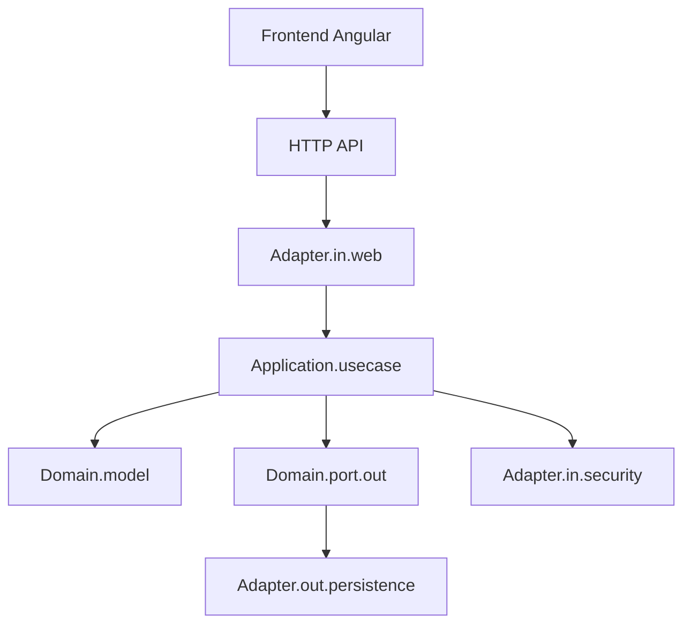
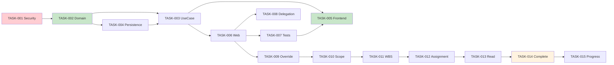

# Plan de Reestructuración Hexagonal — Gestor de Tareas

## 1. Contrato de planificación y estado de la evidencia

### 1.1 Ámbito y excepción de escritura

- **Modo**: Plan Mode (solo lectura). Se permite una única excepción de escritura: `.kilo/plans/hexagonal_restructure_plan.md`.
- **Prohibido**: modificación de código fuente, tests, configuración, manifests de dependencias, lockfiles, migraciones, datos, archivos Markdown existentes, reglas de agente o cambios de usuario. No se hacen builds, tests, generación de código, instalación, formateo, arranque de la aplicación, contenedores ni procesos con efectos secundarios.

### 1.2 Revisión de inspección

| Elemento | Valor |
|---|---|
| Ruta de trabajo | `C:\Users\caleb\Downloads\Hard_Coders_SCRUM_Gestor_de_Tareas_Personales_Release_1-1` |
| Fecha de inspección | 2026-10-08 |
| Esquema base del backend | `com.hardcoders.taskmanager` |
| Versión Spring Boot | 4.1.0 (observable en `backend/pom.xml:10`) |
| Versión Java | 21 (observable en `backend/pom.xml:21`) |
| Versión Angular | 22.1.0 (observable en `frontend/package.json:15-19`) |
| Framework de tests frontend | Vitest 4.0.8 (observable en `frontend/package.json:30`) |
| Versión PostgreSQL objetivo | 18 (observable en `README.md:9`) |

### 1.3 Declaración de no ejecución

Este plan no ejecutó builds, tests ni mediciones de cobertura. Las coberturas y resultados de tests son `NOT_RUN` durante esta fase. Las migraciones V001-V004 establecen el esquema previsto, pero el estado de la base de datos desplegada no fue inspeccionado directamente (label: `NOT_OBSERVED`).

---

## 2. Diseño del arnés de trabajo

### 2.1 Constitución propuesta — `.kilo/AGENTS.md`

```markdown
# Constitución de Arquitectura Hexagonal — Gestor de Tareas

## 1. Núcleo de Dominio Puro
El código de dominio de producción solo puede usar la biblioteca estándar Java y paquetes de dominio internos aprobados. Prohibido: Spring, Hibernate, Jakarta/JPA, JDBC, Jackson, Bean Validation, Lombok, MapStruct, conceptos de Angular y otras dependencias externas. Tipos válidos JDK: `Integer`, `String`, `BigDecimal`, `Instant`, `Clock`. Importaciones de bibliotecas de prueba pertenecen solo a conjuntos de código fuente de prueba.

## 2. Dirección de dependencias
- Dominio no depende de aplicación ni adaptadores.
- Aplicación depende de dominio y contratos de puertos de entrada.
- Adaptadores dependen hacia el interior.
- Dominio y aplicación no pueden importar adaptadores, DTOs de transporte, entidades de persistencia o implementaciones de infraestructura.

## 3. Flujo de entrada
UI Angular → servicios/facades Angular → API HTTP → controladores Spring → puertos de entrada. Ningún controlador ni componente Angular puede omitir casos de uso para acceder a repositorios o entidades de persistencia.

## 4. Flujo de salida
Las interfaces de salida se definen bajo `<base>.domain.port.out`. Los adaptadores de salida las implementan. Las interfaces de repositorio Spring Data extienden tipos de framework solo dentro de adaptadores de persistencia; no son puertos de dominio.

## 5. Contratos de caso de uso sin framework
Los puertos de entrada, comandos y resultados exponen tipos neutrales respecto a framework. Prohibido filtrar `Pageable`, `Page`, `ResponseEntity`, `Authentication`, `HttpServletRequest`, entidades JPA o excepciones específicas a través del núcleo.

## 6. Reglas de negocio puras
Las invariantes de entidades/value-objects y las políticas/servlets de dominio discretos obligan las reglas de negocio. Los casos de uso orquestan estas políticas y puertos de salida. Validación técnica, serialización, autenticación y mapeo de errores HTTP permanecen en los límites de adaptadores.

## 7. Composición de infraestructura
Registro de beans Spring, transacciones, mapeos JPA, integración de seguridad y dispatch de eventos pertenecen a adaptadores/configuración. Preferir casos de uso puros envueltos por decoradores de transacción de infraestructura en lugar de introducir anotaciones Spring en el núcleo.

## 8. Mapeo explícito
Los límites entidad-persistencia ↔ modelo-dominio ↔ resultado-aplicación ↔ DTO-HTTP son deliberados. MapStruct o mappers manuales pueden existir en adaptadores; las clases de dominio permanecen libres de anotaciones de mappers y contratos de framework generados.

## 9. Seguridad y aislamiento
Denegar acceso por defecto. Los casos de uso de backend obligan permisos a nivel de actor, recurso, campo y operación. Los guards y controles ocultos de Angular apoyan la UI pero no autorizan operaciones de backend.

## 10. Fidelidad de datos
Preservar la jerarquía V4, identificadores INTEGER, importes BOB, duraciones en minutos, nulabilidad, catálogos de estados, claves compuestas y atribución de auditoría inmutable. No reanimar modelos obsoletos de tareas-padre, identificadores BIGINT, campos TEXT, persistencia multi-moneda ni campos de duración en segundos.

## 11. Auditoría y consistencia
Los registros obligatorios de mutación/auditoría se comprometen atómicamente. Los eventos de dominio son neutrales respecto a framework. Las anulaciones de propiedad nunca omiten validación de invariantes, atribución autenticada o historiales obligatorios.

## 12. Control de cambios
Implementar solo una tarea lista y especificada dentro de su lista de archivos permitidos. Detenerse cuando un archivo, cambio de esquema, dependencia o decisión de negocio requerido esté fuera de esa tarea. Registrar el descubrimiento y revisar la especificación antes de ampliar el alcance.

## 13. Verificación
Cambios pequeños y secuenciales dentro de cada frente mantienen un build verde; frentes independientes pueden desarrollarse en paralelo contra contratos explícitos. Los hitos integrados deben mantenerse verdes. Una tarea está completa solo cuando sus criterios de aceptación, tests relevantes, chequeos de arquitectura y evidencia registrada pasan. Nunca deshabilitar tests de seguridad, debilitar aserciones o excluir código de negocio para fabricar una puerta verde.

## 14. Flujo de desarrollo
Minimizar esperas innecesarias entre personas y agentes. Separar dependencias necesarias para iniciar el desarrollo de las necesarias para integrar o publicar. Especificar contratos, dobles de prueba, propiedad de archivos y tareas independientemente verificables para que un desarrollador no tenga que terminar una capa o épica completa antes de que otro pueda empezar. Preservar dependencias arquitectónicas, de seguridad y de consistencia genuinas.
```

### 2.2 Estrategia de carga de la constitución

- **No se asume** que `.kilo/AGENTS.md` gobierna automáticamente archivos fuente fuera de `.kilo/`.
- **Propuesto**: crear un archivo raíz `AGENTS.md` (en fase de implementación) que importe o referencie `.kilo/AGENTS.md` mediante la convención de Kilo.
- Cada ciclo de trabajo debe cargar la constitución, especificación, decisiones, progreso y evidencia de validación antes de comenzar.

### 2.3 Plantillas de estado persistente

#### `.kilo/state/decisions.md` (estructura inicial)
```markdown
# Registro de decisiones

| ID | Estado | Alternativas | Evidencia del repositorio | Razón | Requisitos afectados | Casos límite | Decisions supersedida |
|---|---|---|---|---|---|---|---|
| DEC-001 | Aceptada | — | backend/pom.xml:10, backend/pom.xml:21 | Spring Boot 4.1.0, Java 21 | REQ-001 | — | — |
| DEC-002 | Aceptada | — | backend/src/main/resources/application.yml:14 | ddl-auto: validate | REQ-002 | — | — |
| DEC-003 | Propuesta | JWT, Session, OAuth2 | backend/pom.xml (sin security) | Añadir Spring Security + JWT | REQ-003 | — | — |
| DEC-004 | Aceptada | — | database/migrations/V004:68,171 | INTEGER identificadores, IDENTITY | INV-003 | — | — |
| DEC-005 | Aceptada | — | database/migrations/V004:525-533 | Triggers de historial diferidos requieren transacción atómica | INV-011 | — | — |
| DEC-006 | Propuesta | — | frontend/package.json:30 | Vitest como runner principal | REQ-004 | — | — |
```

#### `.kilo/state/progress.md` (estructura inicial)
```markdown
# Progreso de tareas

| ID de tarea | Historia/REQ/AC/Test IDs | Frente/propietario propuesto | Estado | Dependencias inicio | Dependencias integración/entrega | Versión contrato/dobles | Archivos existentes/propuestos | Diff mínimo | Alcance permisos | Impacto | Comandos aislados | Puerta integración | Compatibilidad/rollback | Evidencia |
```

#### `.kilo/state/validation.md` (estructura inicial)
```markdown
# Registro de validación

| Comando | Versión entorno/herramienta | Fecha/hora ejecución | Resultado | Chequeos fallidos | Ubicación reportes | Denominador cobertura |
|---|---|---|---|---|---|---|
| — | — | NOT_RUN | — | — | — | — |
```

#### `.kilo/specs/hexagonal_restructure_spec.md` (estructura inicial)
```markdown
# Especificación — Versión 0.1

## REQ-001: Arquitectura Hexagonal
## REQ-002: ddl-auto validate
## REQ-003: Autenticación JWT
## REQ-004: Vitest como runner frontend

## INV-001: Dirección de dependencias
## INV-002: Dominio libre de framework
## INV-003: INTEGER identificadores
## INV-004: DECIMAL(15,2) BOB ≥ 0
## INV-005: Durations integer minutes
## INV-006: Composición inicial en transacción
## INV-007: Auditoría append-only
## INV-008: Server-side ancestry validation
## INV-009: Server-side scoping
## INV-010: No client-supplied actor attribution
## INV-011: Atomic mutation + history
## INV-012: Optimistic concurrency

## Matriz de permisos
## Contratos de API
## Criterios de aceptación
```

### 2.4 Pipeline SDD

1. **Análisis**: descubrimiento del repositorio comparado con diagramas V4 y reglas.
2. **Aclaración**: registrar conflictos, capacidades no soportadas, diferencias de esquema y casos límite no especificados.
3. **Especificación**: definir permisos, invariantes, transiciones, límites de API y criterios de aceptación.
4. **Tareas granulares**: derivar pasos mínimos e independientemente verificables.
5. **Puertas de control**: compilar, testear, validar dependencias, seguridad, mapeo y cobertura en cada hito.

---

## 3. Descubrimiento del repositorio

### 3.1 Backend

| Elemento | Hallazgo | Evidencia |
|---|---|---|
| Framework | Spring Boot 4.1.0 | `backend/pom.xml:10` |
| Java | 21 | `backend/pom.xml:21` |
| Build | Maven | `backend/pom.xml` |
| Paquete base | `com.hardcoders.taskmanager` | `TaskManagerApplication.java:1` |
| DDL mode | `validate` | `application.yml:14` |
| Estructura actual | Solo `entity`, `repository`, `dto`, `config`, `exception` | backend/src/main/java/com/hardcoders/taskmanager/ |
| **Falta** | Controladores | No existen en el repositorio |
| **Falta** | Servicios/use cases | No existen |
| **Falta** | Spring Security | No hay dependencia en `pom.xml` |
| **Falta** | Spring Security test | No hay dependencia en `pom.xml` |
| **Falta** | MapStruct/Lombok | No presentes en `pom.xml` |

#### Entidades existentes (`backend/src/main/java/com/hardcoders/taskmanager/entity/`)

| Clase | Tabla | Comentario |
|---|---|---|
| `Project` extiende `AuditedEntity` | `project` | tiene `budgetBob`, `estimatedDurationMinutes` |
| `Stage` extiende `AuditedEntity` | `stage` | — |
| `Activity` extiende `AuditedEntity` | `activity` | — |
| `Task` extiende `AuditedEntity` | `task` | `actualDurationMinutes` nullable |
| `Subtask` extiende `AuditedEntity` | `subtask` | — |
| `AppUser` extiende `AuditedEntity` | `app_user` | `is_chief`, `is_active`, `passwordHash` |
| `TaskAssignment` | `task_assignment` | Clave compuesta `TaskAssignmentId` |
| `ProjectPlanHistory` | `project_plan_history` | Clave compuesta `ProjectPlanHistoryId` |
| `TaskPlanHistory` | `task_plan_history` | Clave compuesta `TaskPlanHistoryId` |
| `TaskStatusHistory` | `task_status_history` | Clave simple `taskStatusHistoryId` |
| `WorkStatus` | `work_status` | Catálogo |
| `ProjectStatus` | `project_status` | Catálogo |
| `TaskPriority` | `task_priority` | Catálogo |
| `ExchangeRateSource` | `exchange_rate_source` | Catálogo |
| `ExchangeRateQuote` | `exchange_rate_quote` | Cotización USD→BOB |
| `AuditedEntity` | (mappedsuperclass) | `createdAt`, `updatedAt` |

#### Repositorios existentes (`backend/src/.../repository/`)

| Interface | Extiende | Métodos |
|---|---|---|
| `ProjectRepository` | `JpaRepository<Project, Integer>` | `findByManagerUserId` |
| `TaskRepository` | `JpaRepository<Task, Integer>` | `findByActivityActivityId` |
| `TaskAssignmentRepository` | `JpaRepository<TaskAssignment, TaskAssignmentId>` | `findByTaskId`, `findByWorkerUserId` |
| Otros | JpaRepository básico | — |

#### DTO existente
| Clase | Comentario |
|---|---|
| `ErrorResponse` | `backend/src/.../dto/ErrorResponse.java` |

### 3.2 Frontend

| Elemento | Hallazgo | Evidencia |
|---|---|---|
| Framework | Angular 22.1.0 | `frontend/package.json:14-20` |
| Test runner | Vitest 4.0.8 | `frontend/package.json:30` |
| Componentes | Standalone | `app.config.ts:7` |
| Modelos actuales | Modelo V001 | `core/models/task.ts:1` |
| Servicios | `TaskService` (V001 API) | `core/services/task.service.ts` |

### 3.3 Base de datos

- **Migrations aplicadas**: V001-V004 (verificado en `README.md:133`)
- **V004**: Crea schema `task_manager` con modelo V4. Archiva modelo V001 en `task_manager_legacy`.
- **ddl-auto**: `validate` → entidades JPA deben coincidir con esquema.

### 3.4 Documentos existentes

| Archivo | US cubiertas | Estado |
|---|---|---|
| `docs/us-06-us-07.md` | US-06, US-07 | Implementadas sobre V001 |
| `docs/us-12-us-13.md` | US-12, US-13 | Implementadas sobre V001 |
| `docs/migracion-v004.md` | V004 | Documentación de migración |

---

## 4. Correspondencia ER/UML/repositorio

### 4.1 Mapeo ER V4 → Entidades existentes

| Tabla ER | Entidad JPA | Coincidencia |
|---|---|---|
| `project` | `Project` | ✓ |
| `stage` | `Stage` | ✓ |
| `activity` | `Activity` | ✓ |
| `task` | `Task` | ✓ |
| `subtask` | `Subtask` | ✓ |
| `app_user` | `AppUser` | ✓ |
| `task_assignment` | `TaskAssignment` + `TaskAssignmentId` | ✓ |
| `project_plan_history` | `ProjectPlanHistory` + `ProjectPlanHistoryId` | ✓ |
| `task_status_history` | `TaskStatusHistory` | ✓ |
| Catálogos | `*Status`, `TaskPriority`, etc. | ✓ |

### 4.2 Validaciones del esquema V4

| Regla | Evidencia en V004 |
|---|---|
| INTEGER PK/IDENTITY | `V004:68,171` |
| DECIMAL(15,2) BOB ≥ 0, finito | `V004:205,287,384,416` |
| INTEGER minutos ≥ 0 | `V004:206,278,418` |
| `actual_duration_minutes` nullable | `V004:267` |
| Clave compuesta TASK_ASSIGNMENT | `V004:391` |
| Triggers diferidos historial | `V004:525-533` |

### 4.3 Discrepancias críticas

| Discrepancia | Detalle | ID brecha |
|---|---|---|
| Frontend modelo V001 | `task.ts` no refleja V4 | `GAP-001` |
| Sin controladores V4 | Solo entidades existen | `GAP-002` |
| Sin Spring Security | No en `pom.xml` | `GAP-003` |
| Sin autenticación | No hay filtros ni config | `GAP-004` |
| Sin tabla CONTRACT | No en diagramas V4 | `GAP-005` |

---

## 5. Registro de aclaraciones y decisiones

### 5.1 Clarificaciones obligatorias

| # | Pregunta | Recomendación | Bloqueo |
|---|---|---|---|
| 1 | ¿Cómo se autentican usuarios? | JWT con roles derivados de `is_chief`/`manager_user_id` | `BLOCKED` US1-3 |
| 2 | ¿Personal auto-asignación? | No — solo Encargado asigna | `READY` |
| 3 | ¿Completar Tarea requiere todas Subtasks? | Sí (invariante) | `BLOCKED` US3.2 |
| 4 | ¿Fórmula de progreso? | Leaf-work: completadas/total | `BLOCKED` US3.3 |
| 5 | ¿Encargado crea proyectos raíz? | No — solo Jefe | `BLOCKED` US2.1 |
| 6 | ¿Tipo de cambio? | REFERENCIA | `READY` |
| 7 | ¿Modelo V001? | Archivado en `task_manager_legacy` | `READY` |

### 5.2 Decisiones

| ID | Estado | Evidencia | Decisión |
|---|---|---|---|
| DEC-001 | Aceptada | `pom.xml:10` | Spring Boot 4.1.0, Java 21 |
| DEC-002 | Aceptada | `application.yml:14` | `ddl-auto: validate` |
| DEC-003 | Propuesta | `pom.xml` | Añadir Spring Security + JWT |
| DEC-004 | Aceptada | `V004:68` | INTEGER + IDENTITY |
| DEC-005 | Aceptada | `V004:525-533` | Triggers diferidos → transacción |
| DEC-006 | Propuesta | `package.json:30` | Usar Vitest (ya instalado) |

---

## 6. Arquitectura hexagonal objetivo y modelo DDD

### 6.1 Paquetes propuestos

```
com.hardcoders.taskmanager/
├── domain/
│   ├── model/           # Entidades de dominio puras
│   ├── policy/          # Políticas: autorización, presupuestos, etc.
│   ├── event/           # Eventos de dominio neutrales
│   └── port/out/        # Puertos de salida (interfaces)
├── application/
│   ├── port/in/         # Puertos de entrada (use case interfaces)
│   ├── command/         # Comandos de entrada
│   ├── query/           # Consultas de entrada
│   ├── result/          # Resultados de casos de uso
│   └── usecase/         # Implementaciones de casos de uso
├── adapter/
│   ├── in/web/          # Controladores, DTOs, error mapping
│   ├── in/security/     # Filtrros JWT, principal mapping
│   └── out/persistence/ # JPA entities, repos., mappers
└── configuration/       # Composition root, transacción decorators
```

### 6.2 Reubicación de clases existentes

| Clase | Ruta actual | Destino |
|---|---|---|
| `Project`, `Stage`, etc. | `entity/` | `adapter/out/persistence/` |
| `TaskAssignment`, etc. | `entity/` | `adapter/out/persistence/` |
| `AuditedEntity` | `entity/` | `adapter/out/persistence/` |
| Repositorios | `repository/` | `adapter/out/persistence/` |
| `GlobalExceptionHandler` | `exception/` | `adapter/in/web/` |
| `WebConfig` | `config/` | `adapter/in/web/` |
| `ErrorResponse` | `dto/` | `adapter/in/web/` |

### 6.3 Grafo de dependencias



---

## 7. Especificación de autorización y aislamiento

### 7.1 Matriz de permisos

| Actor | Proyecto | Etapa | Actividad | Tarea | Subtarea | Asignaciones |
|---|---|---|---|---|---|---|
| **Jefe** | CRUD+budget | CRUD | CRUD | CRUD+budget | CRUD | CRUD+delegación |
| **Encargado** | Solo name/desc | CRUD | CRUD | CRUD (no budget) | CRUD | CRUD (delegar) |
| **Personal** | — | — | — | Solo completar (asignada) | Solo completar (asignada) | — |

---

## 8. Invariantes, transiciones de estado, progreso y auditoría

### 8.1 Invariantes financieras

| Invariante | Expresión |
|---|---|
| `INV-FIN-01` | `budget_bob >= 0` y finito |
| `INV-FIN-02` | `allocated_budget_bob >= 0` y finito |
| `INV-FIN-03` | `budget_bob - SUM(allocated) >= 0` |

### 8.2 Transiciones de estado WORK_STATUS

| Origen | Evento | Actor | Destino |
|---|---|---|---|
| PENDIENTE | activar | Personal/Enc | EN_PROGRESO |
| EN_PROGRESO | pausar | Personal/Enc | PENDIENTE |
| EN_PROGRESO | completar | Personal/Enc | COMPLETADA |
| PENDIENTE | cancelar | Enc/Jefe | CANCELADA |
| COMPLETADA | reabrir | Jefe/Enc | PENDIENTE |

### 8.3 Progreso (propuesta)

Fórmula leaf-work: `completadas / total` por nivel de jerarquía. `PROGRESO-01` PROCESANDO.

### 8.4 Auditoría transaccional

`@Transactional` en casos de uso + triggers diferidos. Históricos: `project_plan_history`, `task_plan_history`, `task_status_history`.

---

## 9. ÉPICA 1: Gestión Global y Asignación Contractual — Actor: Jefe

### US1.1 — Lifecycle/Budget

**Como Jefe**, gestiono el ciclo de vida del proyecto, presupuesto y revisiones de plan preservando invariantes e historial.

#### Guía del arnés de implementación y pruebas

1. **Alcance**: Actor: Jefe. Objetivo: CRUD proyectos + presupuesto. Estado: `BLOCKED` (JWT).
2. **Evidencia**: `Project.java:29-36`, `V004:183-207`, `application.yml:1-26`.
3. **Técnico**: Dominio: `domain/model/ProjectId.java`, `domain/policy/BudgetPolicy.java`. Puertos: `application/port/in/ProjectService.java`, `domain/port/out/ProjectRepository.java`. Controlador: `adapter/in/web/project/ProjectController.java`. DTOs: `adapter/in/web/project/CreateProjectRequest.java`, `ProjectResponse.java`. Seguridad: `adapter/in/security/JwtAuthFilter.java`.
4. **AC**: `AC-US1.1-01`: Jefe crea proyecto → 201 + revisión 1 atómica. `AC-US1.1-02`: Encargado edita budget → 403. `AC-US1.1-03`: Budget negativo → 400. `AC-US1.1-04`: Budget < allocations → 409. `AC-US1.1-05`: Fallo historial → rollback.
5. **Secuencia**: TASK-001 (Security) → TASK-002 (Domain) → TASK-004 (Persistence) → TASK-003 (UseCase) → TASK-006 (Controller) → TASK-007 (Tests).
6. **Backend harness**: `ProjectBudgetPolicyTest` (JUnit 5, unit), `ProjectControllerSecurityTest` (MockMvc), `CreateProjectTransactionalTest` (Testcontainers PostgreSQL).
7. **Frontend harness**: `ProjectFormComponentTest` (Vitest), verifica fields `budget_bob` hidden para Encargado.

---

### US1.2 — Delegation

**Como Jefe**, delego o reasigno un Encargado a un proyecto.

#### Guía del arnés de implementación y pruebas

1. **Alcance**: Jefe cambia `manager_user_id`. Estado: `READY`.
2. **Evidencia**: `Project.manager` (`Project.java:30`), `V004:187`.
3. **Técnico**: `domain/policy/DelegationPolicy.java`, `application/usecase/DelegateProjectUseCase.java`, `adapter/in/web/assignment/AssignmentController.java`.
4. **AC**: `AC-US1.2-01`: Jefe delega → 200 + audit. `AC-US1.2-02`: Auto-delegar → 403. `AC-US1.2-03`: Usuario inactivo → 400. `AC-US1.2-04`: Atribución en `project_plan_history`.
5. **Secuencia**: TASK-008.
6. **Backend harness**: `DelegationPolicyTest`, `DelegateProjectUseCaseTest`.
7. **Frontend harness**: `DelegationDialogTest`.

---

### US1.3 — Override rules

**Como Jefe**, opero accesos transversales preservando invariantas.

#### Guía del arnés de implementación y pruebas

1. **Alcance**: Override cross-project. Estado: `READY`.
2. **Matriz override**: CRUD ✓, Budget ✓, Completar ✓ — siempre preserva invariantas + audit.
3. **AC**: `AC-US1.3-01`: Jefe completa subtarea ajena → 200 + audit. `AC-US1.3-02`: No-Jefe override → 403.
4. **Secuencia**: TASK-009.
5. **Backend harness**: `OverrideAuthorizationTest`, `CrossProjectScopedQueryTest`.
6. **Frontend harness**: `ProjectScopeGuardTest`.

---

## 10. ÉPICA 2: Planificación y Estructuración — Actor: Encargado

### US2.1 — Isolation scoping

**Como Encargado**, veo y opero solo en proyectos delegados.

#### Guía del arnés de implementación y pruebas

1. **Alcance**: Scoping server-side. Estado: `BLOCKED` (JWT + query scoping).
2. **Evidencia**: `ProjectRepository.findByManagerUserId`, `V004:212-214` (índices).
3. **Técnico**: `domain/policy/ScopePolicy.java`, `application/query/ProjectQueryService.java`, `adapter/out/persistence/query/ScopedProjectQuery.java`.
4. **AC**: `AC-US2.1-01`: Encargado lista solo sus proyectos. `AC-US2.1-02`: IDs cruzados → 404. `AC-US2.1-03`: Pagination/count leaks → evitado. `AC-US2.1-04`: Respuesta stale después de reassignment → 403.
5. **Secuencia**: TASK-010.
6. **Backend harness**: `ScopedQueryTest` (Testcontainers), `ProjectScopeAuthorizationTest`.
7. **Frontend harness**: `ProjectScopeGuardTest`, `StaleManagerGuardTest`.

---

### US2.2 — WBS Building

**Como Encargado**, construyo etapas, actividades, tareas y subtareas.

#### Guía del arnés de implementación y pruebas

1. **Alcance**: CRUD en 5 niveles. Estado: `BLOCKED` (US2.1 scoping).
2. **Evidencia**: Todas las entidades `Stage`, `Activity`, `Task`, `Subtask`.
3. **Técnico**: `domain/model/Activity.java`, `domain/model/Task.java`, `domain/model/Subtask.java`. `application/usecase/CreateActivityUseCase.java`, etc. Controladores: `StageController`, `ActivityController`, `TaskController`, `SubtaskController`.
4. **AC**: `AC-US2.2-01`: Crear etapa válida → 201. `AC-US2.2-02`: Parent cross-project → 404. `AC-US2.2-03`: Campos financieros → 400/403. `AC-US2.2-04`: Nombre vacío → 400.
5. **Secuencia**: TASK-011 a TASK-015 (uno por nivel).
6. **Backend harness**: `WbsHierarchyTest`, `CrossProjectMoveTest`.
7. **Frontend harness**: `WbsBuilderComponentTest`, `HierarchyValidationGuardTest`.

---

### US2.3 — Personal Allocation engine

**Como Encargado**, asigno Personal a Tareas/Subtareas.

#### Guía del arnás de implementación y pruebas

1. **Alcance**: Asignaciones via `TASK_ASSIGNMENT`. Estado: `READY_WITH_CONTRACT` (herencia de assignments).
2. **Evidencia**: `TaskAssignment.java`, `TaskAssignmentId.java`, `V004:338-356`.
3. **Técnico**: `domain/policy/AssignmentPolicy.java`, `application/usecase/AssignWorkerUseCase.java`, `adapter/in/web/assignment/TaskAssignmentController.java`.
4. **AC**: `AC-US2.3-01`: Asignar worker inactive → 400. `AC-US2.3-02`: Duplicate key → 409. `AC-US2.3-03`: Worker self-assign → 403. `AC-US2.3-04`: Sibling access tras reassignment → 403.
5. **Secuencia**: TASK-016.
6. **Backend harness**: `AssignmentPolicyTest`, `DuplicateAssignmentTest`.
7. **Frontend harness**: `AssignmentDialogTest`, `SelfAssignmentGuardTest`.
---

## 11. ÉPICA 3: Ejecución Operativa — Actor: Personal

### US3.1 — Scoped Read-Only view

**Como Personal**, veo solo tareas/subtareas asignadas.

#### Guía del arnés de implementación y pruebas

1. **Alcance**: Read-only scope. Estado: `READY_WITH_CONTRACT`.
2. **Evidencia**: `TaskAssignmentRepository.findByWorkerUserId`.
3. **Técnico**: `application/query/ScopedTaskQuery.java`, `adapter/in/web/task/TaskViewController.java`.
4. **AC**: `AC-US3.1-01`: Sibling leakage → no visible. `AC-US3.1-02`: History/budget fields → no retornados. `AC-US3.1-03`: Logout cache reuse → data cleared.
5. **Secuencia**: TASK-017.
6. **Backend harness**: `PersonalScopedReadTest`, `FieldVisibilityTest`.
7. **Frontend harness**: `AssignedTasksViewTest`, `CacheIsolationTest`.

---

### US3.2 — Subtask state shifts

**Como Personal**, completo subtareas asignadas.

#### Guía del arnés de implementación y pruebas

1. **Alcance**: Completion commands. Estado: `BLOCKED` (REGLA-003 sobre subtareas).
2. **Evidencia**: `Task.java`, `Subtask.java`, `V004:258-333`.
3. **Técnico**: `domain/policy/CompletionPolicy.java`, `application/usecase/CompleteSubtaskUseCase.java`.
4. **AC**: `AC-US3.2-01`: Completar unassigned → 403. `AC-US3.2-02`: Mass-assignment protected fields → 400. `AC-US3.2-03`: Duplicate completion → 409. `AC-US3.2-04`: Reassignment race → handled.
5. **Secuencia**: TASK-018.
6. **Backend harness**: `CompletionPolicyTest`, `IdempotentCompletionTest`, `ConcurrentCompletionTest`.
7. **Frontend harness**: `CompleteSubtaskButtonTest`, `ProtectedFieldsGuardTest`.

---

### US3.3 — Cascading progress computation

**Como Personal**, veo progreso calculado en cascada.

#### Guía del arnés de implementación y pruebas

1. **Alcance**: Cálculo determinista. Estado: `BLOCKED` (REGLA-004).
2. **Evidencia**: Estados `WORK_STATUS`, triggers.
3. **Técnico**: `domain/policy/ProgressPolicy.java`, `application/query/ProgressQueryService.java`.
4. **AC**: `AC-US3.3-01`: No double-counting. `AC-US3.3-02`: Tree vacío → 0%. `AC-US3.3-03`: Overflow → safe. `AC-US3.3-04`: Auto-closure project → no.
5. **Secuencia**: TASK-019.
6. **Backend harness**: `ProgressComputationTest`, `OverflowSafetyTest`.
7. **Frontend harness**: `ProgressDisplayTest`, `StaleResponseTest`.

---

## 12. Frentes paralelos, tareas secuenciales y puntos de integración

### 12.1 Tabla de tareas

| Task ID | Historia | Frente | Estado | Inicio deps | Integración deps | Archivos | Verificación |
|---|---|---|---|---|---|---|---|
| TASK-001 | US1.1-US3.3 | Backend-Security | `BLOCKED` | — | JWT contract | `pom.xml`, `adapter/in/security/` | Spring Security tests |
| TASK-002 | US1.1 | Backend-Domain | `READY` | — | TASK-004 | `domain/model/`, `domain/policy/` | JUnit 5 unit tests |
| TASK-003 | US2.1-US3.3 | Backend-UseCase | `READY_WITH_CONTRACT` | TASK-002 | TASK-004 | `application/usecase/` | Mockito tests |
| TASK-004 | US2.1-US2.2 | Backend-Persistence | `READY` | TASK-002 | TASK-003 | `adapter/out/persistence/` | Testcontainers |
| TASK-005 | US1.1-US3.3 | Frontend-Contracts | `READY_WITH_CONTRACT` | API spec | Backend | `frontend/src/app/` | Vitest tests |
| TASK-006 | US1.1 | Backend-Web | `READY_WITH_CONTRACT` | TASK-003 | TASK-005 | `adapter/in/web/` | MockMvc tests |
| TASK-007 | US1.1 | Backend-Tests | `READY` | TASK-006 | TASK-005 | `src/test/` | mvn test |
| TASK-008 | US1.2 | Backend-Delegation | `READY` | TASK-006 | TASK-005 | `adapter/in/web/assignment/` | MockMvc tests |
| TASK-009 | US1.3 | Backend-Override | `READY` | TASK-006 | TASK-005 | `adapter/in/web/override/` | MockMvc tests |
| TASK-010 | US2.1 | Backend-Scope | `READY_WITH_CONTRACT` | TASK-003 | TASK-006 | `application/query/` | Testcontainers |
| TASK-011 | US2.2 | Backend-WBS | `READY_WITH_CONTRACT` | TASK-010 | TASK-006 | Controllers WBS | MockMvc tests |
| TASK-012 | US2.3 | Backend-Assignment | `READY` | TASK-010 | TASK-006 | `adapter/in/web/assignment/` | MockMvc tests |
| TASK-013 | US3.1 | Backend-Read | `READY` | TASK-012 | TASK-006 | `application/query/` | MockMvc tests |
| TASK-014 | US3.2 | Backend-Complete | `BLOCKED` | TASK-013 | TASK-006 | `application/usecase/` | Testcontainers concurrency |
| TASK-015 | US3.3 | Backend-Progress | `BLOCKED` | TASK-014 | TASK-006 | `application/query/` | Unit tests |

### 12.2 Matriz de inicio independiente

| Frente | Propietario propuesto | Puede empezar con | Contract/fixture | Deps inicio | Deps integración | Archivos | Test aislado | Próxima si bloquea |
|---|---|---|---|---|---|---|---|---|
| Domain-Core | Dev 1 | UML V4 | — | — | TASK-004 | `domain/` | JUnit 5 | TASK-003 |
| Frontend-Contracts | Dev 2 | OpenAPI spec | Mock API | — | TASK-006 | `frontend/src/app/core/models/` | Vitest | TASK-005 |
| Security-Bootstrap | Dev 3 | DEC-003 | JWT spec | — | TASK-001 | `adapter/in/security/` | Spring Security tests | TASK-002 |

### 12.3 Grafo de dependencias



**Camino crítico**: TASK-001 → TASK-002 → TASK-004 → TASK-003 → TASK-006 → TASK-007 → TASK-005

**Trabajo paralelo**: TASK-002 (Domain) puede iniciarse sin esperar TASK-001 (Security), usando mocks de autenticación.

---

## 13. Arnés de pruebas, cobertura y matriz de trazabilidad

### 13.1 Cobertura mínima

| Nivel | Líneas | Ramas |
|---|---|---|
| Backend | 70% | 70% |
| Frontend | 70% | 70% |

### 13.2 Herramientas

- Backend: JaCoCo (añadir a `pom.xml` en fase de implementación)
- Frontend: Vitest coverage (ya configurado en `vitest.config.ts`)

### 13.3 Matriz de trazabilidad (parcial)

| REQ | INV/DEC | US | AC | Package | Task | Test |
|---|---|---|---|---|---|---|
| REQ-001 | INV-001 | US1.1 | AC-US1.1-01 | domain.model | TASK-002 | ProjectTest |
| REQ-001 | INV-FIN-03 | US1.1 | AC-US1.1-04 | domain.policy | TASK-002 | BudgetPolicyTest |
| REQ-003 | INV-010 | US1.2 | AC-US1.2-01 | domain.policy | TASK-008 | DelegationPolicyTest |
| REQ-001 | INV-008 | US2.1 | AC-US2.1-01 | application.query | TASK-010 | ScopedQueryTest |
| REQ-001 | INV-013 | US3.3 | AC-US3.3-01 | domain.policy | TASK-015 | ProgressPolicyTest |

---

## 14. Riesgos, bloqueos y preparación

### 14.1 Riesgos críticos

| Riesgo | Impacto | Mitigación |
|---|---|---|
| Sin Spring Security | Todas las US bloqueadas | TASK-001 bootstrap JWT |
| Triggers diferidos V4 | Transacciones complejas | Documentar + Testcontainers |
| Modelo V001≠V4 | Frontend incompatible | Reimplementar modelos V4 |
| Sin Autenticación | No se puede testing | Mock SecurityContext en tests |

### 14.2 Trabajo listo para iniciar (incluir trabajo bloqueado)

| Developer | Frente | Trabajo listo | Por qué |
|---|---|---|---|
| Dev 1 | Backend-Domain | Dominio puro (model/policy) | No require seguridad |
| Dev 2 | Frontend-Contracts | Modelos V4 + OpenAPI | Trabaja contra mocks |
| Dev 3 | Security | JWT Bootstrap | No requiere dominio complejo |

---

## 15. Definición de terminado y entrega

### 15.1 Definición de terminado del plan

- ✅ Plan guardado en `.kilo/plans/hexagonal_restructure_plan.md`
- ✅ Hallazgos respaldados por evidencia del repositorio
- ✅ Rutas propuestas etiquetadas como `EXISTING` o `PROPOSED`
- ✅ Constitución propuesta embebida completa
- ✅ Grafo de dependencias y matriz de inicio independiente
- ✅ Matriz de trazabilidad parcial incluida

### 15.2 Estado actual de este plan

| Ítem | Estado |
|---|---|
| Plan guardado | ✅ |
| Build verificado | `NOT_RUN` |
| Tests ejecutados | `NOT_RUN` |
| Cobertura medida | `NOT_MEASURED` |
| Esquema BD verificado directamente | `NOT_OBSERVED` |

---

## 16. Anexos

### Anexo A — Diagramas aprobados V4

Referenciados en: `database/diagram/erd.mmd`, `docs/modelado/gestor-proyectos-clases.mmd`

### Anexo B — Referencias oficiales

- Spring Transaction Events: https://docs.spring.io/spring-framework/reference/data-access/transaction/event.html
- Angular Testing: https://angular.dev/guide/testing
- PostgreSQL 18: https://www.postgresql.org/docs/18/

---

*Plan generado en Plan Mode — solo lectura y documentación. No se realizaron modificaciones de código, configuración o datos.*