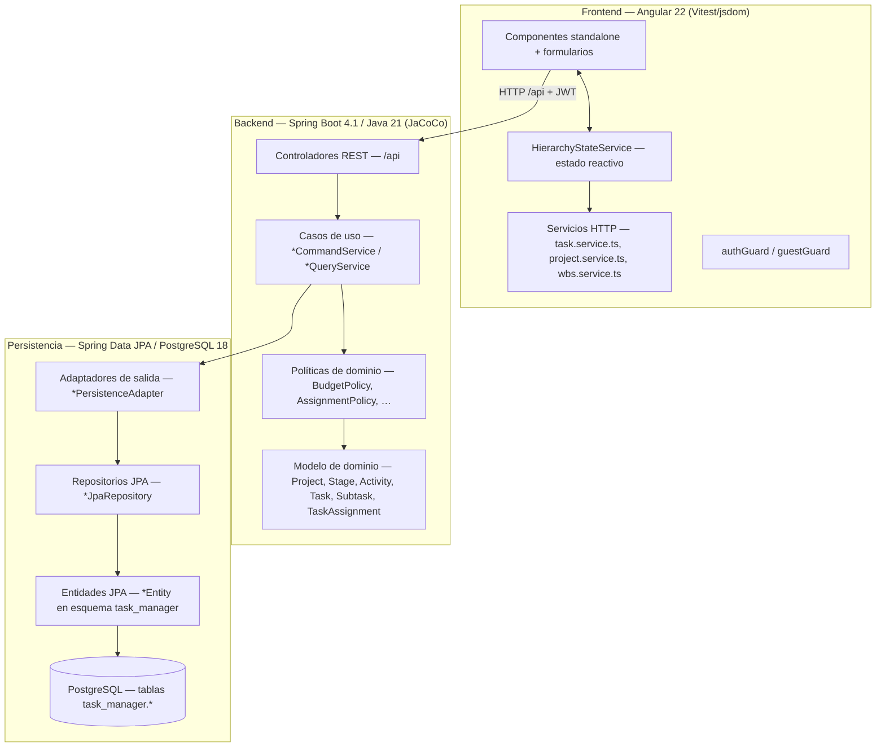
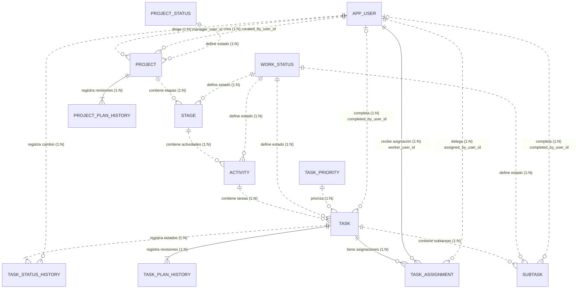
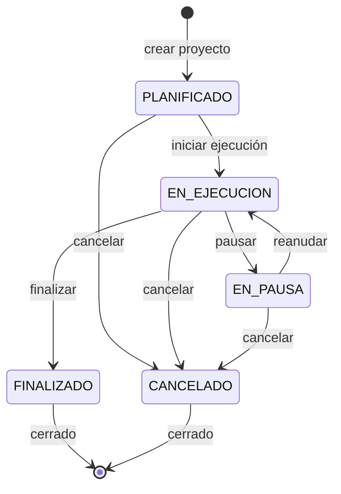
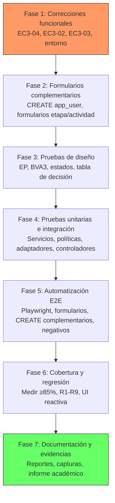

# Análisis Técnico y Plan de Implementación — EC3

**Proyecto:** Gestor de Tareas Personales — Hard Coders  
**Repositorio:** https://github.com/CalebBav234/Hard_Coders_SCRUM_Gestor_de_Tareas_Personales_Release_1  
**Rama analizada:** `Refactor-E2`  
**Asignación académica:** EC3 — Pruebas dinámicas y automatización.  
**Fecha del análisis:** 2026-11-11  
**Estado del entregable:** Solo análisis y planificación. No se implementó código.

---

## Índice

1. [Portada e información general](#1-portada-e-información-general)
2. [Resumen ejecutivo](#2-resumen-ejecutivo)
3. [Arquitectura tecnológica actual](#3-arquitectura-tecnológica-actual)
4. [Modelo de datos y relaciones](#4-modelo-de-datos-y-relaciones)
5. [Análisis detallado del proceso principal](#5-análisis-detallado-del-proceso-principal)
6. [Inventario de formularios](#6-inventario-de-formularios)
7. [Análisis de partición de equivalencia (EP)](#7-análisis-de-partición-de-equivalencia-ep)
8. [Análisis de valores límite BVA3](#8-análisis-de-valores-límite-bva3)
9. [Análisis de transición de estados](#9-análisis-de-transición-de-estados)
10. [Análisis de tabla de decisión](#10-análisis-de-tabla-de-decisión)
11. [Evaluación de las dos tablas complementarias](#11-evaluación-de-las-dos-tablas-complementarias)
12. [Auditoría de testing existente](#12-auditoría-de-testing-existente)
13. [Evaluación de cobertura actual](#13-evaluación-de-cobertura-actual)
14. [Evaluación de Playwright](#14-evaluación-de-playwright)
15. [Auditoría de regresión funcional R1–R9](#15-auditoría-de-regresión-funcional-r1–r9)
16. [Problemas y brechas identificadas](#16-problemas-y-brechas-identificadas)
17. [Plan de implementación futuro](#17-plan-de-implementación-futuro)
18. [Criterios de aceptación](#18-criterios-de-aceptación)
19. [Riesgos y dependencias](#19-riesgos-y-dependencias)

---

## 1. Portada e información general

| Campo | Valor |
|---|---|
| Título | Análisis Técnico y Plan de Implementación — EC3 |
| Proyecto | Gestor de Tareas Personales — Hard Coders |
| Repositorio | https://github.com/CalebBav234/Hard_Coders_SCRUM_Gestor_de_Tareas_Personales_Release_1 |
| Rama analizada | `Refactor-E2` |
| Último commit | `86c32c3` — docs: se creo la documentacion md para la actividad asincronica (2026-11-05) |
| Estado del working tree | Limpio, sincronizado con `origin/Refactor-E2` |
| Objetivo | Examinar, comprender, documentar y planificar el trabajo necesario para cumplir con la EC3 (pruebas dinámicas y automatización), sin implementar código. |
| Alcance | Auditoría del backend, frontend, base de datos, pruebas existentes y cobertura. Plan de implementación futuro para cerrar brechas. |
| Tecnologías principales | Angular 22.1.0, TypeScript, Vitest 4.x, Spring Boot 4.1.0, Java 21, Spring Data JPA, PostgreSQL 18, JaCoCo, JWT (HS256) |
| Arquitectura de software | Hexagonal (puertos y adaptadores) en backend; componentes standalone y estado reactivo compartido en frontend |
| Framework de pruebas backend | JUnit 5 / Spring Boot Test (maven `spring-boot-starter-test`) |
| Framework de pruebas frontend | Vitest 4.x + @vitest/coverage-v8 + jsdom |
| Automatización E2E | No instalada (Playwright ausente) |

> **Nota de integridad:** Este informe no inventa integrantes, docente ni datos académicos desconocidos. Toda afirmación está respaldada por evidencia del código, migraciones SQL, configuraciones o documentación existente, salvo cuando se marque expresamente como "inferido" o "pendiente de verificar".

---

## 2. Resumen ejecutivo

### 2.1 Estado actual del sistema

El sistema es un gestor de tareas personales con jerarquía de trabajo **Proyecto → Etapa → Actividad → Tarea → Subtarea**, implementado con arquitectura hexagonal en el backend y Angular standalone en el frontend. La base de datos es PostgreSQL 18 con esquema `task_manager`, definido por la migración `V004__project_management_model.sql`.

**Funcionalidades relevantes existentes (confirmadas por código):**

- Creación, edición, cambio de estado y delegación de proyectos (solo Jefe).
- Creación, edición y cambio de estado de etapas y actividades dentro de un proyecto.
- Creación, edición, planificación (presupuesto/duración), transición de estados (PENDIENTE ⇄ EN_PROGRESO → COMPLETADA → EN_PROGRESO; cancelación) y eliminación lógica de tareas y subtareas.
- Asignación y revocación de Personal a tareas (US2.3), con validación de autorización, elegibilidad del trabajador, no autoasignación y duplicidad.
- Búsqueda global de proyectos, etapas, actividades y tareas.
- "Mis tareas" (US3.1): vista del Personal con solo tareas asignadas, sin datos financieros.
- Historial de estados de tareas y revisiones de plan de proyectos y tareas.
- Progreso en cascada y contadores de hijos (actividadCount, taskCount) visibles sin recarga.
- Ordenamiento por drag-and-drop de etapas, actividades y tareas.
- Autenticación JWT y autorización por rol (Jefe / Encargado / Personal) con guards de ruta.
- Estado reactivo compartido mediante `HierarchyStateService` (BehaviorSubjects) que sincroniza la UI sin recargas.

### 2.2 Proceso principal

El proceso principal seleccionado es la **jerarquía de trabajo**:

```
Proyecto → Etapa → Actividad → Tarea → Subtarea
```

**Justificación (confirmada en código):**
- Las entidades `Project`, `Stage`, `Activity`, `Task`, `Subtask` existen en `backend/src/main/java/com/hardcoders/taskmanager/domain/model/`.
- Las tablas correspondientes existen en `task_manager` (migración `V004`).
- Existen formularios para proyecto (`project-form`), tarea/subtarea (`task-form`) y asignación (`assignment-dialog`).
- **No** existen formularios dedicados para creación de etapa ni de actividad en el frontend inspeccionado (se crearían a través de la WBS/barra de trabajo; se confirma la ausencia de componentes `stage-form` o `activity-form` dedicados en `frontend/src/app/features/`).
- Las dependencias entre registros son estrictas: una tarea requiere una actividad existente; una actividad requiere una etapa; una etapa requiere un proyecto.

### 2.3 Formularios que intervienen en el proceso principal

| Formulario | Archivo frontend | Operación |
|---|---|---|
| Proyecto (crear) | `frontend/src/app/features/projects/project-form/project-form.ts` | Crear proyecto (solo Jefe) |
| Proyecto (editar detalles) | `frontend/src/app/features/projects/project-form/project-form.ts` | Editar nombre/descripción |
| Tarea (crear) | `frontend/src/app/features/tasks/task-form/task-form.ts` | Crear tarea en actividad |
| Subtarea (crear) | `frontend/src/app/features/tasks/task-form/task-form.ts` | Crear subtarea de tarea |
| Asignar Personal | `frontend/src/app/features/tasks/assignment-dialog/assignment-dialog.ts` | Asignar/revocar trabajador a tarea |

### 2.4 Mecanismos de testing disponibles

- **Backend:** JUnit 5 con `spring-boot-starter-test`; pruebas unitarias de servicios, políticas, adaptadores, controladores web y entidades; JaCoCo para cobertura.
- **Frontend:** Vitest 4.x con jsdom; pruebas de componentes, servicios, pipes y estado jerárquico; `@vitest/coverage-v8`.
- **E2E:** No instalado. No hay configuración de Playwright, Cypress ni equivalente.

### 2.5 Requisitos de EC3 cubiertos vs. con brechas

| Requisito EC3 | Estado | Comentario |
|---|---|---|
| Proceso principal seleccionado y analizado | Cubierto | Jerarquía Proyecto → Etapa → Actividad → Tarea → Subtarea |
| Dos tablas complementarias para pruebas CREATE | Parcial | `app_user` y `task_assignment` identificadas, pero `app_user` no tiene endpoint CREATE |
| Pruebas de partición de equivalencia | Pendiente | No existen pruebas EP diseñadas |
| Pruebas de valores límite BVA3 | Pendiente | No existen pruebas BVA3 diseñadas |
| Transiciones de estados (3+ estados) | Parcial | Backend tiene ciclos de vida (ProjectStatus, WorkStatus) pero sin pruebas de transición diseñadas |
| Tabla de decisión (3+ combinaciones) | Pendiente | No diseñada (flujo de asignación candidato) |
| Cobertura ≥85% líneas y ramas | Parcial | Configurado, pero rama del backend documentada en 83.01% (no verificada) |
| Automatización E2E (Playwright) | Ausente | Playwright no instalado |
| Regresión R1–R9 | Parcial | Documentada en TESTING_GUIDE.md; ejecución E2E manual, sin automatización |

---

## 3. Arquitectura tecnológica actual

### 3.1 Tecnologías por capa

| Capa | Tecnología | Versión / referencia |
|---|---|---|
| Frontend | Angular (componentes standalone) | 22.1.0 (`@angular/*`) |
| Frontend lenguaje | TypeScript | ~6.0.2 |
| Frontend pruebas | Vitest + @vitest/coverage-v8 + jsdom | 4.x |
| Frontend build | Angular CLI | 22.1.5 |
| Backend | Spring Boot | 4.1.0 (`spring-boot-starter-parent`) |
| Backend lenguaje | Java | 21 |
| Backend persistencia | Spring Data JPA + PostgreSQL driver | runtime |
| Backend seguridad | Spring Security + JWT (HS256, sin sesión) | `oauth2-resource-server`, `oauth2-jose` |
| Backend validación | Jakarta Validation | `spring-boot-starter-validation` |
| Base de datos | PostgreSQL | 18 |
| Cobertura backend | JaCoCo | 0.8.15 (umbral 85% línea y rama) |
| Cobertura frontend | @vitest/coverage-v8 | umbral 85% líneas, ramas, funciones, sentencias |
| Migraciones | SQL (Flyway-style, versiones V001–V005) | `database/migrations/` |

### 3.2 Organización por capas (backend, arquitectura hexagonal)

```
backend/src/main/java/com/hardcoders/taskmanager/
├── TaskManagerApplication.java                     # Punto de entrada Spring Boot
├── configuration/                                  # Configuración de casos de uso y transacciones
│   ├── UseCaseConfiguration.java
│   └── TransactionalUseCases.java
├── domain/
│   ├── model/                                      # Entidades de dominio (ricas, sin anotaciones JPA)
│   │   ├── Project.java, Stage.java, Activity.java, Task.java, Subtask.java
│   │   ├── TaskAssignment.java, UserAccount.java (record)
│   │   ├── ProjectStatus.java, WorkStatus.java, TaskPriority.java (enums)
│   │   ├── Actor.java, PlanRevision.java, StatusChange.java, TimeTracking.java, VersionToken.java, WorkText.java, SearchText.java
│   ├── policy/                                     # Reglas de negocio (métodos estáticos require*/validate*)
│   │   ├── BudgetPolicy.java, AssignmentPolicy.java, DelegationPolicy.java
│   │   ├── WbsHierarchyPolicy.java, ProjectAccessPolicy.java, CompletionPolicy.java, ProgressPolicy.java
│   └── exception/                                  # Excepciones de dominio
│   ├── DomainValidationException.java, ForbiddenException.java, NotFoundException.java
│   ├── InvalidStatusTransitionException.java, BudgetBelowAllocationsException.java
│   ├── OpenSubtasksException.java, ProjectTransitionException.java, VersionConflictException.java, DomainException.java
├── application/
│   ├── usecase/                                    # Casos de uso (orquestan puertos de entrada/salida)
│   │   ├── ProjectCommandService.java, ProjectQueryService.java
│   │   ├── HierarchyCommandService.java, HierarchyQueryService.java
│   │   ├── TaskCommandService.java, TaskQueryService.java
│   │   ├── SubtaskCommandService.java
│   │   ├── AssignmentCommandService.java
│   │   ├── ProgressQueryService.java
│   │   ├── ResultMapper.java, ProjectResultAssembler.java
│   ├── command/                                    # Comandos de entrada (records)
│   │   ├── CreateProjectCommand.java, CreateTaskCommand.java, CreateSubtaskCommand.java
│   │   ├── HierarchyCommands.java (CreateStage/CreateActivity/…)
│   │   ├── AssignmentCommands.java (AssignWorker/UnassignWorker)
│   │   ├── TaskCommands.java, UpdateProjectDetailsCommand.java, ReplanProjectCommand.java, …
│   └── result/                                     # Resultados de aplicación (records)
│   ├── port/out/                                   # Puertos de salida (interfaces de persistencia/actor)
│   │   ├── ProjectRepository.java, HierarchyRepository.java, TaskRepository.java
│   │   ├── SubtaskRepository.java, AssignmentRepository.java, UserDirectory.java, CurrentActor.java
└── adapter/
    ├── in/                                         # Adaptadores de entrada (controladores REST + seguridad)
    │   ├── web/project/ProjectController.java
    │   ├── web/task/TaskController.java, HierarchyController.java, ProgressController.java
    │   ├── web/error/GlobalExceptionHandler.java
    │   └── security/ (JWT, filtros, controlador de auth)
    └── out/                                        # Adaptadores de salida (JPA)
        ├── persistence/
        │   ├── ProjectPersistenceAdapter.java, HierarchyPersistenceAdapter.java
        │   ├── TaskPersistenceAdapter.java, SubtaskPersistenceAdapter.java
        │   ├── AssignmentPersistenceAdapter.java, UserDirectoryAdapter.java, CatalogLookup.java
        │   ├── entity/                             # Entidades JPA (mapean a tablas task_manager)
        │   │   ├── ProjectEntity.java, TaskEntity.java, TaskAssignmentEntity.java, AppUserEntity.java, …
        │   └── repository/                         # Repositorios JPA (Spring Data)
        │   ├── ProjectJpaRepository.java, TaskJpaRepository.java, TaskAssignmentJpaRepository.java
        │   ├── AppUserJpaRepository.java, ProjectStatusJpaRepository.java, WorkStatusJpaRepository.java
        │   ├── TaskPriorityJpaRepository.java, StageJpaRepository.java, ActivityJpaRepository.java
        │   └── … (historiales, tipos de cambio)
```

### 3.3 Comunicación frontend-backend

- El frontend consume la API bajo el prefijo `/api` (proxyeado por `frontend/proxy.conf.json` a `http://localhost:8081` en desarrollo; el backend expone `http://localhost:8081` porque el 8080 está ocupado por un proxy del entorno).
- Autenticación mediante JWT enviado por `auth.interceptor.ts` en cada petición (tras login).
- Respuestas de error estandarizadas mediante `GlobalExceptionHandler` (mapea excepciones de dominio a códigos HTTP: 400, 403, 404, 412).

### 3.4 Autenticación y autorización

- **Autenticación:** JWT (HS256) sin sesión (`SecurityConfiguration`, `JwtTokenService`, `AuthController`). Login en `frontend/src/app/features/auth/login/`.
- **Autorización:** `Actor` con `userId`, `chief`, `active`. Reglas:
  - `ProjectAccessPolicy.canManage` / `canView` / `canEditDetails` / `canDelegate` / `canManageHierarchy`.
  - `WbsHierarchyPolicy.canManage`: Jefe (cualquier proyecto) o Encargado del proyecto (`managerUserId == actor.userId`).
  - `AssignmentPolicy.requireCanAssign`: solo Encargado del proyecto (o Jefe por excepción US1.3).
  - `DelegationPolicy.requireCanDelegate`: solo Jefe activo.
  - Guards de ruta Angular: `authGuard`, `guestGuard`.

### 3.5 Persistencia y validaciones

- **Persistencia:** JPA con entidades `*Entity` en esquema `task_manager`; adaptadores de persistencia traducen entre dominio y entidades; repositorios Spring Data JPA.
- **Validaciones backend:** anotaciones Jakarta Validation en los `Request` de los controladores (ej. `TaskRequests.CreateTaskRequest`) + reglas de dominio en `domain/policy/` (presupuesto, duración, nombres, estados, asignación).
- **Validaciones frontend:** `ReactiveFormsModule` con `Validators` (project-form) y validación manual con `ngModel` (task-form, assignment-dialog).
- **Validaciones base de datos:** `CHECK` constraints en V004 (ej. `ck_project_name`, `ck_task_allocated_budget`, `ck_task_estimated_duration`, `ck_app_user_email`).

### 3.6 Diagrama de arquitectura (Mermaid)



---

## 4. Modelo de datos y relaciones

### 4.1 Inventario de tablas del proceso principal

| Tabla | Entidad Java | Función | PK | FK y relaciones | Restricciones |
|---|---|---|---|---|---|
| `task_manager.app_user` | `AppUserEntity` / `UserAccount` | Usuarios del sistema (Jefe, Encargado, Personal) | `user_id` (IDENTITY) | — | email UK, NOT NULL, formato `_%@_%` lowercase; password_hash ≥1; given_names/family_names ≥1; is_chief/is_active boolean DEFAULT false/true |
| `task_manager.project_status` | `ProjectStatusEntity` | Catálogo de estados de proyecto | `project_status_id` | — | name UK, is_closed, is_enabled |
| `task_manager.work_status` | `WorkStatusEntity` | Catálogo de estados de trabajo (etapa/actividad/tarea/subtarea) | `work_status_id` | — | name UK, is_completed, is_enabled |
| `task_manager.task_priority` | `TaskPriorityEntity` | Catálogo de prioridades de tarea | `task_priority_id` | — | name UK, sort_order UK > 0 |
| `task_manager.project` | `ProjectEntity` / `Project` | Raíz de la jerarquía | `project_id` (IDENTITY) | manager_user_id → app_user; project_status_id → project_status; created_by_user_id → app_user | name ≥1 (160); budget_bob ≥ 0 DECIMAL(15,2) DEFAULT 0; estimated_duration_minutes ≥ 0 DEFAULT 0 |
| `task_manager.stage` | `StageEntity` / `Stage` | Etapa de un proyecto (nivel 2) | `stage_id` (IDENTITY) | project_id → project (CASCADE); work_status_id → work_status | name ≥1 (160) |
| `task_manager.activity` | `ActivityEntity` / `Activity` | Actividad de una etapa (nivel 3, mostrada como "categoría") | `activity_id` (IDENTITY) | stage_id → stage (CASCADE); work_status_id → work_status | name ≥1 (160) |
| `task_manager.task` | `TaskEntity` / `Task` | Tarea de una actividad (nivel 4) | `task_id` (IDENTITY) | activity_id → activity (CASCADE); work_status_id → work_status; task_priority_id → task_priority; completed_by_user_id → app_user (NULL) | title ≥1 (160); allocated_budget_bob ≥ 0 DECIMAL(15,2) DEFAULT 0; estimated_duration_minutes ≥ 0 DEFAULT 0; actual_duration_minutes NULL o ≥ 0; completed_at/completed_by_user_id ambos NULL o ambos no NULL |
| `task_manager.subtask` | `SubtaskEntity` / `Subtask` | Subtarea de una tarea (nivel 5) | `subtask_id` (IDENTITY) | task_id → task (CASCADE); work_status_id → work_status; completed_by_user_id → app_user (NULL) | title ≥1 (160); completed_at/completed_by_user_id ambos NULL o ambos no NULL |
| `task_manager.task_assignment` | `TaskAssignmentEntity` / `TaskAssignment` | Asignación Personal ↔ Tarea (clave compuesta) | (`task_id`, `worker_user_id`) PK compuesta | task_id → task (CASCADE); worker_user_id → app_user; assigned_by_user_id → app_user | assigned_at NOT NULL DEFAULT now; assigned_by_user_id NOT NULL |

### 4.2 Tablas de catálogo, historial y asociación

| Tabla | Categoría | Función | PK | FK |
|---|---|---|---|---|
| `task_manager.project_plan_history` | Historial de auditoría | Revisiones del plan de proyecto (presupuesto/duración) | (`project_id`, `revision_number`) compuesta | project → project; exchange_rate_quote_id → exchange_rate_quote (NULL); changed_by_user_id → app_user |
| `task_manager.task_plan_history` | Historial de auditoría | Revisiones del plan de tarea | (`task_id`, `revision_number`) compuesta | task → task; exchange_rate_quote_id → exchange_rate_quote (NULL); changed_by_user_id → app_user |
| `task_manager.task_status_history` | Historial de auditoría | Transiciones de estado de tarea | `task_status_history_id` (IDENTITY) | task_id → task; previous_status_id → work_status (NULL); new_status_id → work_status; changed_by_user_id → app_user |
| `task_manager.exchange_rate_source` | Catálogo | Fuente de tipo de cambio | `exchange_rate_source_id` (IDENTITY) | — |
| `task_manager.exchange_rate_quote` | Catálogo operativa | Cotización BOB/USD | `exchange_rate_quote_id` (IDENTITY) | exchange_rate_source_id → exchange_rate_source |

### 4.3 Dependencias entre tablas

- `project` depende de `app_user` (manager, created_by) y `project_status`.
- `stage` depende de `project` (borrado en cascada) y `work_status`.
- `activity` depende de `stage` (borrado en cascada) y `work_status`.
- `task` depende de `activity` (borrado en cascada), `work_status`, `task_priority` y opcionalmente `app_user` (completed_by).
- `subtask` depende de `task` (borrado en cascada), `work_status` y opcionalmente `app_user` (completed_by).
- `task_assignment` depende de `task` (borrado en cascada) y `app_user` (worker, assigned_by).
- Los historiales dependen de `project`/`task` (borrado en cascada), `app_user` y, opcionalmente, `exchange_rate_quote`.

### 4.4 Diagrama ER existente (Mermaid, reflejado de V004)



### 4.5 Triggers y reglas de integridad en V004

- `trg_*_updated_at`: actualiza `updated_at` en cada UPDATE de project, stage, activity, task, subtask, app_user.
- `trg_project_requires_plan_history` (DEFERRABLE): un proyecto debe tener al menos una revisión en `project_plan_history` al hacer COMMIT.
- `trg_task_requires_histories` (DEFERRABLE): una tarea debe tener al menos una revisión en `task_plan_history` y un registro en `task_status_history`.
- `ck_task_completion`: `(completed_at IS NULL) = (completed_by_user_id IS NULL)`.
- `ck_task_completed_after_created`: `completed_at >= created_at` cuando no es NULL.
- `ck_project_budget`, `ck_task_allocated_budget`: `>= 0 AND <> 'NaN'::numeric`.
- `ck_app_user_email`: `email = lower(btrim(email)) AND email LIKE '_%@_%'`.

---

## 5. Análisis detallado del proceso principal

### 5.1 Descripción del proceso

El proceso principal es la construcción y gestión de la jerarquía de trabajo **Proyecto → Etapa → Actividad → Tarea → Subtarea**, gobernada por el catálogo de estados y las reglas de dominio.

### 5.2 Inicio del proceso

1. Un usuario autenticado con rol **Jefe** crea un proyecto mediante `POST /api/projects` (`ProjectCommandService.create`).
2. `ProjectAccessPolicy.requireChief(actor, "crear proyectos")` valida que el actor sea Jefe.
3. `DelegationPolicy.requireEligibleManager(manager)` valida que el encargado exista y esté activo.
4. `Project.create(...)` construye el dominio en estado `PLANIFICADO`, aplica `BudgetPolicy.validatePositive` y `validateDuration`, y añade una revisión inicial ("Plan inicial") a `pendingRevisions`.
5. `ProjectPersistenceAdapter` persiste el proyecto y sus revisiones en la misma transacción. El trigger `trg_project_requires_plan_history` valida que exista al menos una revisión al COMMIT.

### 5.3 Acciones del usuario y secuencia de creación

| Paso | Actor | Acción | Endpoint | Caso de uso | Tabla afectada |
|---|---|---|---|---|---|
| 1 | Jefe | Crear proyecto | `POST /api/projects` | `ProjectCommandService.create` | `project`, `project_plan_history` |
| 2 | Jefe/Encargado | Crear etapa | `POST /api/projects/{projectId}/stages` | `HierarchyCommandService.createStage` | `stage` |
| 3 | Jefe/Encargado | Crear actividad | `POST /api/stages/{stageId}/activities` | `HierarchyCommandService.createActivity` | `activity` |
| 4 | Jefe/Encargado | Crear tarea | `POST /api/tasks` | `TaskCommandService.create` | `task`, `task_plan_history`, `task_status_history` |
| 5 | Jefe/Encargado | Crear subtarea | `POST /api/tasks/{taskId}/subtasks` | `SubtaskCommandService.create` | `subtask` |
| 6 | Jefe/Encargado | Asignar Personal | `POST /api/tasks/{taskId}/assignments` | `AssignmentCommandService.assign` | `task_assignment` |
| 7 | Personal asignado / Jefe | Transición de estado tarea | `POST /api/tasks/{taskId}/start|pause|complete|reopen` | `TaskCommandService.start|pause|complete|reopen` | `task`, `task_status_history` |

### 5.4 Dependencias entre registros

- Una **etapa** no puede crearse sin un `project_id` válido y el actor debe poder gestionar ese proyecto (`WbsHierarchyPolicy.requireCanManage`).
- Una **actividad** no puede crearse sin un `stage_id` válido perteneciente a un proyecto gestionable por el actor (`requireSameProject` evita cruce de proyectos con 404).
- Una **tarea** no puede crearse sin un `activity_id` válido; el proyecto padre debe estar abierto (`WbsHierarchyPolicy.requireOpen`).
- Una **subtarea** no puede crearse sin un `task_id` válido.
- Una **asignación** requiere tarea existente, trabajador activo, no autoasignación, proyecto abierto y no duplicidad (clave compuesta `task_id + worker_user_id`).

### 5.5 Validaciones del proceso principal

| Ámbito | Validación | Origen (confirmado) |
|---|---|---|
| Proyecto: nombre | obligatorio, ≤160 chars, no solo espacios | `WbsHierarchyPolicy.requireName(…, 160, "nombre")` + `ck_project_name` |
| Proyecto: descripción | opcional, ≤2000 chars | `requireDescription` + columna nullable |
| Proyecto: presupuesto | ≥0, DECIMAL(15,2), finito | `BudgetPolicy.validatePositive` + `ck_project_budget` |
| Proyecto: duración | ≥0 minutos | `BudgetPolicy.validateDuration` + `ck_project_estimated_duration` |
| Proyecto: razón del plan | opcional, ≤300 chars | `Project.create` → `reasonOrDefault` / `requiredReason` |
| Etapa/Actividad: nombre | obligatorio, ≤160 chars | `WbsHierarchyPolicy.requireName` + `ck_stage_name` / `ck_activity_name` |
| Tarea: título | obligatorio, ≤160 chars | `WorkText.title` + `ck_task_title` |
| Tarea: presupuesto asignado | ≥0, DECIMAL(15,2) | `BudgetPolicy.validatePositive` + `ck_task_allocated_budget` |
| Tarea: duración estimada | ≥0 minutos | `BudgetPolicy.validateDuration` + `ck_task_estimated_duration` |
| Tarea: prioridad | ALTA/MEDIA/BAJA (default MEDIA) | `Task.create` default `TaskPriority.MEDIA` + FK a task_priority |
| Tarea: asignación | trabajador existe, activo, no es el actor, no duplicado | `AssignmentPolicy.requireEligibleWorker` / `requireNotSelf` + clave compuesta |
| Transición de estado proyecto | PLANIFICADO→EN_EJECUCION/CANCELADO; EN_EJECUCION→EN_PAUSA/FINALIZADO/CANCELADO; EN_PAUSA→EN_EJECUCION/CANCELADO; FINALIZADO/CANCELADO → ninguno | `ProjectStatus.allowedTargets()` + `Project.changeStatus` |
| Transición de estado tarea | PENDIENTE⇄EN_PROGRESO→COMPLETADA→EN_PROGRESO; cancelación bloqueada si hay subtareas abiertas | `Task.transition` + `OpenSubtasksException` |

### 5.6 Estados

| Entidad | Estados (enum Java / catálogo DB) | Estados cerrados |
|---|---|---|
| Proyecto | PLANIFICADO, EN_EJECUCION, EN_PAUSA, FINALIZADO, CANCELADO | FINALIZADO, CANCELADO (`is_closed=true`) |
| Etapa/Actividad/Tarea/Subtarea | PENDIENTE, EN_PROGRESO, COMPLETADA, CANCELADA | COMPLETADA, CANCELADA (`is_completed=true` para work_status) |

### 5.7 Errores posibles

- `NotFoundException`: proyecto/etapa/actividad/tarea inexistente o ajeno al proyecto del contexto (404).
- `ForbiddenException`: actor no autorizado (403) — no es Jefe/Encargado, autoasignación, delegación no-Jefe.
- `DomainValidationException`: nombre vacío, presupuesto negativo, duración negativa, motivo obligatorio, motivo >300/500 chars, prioridad desconocida (400).
- `ProjectTransitionException`: transición de estado de proyecto no permitida o operación en proyecto cerrado (400/409).
- `InvalidStatusTransitionException`: transición de estado de tarea/etapa/actividad no permitida (400/409).
- `OpenSubtasksException`: cancelar tarea con subtareas abiertas (400/409).
- `BudgetBelowAllocationsException`: presupuesto del proyecto por debajo de lo asignado a tareas (400).
- `VersionConflictException`: conflicto de versión optimista (412).
- `DataIntegrityViolationException`: duplicidad de clave compuesta en `task_assignment` (400).

### 5.8 Diagrama de flujo del proceso principal (Mermaid)

```mermaid
flowchart TD
    A[Inicio: usuario autenticado] --> B{Jefe?}
    B -- Sí --> C[POST /api/projects: crear proyecto PLANIFICADO]
    B -- No --> D[Seleccionar proyecto gestionable]
    C --> E[Proyecto creado + revisión 1 en project_plan_history]
    D --> E
    E --> F[POST /api/projects/{id}/stages: crear etapa PENDIENTE]
    F --> G[POST /api/stages/{id}/activities: crear actividad PENDIENTE]
    G --> H[POST /api/tasks: crear tarea en actividad PENDIENTE]
    H --> I[POST /api/tasks/{id}/subtasks: crear subtarea PENDIENTE]
    H --> J[POST /api/tasks/{id}/assignments: asignar Personal]
    H --> K[Transición de estado: start|pause|complete|reopen]
    I --> K
    K --> L[task_status_history registra la transición]
    L --> M[Fin: tarea en estado final o en ejecución]
```

### 5.9 Pasos que deberían probarse funcionalmente desde la interfaz

1. Crear proyecto (campos obligatorios, presupuesto, duración, encargado).
2. Crear etapa dentro de un proyecto (una sola petición POST, sin duplicados — R5).
3. Crear actividad dentro de una etapa.
4. Crear tarea dentro de una actividad (título, prioridad, presupuesto, duración).
5. Crear subtarea dentro de una tarea.
6. Asignar Personal a una tarea (trabajador activo, no autoasignar, no duplicar).
7. Transición de estado de tarea (start → complete → reopen).
8. Cambio de estado de proyecto (PLANIFICADO → EN_EJECUCION → …).
9. Búsqueda global (R1).
10. Navegación directa y recuperación de contexto jerárquico (R3).
11. Drag-and-drop y persistencia del orden (R6).
12. Actualización de contadores al expandir/contraer (R7).

---

## 6. Inventario de formularios

### 6.1 Formulario: Proyecto (crear)

| Campo | Tipo | Obligatorio | Longitud / Rango | Validación frontend | Validación backend | BD |
|---|---|---|---|---|---|---|
| name | string | Sí | ≤160, no solo espacios | `Validators.required`, `maxLength(160)`, `pattern(/\S/)` | `WbsHierarchyPolicy.requireName(160)` | `ck_project_name`, `varchar(160) NOT NULL` |
| description | string | No | ≤2000 | `maxLength(2000)` | `WbsHierarchyPolicy.requireDescription(2000)` | `varchar(2000) NULL` |
| managerUserId | integer | Sí (crear) | ≥1 | `Validators.min(1)`, valor 0 = inválido | `DelegationPolicy.requireEligibleManager` | `manager_user_id NOT NULL FK → app_user` |
| budgetBob | decimal | Sí | ≥0, ≤13 dígitos enteros, 2 decimales | `Validators.required`, `min(0)`, `pattern(/^\d{1,13}(\.\d{1,2})?$/)` | `BudgetPolicy.validatePositive` | `ck_project_budget`, `DECIMAL(15,2) NOT NULL DEFAULT 0.00` |
| estimatedDurationMinutes | integer | Sí | ≥0 | `Validators.required`, `min(0)`, `pattern(/^\d+$/)` | `BudgetPolicy.validateDuration` | `ck_project_estimated_duration`, `integer NOT NULL DEFAULT 0` |
| reason | string | No | ≤300 | `maxLength(300)` | `requiredReason` (≤300) | no se persiste directamente (va a `project_plan_history.reason`) |

**Archivo frontend:** `frontend/src/app/features/projects/project-form/project-form.ts:86-93`  
**Endpoint:** `POST /api/projects` (`ProjectController.create`)  
**Componente backend:** `ProjectCommandService.create`  
**Tabla asociada:** `task_manager.project` (+ `task_manager.project_plan_history`)  
**Estado actual:** Implementado. Solo Jefe puede crear (`ProjectAccessPolicy.requireChief`).  
**Comportamiento esperado:** se crea proyecto en `PLANIFICADO` con revisión 1; respuesta 201 con `ProjectResponse`.

### 6.2 Formulario: Proyecto (editar detalles)

| Campo | Tipo | Obligatorio | Longitud | Validación frontend | Validación backend |
|---|---|---|---|---|---|
| name | string | Sí | ≤160 | `name.invalid` | `requireName` |
| description | string | No | ≤2000 | `description.invalid` | `requireDescription` |
| version | long | Sí | — | incluido en `UpdateProjectDetailsRequest` | `project.verifyVersion` |

**Archivo frontend:** mismo `project-form.ts` (modo `isEdit`)  
**Endpoint:** `PUT /api/projects/{projectId}`  
**Componente backend:** `ProjectCommandService.updateDetails`  
**Tabla asociada:** `task_manager.project`  
**Estado actual:** Implementado. Jefe o Encargado pueden editar (`ProjectAccessPolicy.requireCanEditDetails`).

### 6.3 Formulario: Tarea (crear)

| Campo | Tipo | Obligatorio | Longitud / Rango | Validación frontend | Validación backend | BD |
|---|---|---|---|---|---|---|
| title | string | Sí | ≤160 | `submitted && title.trim() === ''` (manual) | `WorkText.title` | `ck_task_title`, `varchar(160) NOT NULL` |
| estimatedDays (días) | number | No | ≥0 | `min="0"` (HTML) | — | se convierte a `estimatedDurationMinutes` |
| priority | enum | No | ALTA\|MEDIA\|BAJA | select fijo | `Task.create` default `MEDIA` si null | `task_priority_id NOT NULL FK → task_priority` |
| activityId | integer | Sí (implícito) | existe | `activityId === null` → error UI | `hierarchy.findActivityForUpdate` → 404 | `activity_id NOT NULL FK → activity` |
| allocatedBudgetBob | decimal | Sí (backend) | ≥0 | **No validado en frontend** (se pasa 0 hardcodeado) | `BudgetPolicy.validatePositive` | `ck_task_allocated_budget`, `DECIMAL(15,2) NOT NULL DEFAULT 0.00` |
| estimatedDurationMinutes | integer | Sí (backend) | ≥0 | **hardcodeado a 0 en frontend** | `BudgetPolicy.validateDuration` | `ck_task_estimated_duration`, `integer NOT NULL DEFAULT 0` |

**Archivo frontend:** `frontend/src/app/features/tasks/task-form/task-form.ts:394-445` (`crearTarea`)  
**Endpoint:** `POST /api/tasks` (`TaskController.createTask`)  
**Componente backend:** `TaskCommandService.create`  
**Tabla asociada:** `task_manager.task` (+ `task_plan_history`, `task_status_history`)  
**Estado actual:** Implementado, pero con **inconsistencia confirmada** (ver Hallazgo EC3-04 en sección 16): `duration` se pasa como `allocatedBudgetBob` y `estimatedDurationMinutes` se envía como `0` hardcodeado.

### 6.4 Formulario: Subtarea (crear)

| Campo | Tipo | Obligatorio | Longitud | Validación frontend | Validación backend |
|---|---|---|---|---|---|
| title | string | Sí | ≤160 | `submitted && title.trim() === ''` | `WorkText.title` |
| description | string | No | ≤2000 | — | — |
| taskId | integer | Sí (implícito) | existe | `parentTaskId !== null` | `CreateSubtaskCommand(taskId, …)` |

**Archivo frontend:** mismo `task-form.ts` (modo `parentTaskId !== null`)  
**Endpoint:** `POST /api/tasks/{taskId}/subtasks`  
**Componente backend:** `SubtaskCommandService.create`  
**Tabla asociada:** `task_manager.subtask`  
**Estado actual:** Implementado. Las subtareas (V4) no tienen prioridad, presupuesto ni historial propio.

### 6.5 Formulario: Etapa (crear / editar, panel WBS)

| Campo | Tipo | Obligatorio | Longitud | Validación frontend | Validación backend | BD |
|---|---|---|---|---|---|---|
| name | string | Sí | ≤160, no solo espacios | `maxlength="160"` (HTML), botón deshabilitado si vacío (`newStageName.trim() === ''`) | `@NotBlank`, `@Size(max=160)`, `WorkText.title()` | `stage.name varchar(160) NOT NULL`, `ck_stage_name` |
| description | string | No | ≤2000 | `maxlength="2000"` (HTML) | `@Size(max=2000)`, `WorkText.description()` | `stage.description varchar(2000) NULL` |
| projectId | integer | Sí (implícito, contexto) | existe | viene del `projectId` de entrada del componente | `CreateStageCommand(projectId, …)`, `requireCanManage`, `requireOpen` | `stage.project_id NOT NULL FK → project` |
| workStatus | enum | Sí (derivado) | PENDIENTE al crear | no es campo de entrada | `Stage.create()` asigna `WorkStatus.PENDIENTE` | `stage.work_status_id NOT NULL FK → work_status` |

**Archivo frontend:** `frontend/src/app/features/tasks/wbs/wbs-panel.ts:65-109` (crear), `:173-215` (editar), `:732-756` (`createStage`), `:768-791` (`saveStage`)  
**Endpoint:** `POST /api/projects/{projectId}/stages` (`HierarchyController.createStage`)  
**Componente backend:** `HierarchyCommandService.createStage` / `updateStage`  
**Tabla asociada:** `task_manager.stage`  
**Estado actual:** Implementado como formulario en línea dentro del panel WBS (no modal independiente). Solo actores con `canManage` (Jefe o Encargado del proyecto).

### 6.6 Formulario: Actividad (crear / editar, panel WBS)

| Campo | Tipo | Obligatorio | Longitud | Validación frontend | Validación backend | BD |
|---|---|---|---|---|---|---|
| name | string | Sí | ≤160, no solo espacios | `maxlength="160"` (HTML), botón deshabilitado si vacío (`newActivityName.trim() === ''`) | `@NotBlank`, `@Size(max=160)`, `WorkText.title()` | `activity.name varchar(160) NOT NULL`, `ck_activity_name` |
| description | string | No | ≤2000 | `maxlength="2000"` (HTML) | `@Size(max=2000)`, `WorkText.description()` | `activity.description varchar(2000) NULL` |
| stageId | integer | Sí (implícito, contexto) | existe | viene del `expandedStageId` | `CreateActivityCommand(stageId, …)`, `requireSameProject`, `requireOpen` | `activity.stage_id NOT NULL FK → stage` |
| workStatus | enum | Sí (derivado) | PENDIENTE al crear | no es campo de entrada | `Activity.create()` asigna `WorkStatus.PENDIENTE` | `activity.work_status_id NOT NULL FK → work_status` |

**Archivo frontend:** `frontend/src/app/features/tasks/wbs/wbs-panel.ts:338-378` (crear), `:242-283` (editar), `:819-853` (`createActivity`), `:865-894` (`saveActivity`)  
**Endpoint:** `POST /api/stages/{stageId}/activities` (`HierarchyController.createActivity`)  
**Componente backend:** `HierarchyCommandService.createActivity` / `updateActivity`  
**Tabla asociada:** `task_manager.activity`  
**Estado actual:** Implementado como formulario en línea dentro del panel WBS (no modal independiente). Solo actores con `canManage`.

### 6.7 Formulario: Asignar Personal (complementario)

| Campo | Tipo | Obligatorio | Longitud | Validación frontend | Validación backend |
|---|---|---|---|---|---|
| workerUserId | integer | Sí | ≥1 (existente) | `selectedWorkerId === null` → botón deshabilitado | `AssignmentPolicy.requireEligibleWorker`, `requireNotSelf` |
| reason | string | No | ≤500 | `maxlength="500"` (HTML) | `command.reason().strip()` (no se persiste — ver Hallazgo EC3-03) |

**Archivo frontend:** `frontend/src/app/features/tasks/assignment-dialog/assignment-dialog.ts:386-411`  
**Endpoint:** `POST /api/tasks/{taskId}/assignments` (`HierarchyController.assign`)  
**Componente backend:** `AssignmentCommandService.assign`  
**Tabla asociada:** `task_manager.task_assignment`  
**Estado actual:** Implementado. Solo Encargado del proyecto (o Jefe US1.3). El motivo (`reason`) se recibe en el servicio y se devuelve en `TaskAssignmentResult`, pero **no se persiste** en `task_assignment` (no existe columna `reason`).

### 6.8 Formulario: Login (autenticación)

**Archivo frontend:** `frontend/src/app/features/auth/login/login.ts` / `login.html`  
**Endpoint:** `POST /api/auth/login` (controlador de seguridad)  
**Estado actual:** Implementado. Usuarios de prueba en `database/docker/seed-dev-users.sql` (jefe, encargado1, encargado2, personal, inactivo).

---

## 7. Análisis de partición de equivalencia (EP)

Las particiones se derivan de **restricciones reales** en DTOs, políticas de dominio, entidades JPA y `CHECK` de V004. No se usan particiones genéricas.

### 7.1 EP — Formulario Proyecto (crear)

| Formulario | Campo | Partición | Tipo | Ejemplo | Resultado esperado |
|---|---|---|---|---|---|
| Proyecto | name | Válido: texto con al menos un carácter no espacio, ≤160 | Válida | "Obra Civil Centro" | 201 Creado |
| Proyecto | name | Inválido: vacío | Inválida | "" | 400 "El nombre es obligatorio" |
| Proyecto | name | Inválido: solo espacios | Inválida | "   " | 400 "El nombre es obligatorio" (`pattern(/\S/)`) |
| Proyecto | name | Inválido: >160 caracteres | Inválida | string de 161 chars | 400 "no puede superar 160 caracteres" |
| Proyecto | boundary name | Válido: exactamente 160 caracteres | Válida (límite) | string de 160 chars | 201 Creado |
| Proyecto | description | Válido: nulo / vacío | Válida | null | 201 Creado (descripción NULL) |
| Proyecto | description | Inválido: >2000 caracteres | Inválida | string de 2001 chars | 400 "no puede superar 2000 caracteres" |
| Proyecto | managerUserId | Válido: id de app_user existente y activo | Válida | 3 | 201 Creado |
| Proyecto | managerUserId | Inválido: 0 (sin seleccionar) | Inválida | 0 | 400 frontend / `DelegationPolicy.requireEligibleManager` → null |
| Proyecto | managerUserId | Inválido: id inexistente | Inválida | 99999 | 400 "El usuario indicado no existe" |
| Proyecto | managerUserId | Inválido: usuario inactivo | Inválida | id de `inactivo@gestor.local` | 400 "No se puede delegar a un usuario inactivo" |
| Proyecto | budgetBob | Válido: 0.00 | Válida (límite inferior) | 0.00 | 201 Creado |
| Proyecto | budgetBob | Válido: positivo con 2 decimales | Válida | 15000.50 | 201 Creado |
| Proyecto | budgetBob | Inválido: negativo | Inválida | -100.00 | 400 "El presupuesto debe ser … mayor o igual a 0" |
| Proyecto | budgetBob | Inválido: >13 dígitos enteros | Inválida | 10000000000000.00 | 400 "admite como máximo 13 dígitos enteros" |
| Proyecto | budgetBob | Inválido: >2 decimales | Inválida | 10.005 | 400 (`@Digits(fraction=2)`) / `normalize` UNNECESSARY |
| Proyecto | estimatedDurationMinutes | Válido: 0 | Válida (límite inferior) | 0 | 201 Creado |
| Proyecto | estimatedDurationMinutes | Válido: positivo | Válida | 480 | 201 Creado |
| Proyecto | estimatedDurationMinutes | Inválido: negativo | Inválida | -5 | 400 "La duración estimada debe ser … mayor o igual a 0" |
| Proyecto | reason | Válido: vacío / nulo | Válida | "" | 201 (usa "Plan inicial") |
| Proyecto | reason | Válido: exactamente 300 caracteres | Válida | string de 300 chars | 201 Creado |
| Proyecto | reason | Inválido: >300 caracteres | Inválida | string de 301 chars | 400 "El motivo no puede superar 300 caracteres" |

**Casos candidatos para automatización:** creación válida completa; nombre vacío; presupuesto negativo; duración negativa; manager inexistente; nombre >160.

### 7.2 EP — Formulario Tarea (crear)

| Formulario | Campo | Partición | Tipo | Ejemplo | Resultado esperado |
|---|---|---|---|---|---|
| Tarea | title | Válido: ≤160, no vacío | Válida | "Revisar planos" | 201 Creado (estado PENDIENTE) |
| Tarea | title | Inválido: vacío | Inválida | "" | 400 "El título es obligatorio" |
| Tarea | title | Inválido: solo espacios | Inválida | "   " | 400 (WorkText.title / `ck_task_title`) |
| Tarea | title | Inválido: >160 | Inválida | 161 chars | 400 "no puede superar 160 caracteres" |
| Tarea | priority | Válido: ALTA / MEDIA / BAJA | Válida | ALTA | 201 Creado |
| Tarea | priority | Inválido: valor desconocido | Inválida | "URGENTE" | 400 "Prioridad desconocida" (`TaskCommands.priority` / `@Pattern`) |
| Tarea | priority | Inválido: nulo | Válida (default) | null | 201 (default MEDIA) |
| Tarea | activityId | Válido: actividad existente del proyecto | Válida | 10 | 201 Creado |
| Tarea | activityId | Inválido: inexistente | Inválida | 99999 | 404 NotFoundException (Activity) |
| Tarea | activityId | Inválido: actividad de otro proyecto | Inválida | id válido pero otro proyecto | 404 (requireSameProject evita cruce) |
| Tarea | allocatedBudgetBob | Válido: 0.00 | Válida (límite inferior) | 0.00 | 201 Creado |
| Tarea | allocatedBudgetBob | Válido: positivo | Válida | 500.00 | 201 Creado |
| Tarea | allocatedBudgetBob | Inválido: negativo | Inválida | -10.00 | 400 "El presupuesto asignado no puede ser negativo" |
| Tarea | allocatedBudgetBob | Inválido: >13 enteros / >2 decimales | Inválida | 99999999999999.99 | 400 (`@Digits`) |
| Tarea | estimatedDurationMinutes | Válido: 0 | Válida (límite inferior) | 0 | 201 Creado |
| Tarea | estimatedDurationMinutes | Válido: positivo | Válida | 120 | 201 Creado |
| Tarea | estimatedDurationMinutes | Inválido: negativo | Inválida | -10 | 400 "La duración no puede ser negativa" |

**Casos candidatos para automatización:** título vacío; prioridad inválida; actividad inexistente; presupuesto negativo; duración negativa; actividad de otro proyecto (404).

### 7.3 EP — Formulario Asignar Personal (task_assignment)

| Formulario | Campo | Partición | Tipo | Ejemplo | Resultado esperado |
|---|---|---|---|---|---|
| Asignación | workerUserId | Válido: usuario activo, no asignado, no es el actor | Válida | id de `personal@gestor.local` | 200 OK (asignación creada) |
| Asignación | workerUserId | Inválido: usuario inexistente | Inválida | 99999 | 400 "El usuario indicado no existe" |
| Asignación | workerUserId | Inválido: usuario inactivo | Inválida | id de `inactivo@gestor.local` | 400 "No se puede asignar a un usuario inactivo" |
| Asignación | workerUserId | Inválido: es el propio actor | Inválida | id del actor | 403 "No puedes asignarte trabajo a ti mismo" |
| Asignación | workerUserId | Inválido: ya asignado a la tarea | Inválida | id ya en `task_assignment` | 400 "Ese Personal ya está asignado a la tarea" (clave compuesta) |
| Asignación | actor | Inválido: no es Encargado ni Jefe | Inválida | rol Personal | 403 "Solo el Encargado del proyecto puede asignar Personal" |
| Asignación | proyecto | Inválido: proyecto cerrado | Inválida | proyecto FINALIZADO/CANCELADO | 409 `WbsHierarchyPolicy.requireOpen` |

**Casos candidatos para automatización:** asignación válida; trabajador inactivo; autoasignación; duplicidad; actor no autorizado.

### 7.4 EP — Formulario Etapa (crear / editar)

| Formulario | Campo | Partición | Tipo | Ejemplo | Resultado esperado |
|---|---|---|---|---|---|
| Etapa | name | Válido: texto no vacío, ≤160 caracteres | Válida | "Etapa EP" | 201 Creado |
| Etapa | name | Inválido: vacío | Inválida | "" | 400 "El nombre de la etapa es obligatorio" |
| Etapa | name | Inválido: solo espacios | Inválida | "   " | 400 "El nombre de la etapa es obligatorio" |
| Etapa | name | Inválido: >160 caracteres | Inválida | string de 161 chars | 400 "no puede superar 160 caracteres" |
| Etapa | description | Válido: vacío / nulo, ≤2000 | Válida | "" | 201 Creado (descripción NULL) |
| Etapa | description | Inválido: >2000 caracteres | Inválida | string de 2001 chars | 400 "no puede superar 2000 caracteres" |
| Etapa | projectId | Válido: proyecto existente | Válida | id de proyecto válido | 201 Creado |
| Etapa | projectId | Inválido: proyecto inexistente | Inválida | 99999 | 404 (proyecto no disponible) |

**Casos candidatos para automatización:** nombre vacío; nombre >160; proyecto inexistente.

### 7.5 EP — Formulario Actividad (crear / editar)

| Formulario | Campo | Partición | Tipo | Ejemplo | Resultado esperado |
|---|---|---|---|---|---|
| Actividad | name | Válido: texto no vacío, ≤160 caracteres | Válida | "Actividad EP" | 201 Creado |
| Actividad | name | Inválido: vacío | Inválida | "" | 400 "El nombre de la actividad es obligatorio" |
| Actividad | name | Inválido: solo espacios | Inválida | "   " | 400 "El nombre de la actividad es obligatorio" |
| Actividad | name | Inválido: >160 caracteres | Inválida | string de 161 chars | 400 "no puede superar 160 caracteres" |
| Actividad | description | Válido: vacío / nulo, ≤2000 | Válida | "" | 201 Creado (descripción NULL) |
| Actividad | description | Inválido: >2000 caracteres | Inválida | string de 2001 chars | 400 "no puede superar 2000 caracteres" |
| Actividad | stageId | Válido: etapa existente | Válida | id de etapa válida | 201 Creado |
| Actividad | stageId | Inválido: etapa inexistente | Inválida | 99999 | 404 (etapa no disponible) |

**Casos candidatos para automatización:** nombre vacío; nombre >160; etapa inexistente.

### 7.6 EP — Transición de estado de proyecto (proceso con 3+ estados)

| Formulario/Proceso | Campo | Partición | Tipo | Ejemplo | Resultado esperado |
|---|---|---|---|---|---|
| Proyecto | status → target | Válido: PLANIFICADO → EN_EJECUCION | Válida | PLANIFICADO, EN_EJECUCION | 200 OK, estado cambiado |
| Proyecto | status → target | Válido: EN_EJECUCION → EN_PAUSA | Válida | EN_EJECUCION, EN_PAUSA | 200 OK |
| Proyecto | status → target | Válido: EN_PAUSA → EN_EJECUCION | Válida | EN_PAUSA, EN_EJECUCION | 200 OK |
| Proyecto | status → target | Válido: EN_EJECUCION → FINALIZADO | Válida | EN_EJECUCION, FINALIZADO | 200 OK |
| Proyecto | status → target | Válido: cualquier abierto → CANCELADO | Válida | PLANIFICADO → CANCELADO | 200 OK |
| Proyecto | status → target | Inválido: FINALIZADO → EN_EJECUCION | Inválida | FINALIZADO, EN_EJECUCION | 400 `ProjectTransitionException` (estado cerrado) |
| Proyecto | status → target | Inválido: CANCELADO → EN_PAUSA | Inválida | CANCELADO, EN_PAUSA | 400 `ProjectTransitionException` |
| Proyecto | status → target | Inválido: PLANIFICADO → FINALIZADO | Inválida | PLANIFICADO, FINALIZADO | 400 (no es transición permitida) |
| Proyecto | status → target | Inválido: estado desconocido | Inválida | "INEEXISTENTE" | 400 "Estado de proyecto desconocido" (`parseStatus`) |

---

## 8. Análisis de valores límite BVA3

BVA3 aplica a los campos con restricciones de límites numéricos y de longitud. Para cada límite: valor inmediatamente inferior, valor exacto del límite, valor inmediatamente superior.

### 8.1 BVA3 — Proyecto: nombre (longitud ≤160)

| Formulario | Campo | Límite | Valor inferior | Valor límite | Valor superior | Resultados esperados |
|---|---|---|---|---|---|---|
| Proyecto | name | longitud mínima 1 | 0 chars (vacío) | 1 char | 2 chars | 0 → 400 obligatorio; 1 → 201; 2 → 201 |
| Proyecto | name | longitud máxima 160 | 159 chars | 160 chars | 161 chars | 159 → 201; 160 → 201; 161 → 400 |

### 8.2 BVA3 — Proyecto: descripción (longitud ≤2000)

| Formulario | Campo | Límite | Valor inferior | Valor límite | Valor superior | Resultados esperados |
|---|---|---|---|---|---|---|
| Proyecto | description | longitud máxima 2000 | 1999 chars | 2000 chars | 2001 chars | 1999 → 201; 2000 → 201; 2001 → 400 |

### 8.3 BVA3 — Proyecto: presupuesto (DECIMAL(15,2), ≥0)

| Formulario | Campo | Límite | Valor inferior | Valor límite | Valor superior | Resultados esperados |
|---|---|---|---|---|---|---|
| Proyecto | budgetBob | mínimo 0 | -0.01 | 0.00 | 0.01 | -0.01 → 400; 0.00 → 201; 0.01 → 201 |
| Proyecto | budgetBob | máx. 13 dígitos enteros | 9999999999999 (13) | 10000000000000 (14) | 10000000000000 (14) confirmar | 13 → 201; 14 → 400 (`@Digits(integer=13)`) |
| Proyecto | budgetBob | máx. 2 decimales | 10.00 | 10.00 | 10.001 | 10.00 → 201; 10.001 → 400 (`@Digits(fraction=2)`) |

### 8.4 BVA3 — Proyecto: duración estimada (integer ≥0)

| Formulario | Campo | Límite | Valor inferior | Valor límite | Valor superior | Resultados esperados |
|---|---|---|---|---|---|---|
| Proyecto | estimatedDurationMinutes | mínimo 0 | -1 | 0 | 1 | -1 → 400; 0 → 201; 1 → 201 |
| Tarea | estimatedDurationMinutes | mínimo 0 | -1 | 0 | 1 | -1 → 400; 0 → 201; 1 → 201 |

### 8.5 BVA3 — Tarea: título (≤160)

| Formulario | Campo | Límite | Valor inferior | Valor límite | Valor superior | Resultados esperados |
|---|---|---|---|---|---|---|
| Tarea | title | longitud máxima 160 | 159 chars | 160 chars | 161 chars | 159 → 201; 160 → 201; 161 → 400 |
| Tarea | title | longitud mínima 1 | 0 chars | 1 char | 2 chars | 0 → 400; 1 → 201; 2 → 201 |

### 8.6 BVA3 — Asignación: motivo (≤500 en `UpdateTaskPlanRequest` / transición; asignación usa `strip()` sin límite explícito en dominio pero el input HTML tiene `maxlength="500"`)

| Formulario | Campo | Límite | Valor inferior | Valor límite | Valor superior | Resultados esperados |
|---|---|---|---|---|---|---|
| Asignación | reason | longitud máxima 500 (input HTML) | 499 chars | 500 chars | 501 chars | 499 → aceptado; 500 → aceptado; 501 → truncado/rechazado por HTML |

> **Nota de discrepancia entre capas (inferido):** El dominio `AssignmentCommandService.assign` no impone un límite máximo a `reason` (solo `strip()` y default), mientras que el input frontend limita a 500 caracteres y `TaskCommandService.updatePlan` limita a 500 (`@Size(max=500)`). Se recomienda alinear en una fase posterior.

### 8.7 BVA3 — Etapa: nombre (longitud ≤160)

| Formulario | Campo | Límite | Valor inferior | Valor límite | Valor superior | Resultados esperados |
|---|---|---|---|---|---|---|
| Etapa | name | longitud máxima 160 | 159 chars | 160 chars | 161 chars | 159 → 201; 160 → 201; 161 → 400 |
| Etapa | name | longitud mínima 1 | 0 chars (vacío) | 1 char | 2 chars | 0 → 400 obligatorio; 1 → 201; 2 → 201 |

### 8.8 BVA3 — Etapa: descripción (longitud ≤2000)

| Formulario | Campo | Límite | Valor inferior | Valor límite | Valor superior | Resultados esperados |
|---|---|---|---|---|---|---|
| Etapa | description | longitud máxima 2000 | 1999 chars | 2000 chars | 2001 chars | 1999 → 201; 2000 → 201; 2001 → 400 |

### 8.9 BVA3 — Actividad: nombre (longitud ≤160)

| Formulario | Campo | Límite | Valor inferior | Valor límite | Valor superior | Resultados esperados |
|---|---|---|---|---|---|---|
| Actividad | name | longitud máxima 160 | 159 chars | 160 chars | 161 chars | 159 → 201; 160 → 201; 161 → 400 |
| Actividad | name | longitud mínima 1 | 0 chars (vacío) | 1 char | 2 chars | 0 → 400 obligatorio; 1 → 201; 2 → 201 |

### 8.10 BVA3 — Actividad: descripción (longitud ≤2000)

| Formulario | Campo | Límite | Valor inferior | Valor límite | Valor superior | Resultados esperados |
|---|---|---|---|---|---|---|
| Actividad | description | longitud máxima 2000 | 1999 chars | 2000 chars | 2001 chars | 1999 → 201; 2000 → 201; 2001 → 400 |

### 8.11 Discrepancias entre capas documentadas

| Campo | Límite frontend | Límite backend | Límite BD | Discrepancia |
|---|---|---|---|---|
| Tarea estimatedDurationMinutes | `min="0"` HTML (sin patrón numérico estricto en task-form) | `@PositiveOrZero`, `@Max(Integer.MAX_VALUE)` | `integer >= 0` | Frontend no valida que sea entero; se envía `0` hardcodeado (bug EC3-04) |
| Tarea allocatedBudgetBob | **no hay campo en task-form** (se pasa 0) | `@DecimalMin(0.00)`, `@Digits(13,2)` | `DECIMAL(15,2) >= 0` | Frontend no captura el presupuesto; envía 0 |
| Proyecto reason | `maxlength="300"` | `requiredReason` ≤300 | `varchar(500)` en historial | Alineado (300) |
| Asignación reason | `maxlength="500"` | sin límite en dominio | no existe columna | **Falta columna `reason` en `task_assignment`** (EC3-03) |

---

## 9. Análisis de transición de estados

### 9.1 Proceso seleccionado: ciclo de vida del proyecto

El proceso con al menos tres estados es el **ciclo de vida del proyecto** (`ProjectStatus`): PLANIFICADO, EN_EJECUCION, EN_PAUSA, FINALIZADO, CANCELADO.

**Confirmado en:**
- `backend/src/main/java/com/hardcoders/taskmanager/domain/model/ProjectStatus.java:11-33` (enum con `allowedTargets()`).
- `database/migrations/V004__project_management_model.sql:110-115` (inserción de los 5 estados en `project_status`).
- `backend/src/main/java/com/hardcoders/taskmanager/application/usecase/ProjectCommandService.java:79-86` (`changeStatus`).
- `frontend/src/app/core/models/project.ts:3` (`ProjectStatusName` type).

### 9.2 Estados y transiciones

**Estado inicial:** PLANIFICADO (al crear un proyecto, `Project.create` establece `ProjectStatus.PLANIFICADO`).

**Estados finales (cerrados):** FINALIZADO, CANCELADO (`isClosed() == true`; no admiten más cambios).

**Eventos:** `changeStatus(projectId, status)` vía `PUT /api/projects/{projectId}/status`.

**Condiciones:** el proyecto debe estar abierto (`!status.isClosed()`); el actor debe ser Jefe (`ProjectAccessPolicy.requireChief`); versión optimista coincidente (`verifyVersion`).

### 9.3 Diagrama de estados (Mermaid)



### 9.4 Tabla de transiciones

| Estado actual | Evento | Condición | Estado destino | ¿Permitida? | Resultado esperado |
|---|---|---|---|---|---|
| PLANIFICADO | changeStatus(EN_EJECUCION) | abierto, actor Jefe, versión OK | EN_EJECUCION | Sí | 200 OK, estado EN_EJECUCION |
| PLANIFICADO | changeStatus(CANCELADO) | abierto, actor Jefe, versión OK | CANCELADO | Sí | 200 OK, estado CANCELADO |
| PLANIFICADO | changeStatus(EN_PAUSA) | abierto | EN_PAUSA | No | 400 `ProjectTransitionException` (no está en allowedTargets) |
| PLANIFICADO | changeStatus(FINALIZADO) | abierto | FINALIZADO | No | 400 `ProjectTransitionException` |
| EN_EJECUCION | changeStatus(EN_PAUSA) | abierto | EN_PAUSA | Sí | 200 OK |
| EN_EJECUCION | changeStatus(FINALIZADO) | abierto | FINALIZADO | Sí | 200 OK |
| EN_EJECUCION | changeStatus(CANCELADO) | abierto | CANCELADO | Sí | 200 OK |
| EN_PAUSA | changeStatus(EN_EJECUCION) | abierto | EN_EJECUCION | Sí | 200 OK |
| EN_PAUSA | changeStatus(CANCELADO) | abierto | CANCELADO | Sí | 200 OK |
| FINALIZADO | changeStatus(cualquiera) | cerrado | — | No | 400 `ProjectTransitionException` |
| CANCELADO | changeStatus(cualquiera) | cerrado | — | No | 400 `ProjectTransitionException` |
| cualquiera | changeStatus(desconocido) | — | — | No | 400 "Estado de proyecto desconocido" |

### 9.5 Cobertura de estados vs. cobertura de transiciones

- **Cobertura de estados:** probar que cada estado (PLANIFICADO, EN_EJECUCION, EN_PAUSA, FINALIZADO, CANCELADO) es alcanzable y que los estados cerrados rechazan cambios.
- **Cobertura de transiciones:** probar cada arco permitido (6 transiciones) y cada arco prohibido (al menos 4: PLANIFICADO→EN_PAUSA, PLANIFICADO→FINALIZADO, FINALIZADO→cualquiera, CANCELADO→cualquiera).

**Casos de prueba futuros:** crear proyecto (verificar inicial PLANIFICADO); cambiar a EN_EJECUCION; pausar; reanudar; finalizar; intentar cambiar desde FINALIZADO (rechazado); cancelar desde PLANIFICADO; verificar que un Jefe puede cambiar cualquier proyecto abierto y un Encargado solo los suyos.

---

## 10. Análisis de tabla de decisión

### 10.1 Flujo seleccionado: asignación de Personal a tareas (US2.3)

Se evalúa el proceso de creación de una asignación (`POST /api/tasks/{taskId}/assignments`), que tiene múltiples condiciones de negocio.

### 10.2 Condiciones identificadas (confirmadas en código)

Son condiciones de estado del negocio (no validaciones de formato, ni "no encontrado", ni privilegios). Se excluyen: tarea inexistente (404), trabajador inexistente (404), actor autorizado (C1, no aprobada como condición por el mgr), autoasignación (privilegio `requireNotSelf`).

| Condición | Origen | Tipo |
|---|---|---|
| C1: Proyecto abierto (no cerrado) | `WbsHierarchyPolicy.requireOpen(project, "asignar Personal")` | Estado del proyecto |
| C2: Trabajador activo | `AssignmentPolicy.requireEligibleWorker` | Estado del trabajador |
| C3: No existe asignación duplicada | `assignments.find(taskId, workerUserId).isPresent()` → 400; clave compuesta DB | Estado de datos existentes |

### 10.3 Tabla de decisión

| Condición / Regla | R1 | R2 | R3 | R4 |
|---|---|---|---|---|
| C1: Proyecto abierto | V | F | V | V |
| C2: Trabajador activo | V | V | F | V |
| C3: No duplicada | V | V | V | F |
| **Resultado esperado** | 200 OK asignada | 409 proyecto cerrado | 400 trabajador inactivo | 400 asignación duplicada |

> **Notas:** V = verdadero, F = falso. Se cubren 4 reglas con 3 condiciones de negocio (C1, C2, C3). No se incluyen combinaciones imposibles ni condiciones indiferentes (tarea inexistente, trabajador inexistente, actor autorizado y autoasignación son validaciones/privilegios, no condiciones de estado del negocio).

**Justificación de reglas:**
- R1 (camino feliz): todas las condiciones verdaderas → asignación creada en `task_assignment`.
- R2: proyecto cerrado → 409 `requireOpen` (no se asigna Personal en proyecto FINALIZADO/CANCELADO).
- R3: trabajador inactivo → 400 `requireEligibleWorker`.
- R4: duplicidad → 400 `DomainValidationException` (y clave compuesta DB como última barrera).

### 10.4 Nivel de prueba recomendado

| Regla | Nivel | Justificación |
|---|---|---|
| R1 | Integración + Playwright | Camino feliz completo: endpoint + persistencia + UI |
| R2 | Integración | proyecto cerrado (estado de negocio) |
| R3 | Integración | trabajador inactivo (estado de negocio del trabajador) |
| R4 | Integración | clave compuesta (doble barrera: servicio + BD) |

---

## 11. Evaluación de las dos tablas complementarias

La EC3 requiere dos tablas complementarias relacionadas con el proceso principal para probar la operación CREATE. Se evalúan `app_user` y `task_assignment`.

### 11.1 Tabla 1: `task_assignment`

| Aspecto | Detalle (confirmado) |
|---|---|
| Por qué se selecciona | Relacionada directamente con el proceso principal: asigna Personal a una Tarea (nivel 4 de la jerarquía). Es el CREATE de una tabla de asociación N:M. |
| Relación con el proceso | `task_id → task` (FK, CASCADE); permite que el Personal ejecute sobre tareas asignadas (Épica 3). |
| Entidad Java | `TaskAssignment` (`domain/model/TaskAssignment.java`), `TaskAssignmentEntity` (`adapter/out/persistence/entity/TaskAssignmentEntity.java`), `TaskAssignmentId` (clave embebida compuesta). |
| Atributos | `taskId`, `workerUserId`, `assignedAt` (DEFAULT now), `assignedByUserId`. |
| Relaciones | task (N:1), worker (N:1 a app_user), assigned_by (N:1 a app_user). |
| Restricciones | PK compuesta (`task_id`, `worker_user_id`); FKs con ON DELETE CASCADE / RESTRICT; no permite NULL en ninguna columna. |
| Funcionalidad CREATE existente | Sí: `POST /api/tasks/{taskId}/assignments` (`HierarchyController.assign`) → `AssignmentCommandService.assign` → `AssignmentPersistenceAdapter.save`. |
| Formulario existente | Sí: `assignment-dialog.ts` / `assignment-dialog.html` (seleccionar trabajador, motivo opcional, botón Asignar). |
| Endpoint existente | Sí: `POST /api/tasks/{taskId}/assignments`. |
| Reglas de negocio | actor autorizado (Encargado/Jefe), proyecto abierto, trabajador existe y activo, no autoasignación, no duplicidad (clave compuesta). |
| Pruebas actuales | `AssignmentPersistenceAdapterTest`, `AssignmentCommandServiceCoverageTest`, `HierarchyControllerTest` (backend). `assignment-dialog.spec.ts` (frontend). |
| Brechas detectadas | El campo `reason` se recibe en el servicio y se devuelve en `TaskAssignmentResult`, pero **no existe columna `reason` en `task_assignment`** ni en la entidad JPA ni en el dominio `TaskAssignment`. El motivo se pierde al persistir. |

**Veredicto:** `task_assignment` es apropiada para pruebas de CREATE. Tiene formulario, endpoint y persistencia CREATE funcionales. Brecha: el `reason` no se persiste.

### 11.2 Tabla 2: `app_user`

| Aspecto | Detalle (confirmado) |
|---|---|
| Por qué se selecciona | Tabla de usuarios base del sistema; relacionada con el proceso principal (creador de proyectos, encargado, trabajador asignado, quien completa tareas). |
| Relación con el proceso | `app_user` es referenciada por `project` (manager_user_id, created_by_user_id), `task` (completed_by_user_id), `subtask` (completed_by_user_id), `task_assignment` (worker_user_id, assigned_by_user_id), historiales (changed_by_user_id). |
| Entidad Java | `AppUserEntity` (`adapter/out/persistence/entity/AppUserEntity.java`), `UserAccount` (record de dominio sin password_hash). |
| Atributos | `user_id`, `email`, `password_hash`, `given_names`, `family_names`, `is_chief`, `is_active`, `created_at`, `updated_at`. |
| Relaciones | Referenciada por múltiples tablas (FKs); no tiene FKs propias excepto auditoría. |
| Restricciones | PK `user_id`; email UK, NOT NULL, formato `_%@_%` lowercase; password_hash ≥1; names ≥1; is_chief/is_active boolean DEFAULT false/true. |
| Funcionalidad CREATE existente | **No hay endpoint CREATE de usuarios.** No existe controlador, servicio ni caso de uso para crear `app_user`. La tabla tiene permiso INSERT en BD (`GRANT SELECT, INSERT, UPDATE ON task_manager.app_user`) pero no está expuesto por la API. |
| Formulario existente | No hay formulario de creación de usuarios. Existe `login` (autenticación) y `eligible-managers` (solo lectura de activos). |
| Endpoint existente | No existe `POST /api/users` ni equivalente. |
| Reglas de negocio | email único y formateado; password hash (nunca texto plano); is_chief para Jefe; is_active para login/asignación. |
| Pruebas actuales | `UserDirectoryAdapterTest`, `SecurityConfigurationTest`, `AuthControllerTest`, `JwtTokenServiceTest` (autenticación/autorización, no creación de usuario). |
| Brechas detectadas | Ausencia total de funcionalidad CREATE de usuarios en la API. Los usuarios solo se cargan vía `seed-dev-users.sql` (entorno de desarrollo) o migración (usuario técnico inactivo). |

**Veredicto:** `app_user` es **insuficiente** como segunda tabla para pruebas CREATE porque no existe funcionalidad CREATE expuesta. Es apropiada como tabla de lectura/referencia para las pruebas de `task_assignment` (trabajador debe existir y estar activo), pero no para probar su propio CREATE.

### 11.3 Selección justificada

Se seleccionan **`task_assignment`** (CREATE funcional, formulario y endpoint existentes) y **`app_user`** (tabla de referencia crítica para el proceso, necesaria como precondition de `task_assignment` CREATE, pero sin CREATE propio).

**Alternativa considerada y descartada:** usar `project_status`, `work_status` o `task_priority` como segunda tabla. Son catálogos de sólo lectura (SELECT concedido a la app), sin formulario ni endpoint CREATE, por lo que no sirven para probar la operación CREATE.

### 11.4 Inconsistencia documentada (sin modificar)

**Hallazgo:** En `AssignmentCommandService.assign` (línea 69-74), se computa un `reason` a partir de `command.reason()` y se incluye en `TaskAssignmentResult`, pero `TaskAssignment` (dominio), `TaskAssignmentEntity` (JPA) y la tabla `task_assignment` (V004) **no tienen columna `reason`**. El motivo se recibe por el servicio, se devuelve en la respuesta HTTP, pero **no se persiste**.

**Evidencia:**
- `AssignmentCommands.AssignWorkerCommand` (línea 9): tiene campo `reason`.
- `AssignmentCommandService.assign` (líneas 69-74): computa `reason` y lo pasa a `toResult(saved, task, worker, reason)`.
- `TaskAssignmentResult` (línea 14): incluye campo `reason`.
- `TaskAssignmentEntity` (líneas 17-84): solo tiene `task_id`, `worker_user_id`, `assigned_at`, `assigned_by_user_id` — no hay `reason`.
- Migración V004 `task_assignment` (líneas 338-356): PK compuesta, sin columna `reason`.

**Propuesta (para fase posterior):** Añadir columna `reason` VARCHAR(500) NULL a `task_assignment` mediante nueva migración, mapearla en `TaskAssignmentEntity`, incluirla en `TaskAssignment` dominio, persistirla en `AssignmentPersistenceAdapter.save` y leerla en `toDomain`. Mantener `nullable` para no romper asignaciones existentes.

---

## 12. Auditoría de testing existente

### 12.1 Backend (Java / Maven / JUnit 5)

**Marco de pruebas:** `spring-boot-starter-test` (JUnit 5, Mockito, Spring Boot Test).  
**Configuración de cobertura:** JaCoCo 0.8.15 con umbrales 85% línea y 85% rama (`pom.xml:96-114`).  
**Comando:** `mvn test` (desde `backend`).

**Inventario de archivos de prueba (confirmado por glob):**

| Categoría | Archivos representativos |
|---|---|
| Casos de uso (servicios de aplicación) | `ProjectUseCasesTest`, `TaskUseCasesTest`, `TaskCommandServiceTest`, `TaskCommandServiceOverrideTest`, `ProjectCommandServiceUnitTest`, `TaskQueryServiceTest`, `ProjectQueryServiceTest`, `HierarchyQueryServiceTest`, `HierarchyQueryServiceSearchTest`, `AssignmentCommandServiceCoverageTest`, `HierarchyCommandServiceCoverageTest`, `SubtaskCommandServiceCoverageTest`, `PersonalExecutionUseCaseTest`, `ProjectQueryServiceScopingTest`, `TransactionalUseCasesTest` |
| Políticas de dominio | `BudgetPolicyTest`, `BudgetPolicyBasicPathTest`, `AssignmentPolicyTest`, `DelegationPolicyTest`, `DelegationPolicyBasicPathTest`, `CompletionPolicyBasicPathTest`, `ProjectAccessPolicyTest`, `WbsHierarchyPolicyTest`, `WorkTextTest` |
| Modelo de dominio | `ProjectTest`, `TaskTest`, `SubtaskTest`, `SearchTextTest`, `VersionTokenTest`, `ExecutionTimeTrackingTest` |
| Adaptadores de persistencia | `ProjectPersistenceAdapterTest`, `TaskPersistenceAdapterTest`, `SubtaskPersistenceAdapterTest`, `SubtaskPersistenceAdapterCoverageTest`, `AssignmentPersistenceAdapterTest`, `UserDirectoryAdapterTest`, `HierarchyPersistenceAdapterTest`, `CatalogLookupTest`, `JpaEntityCoverageTest` |
| Controladores web | `ProjectControllerTest`, `ProjectControllerQueriesTest`, `TaskControllerTest`, `ProgressControllerTest`, `PersonalExecutionControllerTest`, `HierarchyControllerTest` |
| Seguridad | `AuthControllerTest`, `JwtTokenServiceTest`, `JwtPropertiesTest`, `SecurityConfigurationTest`, `SecurityCurrentActorAdapterTest` |
| Manejo de errores | `GlobalExceptionHandlerTest` |
| Arquitectura | `HexagonalArchitectureTest` |

**Cantidad de casos de prueba definidos:** documentada en TESTING_GUIDE.md como 318 pruebas (313 originales + 5 nuevas para conteos jerárquicos). **Nota:** esta cifra proviene de la documentación, no fue verificada mediante ejecución en este análisis.

**Cantidad de pruebas ejecutadas / aprobadas / falladas / omitidas:** **pendiente de medición** (no se ejecutaron pruebas en este análisis por restricción del encargo).

### 12.2 Frontend (Angular / Vitest / jsdom)

**Marco de pruebas:** Vitest 4.x + @vitest/coverage-v8 + jsdom.  
**Configuración de cobertura:** `frontend/vitest.config.ts` con umbrales 85% líneas, ramas, funciones, sentencias.  
**Comando:** `npm test` / `npx vitest run` (desde `frontend`).

**Inventario de archivos de prueba (confirmado por glob):**

| Categoría | Archivos |
|---|---|
| Componentes | `project-list`, `task-home`, `task-list`, `task-editor`, `task-form`, `progress-panel`, `wbs-panel`, `assignment-dialog`, `login` |
| Servicios | `task.service`, `task-mapper`, `project.service` (vía wbs), `hierarchy-state.service`, `wbs.service` |
| Modelos/pipes | `project.spec`, `duration-format.pipe.spec` |
| App | `app.spec`, `app-integration.spec` |
| Auth | `auth.spec` |

**Nuevos archivos de prueba agregados (TESTING_GUIDE.md:3.4):** `task-mapper.spec.ts`, `hierarchy-state.service.spec.ts`, `wbs-panel.spec.ts`, `task.service.spec.ts`, `task-list.spec.ts`.

**Cantidad de casos de prueba definidos:** documentada en TESTING_GUIDE.md como 261 originales + nuevas pruebas de cobertura. **Nota:** cifra de documentación, no verificada.

**Cantidad de pruebas ejecutadas / aprobadas / falladas / omitidas:** **pendiente de medición**.

### 12.3 Diferencia entre definido y ejecutado

Todas las cifras de TESTING_GUIDE.md (318 backend, 261+ frontend) son **resultados esperados documentados**, no mediciones actuales verificadas en este análisis. El encargo prohíbe ejecutar pruebas que modifiquen dependencias, configuración ni datos; por tanto estas métricas quedan como **pendientes de medición** (sección 13).

---

## 13. Evaluación de cobertura actual

### 13.1 Configuración de cobertura

| Proyecto | Herramienta | Umbral configurado | Archivo de configuración |
|---|---|---|---|
| Backend | JaCoCo 0.8.15 | Línea ≥85%, Rama ≥85% | `backend/pom.xml` (ejecución `check`, fase `verify`) |
| Frontend | @vitest/coverage-v8 | Línea 85, Rama 85, Funciones 85, Sentencias 85 | `frontend/vitest.config.ts` (líneas 10-19) |

### 13.2 Métricas disponibles (documentadas vs. pendientes)

| Indicador | Frontend | Backend |
|---|---|---|
| Tests ejecutados | Pendiente de medición | Pendiente de medición |
| Tests aprobados | Pendiente de medición | Pendiente de medición |
| Tests fallidos | Pendiente de medición | Pendiente de medición |
| Tests omitidos | Pendiente de medición | Pendiente de medición |
| Cobertura de líneas | Pendiente de medición | Pendiente de medición |
| Cobertura de ramas | Pendiente de medición | Pendiente de medición |
| Cobertura de funciones | Pendiente de medición | Pendiente de medición |
| Cobertura de sentencias | Pendiente de medición | Pendiente de medición |

> **Nota:** TESTING_GUIDE.md documenta resultados esperados (backend: línea 92.97%, rama 83.01%; frontend: línea 90.34%, rama 83.74%), pero estas son cifras históricas/documentadas, **no mediciones actuales verificadas**. Conforme a la restricción del encargo, no se ejecutaron pruebas; se deja constancia de los comandos para medirlas posteriormente.

### 13.3 Comandos para medir cobertura (pendientes de ejecución)

```powershell
# Backend
cd backend
mvn test
mvn jacoco:report
# Reporte: backend/target/site/jacoco/index.html

# Frontend
cd frontend
npm install   # una sola vez
npx vitest run --coverage
# Reporte: frontend/coverage/index.html
```

### 13.4 Módulos que probablemente requieren mayor atención (inferido)

- **Backend rama (83.01% documentado, cercano al umbral 85%):** las nuevas ramas defensivas en métodos de conteo y mapeo (TESTING_GUIDE.md:2.3). Candidatos: `HierarchyCommandService` (reorder), `TaskCommandService` (transiciones con ramas de razón), `ProjectCommandService` (replan con `validateAllocationCap`).
- **Frontend rama (83.74% documentado):** condicionales de plantilla (`@if`), manejo de errores, rutas de drag-and-drop con rollback. Candidatos: `task-form`, `assignment-dialog`, `hierarchy-state.service`, `task-list`.

### 13.5 Pruebas que permitirían mejorar la cobertura sin crear pruebas artificiales

- Pruebas de integración de los endpoints `assign` / `unassign` (cubren ramas de autorización, duplicidad, proyecto cerrado).
- Pruebas de transición de estado de proyecto (todas las ramas de `ProjectStatus.allowedTargets()`).
- Pruebas de `TaskCommandService.updatePlan` con `validateAllocationCap` (presupuesto por debajo de asignado).
- Pruebas de `AssignmentCommandService` con trabajador inactivo y autoasignación.

---

## 14. Evaluación de Playwright

### 14.1 Estado actual: Playwright NO está instalado ni configurado

**Evidencia:**
- `frontend/package.json`: no aparece `playwright` ni `@playwright/test` en `dependencies` ni `devDependencies`.
- No existe archivo `playwright.config.ts` / `playwright.config.js` (glob sin resultados).
- No existe carpeta de pruebas E2E (`frontend/e2e` o similar ausente).
- `TESTING_GUIDE.md` sección 4 describe pruebas **manuales en el navegador** (smoke tests R1–R9), no automatizadas con Playwright.

### 14.2 Configuración que debería añadirse (propuesta, no implementada)

- Instalar `@playwright/test` y los browsers (Chromium, Firefox, WebKit).
- Crear `frontend/playwright.config.ts` con `baseURL: 'http://localhost:4200'` y proxyeo a backend `http://localhost:8081`.
- Añadir fixture de autenticación (login como Jefe/Encargado/Personal, guardar token en localStorage o usar `request` API para obtener token).
- Organizar pruebas por carpeta: `frontend/e2e/`, con page objects para formularios (project-form, task-form, assignment-dialog).
- Configurar reportes (HTML), capturas de pantalla en fallo y trazas (trace) para depuración.
- Integrar en el pipeline de CI para ejecutar contra un entorno de prueba con PostgreSQL desplegado.

### 14.3 Escenarios E2E propuestos basados en formularios y procesos reales

| ID | Escenario | Formulario/proceso | Tipo |
|---|---|---|---|
| E2E-01 | Crear proyecto válido (Jefe) | project-form | Positivo |
| E2E-02 | Crear proyecto con nombre vacío (rechazado) | project-form | Negativo |
| E2E-03 | Crear etapa con un clic (una sola POST, sin duplicados) | project-form → etapa | Positivo (R5) |
| E2E-04 | Crear tarea en actividad (título, prioridad, presupuesto, duración) | task-form | Positivo |
| E2E-05 | Crear tarea con título vacío (rechazado) | task-form | Negativo |
| E2E-06 | Crear subtarea dentro de tarea | task-form (parentTaskId) | Positivo |
| E2E-07 | Asignar Personal a tarea (trabajador activo) | assignment-dialog | Positivo |
| E2E-08 | Asignar Personal inactivo (rechazado) | assignment-dialog | Negativo |
| E2E-09 | Autoasignación (rechazada) | assignment-dialog | Negativo |
| E2E-10 | Asignación duplicada (rechazada) | assignment-dialog | Negativo |
| E2E-11 | Transición de estado tarea: start → complete → reopen | task-list / task-editor | Positivo (transiciones) |
| E2E-12 | Cambio de estado proyecto: PLANIFICADO → EN_EJECUCION → FINALIZADO | project-list | Positivo (transiciones) |
| E2E-13 | Búsqueda global insensible a acentos | task-list (buscar) | Positivo (R1) |
| E2E-14 | Navegación directa y recuperación de contexto (recarga) | rutas jerárquicas | Positivo (R3) |
| E2E-15 | Drag-and-drop persiste el orden tras recarga | wbs-panel | Positivo (R6) |
| E2E-16 | Contadores de hijos actualizados sin recarga | task-list | Positivo (R7) |
| E2E-17 | Crear etapa en proyecto (nombre, descripción) | wbs-panel (etapa) | Positivo |
| E2E-18 | Crear etapa con nombre vacío (rechazado) | wbs-panel (etapa) | Negativo |
| E2E-19 | Crear actividad en etapa (nombre, descripción) | wbs-panel (actividad) | Positivo |
| E2E-20 | Crear actividad con nombre vacío (rechazado) | wbs-panel (actividad) | Negativo |

---

## 15. Auditoría de regresión funcional R1–R9

Basada en TESTING_GUIDE.md sección 5. Los escenarios están **documentados como pruebas manuales**; no hay evidencia de automatización con Playwright.

| ID | Escenario | Documentado | Implementado | Pruebas automatizadas | Comentario |
|---|---|---|---|---|---|
| R1 | Búsqueda global (insensible a mayúsculas/acentos) | Sí | Sí (`queryTasks.search`, `/api/tasks?q`) | No | Solo manual |
| R2 | Consistencia de unidades de duración (minutos) | Sí | Parcial | No | `task-form` envía duración en días como presupuesto (bug EC3-04); `estimatedDurationMinutes` hardcodeado a 0 |
| R3 | Navegación directa y recuperación de contexto jerárquico | Sí | Sí (`hierarchy-state.service`, parámetros de ruta) | No | Implementado en Release E2 |
| R4 | Creación de elementos jerárquicos (proyecto→etapa→actividad→tarea→subtarea) | Sí | Sí | No | Flujo completo implementado |
| R5 | Creación de etapa con una sola acción (evitar POST duplicados) | Sí | Sí (`busyId` guard, estado de carga) | No | Implementado en Release E2 |
| R6 | Persistencia del orden mediante drag-and-drop | Sí | Sí (`@angular/cdk/drag-drop`, reorder endpoints) | No | Implementado en Release E2 |
| R7 | Actualización de contadores al expandir/contraer | Sí | Sí (`activityCount`, `taskCount`, consultas SQL nativas) | No | Implementado en Release E2 |
| R8 | Claridad y consistencia de la interfaz | Sí | Parcial | No | UI/UX rediseñado (Release E2), pero `task-form` tiene inconsistencia de campos |
| R9 | Métodos de fábrica del backend (`Task.create`, `Project.create`, `restore`) | Sí | Sí | Sí (pruebas unitarias de dominio) | Cubierto por pruebas unitarias |

### 15.1 Problema detectado en R2 (consistencia de duración)

En `frontend/src/app/features/tasks/task-form/task-form.ts:412-420`, `crearTarea()` llama a `taskService.createTask(activityId, title, priority, duration, 0, parentTaskId)` donde:
- El 4º argumento es `allocatedBudgetBob` pero se le pasa `duration` (días, `Math.floor(estimatedDays)`).
- El 5º argumento es `estimatedDurationMinutes` pero se le pasa `0` hardcodeado.

Esto rompe la consistencia de duración: la duración ingresada por el usuario no se envía como `estimatedDurationMinutes`, sino que se destina erróneamente al campo de presupuesto. **Confirmado por inspección de código** (no se ejecutó nada).

---

## 16. Problemas y brechas identificadas

| ID | Área | Hallazgo | Evidencia técnica | Impacto | Prioridad | Solución propuesta |
|---|---|---|---|---|---|---|
| EC3-01 | Funcionalidad | `app_user` no tiene funcionalidad CREATE expuesta (no hay endpoint, servicio ni formulario de creación de usuarios) | No existe `POST /api/users`; `UserDirectory` solo tiene `findById`, `findByIds`, `findActive`, `findByIds`; `seed-dev-users.sql` carga usuarios solo en dev | Bloquea usar `app_user` como segunda tabla para pruebas CREATE de la EC3 | Crítica | Añadir endpoint seguro `POST /api/users` (solo Jefe), servicio `CreateUserUseCase`, validaciones de email/password, y formulario de creación. No modificar usuarios existentes. |
| EC3-02 | Modelo de datos | `task_assignment` no persiste el campo `reason` (motivo de asignación) | `AssignmentCommandService.assign` computa `reason` y lo devuelve en `TaskAssignmentResult.reason`, pero `TaskAssignment`, `TaskAssignmentEntity` y la tabla `task_assignment` (V004:líneas 338-356) no tienen columna `reason` | El motivo de asignación se pierde al persistir; incumple trazabilidad esperada | Alta | Nueva migración: añadir `reason VARCHAR(500) NULL` a `task_assignment`; mapear en `TaskAssignmentEntity`; incluir en `TaskAssignment` dominio; persistir en `AssignmentPersistenceAdapter.save`; leer en `toDomain`. |
| EC3-03 | Validaciones | Discrepancia de límite de `reason` entre capa (asignación sin límite en dominio vs. 500 en HTML y 500 en `UpdateTaskPlanRequest`) | `assignment-dialog.html:151` `maxlength="500"`; `AssignmentCommandService.assign:69-71` solo `strip()`; `TaskRequests.UpdateTaskPlanRequest:76` `@Size(max=500)` | Posible inconsistencia de longitud de motivo entre UI y backend | Media | Alinear límite: añadir `@Size(max=500)` a `AssignWorkerCommand.reason` o documentar que no hay límite en dominio. |
| EC3-04 | Formularios | `task-form` envía `duration` como `allocatedBudgetBob` y `estimatedDurationMinutes` como `0` hardcodeado | `task-form.ts:414-422`: `createTask(activityId, title, priority, duration, 0, parentTaskId)`; comentario del código admite la suposición ("Asumo que este segundo 0 es para otra métrica") | La duración ingresada no se persiste; el presupuesto recibe un valor erróneo; rompe R2 (consistencia de duración) | Crítica | Corregir el mapeo de argumentos en `crearTarea()` para que `duration` (convertido a minutos) vaya a `estimatedDurationMinutes` y `allocatedBudgetBob` se capture desde un campo de presupuesto o se envíe 0 válido intencionalmente. |
| EC3-05 | Testing / Automatización | Playwright no instalado ni configurado; no hay pruebas E2E automatizadas | `frontend/package.json` sin `playwright`; sin `playwright.config.ts`; sin carpeta `e2e` | No se pueden automatizar escenarios E2E (R1–R9, formularios, transiciones, tabla de decisión) | Crítica | Añadir `@playwright/test`, configurar `playwright.config.ts`, fixtures de autenticación, page objects y pruebas E2E basadas en la matriz de pruebas (sección 7.4). |
| EC3-06 | Cobertura | Cobertura de ramas del backend documentada en 83.01% (por debajo del umbral 85%); frontend rama 83.74% | TESTING_GUIDE.md:2.3 y 3.3 (cifras documentadas, no verificadas) | Riesgo de no cumplir el criterio de aceptación de cobertura ≥85% | Alta | Medir cobertura real (`mvn jacoco:report`, `npx vitest run --coverage`); añadir pruebas unitarias/integración para ramas faltantes (transiciones, validaciones, asignación). |
| EC3-07 | Pruebas existentes | Métricas de pruebas (ejecutadas/aprobadas/falladas/omitidas) no verificadas; cifras de TESTING_GUIDE.md son esperadas, no actuales | No se ejecutaron pruebas en este análisis (restricción del encargo) | No se puede reportar cobertura real ni estado de pruebas | Media | Ejecutar `mvn test` y `npx vitest run --coverage` en entorno aislado y registrar métricas reales. |
| EC3-08 | Regresión | Escenarios R1–R9 solo documentados como pruebas manuales, sin automatización | TESTING_GUIDE.md sección 5 | Regresión no reproducible automáticamente; riesgo de regresiones silenciosas | Alta | Automatizar R1–R9 con Playwright tras configurarlo (EC3-05). |
| EC3-09 | Formularios | Los formularios de etapa y actividad existen como formularios en línea dentro del panel WBS (no como modales independientes) | `wbs-panel.ts:65-109` (crear etapa), `:173-215` (editar etapa), `:338-378` (crear actividad), `:242-283` (editar actividad); endpoints `POST /api/projects/{id}/stages` y `POST /api/stages/{id}/activities` | Las pruebas EP/BVA3 de etapa y actividad ya están documentadas en secciones 7.4, 7.5, 8.7, 8.8 | Resuelta | Ninguna acción requerida; los casos EP/BVA3 se añadieron al informe. |
| EC3-10 | Seguridad | Usuario técnico de migración (`migracion.v004@gestor-tareas.local`) es inactivo y con hash inválido; no puede loguearse | V004:líneas 562-567 (`is_active: false`, `password_hash: '!'`) | No afecta operación normal; solo es usuario técnico de migración | Baja | Ninguna acción requerida; documentar que no es usable para pruebas de autenticación. |

**Clasificación de prioridades:**
- **Crítica:** EC3-01, EC3-04, EC3-05 (bloquean el cumplimiento de la EC3 o comprometen una regla esencial).
- **Alta:** EC3-02, EC3-06, EC3-08 (funcionalidad o prueba importante que falta).
- **Media:** EC3-03, EC3-07 (mejora necesaria o inconsistencia relevante).
- **Resuelta:** EC3-09 (los formularios de etapa y actividad existen en wbs-panel y sus casos EP/BVA3 están documentados).
- **Baja:** EC3-10 (mejora no bloqueante).

---

## 17. Plan de implementación futuro

> Esta sección planifica el trabajo futuro. **No se implementa nada en esta fase.**

### 17.1 Fases de implementación

**Fase 1 — Preparación y correcciones funcionales**
- Corregir EC3-04 (mapeo de argumentos en `task-form.crearTarea`).
- Corregir EC3-02 (persistir `reason` en `task_assignment`): nueva migración, entidad, dominio, adaptador.
- Alinear validaciones (EC3-03: límite de `reason`).
- Determinar requisitos técnicos del entorno de pruebas (PostgreSQL, JDK 21, Node 18, browsers de Playwright).

**Fase 2 — Formularios y funcionalidades complementarias**
- Desarrollar funcionalidad CREATE de `app_user` (EC3-01): endpoint seguro `POST /api/users`, servicio, validaciones, formulario de creación (solo Jefe).
- Automatizar E2E creación de etapa y actividad en `wbs-panel` (los formularios ya existen; validar contra endpoints `POST /api/projects/{id}/stages` y `POST /api/stages/{id}/activities`).
- Especificar flujos CREATE de las dos tablas complementarias (`task_assignment` ya existe; `app_user` por desarrollar).

**Fase 3 — Pruebas de diseño**
- Preparar casos EP (secciones 7.1 a 7.6) para proyecto, etapa, actividad, tarea, subtarea, asignación.
- Preparar casos BVA3 (secciones 8.1 a 8.10) para límites de nombre, descripción, presupuesto, duración, título.
- Preparar cobertura de estados y transiciones de proyecto (sección 9).
- Preparar tabla de decisión de asignación (sección 10).

**Fase 4 — Pruebas unitarias y de integración**
- Ampliar pruebas de servicios y reglas de negocio (AssignmentCommandService, TaskCommandService, ProjectCommandService).
- Probar validaciones y restricciones (presupuesto, duración, nombres, estados).
- Probar persistencia y manejo de errores (duplicidad, 404, 403, 412).

**Fase 5 — Automatización E2E**
- Configurar Playwright (EC3-05).
- Automatizar formularios principales (proyecto, tarea, subtarea, asignación).
- Automatizar los dos CREATE complementarios (`task_assignment` y `app_user` tras desarrollarse).
- Automatizar escenarios negativos (trabajador inactivo, autoasignación, duplicidad, proyecto cerrado).
- Validar interfaz y persistencia.

**Fase 6 — Cobertura y regresión**
- Medir cobertura real (backend y frontend).
- Completar ramas y líneas faltantes para alcanzar ≥85%.
- Validar escenarios R1–R9 automatizados.
- Verificar actualización reactiva de la interfaz (hierarchy-state.service).

**Fase 7 — Documentación y evidencias**
- Preparar reportes de cobertura y ejecución.
- Capturar evidencias de pruebas.
- Documentar comandos de ejecución.
- Preparar el informe académico final de la EC3.

### 17.2 Desglose detallado de actividades

| ID | Fase | Actividad | Descripción | Dependencia | Prioridad | Resultado esperado |
|---|---|---|---|---|---|---|
| A1 | 1 | Corregir mapeo de `task-form.crearTarea` | Enviar `estimatedDurationMinutes` correctamente y no usar `duration` como `allocatedBudgetBob` | — | Crítica | `task-form.ts` envía los argumentos correctos a `taskService.createTask` |
| A2 | 1 | Añadir columna `reason` a `task_assignment` | Nueva migración SQL con `reason VARCHAR(500) NULL` | — | Alta | Tabla `task_assignment` con columna `reason` |
| A3 | 1 | Mapear `reason` en `TaskAssignmentEntity` y dominio | Añadir campo `reason` a entidad JPA y record `TaskAssignment`; persistir en adapter | A2 | Alta | `reason` persiste y se recupera |
| A4 | 1 | Alinear límite de `reason` en asignación | Añadir `@Size(max=500)` a `AssignWorkerCommand.reason` | — | Media | Validación consistente frontend/backend |
| A5 | 1 | Preparar entorno de pruebas | Verificar JDK 21, Maven, Node 18, PostgreSQL, browsers Playwright | — | Crítica | Entorno listo para ejecutar pruebas |
| A6 | 2 | Desarrollar CREATE de `app_user` | Endpoint `POST /api/users`, servicio, validaciones, seguridad (solo Jefe) | A5 | Crítica | Funcionalidad de creación de usuarios expuesta y segura |
| A7 | 2 | Valorar formularios de etapa y actividad | Crear modals/formularios para etapa y actividad con validaciones | A5 | Media | Formularios disponibles para pruebas EP/BVA3 de etapa/actividad |
| A8 | 3 | Diseñar casos EP | Escribir casos de partición de equivalencia (sección 7.4) | A1, A2 | Alta | Matriz de casos EP documentada |
| A9 | 3 | Diseñar casos BVA3 | Escribir casos de valores límite (sección 7.4) | A1, A2 | Alta | Matriz de casos BVA3 documentada |
| A10 | 3 | Diseñar casos de transición y tabla de decisión | Casos de estados de proyecto y reglas de asignación | A1 | Alta | Casos de transición y tabla de decisión documentados |
| A11 | 4 | Ampliar pruebas unitarias y de integración | Servicios, políticas, adaptadores, controladores | A1, A2, A3 | Alta | Pruebas de backend cubriendo reglas críticas |
| A12 | 5 | Configurar Playwright | Instalar dependencia, `playwright.config.ts`, fixtures de auth | A5 | Crítica | Playwright funcionando en el entorno |
| A13 | 5 | Automatizar formularios principales | Pruebas E2E de proyecto, tarea, subtarea, asignación | A12 | Alta | Escenarios E2E positivos y negativos automatizados |
| A14 | 5 | Automatizar CREATE de tablas complementarias | E2E de `task_assignment` y `app_user` | A6, A12 | Alta | CREATE de las dos tablas probado E2E |
| A15 | 6 | Medir cobertura y completar ramas | `mvn jacoco:report`, `npx vitest run --coverage`; añadir pruebas faltantes | A11, A13 | Alta | Cobertura ≥85% líneas y ramas (backend y frontend) |
| A16 | 6 | Validar regresión R1–R9 | Ejecutar E2E automatizados de R1–R9 | A13, A14 | Alta | Regresión funcional verificada |
| A17 | 7 | Documentar y evidenciar | Reportes, capturas, comandos, informe académico | A15, A16 | Media | Entregables de la EC3 listos |

### 17.3 Archivos y módulos que deberían modificarse posteriormente

| Archivo o ruta | Capa | Estado actual | Modificación propuesta | Motivo | Prioridad |
|---|---|---|---|---|---|
| `frontend/src/app/features/tasks/task-form/task-form.ts` | Frontend | Bug: `duration` como `allocatedBudgetBob`, `estimatedDurationMinutes=0` | Corregir mapeo de argumentos en `crearTarea` | EC3-04 (crítica) | Crítica |
| `database/migrations/V005__...sql` (nueva) | Base de datos | No existe | Añadir columna `reason VARCHAR(500) NULL` a `task_assignment` | EC3-02 | Alta |
| `backend/src/main/java/.../adapter/out/persistence/entity/TaskAssignmentEntity.java` | Backend | Sin `reason` | Añadir campo `reason` + getter/setter | EC3-02 | Alta |
| `backend/src/main/java/.../domain/model/TaskAssignment.java` | Backend | Sin `reason` | Añadir campo `reason` al constructor y getters | EC3-02 | Alta |
| `backend/src/main/java/.../adapter/out/persistence/AssignmentPersistenceAdapter.java` | Backend | No persiste `reason` | Persistir y leer `reason` en `save`/`toDomain` | EC3-02 | Alta |
| `backend/src/main/java/.../application/command/AssignmentCommands.java` | Backend | `AssignWorkerCommand` tiene `reason` | Añadir `@Size(max=500)` a `reason` | EC3-03 | Media |
| `backend/src/main/java/.../adapter/in/web/...` (nuevo controlador de usuarios) | Backend | No existe | Crear `UserController` con `POST /api/users` | EC3-01 | Crítica |
| `backend/src/main/java/.../application/usecase/` (nuevo `CreateUserUseCase`) | Backend | No existe | Crear caso de uso de creación de usuarios | EC3-01 | Crítica |
| `frontend/src/app/features/auth/` o nueva feature de usuarios | Frontend | No existe formulario de creación | Crear formulario de creación de usuario (solo Jefe) | EC3-01 | Crítica |
| `frontend/playwright.config.ts` (nuevo) | Frontend | No existe | Configurar Playwright con `baseURL` y fixtures de auth | EC3-05 | Crítica |
| `frontend/e2e/` (nueva carpeta) | Frontend | No existe | Crear pruebas E2E page objects y escenarios | EC3-05, EC3-08 | Alta |
| `backend/pom.xml` | Backend | JaCoCo 85% línea/rama | Mantener; verificar que se cumpla tras agregar pruebas | EC3-06 | Alta |
| `frontend/vitest.config.ts` | Frontend | 85% todas las métricas | Mantener; verificar cumplimiento | EC3-06 | Alta |

> **Nota:** Los archivos marcados como "nuevo" tienen ruta propuesta pendiente de diseño detallado en la fase de implementación.

### 17.4 Plan de pruebas futuro (matriz consolidada)

| ID de caso | Técnica | Formulario o proceso | Escenario | Resultado esperado | Nivel de prueba | Automatización propuesta |
|---|---|---|---|---|---|---|
| P-EP-01 | EP | Proyecto (crear) | Nombre válido (1-160 chars) | 201 Creado | Unidad + E2E | Vitest + Playwright |
| P-EP-02 | EP | Proyecto (crear) | Nombre vacío / solo espacios | 400 obligatorio | Unidad + E2E | Vitest + Playwright |
| P-EP-03 | EP | Proyecto (crear) | Nombre >160 chars | 400 longitud | Unidad + E2E | Vitest + Playwright |
| P-EP-04 | EP | Proyecto (crear) | Presupuesto negativo | 400 ≥0 | Unidad + E2E | Vitest + Playwright |
| P-EP-05 | EP | Proyecto (crear) | Duración negativa | 400 ≥0 | Unidad + E2E | Vitest + Playwright |
| P-EP-06 | EP | Proyecto (crear) | Manager inexistente / inactivo | 400 / 403 | Integración | Vitest |
| P-EP-07 | EP | Tarea (crear) | Título válido | 201 Creado | Unidad + E2E | Vitest + Playwright |
| P-EP-08 | EP | Tarea (crear) | Título vacío | 400 obligatorio | Unidad + E2E | Vitest + Playwright |
| P-EP-09 | EP | Tarea (crear) | Prioridad inválida | 400 desconocida | Integración | Vitest |
| P-EP-10 | EP | Tarea (crear) | Actividad inexistente / otro proyecto | 404 | Integración | Vitest |
| P-EP-11 | EP | Tarea (crear) | Presupuesto negativo | 400 ≥0 | Unidad + E2E | Vitest + Playwright |
| P-EP-19 | EP | Etapa (crear) | Nombre válido (1-160 chars) | 201 Creado | Unidad + E2E | Vitest + Playwright |
| P-EP-20 | EP | Etapa (crear) | Nombre vacío / solo espacios | 400 obligatorio | Unidad + E2E | Vitest + Playwright |
| P-EP-21 | EP | Etapa (crear) | Nombre >160 chars | 400 longitud | Unidad + E2E | Vitest + Playwright |
| P-EP-22 | EP | Actividad (crear) | Nombre válido (1-160 chars) | 201 Creado | Unidad + E2E | Vitest + Playwright |
| P-EP-23 | EP | Actividad (crear) | Nombre vacío / solo espacios | 400 obligatorio | Unidad + E2E | Vitest + Playwright |
| P-EP-24 | EP | Actividad (crear) | Nombre >160 chars | 400 longitud | Unidad + E2E | Vitest + Playwright |
| P-EP-12 | EP | Asignación (task_assignment) | Trabajador activo, no duplicado, actor autorizado | 200 OK | Integración + E2E | Vitest + Playwright |
| P-EP-13 | EP | Asignación | Trabajador inactivo | 400 | Integración | Vitest |
| P-EP-14 | EP | Asignación | Autoasignación | 403 | Integración + E2E | Vitest + Playwright |
| P-EP-15 | EP | Asignación | Duplicidad (clave compuesta) | 400 | Integración | Vitest |
| P-EP-16 | EP | Asignación | Actor no autorizado | 403 | Integración + E2E | Vitest + Playwright |
| P-EP-17 | EP | app_user (CREATE tras desarrollar) | Usuario válido (email único, activo) | 201 Creado | Integración + E2E | Vitest + Playwright |
| P-EP-18 | EP | app_user (CREATE tras desarrollar) | Email duplicado | 400 UK | Integración | Vitest |
| P-BVA-01 | BVA3 | Proyecto | name longitud 159 / 160 / 161 | 201 / 201 / 400 | Unidad + E2E | Vitest + Playwright |
| P-BVA-02 | BVA3 | Proyecto | budgetBob -0.01 / 0.00 / 0.01 | 400 / 201 / 201 | Unidad + E2E | Vitest + Playwright |
| P-BVA-03 | BVA3 | Proyecto | estimatedDurationMinutes -1 / 0 / 1 | 400 / 201 / 201 | Unidad + E2E | Vitest + Playwright |
| P-BVA-04 | BVA3 | Tarea | title longitud 159 / 160 / 161 | 201 / 201 / 400 | Unidad + E2E | Vitest + Playwright |
| P-BVA-05 | BVA3 | Tarea | estimatedDurationMinutes -1 / 0 / 1 | 400 / 201 / 201 | Unidad + E2E | Vitest + Playwright |
| P-BVA-06 | BVA3 | Etapa | name longitud 159 / 160 / 161 | 201 / 201 / 400 | Unidad + E2E | Vitest + Playwright |
| P-BVA-07 | BVA3 | Etapa | description longitud 1999 / 2000 / 2001 | 201 / 201 / 400 | Unidad + E2E | Vitest + Playwright |
| P-BVA-08 | BVA3 | Actividad | name longitud 159 / 160 / 161 | 201 / 201 / 400 | Unidad + E2E | Vitest + Playwright |
| P-BVA-09 | BVA3 | Actividad | description longitud 1999 / 2000 / 2001 | 201 / 201 / 400 | Unidad + E2E | Vitest + Playwright |
| P-EST-01 | Transiciones | Proyecto | PLANIFICADO → EN_EJECUCION → FINALIZADO | 200 OK cada paso | Integración + E2E | Vitest + Playwright |
| P-EST-02 | Transiciones | Proyecto | FINALIZADO → cualquier (rechazado) | 400 | Integración | Vitest |
| P-EST-03 | Transiciones | Proyecto | CANCELADO → cualquier (rechazado) | 400 | Integración | Vitest |
| P-EST-04 | Transiciones | Tarea | PENDIENTE → EN_PROGRESO → COMPLETADA → EN_PROGRESO | 200 OK | Integración + E2E | Vitest + Playwright |
| P-EST-05 | Transiciones | Tarea | Cancelar con subtareas abiertas | 400 OpenSubtasksException | Integración | Vitest |
| P-DEC-01 | Tabla de decisión | Asignación | R1 (camino feliz, C1=V C2=V C3=V) | 200 OK | Integración + E2E | Vitest + Playwright |
| P-DEC-02 | Tabla de decisión | Asignación | R2 (C1=F, proyecto cerrado) | 409 | Integración | Vitest |
| P-DEC-03 | Tabla de decisión | Asignación | R3 (C2=F, trabajador inactivo) | 400 | Integración | Vitest |
| P-DEC-04 | Tabla de decisión | Asignación | R4 (C3=F, duplicidad) | 400 | Integración | Vitest |
| P-CREA-01 | CREATE | task_assignment | Asignar trabajador a tarea | 200 OK, fila en task_assignment | Integración + E2E | Vitest + Playwright |
| P-CREA-02 | CREATE | app_user (tras desarrollar) | Crear usuario válido | 201 Creado, fila en app_user | Integración + E2E | Vitest + Playwright |
| P-REG-01 | Regresión | R1 | Búsqueda global | Resultados filtrados sin recarga | E2E | Playwright |
| P-REG-02 | Regresión | R2 | Consistencia de duración | Duración guardada y mostrada en minutos | E2E | Playwright |
| P-REG-03 | Regresión | R3 | Navegación directa + recarga | Contexto jerárquico recuperado | E2E | Playwright |
| P-REG-04 | Regresión | R4 | Creación jerárquica completa | Sin huérfanos ni duplicados | E2E | Playwright |
| P-REG-05 | Regresión | R5 | Crear etapa, una sola POST | Una sola petición, sin duplicados | E2E | Playwright |
| P-REG-06 | Regresión | R6 | Drag-and-drop | Orden persiste tras recarga | E2E | Playwright |
| P-REG-07 | Regresión | R7 | Contadores expandido/colapsado | Conteo correcto y actualizado | E2E | Playwright |
| P-REG-08 | Regresión | R8 | Claridad de interfaz | Mensajes de validación claros, feedback de éxito | E2E | Playwright |
| P-REG-09 | Regresión | R9 | Métodos de fábrica backend | `Task.create`/`Project.create`/`restore` correctos | Unidad | Vitest |

### 17.5 Criterios de aceptación

Se considerará completa la implementación de la EC3 cuando se cumplan **todos** los siguientes criterios:

1. **Proceso principal:** los formularios de proyecto, etapa, actividad, tarea y subtarea del proceso principal están cubiertos por pruebas EP y BVA3.
2. **Técnicas EP y BVA3:** aplicadas a los formularios correspondientes con al menos los casos de la matriz (secciones 7.1 a 7.6 y 8.1 a 8.10).
3. **Proceso con 3+ estados:** el ciclo de vida del proyecto (PLANIFICADO, EN_EJECUCION, EN_PAUSA, FINALIZADO, CANCELADO) evaluado con cobertura de estados y de transiciones documentada.
4. **Cobertura de estados y transiciones:** cada estado alcanzable y cada transición permitida/prohibida probada.
5. **Tabla de decisión:** al menos tres combinaciones relevantes (R1 camino feliz, R2 proyecto cerrado, R3 trabajador inactivo, R4 duplicidad) del flujo de asignación diseñadas y probadas con las condiciones C1, C2, C3.
6. **Dos tablas complementarias:** `task_assignment` y `app_user` seleccionadas; su operación CREATE probada (`task_assignment` ya funcional; `app_user` tras desarrollar CREATE).
7. **Casos funcionales automatizados:** escenarios E2E automatizados con Playwright para formularios principales y CREATE complementarios.
8. **Validaciones frontend y backend:** verificadas para los formularios del proceso principal (coherencia de límites, mensajes de error).
9. **Cobertura mínima:** ≥85% de líneas y ≥85% de ramas en **frontend y backend**, medido con `mvn jacoco:report` y `npx vitest run --coverage`.
10. **Regresión funcional:** escenarios R1–R9 verificados (manual o automatizado).
11. **Métricas reales:** cantidades reales de pruebas ejecutadas, aprobadas, falladas y omitidas, registradas (no cifras documentadas).
12. **Evidencias y documentación:** reportes de cobertura, capturas de pantalla y comandos de ejecución reproducibles.

### 17.6 Riesgos y dependencias

| Riesgo | Impacto | Probabilidad | Mitigación propuesta |
|---|---|---|---|
| Diferencias de validación entre capas (frontend/backend/BD) | Inconsistencias de datos, errores silenciosos | Alta | Alinear límites (longitud, rango, formato) en las tres capas; pruebas EP/BVA3 por capa |
| Dependencias entre registros (proyecto→etapa→actividad→tarea) | Fallos en cascada si falta dato padre | Media | Usar datos de prueba con jerarquía completa; limpiar entre pruebas |
| Configuración de PostgreSQL (puerto 5432, esquema task_manager, credenciales) | No se puede ejecutar backend ni pruebas de integración | Media | Documentar variables de entorno (`SPRING_DATASOURCE_PASSWORD`); usar Docker Compose para entorno aislado |
| Datos de prueba (usuarios jefe/encargado/personal) | Pruebas dependen de usuarios semillados | Media | Semillar usuarios de prueba en entorno de pruebas; no usar `seed-dev-users.sql` en producción |
| Permisos y autenticación (JWT, roles Jefe/Encargado/Personal) | Pruebas E2E fallan sin token válido | Alta | Fixture de Playwright que hace login y obtiene token; usar usuarios de prueba conocidos |
| Compatibilidad de Playwright con el entorno | Browsers no disponibles o fallan | Media | Instalar browsers en CI; usar Chromium por defecto; fallback a headed mode |
| Cobertura insuficiente (<85%) | No cumple criterio de aceptación | Media | Medir temprano; añadir pruebas unitarias dirigidas a ramas faltantes |
| Tests frágiles (dependientes de orden o datos) | Falsos positivos/negativos | Media | Datos independientes por prueba; evitar acoplamiento entre casos |
| Dependencia de funcionalidades inexistentes (CREATE de app_user) | Bloquea pruebas CREATE de `app_user` | Alta | Desarrollar CREATE de `app_user` en Fase 2 antes de automatizar sus pruebas |
| Riesgo de afectar datos existentes | Corrupción de datos reales | Baja | Ejecutar pruebas contra base de datos de prueba aislada, nunca contra producción |

### 17.7 Orden recomendado de ejecución (Mermaid)



**Orden lineal recomendado:**
1. Fase 1 (corregir bugs críticos EC3-04 y EC3-02 antes de probar).
2. Fase 2 (desarrollar CREATE de `app_user`, prerequisite de sus pruebas).
3. Fase 3 (diseñar casos de prueba basados en el código ya corregido).
4. Fase 4 (pruebas unitarias/integración de backend).
5. Fase 5 (configurar Playwright y automatizar E2E).
6. Fase 6 (medir cobertura, completar ramas, validar regresión R1–R9).
7. Fase 7 (documentar y evidenciar).

---

## 18. Criterios de aceptación

(Repetidos y consolidados desde la sección 17.5 para facilitar verificación final.)

| # | Criterio | Cómo verificarse |
|---|---|---|
| C1 | Formularios del proceso principal cubiertos por EP y BVA3 | Matriz de pruebas (sección 7.4) ejecutada |
| C2 | Técnicas EP y BVA3 aplicadas | Casos P-EP-* y P-BVA-* definidos y ejecutados |
| C3 | Proceso con 3+ estados evaluado | Ciclo de vida del proyecto probado (P-EST-*) |
| C4 | Cobertura de estados y transiciones documentada | Cada estado y transición de la tabla 9.4 probada |
| C5 | Tabla de decisión con ≥3 combinaciones | Reglas R1, R2, R3, R4 probadas con condiciones C1, C2, C3 |
| C6 | Dos tablas complementarias con CREATE probado | `task_assignment` y `app_user` (tras desarrollar) |
| C7 | Casos funcionales automatizados | Playwright ejecutando escenarios E2E |
| C8 | Validaciones frontend y backend verificadas | Pruebas de límites y mensajes de error |
| C9 | Cobertura ≥85% líneas y ramas (frontend y backend) | Reportes JaCoCo y Vitest |
| C10 | Regresión funcional verificada | Escenarios R1–R9 pasan |
| C11 | Métricas reales registradas | Tests ejecutados/aprobados/fallados/omitidos contabilizados |
| C12 | Evidencias y documentación reproducibles | Reportes, capturas, comandos archivados |

---

## 19. Riesgos y dependencias

(Resumidos desde la sección 17.6 con la tabla de riesgos, impactos, probabilidades y mitigaciones.)

**Dependencias críticas de orden:**
- No automatizar pruebas de `app_user` CREATE antes de desarrollar la funcionalidad (Fase 2).
- No medir cobertura como cumplida antes de ejecutar las pruebas en entorno aislado.
- No considerar `app_user` como tabla CREATE válida para la EC3 hasta que exista el endpoint correspondiente.

**Limitaciones del análisis:**
- No se ejecutaron pruebas (restricción del encargo). Todas las métricas de ejecución y cobertura están pendientes de medición.
- Las cifras de TESTING_GUIDE.md (318 pruebas backend, 261+ frontend, coberturas documentadas) son referencias históricas, no mediciones actuales.
- Se verificó la rama `Refactor-E2`; el working tree está limpio y sincronizado con `origin/Refactor-E2`.

---

**Fin del informe.** Este documento es el único entregable autorizado (`docs/EC3/ANALISIS_EC3.md`). No se modificó código fuente, configuración, base de datos ni pruebas existentes.