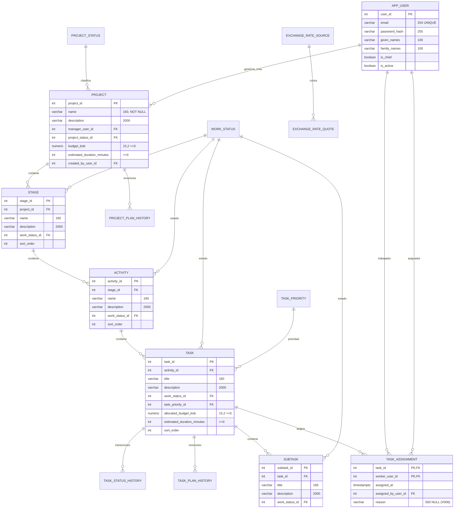
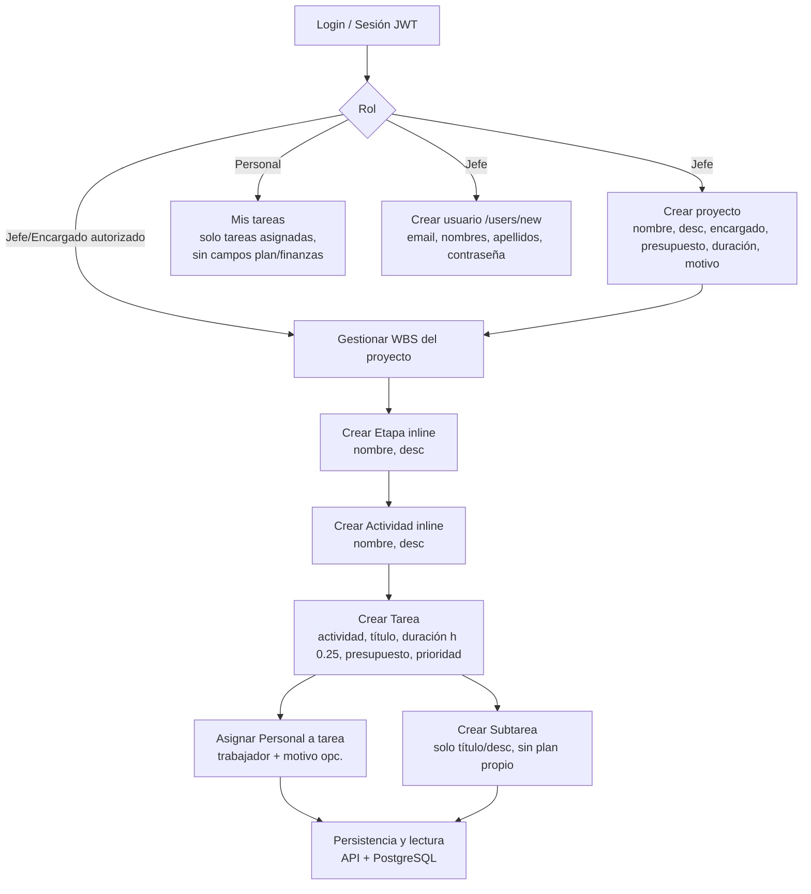
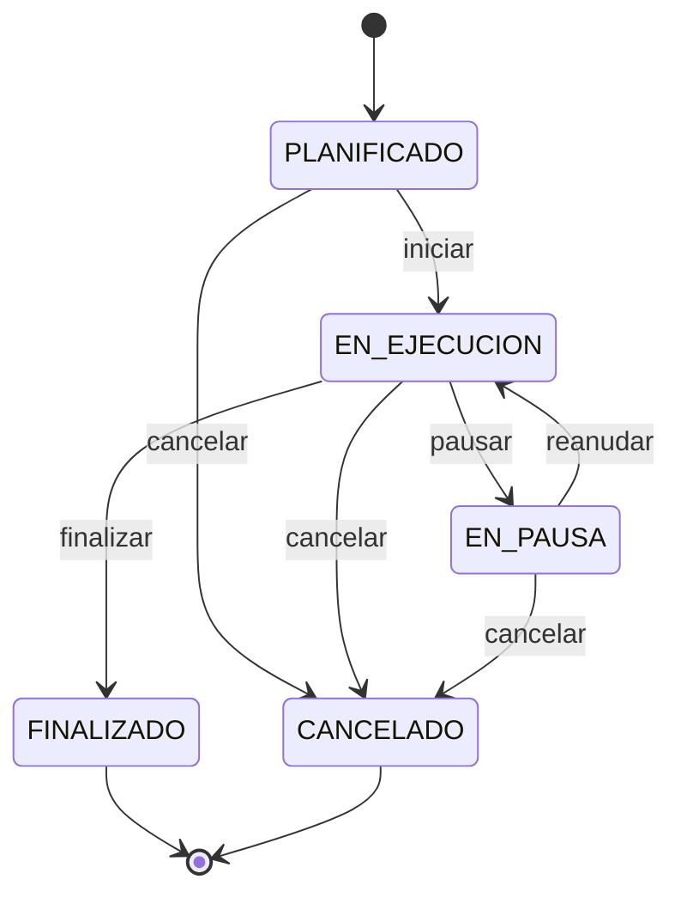

# 1. Portada

- **Título del informe:** [PENDIENTE DE COMPLETAR: Título oficial del informe EC3]
- **Asignatura:** [PENDIENTE DE COMPLETAR: Asignatura]
- **Grupo/Sección:** [PENDIENTE DE COMPLETAR: Grupo o sección]
- **Docente:** [PENDIENTE DE COMPLETAR: Nombre del docente]
- **Integrantes del equipo:** [PENDIENTE DE COMPLETAR: Nombres completos de los integrantes]
- **Fecha de entrega:** [PENDIENTE DE COMPLETAR: Fecha de entrega]
- **Fecha de recopilación de la base documental:** 2026-11-16 03:22:05 -04:00
- **Repositorio:** `CalebBav234/Hard_Coders_SCRUM_Gestor_de_Tareas_Personales_Release_1`
- **Rama:** `Refactor-E2`
- **HEAD (commit de referencia):** `10988a31d81f7596947c93d1e3abc3ddb42028db`
- **Estado del árbol de trabajo al recopilar:** no limpio (modificaciones y artefactos locales presentes; sin commit/push/merge realizados como parte de esta recopilación)

> **Nota de integridad:** Este documento es la base documental fuente para que una herramienta externa genere el informe académico. Solo incluye información verificable en el repositorio (código HEAD, migraciones, guías y evidencias EC3 disponibles). Los datos no disponibles se marcan explícitamente como `[PENDIENTE DE COMPLETAR: ...]`, `NO DISPONIBLE`, `BLOCKED` o `FAIL` según corresponda. No se incluyen secretos (contraseñas, tokens, hashes, cookies ni `storageState`).

---

# 2. Introducción

## 2.1 Objetivo
Construir y documentar, de forma verificable, el expediente de pruebas dinámicas y automatización correspondiente a la Evaluación Continua 3 (EC3) del sistema **Gestor de Tareas Personales / Gestor de Proyectos (Hard Coders)**. El expediente consolida: correcciones y estabilización de entorno (Etapa 1), implementación y verificación de funcionalidades/formularios complementarios (Etapa 2), diseño de pruebas con técnicas de caja negra ISTQB CTFL (Etapa 3), pruebas de integración con PostgreSQL real aislado (Etapa 4), automatización E2E con Playwright sobre flujos reales (Etapa 5) y cobertura/regresión con umbrales vigentes cumplidos (Etapa 6), junto con trazabilidad, evidencias y pendientes.

## 2.2 Alcance
- **Proceso principal evaluado:** jerarquía de trabajo `Proyecto → Etapa → Actividad → Tarea → Subtarea`, incluyendo planificación/presupuesto/duración de tarea, asignación de personal, gestión de usuarios (Jefe) y controles de acceso por rol.
- **Capas cubiertas:** dominio, aplicación/casos de uso, puertos/adaptadores (web, persistencia, seguridad), migraciones/base de datos PostgreSQL, interfaz Angular y flujos E2E reales (navegador + backend + BD).
- **Diseño de pruebas (Etapa 3):** partición de equivalencia (EP), análisis de valores límite de tres valores (BVA3), transición de estados, tabla de decisión para asignación y casos CREATE complementarios (`app_user`, `task_assignment`), con trazabilidad a ejecución futura E4/E5/E6.
- **Ejecución:** suites unitarias/integración backend y frontend, integración HTTP/JPA/JDBC contra PostgreSQL real aislado, y suite Playwright Chromium (14 escenarios) contra backend/frontend/BD reales.
- **Exclusiones/alcances no cubiertos por este expediente:** generación de informe académico final (PDF/DOCX) — este archivo es solo la base documental; `docs/EC3/scripts/e2e_fase1.sh` (API+BD, 21/21) no se contabiliza como Playwright E2E; no se realizaron commit/push/merge; no se modificó código de producción en Etapa 7.

## 2.3 Contexto técnico resumido
- **Backend:** Java 21, Spring Boot 4.1.0, Maven 3.9.16, arquitectura hexagonal (domain/application/ports/adapters/configuration), Spring Security + JWT, JPA/JDBC, JaCoCo 0.8.15.
- **Frontend:** Angular 22.1.x, TypeScript ~6.0.2, componentes standalone, Vitest 4.1.12, Playwright 1.58.2 (Chromium).
- **Base de datos:** PostgreSQL 18 (`gestor-tareas-db`, contenedor Docker, `:5432`), esquema `task_manager`, migraciones V001–V006.
- **Entorno operativo registrado:** Windows/PowerShell, Docker 28.4.0, Node v24.15.0, npm 11.12.1. Backend `http://localhost:8081` (`ddl-auto: validate`), frontend `http://localhost:4200` con proxy `frontend/proxy.conf.json` (`/api -> http://localhost:8081`). BD desarrollo `gestor_tareas`; BD de integración aislada `gestor_tareas_test`.
- **Umbrales vigentes:** backend JaCoCo LINE/BRANCH `minimum 0.85` (`backend/pom.xml`, fase `verify`); frontend Vitest `lines/branches/functions/statements: 85` (`frontend/vitest.config.ts`).

---
# 3. Diseño (arquitectura, base de datos, entidades y componentes principales)

## 3.1 Arquitectura lógica (hexagonal)

```mermaid
flowchart LR
    subgraph FE[Frontend Angular 22]
      UI[Componentes/Rutas/Guards\nproject-form, task-form, wbs-panel,\nassignment-dialog, user-form]
      SVC[Servicios HTTP\nProject/Task/Wbs/User/Auth]
    end

    subgraph BE[Backend Spring Boot 4.1 / Java 21]
      INW[Adapters IN Web\nControllers + DTO Requests/Responses\n+ Security/JWT]
      APP[Application\nUseCases/Commands/Services]
      DOM[Domain\nModelos + Policies + Exceptions + Ports OUT]
      OUTP[Adapters OUT Persistence/Security\nJPA Entities + Adapters + PasswordHasher]
    end

    subgraph DB[(PostgreSQL 18\ntask_manager)]
      TBL[Tablas V001-V006\ncatálogos, jerarquía, asignaciones,\nhistoriales, usuarios]
    end

    UI --> SVC -->|HTTP /api via proxy| INW
    INW --> APP --> DOM
    APP -->|Ports OUT| OUTP --> TBL
    OUTP --> APP
```

**Evidencia de estructura real (HEAD):**
- Dominio: `backend/src/main/java/com/hardcoders/taskmanager/domain/model/` (`Project`, `ProjectStatus`, `Stage`, `Activity`, `Task`, `Subtask`, `WorkStatus`, `TaskPriority`, `TaskAssignment`, `UserAccount`, `PlanRevision`, `WorkText`, etc.), `domain/policy/` (`ProjectAccessPolicy`, `WbsHierarchyPolicy`, `AssignmentPolicy`, `BudgetPolicy`, `CompletionPolicy`), `domain/exception/*`, `domain/port/out/*`.
- Aplicación: `application/usecase/*` (`ProjectCommandService`, `TaskCommandService`, `HierarchyCommandService`, `SubtaskCommandService`, `AssignmentCommandService`, `UserCommandService`, etc.), `application/command/*`, `application/port/in/*`, `application/result/*`.
- Adapters IN: `adapter/in/web/project|task|user|error/*`, `adapter/in/security/*`.
- Adapters OUT: `adapter/out/persistence/*` (adapters, entities, repositorios Spring Data), `SpringSecurityPasswordHasher`.
- Frontend rutas/guards: `frontend/src/app/app.routes.ts`, `core/auth/auth.guard.ts`, `core/auth/chief.guard.ts`.
- Configuración/proxy: `frontend/proxy.conf.json`, `frontend/playwright.config.ts`, `backend/pom.xml`.

## 3.2 Base de datos y modelo relacional (migraciones reales)

**Migraciones presentes en `database/migrations/` (estado real del repositorio):**
| Versión | Archivo | Propósito verificado |
|---|---|---|
| V001 | `V001__initial_schema.sql` | Esquema inicial `task_manager` (modelo de tareas/categorías/etiquetas/historial/tiempos del gestor previo), triggers y constraints base. |
| V002 | `V002__views_and_permissions.sql` | Vistas `v_tasks`, `v_pending_tasks`, `v_task_history` y permisos mínimos para `gestor_tareas_app` (condicionados a existencia del rol). |
| V003 | `V003__task_archive.sql` | Vista `v_task_archive` (terminadas/eliminadas lógicamente) y permisos de lectura. |
| V004 | `V004__project_management_model.sql` | Migración mayor al modelo de gestión de proyectos: archiva modelo anterior en `task_manager_legacy`, crea catálogos (`project_status`, `work_status`, `task_priority`, `exchange_rate_source`), `app_user`, `exchange_rate_quote`, jerarquía `project→stage→activity→task→subtask`, `task_assignment` (PK compuesta `task_id, worker_user_id`), historiales de plan/estado y migración de datos legacy. Moneda BOB, tiempos en minutos. |
| V005 | `V005__add_sort_order.sql` | `sort_order` (DEFAULT 0) e índices de orden en `stage`, `activity`, `task` para reordenamiento (drag-and-drop). |
| V006 | `V006__task_assignment_reason.sql` | Agrega `task_assignment.reason varchar(500) NULL` y `ck_task_assignment_reason` (NULL o trimmed no vacío) para persistir motivo de asignación (EC3-02/03). |

> **Observación de coherencia documental:** `docs/EC3/ANALISIS_EC3.md` (análisis previo) hipotetizó nombres distintos para V002/V003; la fuente de verdad para este expediente es el contenido real de `database/migrations/` y el esquema descrito arriba.

**Diagrama entidad-relación (núcleo V004+V006, simplificado y verificado):**



## 3.3 Entidades y componentes principales (flujo/proceso)

- **Proyecto:** `Project`/`ProjectStatus` (PLANIFICADO, EN_EJECUCION, EN_PAUSA, FINALIZADO, CANCELADO; cerrados sin cambios). Gestión/estado restringido a Jefe según política; edición de detalles según permisos (`canEditDetails`), presupuesto/duración/encargado y revisiones de plan con historial (`project_plan_history`).
- **Etapa/Actividad (WBS inline):** `Stage`/`Activity` con `WorkStatus` (PENDIENTE, EN_PROGRESO, COMPLETADA, CANCELADA), nombres ≤160, descripción ≤2000, pertenencia al proyecto/etapa, control de permisos y proyecto abierto (`WbsHierarchyPolicy`), ordenamiento por `sort_order` (V005). UI inline en `wbs-panel.ts`.
- **Tarea:** `Task` (título ≤160, descripción ≤2000, prioridad ALTA/MEDIA/BAJA, `allocated_budget_bob` DECIMAL(15,2) ≥0, `estimated_duration_minutes` entero ≥0, estado de trabajo, versión/concurrencia, historial de plan/estado). UI `task-form.ts`: duración en horas con `step 0.25` y validación de múltiplos de 0.25 h (conversión `Math.round(h*60)`), presupuesto validado por patrón 13,2.
- **Subtarea (V4):** `Subtask` sin campos de plan/finanzas/prioridad propios; creación/gestión vinculada a tarea padre; ejecución sujeta a reglas de asignación/estado.
- **Asignación (`task_assignment`):** `TaskAssignment` con `reason` normalizado (default `"Asignación de Personal"`, trim, máx. 500; V006), PK compuesta, restricciones de actor autorizado (Jefe/Encargado según gestión del proyecto), trabajador activo/elegible, no autoasignación, no duplicidad, proyecto abierto, tarea existente. UI `assignment-dialog.ts`, endpoint `POST /api/tasks/{taskId}/assignments` (`HierarchyController`).
- **Usuario (`app_user`):** creación exclusiva de Jefe (`POST /api/users`, `UserController` + `UserCommandService`), usuario creado no-jefe/activo, email normalizado único, nombres/apellidos ≤100, contraseña política 8–200 chars (divergencia observada: BCrypt efectivo ≤72 bytes en implementación actual), hash nunca expuesto. UI `user-form.ts`, ruta `/users/new` protegida por `authGuard + chiefGuard`.

## 3.4 Matriz de entidades, campos y reglas (principales formularios del proceso)

| Formulario | Campos (UI real) | Reglas/tipos/longitudes | Origen (capas) |
|---|---|---|---|
| Proyecto (crear) | nombre, descripción, encargado, presupuesto Bs, duración min, motivo opc. | nombre 1–160; desc ≤2000; manager obligatorio/elegible; budget DECIMAL(15,2) ≥0 (13,2); duración entero ≥0 min; motivo opc. (UI 300 = dominio 300; columna BD 500) | `project-form.ts/html`, `ProjectRequests`, `Project/BudgetPolicy/PlanRevision`, V004 `project` |
| Proyecto (editar detalles) | nombre, descripción | nombre/desc con límites; versión para concurrencia; sin plan/encargado en este form | `project-form.ts`, `ProjectRequests.UpdateDetails`, `Project.editDetails` |
| Etapa (inline WBS) | nombre, descripción opc. | nombre 1–160; desc ≤2000; proyecto abierto y autorizado; mismo proyecto | `wbs-panel.ts`, `HierarchyRequests`, `Stage/WbsHierarchyPolicy`, V004 `stage` |
| Actividad (inline WBS) | nombre, descripción opc. | nombre 1–160; desc ≤2000; etapa/proyecto válidos y abiertos | `wbs-panel.ts`, `HierarchyRequests`, `Activity/WbsHierarchyPolicy`, V004 `activity` |
| Tarea | título, duración h (0.25), presupuesto Bs, prioridad, actividad | título 1–160; desc ≤2000; prioridad enum; budget DECIMAL(15,2) ≥0; duración múltiplo 0.25 h → minutos enteros ≥0; actividad requerida; versión en updates | `task-form.ts`, `TaskRequests`, `Task/BudgetPolicy/WorkText`, V004 `task` |
| Subtarea | título, descripción opc. | título 1–160; desc ≤2000; tarea padre válida; sin presupuesto/duración/prioridad propios (V4) | `task-form.ts`, `Subtask*Request`, `Subtask/WorkText`, V004 `subtask` |
| Asignación | trabajador, motivo opc. | worker activo/elegible existente; actor autorizado; no self; no duplicado; proyecto abierto; motivo null/blank→default, trim, ≤500 | `assignment-dialog.ts`, `HierarchyRequests.AssignWorkerRequest`, `TaskAssignment/AssignmentPolicy/WbsHierarchyPolicy`, V004/V006 |
| Usuario (Jefe) | email, nombres, apellidos, contraseña | email ≤254 formato único normalizado; nombres/apellidos 1–100; pwd 8–200 (BCrypt ≤72 bytes efectivo); crea no-jefe activo; sin campos privilegiados | `user-form.ts`, `UserRequests`, `UserCommandService`, V004 `app_user` |

---
# 4. Proceso y formularios (flujo principal, reglas y validaciones)

## 4.1 Flujo principal del proceso



## 4.2 Reglas de validación por formulario (resumen consolidado)

- **Proyecto:** nombre obligatorio y trim no vacío (≤160); descripción opcional (≤2000); encargado obligatorio en creación; presupuesto BOB ≥0 con formato 13 enteros/2 decimales; duración minutos entero ≥0; motivo opcional ≤300 (UI y dominio; DIV-01 cerrado). Creación restringida a Jefe; concurrencia por versión en actualizaciones.
- **Etapa/Actividad (inline):** nombre obligatorio no vacío (≤160), descripción opcional (≤2000), UI deshabilita submit con nombre vacío/espacios; padre/contexto válido y proyecto abierto; permisos de gestión.
- **Tarea:** título obligatorio (≤160); prioridad enum (default MEDIA); actividad padre requerida; presupuesto vacío→0, ≥0, patrón 13,2; duración vacía→0, múltiplos de 0.25 h, conversión a minutos enteros, tope `MAX_DURATION_MINUTES` (2,147,483,647); subtarea oculta campos plan y envía 0.
- **Subtarea:** título obligatorio (≤160), descripción opcional (≤2000), tarea padre válida; **no** aplica presupuesto/duración/prioridad propios.
- **Asignación:** trabajador seleccionado, existente, activo y elegible; actor autenticado y autorizado; prohibida autoasignación (403) y duplicidad (400/409 por integridad/regla, PK compuesta); proyecto abierto (409 si cerrado); tarea existente; `reason` normalizado a default si null/vacío/espacios, trim y ≤500; lectura posterior coherente vía GET.
- **Usuario:** solo Jefe (ruta/guard y backend 403/401 según caso); email válido/único/normalizado ≤254; nombres/apellidos obligatorios ≤100; contraseña 8–200 (validación) con límite efectivo BCrypt 72 bytes (>72 bytes → 400 tras corrección DIV-E4-01); respuesta sin secretos; crea `is_chief=false,is_active=true`; campos privilegiados ignorados/no aceptados.

## 4.3 Roles y controles de acceso (verificados en diseño/ejecución)

| Rol | Capacidades relevantes verificadas | Restricciones verificadas |
|---|---|---|
| Jefe | Crear proyecto/usuarios; gestionar jerarquía y asignaciones; acceso `/users/new` | Cambio de estado de proyecto y creación de usuario sujetos a rol Jefe |
| Encargado | Gestión en proyecto asignado según políticas (WBS/asignaciones donde aplique) | Sin acceso a creación de usuarios (403/redirección) |
| Personal | Ejecución/visualización de tareas asignadas; "Mis tareas" sin campos plan/finanzas | Sin acceso a `/users/new` (403/redirección); sin gestión no autorizada |

## 4.4 Fragmentos de código representativos (verificados, HEAD)

**Duración y presupuesto de tarea (UI, `frontend/src/app/features/tasks/task-form/task-form.ts`, extracto):**
```ts
const BUDGET_PATTERN = /^\d{1,13}(\.\d{1,2})?$/;
const MAX_DURATION_MINUTES = 2_147_483_647;

estimatedMinutes(): number {
  const hours = Number(this.estimatedHours);
  if (this.estimatedHours === null || !Number.isFinite(hours) || hours < 0) return 0;
  return Math.round(hours * 60);
}

private validateHours(): string | null {
  if (this.estimatedHours === null || (this.estimatedHours as unknown) === '') return null;
  const hours = Number(this.estimatedHours);
  if (!Number.isFinite(hours) || hours < 0) return 'La duración debe ser un número mayor o igual a 0.';
  const quarterHours = hours / 0.25;
  if (Math.abs(quarterHours - Math.round(quarterHours)) > 1e-9)
    return 'La duración debe usar incrementos de 0.25 h (15 min).';
  if (Math.round(hours * 60) > MAX_DURATION_MINUTES) return 'La duración estimada es demasiado grande.';
  return null;
}
```

**Motivo de asignación (dominio, `TaskAssignment`, extracto):**
```java
public static final int REASON_MAX = 500;
public static final String DEFAULT_REASON = "Asignación de Personal";

public static String normalizeReason(String reason) {
    if (reason == null || reason.isBlank()) return DEFAULT_REASON;
    String stripped = reason.strip();
    if (stripped.length() > REASON_MAX)
        throw new DomainValidationException("El motivo no puede superar " + REASON_MAX + " caracteres");
    return stripped;
}
```

**Estados de proyecto (dominio, `ProjectStatus`, extracto):**
```java
public Set<ProjectStatus> allowedTargets() {
    return switch (this) {
        case PLANIFICADO -> EnumSet.of(EN_EJECUCION, CANCELADO);
        case EN_EJECUCION -> EnumSet.of(EN_PAUSA, FINALIZADO, CANCELADO);
        case EN_PAUSA -> EnumSet.of(EN_EJECUCION, CANCELADO);
        case FINALIZADO, CANCELADO -> EnumSet.noneOf(ProjectStatus.class);
    };
}
```

**Creación de usuario (web, `UserController`, extracto):**
```java
@PostMapping
@ResponseStatus(HttpStatus.CREATED)
public UserResponses.UserResponse create(@Valid @RequestBody UserRequests.CreateUserRequest request) {
    String given = request.givenNames() == null ? "" : request.givenNames().strip();
    String family = request.familyNames() == null ? "" : request.familyNames().strip();
    UserSummaryResult created = manageUsers.create(new CreateUserCommand(
            request.email(), given, family, request.password()));
    return new UserResponses.UserResponse(created.userId(), created.email(), given, family,
            created.fullName(), created.chief(), created.active());
}
```

**Contrato de asignación y migración (extractos):**
```java
public record AssignWorkerRequest(
        @NotNull(message = "El trabajador es obligatorio") Integer workerUserId,
        @Size(max = 500, message = "El motivo no puede superar 500 caracteres") String reason) { }
```
```sql
ALTER TABLE task_manager.task_assignment ADD COLUMN IF NOT EXISTS reason varchar(500) NULL;
-- ck_task_assignment_reason: reason IS NULL OR length(btrim(reason)) >= 1
```

---

# 5. Cambios y modificaciones realizados en EC3

## 5.1 Correcciones y adecuaciones (Etapas 1–2, verificadas)
| Área | Cambio/modificación | Estado |
|---|---|---|
| EC3-04 (tarea) | Duración UI en horas con `step 0.25`, validación de múltiplos de 0.25 h y conversión a `estimatedDurationMinutes` enteros; presupuesto `allocatedBudgetBob` independiente (13,2, ≥0); subtareas sin campos de plan V4; visibilidad R2/US3.1 preservada | PASS (E1/E4/E5/E6) |
| EC3-02/03 (asignación) | Persistencia/lectura end-to-end de `task_assignment.reason` (V006, dominio, entidad/adaptador, request/response), normalización/default, límite 500 coherente UI/DTO/dominio/DB | PASS |
| EC3-11 (BD/bootstrap) | Bootstrap/tracking y compatibilidad V001–V006; operación con `ddl-auto: validate` y BD alineada (idempotente/aditivo según evidencia) | PASS |
| EC3-12/13 (frontend) | Alineación dependencias Angular y compilación/ejecución de specs Vitest | PASS |
| A6 (usuario) | CREATE `app_user` seguro y Jefe-only: `POST /api/users`, caso de uso/puertos/adaptadores, hash BCrypt, normalización/validaciones/unicidad, respuesta sin secretos, ruta `/users/new` con guards y formulario | PASS (E2/E4/E5) |
| E2/E5 (formularios) | Verificación/soporte de formularios inline etapa/actividad (WBS) y diálogo de asignación en flujos reales | PASS |

## 5.2 Cambios de soporte a calidad (Etapa 6, sin bajar umbrales ni cambiar contrato)
- **Backend (tests):** ampliaciones en dominio/políticas/aplicación para mejorar cobertura de ramas/líneas y regresión R9 — `ProjectTest`, `TaskTest`, `WorkStatusTest`, `TaskPriorityTest`, `ProjectAccessPolicyTest`, `DelegationPolicyBasicPathTest`, `ProgressPolicyTest`, `UserCommandServiceTest`.
- **Frontend (tests):** `app.spec.ts`, `core/services/task.service.spec.ts`, `core/services/project.service.spec.ts` (nuevo) para cobertura de funciones/ramas.
- **Configuración de pruebas:** `frontend/playwright.config.ts`, suite `frontend/e2e/**` (auth, flujo principal, validaciones, usuarios).
- **Sin cambios en Etapa 7:** no se modificó código de producción, contratos/endpoints/UI de negocio, migraciones ni umbrales.

## 5.3 Evidencia de archivos modificados/no rastreados relevantes (estado recopilado)
> El árbol de trabajo contenía modificaciones y archivos no rastreados vinculados a EC3 (tests, docs, evidencias, e2e, artefactos de reportes/logs). Esta base documental **no** los normaliza, commitea ni elimina; los referencia como contexto del estado `Refactor-E2@10988a31`.

---
# 6. Diseño de pruebas (EP, BVA3, transición de estados, tabla de decisión, trazabilidad)

> Fuentes principales: `docs/EC3/ETAPA_3_DISENO_PRUEBAS.md` (diseño, 2026-11-16) y `docs/EC3/ETAPA_3_GUIA_PRUEBAS.md` (revisión/trazabilidad, actualizado con hallazgos E4). Las matrices completas de IDs EP/BVA3/estados/decisión/CREATE constan en dichos documentos; aquí se consolidan los elementos verificables y su ejecución.

## 6.1 Partición de equivalencia (EP)
- **Cobertura diseñada:** Proyecto (crear/editar), Etapa inline, Actividad inline, Tarea, Subtarea, Asignación `task_assignment` (CREATE) y Usuario `app_user` (CREATE).
- **Criterios:** particiones no vacías, no solapadas, comportamiento homogéneo; base *Each Choice* + combinaciones de riesgo; resultado esperado por capa (UI/API/BD) con origen de regla (UI/DTO/dominio/DB).
- **Representativos (IDs):** `EP-TAR-DUR-01` (0/0.25/1.5 h válidos, conversión a minutos), `EP-TAR-DUR-02` (-0.25 o no múltiplo 0.25 como 0.1/0.3 inválidos), `EP-TAR-PRES-02/03` (negativo o formato/escala/dígitos inválidos), `EP-ASG-REA-01` (null/vacío/espacios → default `"Asignación de Personal"`), `EP-ASG-REA-03` (>500 inválido), `EP-ASG-SELF-02` (autoasignación 403), `EP-ASG-DUP-02` (duplicidad 400/409), `EP-USR-PWD-04` (73–200 chars ASCII >72 bytes: inválida; 500 en E4, 400 tras corrección DIV-E4-01), `EP-SUB-NOPLAN-01` (subtarea sin campos plan/finanzas/prioridad).

## 6.2 Análisis de valores límite BVA3 (n-1, n, n+1)
- **Cobertura diseñada:** longitudes (nombres/títulos/descripciones/email), presupuesto BOB (escala 0.01, 13 enteros/2 decimales), duración proyecto (min) y tarea (0.25 h/15 min y máximo minutos), motivo asignación (500), contraseña usuario (contrato 8–200 y frontera efectiva BCrypt 72 bytes).
- **Destacados:** `BVA3-TAR-DUR-MIN` (-0.25/0/0.25 h), `BVA3-TAR-DUR-MAX` (2,147,483,646/2,147,483,647/2,147,483,648 min), `BVA3-TAR-PRES-MIN` (-0.01/0.00/0.01), `BVA3-TAR-PRES-SCALE` (2 dec válidos / 3 dec inválido), `BVA3-ASG-REA-MAX` (499/500/501), `BVA3-USR-PWD-MIN` (7/8/9), `BVA3-USR-PWD-BCRYPT` (71/72/73 bytes; 73 → 400 tras corrección DIV-E4-01). Subtarea sin BVA de presupuesto/duración.

## 6.3 Transición de estados

**Proyecto (`ProjectStatus`, grafo verificado):**


- **Diseño (E3):** 5/5 estados; 7/7 transiciones válidas `ST-PROY-01..07`; inválidas relevantes `ST-PROY-08..15` (terminales, saltos, 401/403, 412 versión, 400 payload). Guardas: Jefe, versión, proyecto no cerrado donde aplique.
- **Complemento tarea/subtarea (`WorkStatus`):** `ST-TAR-01..09` (PENDIENTE↔EN_PROGRESO→COMPLETADA→EN_PROGRESO, cancelación/`TASK_HAS_SUBTASKS` 409, restricciones de ejecución).
- **Ejecución sistemática 1:1 trazada por ID:** **NO DISPONIBLE/PARCIAL** en evidencias consolidadas (cobertura implícita parcial por dominio/regresión R9 y flujos).

## 6.4 Tabla de decisión — asignación `POST /api/tasks/{taskId}/assignments`

| Regla | Condición clave | Esperado | Persistencia |
|---|---|---|---|
| DT-ASG-R1 | Feliz (autorizado, abierto, worker activo, no self/dup) | 200, reason normalizado | Sí |
| DT-ASG-R2 | Actor no autorizado | 403 | No |
| DT-ASG-R3 | Proyecto cerrado | 409 | No |
| DT-ASG-R4 | Trabajador inactivo | 400 | No |
| DT-ASG-R5 | Autoasignación | 403 | No |
| DT-ASG-R6 | Duplicidad (PK compuesta) | 400/409 | No |
| DT-ASG-R7 | Tarea inexistente | 404 | No |
| DT-ASG-R8 | Worker inexistente | 400/404 | No |
| DT-ASG-R9 | Relación inconsistente/no visible | 404/400/403 | No |
| DT-ASG-R10 | No autenticado | 401 | No |

- **Diseño:** 10/10 reglas factibles especificadas (100% diseño).
- **Ejecución E4:** R1..R10 ejecutadas en integración HTTP real (PostgreSQL aislado) — **PASS** (tolerancias 400/409/403/404 según detección documentadas).

## 6.5 Casos CREATE complementarios
- **`task_assignment` (CA-ASG-01..12):** reason explícito/trim, null/vacío→default, rechazo >500, inactivo, autoasignación, duplicidad, proyecto cerrado, no autorizado, no autenticado, tarea inexistente, lectura coherente — **E4 PASS**.
- **`app_user` (CA-USR-01..10):** creación válida Jefe (normalización/seguridad), duplicidad, validaciones nombres/email/contraseña, 401/403, tampering privilegios ignorado, hash/login — **E4 PASS** (CA-USR-05 con divergencia BCrypt DIV-E4-01 documentada).

## 6.6 Trazabilidad
| Requisito | IDs/técnica | Ejecución/evidencia | Estado |
|---|---|---|---|
| R-EC3-EP-01 | EP formularios principales | E4/E5/E6 consolidado | PASS |
| R-EC3-EP-02 | EP/CA `app_user`, `task_assignment` | E4 integración PG, E5 UI | PASS |
| R-EC3-BVA3-01/02 | BVA3 límites y tarea duración/presupuesto | E4/E5/E6 (subset crítico) | PASS |
| R-EC3-ST-01 | ST-PROY-01..15 | Diseño E3; ejecución 1:1 | DISEÑADO / NO EJECUTADO 1:1 |
| R-EC3-ST-02 | ST-TAR-01..09 | Diseño E3; R9 parcial | PARCIAL |
| R-EC3-DT-01 | DT-ASG-R1..R10 | E4 `PostgresIntegrationTest` | PASS |
| R-EC3-SEC-01 | Roles/401/403/no privilegios | E4/E5 | PASS |
| R-EC3-DATA-01 | Persistencia API+BD+UI | E4/E5/E6 | PASS |
| R-EC3-TRACE-01 | Diseño + guías E1–E6 | Este expediente | PASS |

---
# 7. Ejecución de pruebas (etapas, resultados, cobertura y regresión R1–R9)

## 7.1 Resumen por etapa

| Etapa | Alcance | Resultado | Evidencia principal |
|---|---|---|---|
| E1 | Correcciones/entorno/contratos (EC3-04/02/03/11/12/13, R2, US3.1), V001–V006, `ddl-auto: validate` | **PASS** | `docs/EC3/ETAPA_1_GUIA_PRUEBAS.md` |
| E2 | A6 CREATE `app_user` (Jefe-only), flujos `task_assignment` y etapa/actividad inline (BROWSER-01..14) | **PASS (14/14)** | `docs/EC3/ETAPA_2_GUIA_PRUEBAS.md`, `docs/EC3/evidencias/etapa_2/browser/*` |
| E3 | Diseño EP, BVA3, estados, decisión, CREATE complementarios, trazabilidad | **PASS (diseño)** | `docs/EC3/ETAPA_3_DISENO_PRUEBAS.md`, `docs/EC3/ETAPA_3_GUIA_PRUEBAS.md` |
| E4 | Integración PostgreSQL real aislado (`gestor_tareas_test`, V001–V006), DT-ASG/CA-ASG/CA-USR/MIG, consolidación | **PASS** | `docs/EC3/ETAPA_4_GUIA_PRUEBAS.md` |
| E5 | Playwright E2E real (Chromium) backend/frontend/BD | **PASS (14/14)** | `docs/EC3/ETAPA_5_GUIA_PRUEBAS.md`, `docs/EC3/evidencias/etapa_5/EVIDENCIA_EJECUCION.md`, `frontend/test-results/.last-run.json` |
| E6 | Cobertura ≥85% líneas/ramas (umbrales vigentes), consolidación y regresión R1–R9 | **PASS** | `docs/EC3/ETAPA_6_GUIA_PRUEBAS.md`, `docs/EC3/evidencias/etapa_6/EVIDENCIA_EJECUCION.md` |

## 7.2 Resultados cuantitativos (histórico/intermedio vs final)

| Medición | Contexto | Comando/artefacto | Resultado | Clasificación |
|---|---|---|---|---|
| Backend consolidado E4 | Suite Surefire E4 | `mvn -q test` | **337 tests, 0 fallos, 0 errores, 0 omitidos**; `PostgresIntegrationTest` 25/25 | Histórico/intermedio E4 |
| Frontend Vitest E4 | Consolidación E4 | `npx vitest run` | **18 archivos, 297 tests PASS** | Histórico/intermedio E4 |
| **Backend final E6** | **Medición fresca + gate JaCoCo** | `cd backend; mvn verify` | **BUILD SUCCESS (01:12)**. **376 tests, 0 fallos, 0 errores, 0 omitidos**. JaCoCo: **INSTRUCTION 92.53% (13245/14315), BRANCH 85.01% (618/727), LINE 94.93% (2714/2859)** — checks cumplidos | **Final E6** |
| **Frontend Vitest final E6** | **Medición fresca + cobertura** | `cd frontend; npx --no-install ng test --watch=false --coverage` | **19 archivos, 303 tests PASS**. **Statements 92.67%, Branches 87.99%, Functions 86.45%, Lines 93.60%** | **Final E6** |
| **Playwright E5/E6** | E2E real Chromium | `playwright test --project=chromium --reporter=line` | **14 passed (E6: 52.9s, E5: 54.1s), 0 failed, 0 skipped** | **Ejecutado/Final** |
| Last-run PW | Artefacto frontend | `frontend/test-results/.last-run.json` | `{"status":"passed","failedTests":[]}` | Ejecutado |

> Diferencias de conteo E4→E6 reflejan pruebas añadidas en E6 (backend +39, frontend +6/1 archivo) sin bajar umbrales ni cambiar contratos.

## 7.3 Ejecución E4 (integración PostgreSQL real)
- **BD:** `gestor_tareas_test` aislada (Docker `gestor-tareas-db`, postgres:18), V001–V006, `ddl-auto=validate`, limpieza transaccional; sin borrado de volúmenes ni secretos.
- **Suite:** `integration/PostgresIntegrationTest` (25): `MigrationsAndReason` (3), `AssignmentApi` (14), `UserApi` (8).
- **Cobertura trazada:** DT-ASG-R1..R10, CA-ASG-01..12, CA-USR-01..10, MIG/compatibilidad reason/PK — **PASS** (tolerancias 400/409/403/404 según detección documentadas).
- **Consolidación:** backend 337/337, frontend 297/297. Gate JaCoCo diferido y cerrado en E6.

## 7.4 Ejecución E5 (Playwright)
- **Suites (14):** `e2e/auth/auth.spec.ts` (6), `e2e/tasks/main-flow.spec.ts` (1), `e2e/tasks/validations.spec.ts` (3), `e2e/users/user-create.spec.ts` (4) — **14/14 PASS**.
- **Cobertura clave:** login/roles y rechazos, guard `/users/new`, flujo `Proyecto→Etapa→Actividad→Tarea→Subtarea→Asignación` con persistencia observable, EC3-04 (1.5 h→90 min, presupuesto 250.50, POST único por etapa, UI+API+BD), validaciones UI/API (0.1 h y 3 decimales rechazados, -1/-0.01 rechazados), asignación (default, duplicado, inactivo, 501 rechazado, 500 aceptado), creación usuario Jefe (201 sin secretos) y login, duplicado email (400/409), contraseña corta UI, Personal sin acceso/403.
- **Contexto:** backend `:8081`, frontend `:4200` (proxy), PostgreSQL `:5432`, datos únicos, sin secretos.

## 7.5 Regresión R1–R9 (Etapa 6)
| ID | Regla | Verificación | Resultado |
|---|---|---|---|
| R1 | Búsqueda | Regresión suites FE/BE/E2E preservando contratos | PASS |
| R2 | Duración visible (EC3-04) | Flujo 1.5 h→90 min y mapeo/lista en suites | PASS |
| R3 | Presupuesto separado | 250.50 Bs y validaciones API/UI | PASS |
| R4 | Navegación jerárquica | Flujo principal, rutas/WBS, E2E y suites | PASS |
| R5 | Creación jerárquica | `main-flow.spec.ts`, E2/E4 | PASS |
| R6 | POST único por etapa | Verificado en E5 (flujo principal) | PASS |
| R7 | Orden/contadores/UI | `sort_order`/WBS/contadores preservados | PASS |
| R8 | Estados/UI/contratos | Suites FE/BE/E2E en verde | PASS |
| R9 | Reglas de dominio (create/restore/normalización/versionado/transiciones) | `ProjectTest`, `TaskTest` y políticas en `mvn verify` | PASS |

## 7.6 Divergencias y observaciones registradas
| ID | Divergencia | Estado |
|---|---|---|
| DIV-01 | Motivo proyecto UI 300 = dominio 300; solo la columna BD admite 500 | **Cerrado** — sin divergencia funcional |
| DIV-02 | `GET /api/users` no contrato operativo confirmado | Confirmado (uso create/login/BD) |
| DIV-03/04 | Duplicados usuario/asignación mapeados 400/409 | Confirmado E4/E5 |
| DIV-05 | Asignación en proyecto cerrado → 409 | Confirmado E4 |
| DIV-06 | Duración no múltiplo 0.25 depende de handler UI | Cubierto (E4/E5/E6) |
| DIV-E4-01 | Contraseña 8–200 contractual vs BCrypt >72 bytes efectivo | **Corregido** (2026-11-18): >72 bytes → 400 |
| DIV-E4-02 | DT-ASG-R9 resuelto 403/404/400 según visibilidad | Observado E4 |
| DIV-E4-03 | Variante de comando `ng test --browsers` no aplicable en entorno previo; E6 ejecutó con cobertura vía Vitest/ng test | Resuelto por comando efectivo documentado |

---
# 8. Evidencias (navegador, código, capturas y trazabilidad)

## 8.1 Capturas de navegador disponibles (reutilizables)
Existen en `docs/EC3/evidencias/etapa_2/browser/` (Etapa 2, verificadas):
- Usuario (acceso/creación/validación/login/bloqueos): `BROWSER-01-acceso-jefe.png`, `BROWSER-02-creacion-usuario.png`, `BROWSER-03-validaciones-usuario.png`, `BROWSER-04-login-usuario-creado.png`, `BROWSER-05-bloqueo-encargado.png`, `BROWSER-06-bloqueo-personal.png`, apoyo `01-users-form-chief.png`, `02-user-created-success.png`, `03-non-chief-users-route-redirect.png`.
- Matriz permisos: `BROWSER-07-jefe.png`, `BROWSER-07-encargado.png`, `BROWSER-07-personal.png`.
- Asignaciones: `BROWSER-08-asignacion-motivo.png`, `BROWSER-09-motivo-default.png`, `BROWSER-10-asignaciones-invalidas.png`.
- WBS etapa/actividad: `BROWSER-11-creacion-etapa.png`, `BROWSER-12-validacion-etapa.png`, `BROWSER-13-creacion-actividad.png`, `BROWSER-14-validacion-actividad.png`.

**Capturas específicas E5 (Playwright/browser, agregadas 2026-11-16):** `docs/EC3/evidencias/etapa_5/browser/`
- `E5-01-login-page.png` — pantalla de login.
- `E5-02-login-credenciales-incorrectas.png` — rechazo credenciales incorrectas (alerta UI).
- `E5-03-home-jefe-usuarios-menu.png` — home Jefe con menú Usuarios visible.
- `E5-04-users-new-jefe.png` — formulario `/users/new` accesible para Jefe.
- `E5-05-encargado-sin-acceso-users.png` — Encargado sin acceso a `/users/new` (redirigido, sin menú Usuarios).
- `E5-06-wbs-estructura-proyecto.png` — panel WBS/estructura del proyecto.
- `E5-07-formulario-nueva-etapa-inline.png` — formulario inline de nueva etapa.
- `E5-08-validacion-duracion-025.png` — validación UI duración no múltiplo 0.25 h (error visible).
- `E5-09-flujo-principal-wbs-tareas.png` — proyecto con jerarquía WBS/tareas/progreso (flujo principal).
- `E5-10-validacion-presupuesto-decimales.png` — validación UI presupuesto >2 decimales (error visible).

**Capturas específicas E6 (reutilizadas de la evidencia browser E5 para la etapa de regresión/cobertura):** `docs/EC3/evidencias/etapa_6/browser/` (`E6-01..E6-10`, mismo set de escenarios). Respaldadas además por evidencia textual/reportes (`EVIDENCIA_EJECUCION.md`, `playwright-report`, `.last-run.json`, `jacoco`, `frontend/coverage`).

## 8.2 Evidencias de código y configuración
- **Migraciones:** `database/migrations/V001__initial_schema.sql`–`V006__task_assignment_reason.sql`, `database/docker/init-dev-db.sql`.
- **Backend:** `domain/model/{ProjectStatus,TaskAssignment,WorkStatus,...}`, `domain/policy/*`, `application/usecase/*`, `adapter/in/web/project|task|user|error/*`, `adapter/out/persistence/*`, `backend/pom.xml`.
- **Frontend:** `frontend/src/app/app.routes.ts`, `core/auth/{auth.guard.ts,chief.guard.ts}`, `features/tasks/task-form/task-form.ts`, `features/tasks/assignment-dialog/assignment-dialog.ts`, `features/users/user-form/user-form.ts`, `features/tasks/wbs/wbs-panel.ts`, `features/projects/project-form/project-form.ts`, `frontend/package.json`, `frontend/vitest.config.ts`, `frontend/playwright.config.ts`, `frontend/proxy.conf.json`.
- **Pruebas:** `backend/src/test/java/...` (dominio/políticas/integración `PostgresIntegrationTest`), `frontend/src/app/**/*.spec.ts`, `frontend/e2e/{auth,tasks,users}/*.spec.ts`.

## 8.3 Evidencias de ejecución y reportes
- **Guías/evidencias:** `docs/EC3/ETAPA_1..6_GUIA_PRUEBAS.md`, `ETAPA_3_DISENO_PRUEBAS.md`, `FASE1_CORRECCIONES_Y_ENTORNO.md`, `evidencias/etapa_5/EVIDENCIA_EJECUCION.md`, `evidencias/etapa_6/EVIDENCIA_EJECUCION.md`.
- **Cobertura backend:** `backend/target/site/jacoco/index.html`, `jacoco.csv`, `jacoco.xml` (reporte presente: BRANCH 85%, LINE/INSTR ~92–94% según cabecera/medición E6).
- **Cobertura frontend:** `frontend/coverage/index.html` y artefactos asociados.
- **Playwright:** `frontend/playwright-report/index.html`, `frontend/test-results/.last-run.json` (`{"status":"passed","failedTests":[]}`).

## 8.4 Trazabilidad evidencia ↔ escenario
| Escenario/área | Evidencia | Estado |
|---|---|---|
| BROWSER-01..14 (usuario/asignación/WBS) | PNG `evidencias/etapa_2/browser/*`, guía E2 | DISPONIBLE |
| E2E 14 escenarios (auth/flujo/validaciones/usuarios) | Evidencias E5/E6, `playwright-report`, `.last-run.json`, specs e2e, capturas browser `evidencias/etapa_5/browser/E5-01..10` | DISPONIBLE (textual/reporte + capturas) |
| Integración PG (DT-ASG/CA-ASG/CA-USR/MIG) | Guía E4, `PostgresIntegrationTest` | DISPONIBLE |
| Cobertura final BE/FE y regresión R1–R9 | Guía/evidencia E6, `jacoco/*`, `frontend/coverage/*`, capturas `evidencias/etapa_6/browser/E6-01..10` | DISPONIBLE |
| Capturas específicas E5/E6 | `evidencias/etapa_5/browser/*`, `evidencias/etapa_6/browser/*` | **DISPONIBLE (parcial por escenario, representativas)** |
| Ejecución 1:1 trazada de toda matriz de estados | Diseño E3 (sin suite trazada completa en evidencias) | **NO DISPONIBLE/PARCIAL** |

---

# 9. Conclusiones y lecciones aprendidas

## 9.1 Conclusiones
- Las etapas EC3 1–6 se completaron con resultados **PASS** según sus gates: estabilización y contratos (E1), funcionalidades/formularios complementarios y control de acceso (E2), diseño sistemático ISTQB (E3), integración real con PostgreSQL aislado y trazabilidad crítica (E4), E2E Playwright real 14/14 (E5) y cumplimiento de umbrales de cobertura con regresión R1–R9 (E6).
- **Métricas finales verificables (E6):** backend 376 tests (0 fallos/errores/omitidos), JaCoCo **BRANCH 85.01% (618/727)** y **LINE 94.93% (2714/2859)** (BUILD SUCCESS, umbral ≥85%); frontend 303 tests, **Statements 92.67% / Branches 87.99% / Functions 86.45% / Lines 93.60%**; Playwright **14/14 PASS**.
- El diseño E3 es trazable y alineado con contratos reales; E4/E5/E6 cubrieron los escenarios críticos (asignación, usuarios, migraciones/compatibilidad, flujo principal y validaciones), aunque la matriz completa de transición de estados no quedó ejecutada 1:1 con evidencia por ID.

## 9.2 Lecciones aprendidas
- **Diseño anclado a la implementación:** contrastar UI/DTO/dominio/BD expuso divergencias reales (límites de motivo, BCrypt ≤72 bytes efectivo, mapeos 400/409) y evitó supuestos inválidos.
- **Separar mediciones por etapa:** distinguir resultados intermedios (E4) y finales (E6) previene doble conteo y facilita auditoría.
- **Entornos reales y aislados:** `gestor_tareas_test` con `ddl-auto: validate` y E2E contra backend/frontend/BD reales aportaron evidencia de persistencia y contratos no cubierta por unit tests.
- **Calidad sin degradar gates:** mantener umbrales/contratos exigió cerrar brechas con pruebas, no con exclusiones ni relajación de reglas.
- **Evidencia segura y reproducible:** registrar comandos, rutas y artefactos sin exponer secretos es clave para un expediente auditable.

## 9.3 Pendientes y riesgos residuales
- Ejecución sistemática 1:1 de `ST-PROY-01..15` y `ST-TAR-01..09` con trazabilidad por ID: **NO DISPONIBLE/PARCIAL**.
- Capturas específicas de corridas E5/E6: **DISPONIBLE (representativas)** en `docs/EC3/evidencias/etapa_5/browser/` (E5-01..E5-10) y `docs/EC3/evidencias/etapa_6/browser/` (E6-01..E6-10); cobertura visual parcial por escenario, respaldada por evidencia textual/reportes.
- `DIV-E4-01`: contraseña >72 bytes — **corregido**, ahora responde 400 (backend) y la UI lo valida.
- `DIV-01`: motivo de proyecto — **cerrado**; UI 300 = dominio 300, solo la columna BD admite 500.
- Datos académicos de portada/entrega: **PENDIENTES**.

---

# 10. Anexos (diagramas, fragmentos de código, referencias y pendientes)

## 10.1 Diagramas (Mermaid)
- Arquitectura hexagonal: sección 3.1.
- Modelo entidad-relación núcleo V004+V006: sección 3.2.
- Flujo principal del proceso: sección 4.1.
- Transición de estados de proyecto: sección 6.3.

## 10.2 Fragmentos de código relevantes
- Duración/presupuesto tarea (frontend, validación y conversión): sección 4.4.
- Normalización de motivo de asignación (dominio): sección 4.4.
- Estados permitidos de proyecto (dominio): sección 4.4.
- Creación de usuario y respuesta sin secretos (controller): sección 4.4.
- Contrato request de asignación y migración V006 (reason): sección 4.4.

## 10.3 Referencias a archivos y evidencias
- **Guías/diseño:** `docs/EC3/ETAPA_1_GUIA_PRUEBAS.md`, `ETAPA_2_GUIA_PRUEBAS.md`, `ETAPA_3_GUIA_PRUEBAS.md`, `ETAPA_3_DISENO_PRUEBAS.md`, `ETAPA_4_GUIA_PRUEBAS.md`, `ETAPA_5_GUIA_PRUEBAS.md`, `ETAPA_6_GUIA_PRUEBAS.md`, `FASE1_CORRECCIONES_Y_ENTORNO.md`, `ANALISIS_EC3.md`, `DIVISION_TRABAJO_EC3.md`.
- **Evidencias:** `docs/EC3/evidencias/etapa_2/browser/*.png`, `docs/EC3/evidencias/etapa_5/EVIDENCIA_EJECUCION.md`, `docs/EC3/evidencias/etapa_6/EVIDENCIA_EJECUCION.md`.
- **Reportes:** `backend/target/site/jacoco/index.html`, `frontend/coverage/index.html`, `frontend/playwright-report/index.html`, `frontend/test-results/.last-run.json`.
- **Migraciones:** `database/migrations/V001__initial_schema.sql`–`V006__task_assignment_reason.sql`.
- **Configuración:** `backend/pom.xml`, `frontend/package.json`, `frontend/vitest.config.ts`, `frontend/playwright.config.ts`, `frontend/proxy.conf.json`.

## 10.4 Estado global del expediente (Etapa 7)
- **Estado:** **INCOMPLETO** — estructura ANEXO 1 completa y contenido verificable consolidado, con pendientes y elementos no disponibles explícitamente declarados.

## 10.5 Lista de información pendiente
- `[PENDIENTE DE COMPLETAR: Título oficial del informe EC3]`
- `[PENDIENTE DE COMPLETAR: Asignatura]`
- `[PENDIENTE DE COMPLETAR: Grupo o sección]`
- `[PENDIENTE DE COMPLETAR: Nombre del docente]`
- `[PENDIENTE DE COMPLETAR: Nombres completos de los integrantes]`
- `[PENDIENTE DE COMPLETAR: Fecha de entrega]`
- **DISPONIBLE (parcial/representativa):** capturas browser E5/E6 en `docs/EC3/evidencias/etapa_5/browser/` (E5-01..E5-10) y `docs/EC3/evidencias/etapa_6/browser/` (E6-01..E6-10). Quedan fuera capturas por cada uno de los 14 tests individuales automatizados de Playwright.
- **NO DISPONIBLE/PARCIAL:** ejecución trazada 1:1 de toda la matriz de transición de estados `ST-PROY-01..15` y `ST-TAR-01..09`.
- **CERRADO:** DIV-01 (motivo de proyecto: UI 300 = dominio 300; solo la columna BD admite 500).
- **CORREGIDO:** DIV-E4-01 (contraseña >72 bytes → 400).
- **Conteo:** las 25 IT PostgreSQL están incluidas en los tests del backend (376 en E6); no contarlas dos veces.
- **Limitaciones conocidas no corregidas (LIM-01..08)** y correcciones FIX-01..09: ver `GUIA_MAESTRA_EJECUCION_Y_PRUEBAS_EC3.md` §16.1–16.2 y `PLAN_PRUEBAS_VALIDACION_EC3.md`.
- **NO DISPONIBLE:** cualquier dato académico u otra métrica/evidencia no presente en las fuentes del repositorio.
