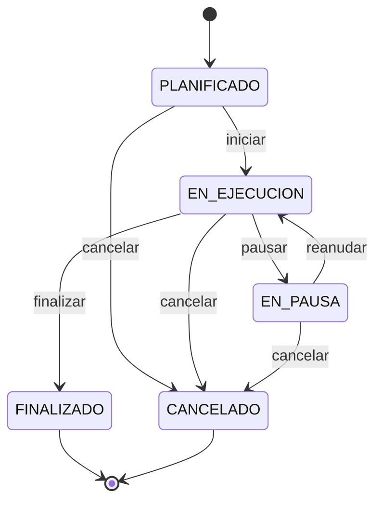

# ETAPA 3 — Diseño de pruebas (EC3)

- **Proyecto:** Gestor de Tareas Personales / `CalebBav234/Hard_Coders_SCRUM_Gestor_de_Tareas_Personales_Release_1`
- **Rama:** `Refactor-E2`
- **HEAD:** `10988a31d81f7596947c93d1e3abc3ddb42028db`
- **Working tree:** no limpio (cambios y artefactos de etapas previas/logs presentes; sin commit/push/merge). Estado registrado para trazabilidad del diseño.
- **Fecha de diseño:** 2026-11-16
- **Rol:** Test Analyst / QA Architect (ISTQB CTFL, caja negra, reglas de negocio)
- **Alcance:** diseño documental (EP, BVA3, transición de estados, tabla de decisión de asignación, CREATE complementarios `app_user`/`task_assignment`, trazabilidad). **No** se modifica código de aplicación, endpoints, migraciones ni UI. **No** se ejecutan pruebas ni se implementan suites automatizadas en esta etapa (E4 backend/integración, E5 E2E, E6 regresión/umbrales).

## 1. Gate de entrada

| Criterio | Evidencia | Estado |
|---|---|---|
| Rama/HEAD/working tree verificados | `git branch --show-current` → `Refactor-E2`; `git rev-parse HEAD` → `10988a31…`; `git status --short --branch` muestra WT sucio. | OK |
| Etapa 1 PASS | `docs/EC3/ETAPA_1_GUIA_PRUEBAS.md` → **Estado: PASS** (EC3-04/02/03/11/12/13, R2, US3.1). | OK |
| Etapa 2 PASS | `docs/EC3/ETAPA_2_GUIA_PRUEBAS.md` → **Estado: PASS** (A6 CREATE `app_user`, BROWSER-01..14 14/14 PASS, contratos heredados preservados). | OK |
| Dependencias | Sin bloqueos; se puede diseñar Etapa 3. | OK |
| Revalidación con HEAD actual | Formularios, DTOs, dominio, políticas, controladores, migraciones V001–V006 y frontend revalidados (secciones 2–8). No se copian matrices previas sin cotejo. | OK |

## 2. Fuentes y revalidación contractual

| Capa | Archivos/elementos clave |
|---|---|
| Migraciones/DB | `database/migrations/V001__initial_schema.sql`, `V004__project_management_model.sql`, `V005__add_sort_order.sql`, `V006__task_assignment_reason.sql` |
| Dominio (modelos/enums) | `domain/model/{Project,ProjectStatus,Stage,Activity,Task,TaskPriority,Subtask,WorkStatus,TaskAssignment,WorkText,PlanRevision,UserAccount}.java` |
| Políticas | `domain/policy/{ProjectAccessPolicy,WbsHierarchyPolicy,AssignmentPolicy,BudgetPolicy,CompletionPolicy}.java` |
| Casos de uso/servicios | `application/usecase/{ProjectCommandService,TaskCommandService,HierarchyCommandService,SubtaskCommandService,AssignmentCommandService,UserCommandService}.java` |
| Web/DTO/controladores | `adapter/in/web/project/{ProjectController,ProjectRequests,ProjectResponses}.java`, `adapter/in/web/task/{HierarchyController,TaskController,SubtaskController,AssignmentController,TaskRequests,HierarchyRequests,TaskResponses}.java`, `adapter/in/web/user/{UserController,UserRequests,UserResponses}.java`, `adapter/in/web/error/GlobalExceptionHandler.java` |
| Frontend (forms/UI reales) | `features/projects/project-form/project-form.{ts,html}`, `features/tasks/wbs/wbs-panel.ts` (etapa/actividad inline), `features/tasks/task-form/task-form.ts`, `features/tasks/task-list/task-list.ts` (subtarea inline/acciones), `features/tasks/assignment-dialog/assignment-dialog.{ts,html}`, `features/users/user-form/user-form.ts` |
| Guías EC3 | `docs/EC3/ANALISIS_EC3.md`, `docs/EC3/DIVISION_TRABAJO_EC3.md`, guías Etapa 1 y 2 |

### 2.1 Inventario de formularios/controles (proceso principal)

Proceso: `Proyecto → Etapa → Actividad → Tarea → Subtarea`.

| Formulario/control | Tipo UI real | Campos visibles (HEAD) | Observación |
|---|---|---|---|
| Proyecto (crear) | Modal `project-form` | nombre, descripción, encargado, presupuesto (Bs), duración estimada (min), motivo plan inicial opcional | Crear: solo Jefe (regla). Editar detalles: nombre/descripción. |
| Proyecto (editar detalles) | Modal `project-form` (modo edición) | nombre, descripción | Sin presupuesto/encargado (flujos separados). |
| Etapa | Inline en `wbs-panel` | nombre, descripción opcional | No modal; padre = proyecto del contexto. |
| Actividad | Inline en `wbs-panel` | nombre, descripción opcional | No modal; padre = etapa. |
| Tarea (padre) | `task-form` | título, duración estimada (h, step 0.25), presupuesto (Bs), prioridad, actividad destino (contexto) | Duración UI en horas → `estimatedDurationMinutes` enteros. Subtarea oculta estos campos. |
| Subtarea | `task-form` con `parentTaskId` / flujo inline lista | título (y descripción según contrato) | V4: sin prioridad, presupuesto, duración, categoría propias. |
| Asignación (`task_assignment`) | `assignment-dialog` | trabajador, motivo opcional | Sobre tarea existente, proyecto del contexto. |
| Usuario (`app_user`, Etapa 2) | `user-form` `/users/new` | correo, nombres, apellidos, contraseña | Solo Jefe; crea no-jefe activo. |

### 2.2 Contratos reales por formulario (revalidación)

| Formulario | Oblig./opc. | Tipo/formato | Longitud/límites | Default/enums | Unicidad/FK/reglas | Validación UI (Angular/HTML) | Validación DTO/Bean | Dominio | DB (SQL) | Divergencias |
|---|---|---|---|---|---|---|---|---|---|---|
| **Proyecto (crear)** | nombre*; descripción opc; encargado*; presupuesto*; duración* (min); motivo opc | nombre/desc/motivo texto; presupuesto decimal; duración entero; manager id | nombre ≤160, no vacío; desc ≤2000; presupuesto ≥0, patrón `^\d{1,13}(\.\d{1,2})?$`, `DECIMAL(15,2)`; duración ≥0 entero (min); motivo ≤300 (UI) | status/flujo según backend; motivo nulo si vacío | manager existente/activo elegible; Jefe crea; plan inicial coherente | `project-form`: required+maxLength+pattern `/\S/` nombre, maxLength desc 2000, managerId≥1, budget min0/pattern, duration min0/`^\d+$`, reason maxLength 300 | `ProjectRequests.Create`: `@NotBlank @Size(160)` name, `@Size(2000)` desc, `@NotNull` managerUserId, `@NotNull @DecimalMin(0) @Digits(13,2)` budgetBob, `@NotNull @Min(0)` duration, `@Size(500)` reason | `BudgetPolicy.validatePositive/Duration`, `WorkText`, `ProjectAccessPolicy.requireChief`, `PlanRevision.REASON_MAX=500` | `project.name varchar(160)` NOT NULL + `ck_project_name` trim; desc 2000; budget `numeric(15,2)` ≥0; duration `integer` ≥0; FKs manager/status/created_by | **Motivo:** UI `maxlength=300`, DTO `@Size(500)`, dominio/plan `PlanRevision.REASON_MAX=500`. HTML nativo limitado por `maxlength`. |
| **Proyecto (editar)** | nombre*, descripción opc | texto | nombre ≤160, desc ≤2000 | n/a | Jefe o Encargado del proyecto (`canEditDetails`) | Solo valida nombre/desc en modo edición | `UpdateDetails`: name/desc + `@NotNull @PositiveOrZero version` | `Project.editDetails`, control de versión (`VersionToken/Precondition`) | mismas columnas + concurrencia por versión/updated_at | Edición no toca plan/encargado en este form (separación correcta). |
| **Etapa (inline)** | nombre*, descripción opc | texto | nombre ≤160; desc ≤2000 | status `PENDIENTE` al crear | Padre = `projectId` del contexto; proyecto abierto; actor con permiso de jerarquía | `wbs-panel`: `newStageName.trim()==''` deshabilita crear; `maxlength` 160/2000; edición requiere nombre no vacío | `HierarchyRequests.CreateStageRequest/UpdateStageRequest`: `@NotBlank @Size(160)` name, `@Size(2000)` desc, update exige `@NotNull @PositiveOrZero version` | `WbsHierarchyPolicy.requireName/Description`, `Stage.create/edit`, mismo proyecto (`requireSameProject`), permisos `canManage` y proyecto abierto | `stage.name varchar(160)` + `ck_stage_name`; desc 2000; FK project/status | Nombre solo espacios: UI trim evita submit, backend/dominio rechazan vacío/trim. |
| **Actividad (inline)** | nombre*, descripción opc | texto | nombre ≤160; desc ≤2000 | `PENDIENTE` | Padre = `stageId` (y etapa del proyecto) | `wbs-panel`: trim+disabled; maxlength 160/2000 | `HierarchyRequests.CreateActivityRequest/UpdateActivityRequest`: igual patrón + versión en update | `Activity.create/edit`, `WbsHierarchyPolicy`, proyecto abierto/mismo proyecto | `activity.name varchar(160)` + `ck_activity_name`; desc 2000; FK stage/status | Igual que etapa. |
| **Tarea** | título*; prioridad* (UI); actividad padre* (contexto); presupuesto opc (default 0); duración opc (h, default 0) | título texto; prioridad enum; presupuesto decimal Bs; duración horas (UI) | título ≤160; presupuesto ≥0, 13 enteros+2 decimales (`DECIMAL(15,2)`); duración UI `step=0.25` h, múltiplo 0.25, conversión `round(h*60)` a minutos enteros, ≤ `MAX_DURATION_MINUTES` (2,147,483,647) | prioridad `MEDIA`; budget 0; duración 0 si vacío; status `PENDIENTE` | FK `activity_id`; proyecto abierto/permiso jerarquía; versión en updates; plan/historial inicial según dominio | `task-form`: título obligatorio; `validateHours()` rechaza <0, no múltiplo de 0.25, exceso max; `validateBudget()` patrón 13,2; requiere `activityId` para tarea padre; submit `type=button` (no depende de validación nativa HTML para bloquear lógica propia) | `TaskRequests.Create/Update`: `@NotBlank @Size(160)` title, `@Size(2000)` desc, prioridad/estado según endpoint, `@NotNull @DecimalMin(0) @Digits(13,2)` allocatedBudgetBob, `@NotNull @Min(0)` estimatedDurationMinutes (en contrato API), versión en update; `PlanChangeRequest` con reason `@NotBlank @Size(500)` | `Task.create/edit/replan`, `BudgetPolicy.validatePositive/Duration`, `WorkText.title/description`, prioridad default `MEDIA` | `task.title varchar(160)` + check trim; desc 2000; `allocated_budget_bob numeric(15,2)` ≥0; `estimated_duration_minutes integer` ≥0; FKs activity/status/priority; `task_plan_history.reason varchar(500)` NOT NULL trim | **Unidad:** UI horas (0.25) vs API/DB minutos enteros (correcto). **No-múltiplo 0.25:** aplicado en handler TS (verificable) además de `step` nativo. |
| **Subtarea** | título*; descripción opc; tarea padre* | texto | título ≤160; desc ≤2000 | status `PENDIENTE` | FK `task_id`; sin presupuesto/duración/prioridad/categoría propias (V4) | `task-form` (parent) solo título/crear/cancelar; validación mínima de título vacío en UI | `TaskRequests.Subtask*` (`SubtaskCreateRequest`, `SubtaskUpdateRequest` con versión): `@NotBlank @Size(160)` title, `@Size(2000)` desc | `Subtask.create/edit`, `WorkText`; ejecución/gestión según `SubtaskCommandService` y asignación de tarea contenedora; cancelación restringida por estado | `subtask.title varchar(160)` + check; desc 2000; FK task/status; sin campos plan | **Importante:** subtarea no tiene campos de duración/presupuesto (no aplicar BVA de tarea). |
| **Asignación (`task_assignment`)** | trabajador*; motivo opc | worker id; motivo texto | motivo ≤500 (UI/DTO/dominio); `reason` DB `varchar(500)` NOT NULL con `ck_task_assignment_reason` trim (V006) | motivo null/vacío/espacios → `DEFAULT_REASON` `"Asignación de Personal"` | tarea existente; actor autorizado (Jefe o Encargado del proyecto, `AssignmentPolicy/WbsHierarchyPolicy`); proyecto abierto; trabajador existente y activo; no autoasignación; no duplicada (PK compuesta task+worker) | `assignment-dialog`: selector trabajador, motivo `maxlength=500`, evita no selección, deshabilita durante guardado, muestra errores backend | `HierarchyRequests.AssignWorkerRequest`: `@NotNull workerUserId`, `@Size(max=500) reason` | `TaskAssignment.normalizeReason` (trim, default, max 500), `AssignmentPolicy.requireCanAssign/requireEligibleWorker/requireNotSelf`, proyecto abierto, tarea/proyecto válidos | V006: `task_assignment.reason varchar(500) NOT NULL DEFAULT 'Asignación de Personal'`, `ck_task_assignment_reason` `char_length(btrim(reason))>=1`; PK `(task_id,worker_user_id)` | `GET /assignments` expone `reason` (puede ser null en filas previas a V006 según restore), nuevas creaciones normalizan en dominio. |
| **Usuario (`app_user`)** | email*, nombres*, apellidos*, contraseña* | email, texto, password | email ≤254, formato email, normalizado trim+lowercase; nombres/apellidos ≤100 no vacíos; contraseña 8–200 (política DTO/UI); **límite efectivo de hash BCrypt: 72 bytes** en implementación actual | `is_chief=false`, `is_active=true` | solo Jefe crea; email único (pre-check + carrera BD); sin campos privilegiados aceptados; hash BCrypt real, nunca expuesto | `user-form`: required/email/maxLength 254, nombres/apellidos required+maxLength 100+pattern `/\S/`, password required min 8 max 200, anti doble envío, reseteo sin retener password | `UserRequests.CreateUserRequest`: `@NotBlank @Email @Size(254)` email, `@NotBlank @Size(100)` given/family, `@NotBlank @Size(8..200)` password | `UserCommandService`: requireChief, normaliza email, valida longitudes/nombres, duplicado (`DuplicateResourceException`), `PasswordHasher`, crea no-jefe activo | `app_user.email varchar(254)` UNIQUE + `ck_app_user_email` lower/trim/formato; `password_hash varchar(255)`; nombres/apellidos `varchar(100)` con checks trim; flags boolean | **Sin endpoint de listado operativo confirmado en esta verificación** (`GET /api/users` no usado como contrato estable aquí); verificación por respuesta create/login/BD. **Divergencia E4 (DIV-E4-01):** `BCryptPasswordEncoder` rechaza >72 bytes → 73 ASCII producen 500 (no 400) pese a cumplir `@Size(max=200)`. |

### 2.3 Mapeo de errores HTTP reales (observado/contractual)

| Situación | HTTP / código típico | Fuente |
|---|---:|---|
| Validación DTO/binding (`@Valid`, parseo, tipo, método handler) | 400 `VALIDATION_ERROR` | `GlobalExceptionHandler` (`MethodArgumentNotValidException`, `HttpMessageNotReadableException`, `MissingServletRequestParameterException`, `MethodArgumentTypeMismatchException`, `HandlerMethodValidationException`) |
| Regla de dominio inválida | 400 `VALIDATION_ERROR` | `DomainValidationException` |
| No encontrado (dominio/JPA) | 404 `*_NOT_FOUND`/`NOT_FOUND` | `NotFoundException`, `EntityNotFoundException` |
| Sin permiso | 403 `FORBIDDEN` | `ForbiddenException`, Spring Security `@PreAuthorize` (según configuración) |
| No autenticado | 401 | Spring Security / filtro JWT |
| Conflicto de estado/transición/negocio/BD | 409 `INVALID_PROJECT_TRANSITION`/`INVALID_STATE_TRANSITION`/`BUDGET_BELOW_ALLOCATIONS`/`DATA_INTEGRITY_VIOLATION`/`TASK_HAS_SUBTASKS` | `ProjectTransitionException`, `InvalidStatusTransitionException`, `BudgetBelowAllocationsException`, `OpenSubtasksException`, `DataIntegrityViolationException` |
| Conflicto de versión/concurrencia | 412 `VERSION_CONFLICT` | `VersionConflictException`, `OptimisticLockException` |
| Recurso duplicado (caso usuario) | 400/409 según mapeo de excepción de aplicación (`DuplicateResourceException` observado como rechazo de duplicado en Etapa 2) | `UserCommandService` + handler de aplicación |

> Nota de diseño: los casos EP/BVA deben indicar el resultado esperado por capa (UI/API/BD) y el código HTTP **cuando el contrato real lo define**; si una variante puede mapear distinto por handler global, se marca “400/409 según mapeo real” y se exige verificación en ejecución futura.

## 3. Diseño EP — Particiones de equivalencia

Convenciones: IDs `EP-<FORM>-<CAMPO>-<nn>`; particiones **no vacías, no solapadas** y con comportamiento esperado homogéneo. Base *Each Choice* por formulario con combinaciones de riesgo añadidas en casos compuestos (sección 9 y tabla de decisión).

### 3.1 Proyecto (crear / editar detalles)

| ID | Formulario | Campo | Partición | Válida/Inválida | Dato representativo | Precondición | Resultado UI | Resultado API/BD | Origen de la regla |
|---|---|---|---|---|---|---|---|---|---|
| EP-PROY-NOM-01 | Proyecto crear/editar | Nombre | Texto no vacío, trim válido, 1–160 chars | Válida | `"Proyecto Alfa"` | Actor autorizado (crear: Jefe) | Acepta/campo válido | 201 (crear) o 200 (editar); persiste `name` trim | `project-form` required/max160/pattern; `ProjectRequests` @NotBlank/@Size(160); `WorkText`/dominio; V004 `ck_project_name` |
| EP-PROY-NOM-02 | Proyecto crear/editar | Nombre | Vacío / solo espacios | Inválida | `""`, `"   "` | Form abierto | Error campo/bloqueo submit (UI) | 400 VALIDATION_ERROR si llega | UI pattern `/\S/`; DTO @NotBlank; dominio; DB check trim |
| EP-PROY-NOM-03 | Proyecto crear/editar | Nombre | Longitud 161+ | Inválida | 161 chars | Form abierto | `maxlength`/error cliente; backend rechaza si forzado | 400 | UI maxLength 160; DTO @Size(160); DB varchar(160) |
| EP-PROY-DESC-01 | Proyecto crear/editar | Descripción | Nula/vacía/solo espacios (opcional) | Válida | `null`, `""` | Actor autorizado | Acepta | Persiste `null`/vacío normalizado según implementación | UI maxLength 2000; DTO @Size(2000); dominio permite nulo |
| EP-PROY-DESC-02 | Proyecto crear/editar | Descripción | Texto 1–2000 chars | Válida | `"Descripción válida"` | Actor autorizado | Acepta | Persiste valor | UI/DTO/DB varchar(2000) |
| EP-PROY-DESC-03 | Proyecto crear/editar | Descripción | 2001+ chars | Inválida | 2001 chars | Form abierto | Limitado por `maxlength`/rechazo | 400 si forzado | UI maxLength 2000; DTO @Size(2000); DB |
| EP-PROY-ENC-01 | Proyecto crear | Encargado | Usuario elegible existente/activo seleccionado (id ≥1) | Válida | manager activo | Jefe autenticado | Acepta | Proyecto creado con `manager_user_id` válido | `project-form` min(1); `ProjectRequests` @NotNull; servicio valida manager; FK `project.manager_user_id` |
| EP-PROY-ENC-02 | Proyecto crear | Encargado | No seleccionado / 0 / nulo | Inválida | `0` | Jefe | Error “elige encargado” | 400 | UI min(1); DTO @NotNull |
| EP-PROY-ENC-03 | Proyecto crear | Encargado | Id inexistente o no elegible | Inválida | id ajeno/inexistente | Jefe, request forzada | No representable en selector normal | 400/404 según regla de servicio | `ProjectCommandService`/lookup manager + FK |
| EP-PROY-PRES-01 | Proyecto crear | Presupuesto (BOB) | 0.00 o positivo, ≤13 enteros y ≤2 decimales | Válida | `0.00`, `1500.50` | Jefe | Acepta/patrón válido | Persiste `numeric(15,2)` | UI pattern/min/step; DTO @DecimalMin(0) @Digits(13,2); `BudgetPolicy.validatePositive`; DB check ≥0 |
| EP-PROY-PRES-02 | Proyecto crear | Presupuesto (BOB) | Negativo | Inválida | `-1.00` | Jefe | Error/HTML min | 400 | UI min 0; DTO @DecimalMin(0); dominio/DB |
| EP-PROY-PRES-03 | Proyecto crear | Presupuesto (BOB) | >2 decimales o >13 dígitos enteros / formato inválido | Inválida | `1.234`, `99999999999999.00` | Jefe | Error patrón cliente | 400 | UI pattern `^\d{1,13}(\.\d{1,2})?$`; DTO @Digits(13,2); `BudgetPolicy` |
| EP-PROY-DUR-01 | Proyecto crear | Duración estimada (min) | Entero ≥0 | Válida | `0`, `480` | Jefe | Acepta | Persiste minutos | UI min 0 step 1 pattern `^\d+$`; DTO @Min(0); `BudgetPolicy.validateDuration`; DB integer ≥0 |
| EP-PROY-DUR-02 | Proyecto crear | Duración estimada (min) | Negativa o no entera | Inválida | `-1`, `1.5` | Jefe | Rechazo cliente | 400 | UI pattern/step/min; DTO @Min(0) |
| EP-PROY-MOT-01 | Proyecto crear | Motivo plan inicial | Nulo/vacío (opcional) | Válida | `null`, `""` | Jefe | Acepta | Se omite/normaliza (según servicio) | UI maxLength 300; DTO @Size(500); dominio plan/revisión |
| EP-PROY-MOT-02 | Proyecto crear | Motivo plan inicial | Texto 1–300 (UI) / 1–500 (contrato backend) | Válida (si respeta límite efectivo) | `"Plan inicial"` | Jefe | Acepta | Persiste motivo en revisión inicial si aplica | UI 300, DTO 500, `PlanRevision.REASON_MAX=500` |
| EP-PROY-MOT-03 | Proyecto crear | Motivo plan inicial | >500 chars (backend) o solo espacios (según regla de plan) | Inválida/condicionada | 501 chars, `"   "` | Jefe | UI limita a 300; forzado backend posible | 400 si supera 500 o inválido por dominio | **Divergencia UI 300 vs DTO/dominio 500**; `requiredReason` rechaza blank cuando se exige |

### 3.2 Etapa (inline WBS)

| ID | Formulario | Campo | Partición | Válida/Inválida | Dato representativo | Precondición | Resultado UI | Resultado API/BD | Origen de la regla |
|---|---|---|---|---|---|---|---|---|---|
| EP-ETA-NOM-01 | Etapa inline | Nombre | 1–160 chars, no solo espacios | Válida | `"Cimentación"` | Proyecto existente/abierto, actor autorizado | Botón crear/guardar habilitado con texto | 201/200, persiste `Stage` PENDIENTE al crear | `wbs-panel` trim/maxlength; `CreateStageRequest` @NotBlank/@Size(160); `WbsHierarchyPolicy.requireName`; V004 `ck_stage_name` |
| EP-ETA-NOM-02 | Etapa inline | Nombre | Vacío/espacios | Inválida | `""`, `"   "` | Form inline abierto | Botón deshabilitado/no submit | 400 si forzado | UI trim; DTO/dominio/DB |
| EP-ETA-NOM-03 | Etapa inline | Nombre | 161+ chars | Inválida | 161 chars | — | `maxlength` evita | 400 si forzado | UI/DTO/DB |
| EP-ETA-DESC-01 | Etapa inline | Descripción | Nula/vacía | Válida | `""` | — | Acepta | Persiste null/normalizada | `requireDescription`; varchar(2000) |
| EP-ETA-DESC-02 | Etapa inline | Descripción | 1–2000 chars | Válida | texto | — | Acepta | Persiste | UI/DTO/DB |
| EP-ETA-DESC-03 | Etapa inline | Descripción | 2001+ chars | Inválida | 2001 chars | — | `maxlength` | 400 si forzado | UI/DTO/DB |
| EP-ETA-CTX-01 | Etapa inline | Contexto/padre | `projectId` válido, accesible y abierto | Válida | proyecto en gestión | Actor Jefe/Encargado del proyecto | Operación disponible | Crea/actualiza en proyecto correcto | `HierarchyController` rutas `/projects/{projectId}/stages`; `WbsHierarchyPolicy.requireCanManage`, `requireOpen`, `requireSameProject` |
| EP-ETA-CTX-02 | Etapa inline | Contexto/padre | Proyecto cerrado / ajeno / no autorizado | Inválida | proyecto FINALIZADO/CANCELADO o ajeno | Sesión válida | Control oculto/denegado o error | 403/404/409 según caso | `WbsHierarchyPolicy`, `ProjectTransitionException`/`ForbiddenException`/`NotFoundException` |

### 3.3 Actividad (inline WBS)

| ID | Formulario | Campo | Partición | Válida/Inválida | Dato representativo | Precondición | Resultado UI | Resultado API/BD | Origen de la regla |
|---|---|---|---|---|---|---|---|---|---|
| EP-ACT-NOM-01 | Actividad inline | Nombre | 1–160 chars válidos | Válida | `"Excavación"` | Etapa del proyecto abierta, actor autorizado | Crear habilitado con nombre | 201/200 | `CreateActivityRequest` @NotBlank/@Size(160); `WbsHierarchyPolicy`; V004 `ck_activity_name` |
| EP-ACT-NOM-02 | Actividad inline | Nombre | Vacío/espacios | Inválida | `"   "` | — | Deshabilitado | 400 si forzado | UI/DTO/dominio/DB |
| EP-ACT-NOM-03 | Actividad inline | Nombre | 161+ chars | Inválida | 161 chars | — | `maxlength` | 400 si forzado | UI/DTO/DB |
| EP-ACT-DESC-01 | Actividad inline | Descripción | Nula/vacía | Válida | `""` | — | Acepta | Persiste null | DTO @Size(2000); dominio |
| EP-ACT-DESC-02 | Actividad inline | Descripción | 1–2000 chars | Válida | texto | — | Acepta | Persiste | UI/DTO/DB |
| EP-ACT-DESC-03 | Actividad inline | Descripción | 2001+ chars | Inválida | 2001 chars | — | `maxlength` | 400 si forzado | UI/DTO/DB |
| EP-ACT-CTX-01 | Actividad inline | Padre/contexto | `stageId` existente en mismo proyecto, proyecto abierto, autorizado | Válida | etapa válida | Actor con gestión | Disponible | Crea bajo etapa correcta | `/stages/{stageId}/activities`, `requireSameProject`, `requireCanManage`, `requireOpen` |
| EP-ACT-CTX-02 | Actividad inline | Padre/contexto | Etapa/proyecto inexistente, ajeno, cerrado o no autorizado | Inválida | stage ajeno/cerrado | — | Error/oculto | 403/404/409 | `WbsHierarchyPolicy`, excepciones dominio |

### 3.4 Tarea

| ID | Formulario | Campo | Partición | Válida/Inválida | Dato representativo | Precondición | Resultado UI | Resultado API/BD | Origen de la regla |
|---|---|---|---|---|---|---|---|---|---|
| EP-TAR-TIT-01 | Tarea | Título | 1–160 chars no vacío | Válida | `"Revisar planos"` | Actividad seleccionada, actor autorizado | Acepta | 201/200, persiste | `task-form` required; `TaskRequests` @NotBlank/@Size(160); `WorkText.title`; V004 `ck_task_title` |
| EP-TAR-TIT-02 | Tarea | Título | Vacío/espacios | Inválida | `""` | — | Error “obligatorio” | 400 | UI/DTO/dominio/DB |
| EP-TAR-TIT-03 | Tarea | Título | 161+ chars | Inválida | 161 chars | — | Rechazo (si input limitado/forzado) | 400 | DTO @Size(160); DB varchar(160) |
| EP-TAR-PRI-01 | Tarea | Prioridad | Valor enum válido `ALTA|MEDIA|BAJA` | Válida | `MEDIA` | Crear tarea padre | Selector válido (default MEDIA) | Persiste prioridad | `task-form` default MEDIA; `TaskPriority`; DTO/servicio |
| EP-TAR-PRI-02 | Tarea | Prioridad | Valor fuera de enum/nulo en contexto que lo exige | Inválida | `"URGENTE"` | Request forzada | No representable en selector normal | 400 | Enum/DTO binding |
| EP-TAR-ACT-01 | Tarea | Actividad padre (contexto) | Actividad válida del proyecto, seleccionada | Válida | `activityId` real | Proyecto/etapa/actividad elegidos | Permite crear | Tarea creada en actividad | `task-form` exige `activityId` para no-subtarea; jerarquía WBS; FK `task.activity_id` |
| EP-TAR-ACT-02 | Tarea | Actividad padre | No seleccionada / inexistente / ajena | Inválida | `null`, id ajeno | — | Mensaje “elige etapa y actividad” | 400/404 | UI guard; `Hierarchy/Task` services + `requireSameProject`/FK |
| EP-TAR-PRES-01 | Tarea | Presupuesto `allocatedBudgetBob` | Vacío/nulo tratado como 0, o valor 0..(13,2) válido | Válida | `null→0`, `0.00`, `250.50` | Tarea padre | Acepta | Persiste `numeric(15,2)` | `task-form.validateBudget` + default 0; `TaskRequests` @DecimalMin(0) @Digits(13,2); `BudgetPolicy`; DB check |
| EP-TAR-PRES-02 | Tarea | Presupuesto | Negativo | Inválida | `-0.01` | — | Error | 400 | UI/min; DTO; dominio; DB |
| EP-TAR-PRES-03 | Tarea | Presupuesto | >2 decimales o excede 13 enteros | Inválida | `1.234`, 14 dígitos enteros | — | Error patrón | 400 | UI patrón; DTO @Digits; `BudgetPolicy` |
| EP-TAR-DUR-01 | Tarea | Duración `estimatedHours` (UI) → minutos | Vacío/nulo = 0, o múltiplo de 0.25 h, conversión `round(h*60)` entero, ≤ `MAX_DURATION_MINUTES` | Válida | `0`, `0.25`, `1.5` | Tarea padre | Acepta; muestra aproximación | Persiste `estimated_duration_minutes` entero | EC3-04: `task-form.validateHours`, step 0.25, `Math.round(hours*60)`; `BudgetPolicy.validateDuration`; DB integer ≥0 |
| EP-TAR-DUR-02 | Tarea | Duración | Negativa o no múltiplo de 0.25 (ej. 0.1, 0.3) | Inválida | `-0.25`, `0.1`, `0.3` | — | Error “incrementos de 0.25 h (15 min)” / negativo | 400 si llega (handler bloquea) | **Regla contractual confirmada en UI handler** (`validateHours`) aunque input sea `type=button`; step nativo no es única defensa |
| EP-TAR-DUR-03 | Tarea | Duración | Excede máximo representable en minutos | Inválida | valor que da `>2147483647` min | — | Error “demasiado grande” | 400 | `MAX_DURATION_MINUTES` en `task-form`; entero DB/Java |
| EP-TAR-SUBCTX-01 | Subtarea (contexto de form tarea) | Campos plan/finanzas | Subtarea no expone prioridad/presupuesto/duración/categoría | Válida (por modelo) | crear con solo título | `parentTaskId` presente | Campos ocultos; envía budget 0, minutes 0 | Subtarea creada sin campos plan propios | `task-form` rama `isSubtask`; modelo V4 subtask |

### 3.5 Subtarea

| ID | Formulario | Campo | Partición | Válida/Inválida | Dato representativo | Precondición | Resultado UI | Resultado API/BD | Origen de la regla |
|---|---|---|---|---|---|---|---|---|---|
| EP-SUB-TIT-01 | Subtarea | Título | 1–160 chars no vacío | Válida | `"Subtarea 1"` | Tarea padre válida/visible, permiso | Acepta | 201/200, persiste | `SubtaskCreate/UpdateRequest` @NotBlank/@Size(160); `WorkText.title`; V004 `ck_subtask_title` |
| EP-SUB-TIT-02 | Subtarea | Título | Vacío/espacios | Inválida | `" "` | — | Error/bloqueo | 400 | UI/DTO/dominio/DB |
| EP-SUB-TIT-03 | Subtarea | Título | 161+ chars | Inválida | 161 chars | — | Rechazo | 400 | DTO/DB |
| EP-SUB-DESC-01 | Subtarea | Descripción | Nula/vacía | Válida | `null` | — | Acepta | Persiste null | `WorkText.description`; DTO @Size(2000) |
| EP-SUB-DESC-02 | Subtarea | Descripción | 1–2000 chars | Válida | texto | — | Acepta | Persiste | DTO/DB |
| EP-SUB-DESC-03 | Subtarea | Descripción | 2001+ chars | Inválida | 2001 chars | — | Rechazo | 400 | DTO/DB |
| EP-SUB-PAD-01 | Subtarea | Tarea padre | Tarea existente en contexto autorizado | Válida | `taskId` válido | Actor autorizado/según política | Crea subtarea vinculada | FK `subtask.task_id` OK | `SubtaskController`/`SubtaskCommandService`, `task-form` parentTaskId |
| EP-SUB-PAD-02 | Subtarea | Tarea padre | Inexistente/ajena/no accesible | Inválida | id inválido | — | Error | 404/403 | Servicios + `NotFound/Forbidden` |
| EP-SUB-NOPLAN-01 | Subtarea | Presupuesto/duración/prioridad | Campos no soportados en V4 | Válida (exclusión) | n/a | — | No se muestran ni envían | Modelo sin columnas de plan/prioridad | V004 `subtask` schema; `task-form` (subtask mode) — **no BVA de estos campos** |

### 3.6 Asignación `task_assignment` (CREATE)

| ID | Formulario | Campo | Partición | Válida/Inválida | Dato representativo | Precondición | Resultado UI | Resultado API/BD | Origen de la regla |
|---|---|---|---|---|---|---|---|---|---|
| EP-ASG-WKR-01 | Asignación | Trabajador | Usuario existente, **activo**, elegible y seleccionable | Válida | worker activo del proyecto | Tarea/proyecto abierto, actor autorizado, no duplicado, no self | Seleccionable y asigna | 200 + asignación persistida | `AssignmentPolicy.requireEligibleWorker`; `wbs.listWorkers`; UI filtra asignados |
| EP-ASG-WKR-02 | Asignación | Trabajador | No seleccionado / nulo | Inválida | `null` | — | Botón deshabilitado | 400 si forzado | `assignment-dialog` guard; `@NotNull workerUserId` |
| EP-ASG-WKR-03 | Asignación | Trabajador | Inexistente | Inválida | id 999999 | — | No disponible normalmente | 400/404 según servicio/repositorio | `TaskAssignment`/lookup usuario |
| EP-ASG-WKR-04 | Asignación | Trabajador | Inactivo | Inválida | usuario `is_active=false` | — | No elegible/visible | 400 (dominio) / rechazo | `AssignmentPolicy.requireEligibleWorker` |
| EP-ASG-ACT-01 | Asignación | Actor | Jefe o Encargado del proyecto (según regla real) | Válida | jefe/encargado | Sesión autenticada | Puede operar | 200 | `AssignmentPolicy.canAssign` → `WbsHierarchyPolicy.canManage`, `ProjectAccessPolicy` |
| EP-ASG-ACT-02 | Asignación | Actor | No autorizado (p.ej. Personal sin permiso de gestión) / no autenticado | Inválida | personal, anónimo | — | UI restringida | 403 / 401 | `AssignmentPolicy.requireCanAssign`, Spring Security |
| EP-ASG-SELF-01 | Asignación | Autoasignación | Worker distinto del actor | Válida | actor≠worker | — | Permitido si demás reglas OK | 200 | `AssignmentPolicy.requireNotSelf` |
| EP-ASG-SELF-02 | Asignación | Autoasignación | Actor intenta asignarse a sí mismo | Inválida | workerId=actorId | — | Puede aparecer opción según lista; backend rechaza | 403 `FORBIDDEN` | `AssignmentPolicy.requireNotSelf` |
| EP-ASG-DUP-01 | Asignación | Duplicidad | No existe asignación previa (task, worker) | Válida | par nuevo | — | Acepta | 200, inserta fila | PK compuesta V004 `(task_id,worker_user_id)` |
| EP-ASG-DUP-02 | Asignación | Duplicidad | Asignación ya existente | Inválida | mismo par | — | Error “ya asignado” (según backend) | 400/409 por integridad/regla | PK compuesta + `DataIntegrityViolationException`/dominio |
| EP-ASG-PROJ-01 | Asignación | Estado proyecto | Proyecto abierto | Válida | `PLANIFICADO/EN_EJECUCION/EN_PAUSA` | — | Permitido | 200 | `WbsHierarchyPolicy.requireOpen` |
| EP-ASG-PROJ-02 | Asignación | Estado proyecto | Proyecto cerrado (`FINALIZADO`/`CANCELADO`) | Inválida | cerrado | — | Rechazado | 409 `INVALID_PROJECT_TRANSITION` o equivalente de dominio | `ProjectTransitionException` vía `requireOpen` |
| EP-ASG-REA-01 | Asignación | `reason` | Nulo/vacío/solo espacios → default | Válida (normalizada) | `null`, `""`, `"   "` | — | Acepta vacío | Persiste `"Asignación de Personal"` | `TaskAssignment.normalizeReason/DEFAULT_REASON`; V006 default/check |
| EP-ASG-REA-02 | Asignación | `reason` | Texto 1–500 chars (trim válido) | Válida | `"Experiencia en obra"` | — | Acepta | Persiste motivo recortado | UI maxlength 500; DTO @Size(500); dominio `REASON_MAX=500`; V006 varchar(500) |
| EP-ASG-REA-03 | Asignación | `reason` | 501+ chars | Inválida | 501 chars | — | `maxlength` evita; forzado rechazado | 400 | UI/DTO/dominio |
| EP-ASG-REL-01 | Asignación | Relaciones | Tarea existente en proyecto válido, worker válido en contexto | Válida | IDs coherentes | — | OK | 200 | FK task/worker, servicios de jerarquía/proyecto |
| EP-ASG-REL-02 | Asignación | Relaciones | Tarea inexistente o relación inválida | Inválida | taskId 999999 | — | Error | 404/400 | `NotFoundException`/validaciones |

### 3.7 Usuario `app_user` (CREATE, Etapa 2)

| ID | Formulario | Campo | Partición | Válida/Inválida | Dato representativo | Precondición | Resultado UI | Resultado API/BD | Origen de la regla |
|---|---|---|---|---|---|---|---|---|---|
| EP-USR-EMA-01 | Usuario crear | Email | Formato válido, ≤254, normalizable (trim+lowercase), único | Válida | `"Ana@Gestor.local "` → `ana@gestor.local` | Sesión Jefe | Acepta | 201, persiste email normalizado | `user-form` email/max254; `UserRequests` @Email/@Size(254); `UserCommandService` normaliza; V004 unique + `ck_app_user_email` |
| EP-USR-EMA-02 | Usuario crear | Email | Vacío o formato inválido | Inválida | `""`, `"bad"` | — | Error campo | 400 | UI/DTO |
| EP-USR-EMA-03 | Usuario crear | Email | Longitud >254 | Inválida | 255 chars válidos en forma | — | `maxlength`/rechazo | 400 | UI/DTO/DB varchar(254) |
| EP-USR-EMA-04 | Usuario crear | Email | Duplicado (exacto o equivalente por normalización/case) | Inválida | email existente | — | Error servidor | 400/409 (duplicado) + sin crear | `UserCommandService` pre-check/carrera; DB UNIQUE/CK |
| EP-USR-GIV-01 | Usuario crear | Nombres (`givenNames`) | 1–100 chars, no solo espacios (tras trim) | Válida | `"Ana María"` | Jefe | Acepta | Persiste trim | UI required/max100/pattern `/\S/`; DTO @NotBlank/@Size(100); dominio; DB `ck_app_user_given_names` |
| EP-USR-GIV-02 | Usuario crear | Nombres | Vacío/espacios | Inválida | `"   "` | — | Error | 400 | UI/DTO/dominio/DB |
| EP-USR-GIV-03 | Usuario crear | Nombres | 101+ chars | Inválida | 101 chars | — | `maxlength` | 400 | UI/DTO/DB |
| EP-USR-FAM-01 | Usuario crear | Apellidos (`familyNames`) | 1–100 chars, no solo espacios | Válida | `"Pérez López"` | Jefe | Acepta | Persiste trim | Igual que nombres |
| EP-USR-FAM-02 | Usuario crear | Apellidos | Vacío/espacios | Inválida | `""` | — | Error | 400 | Igual |
| EP-USR-FAM-03 | Usuario crear | Apellidos | 101+ chars | Inválida | 101 chars | — | `maxlength` | 400 | Igual |
| EP-USR-PWD-01 | Usuario crear | Contraseña | 8–72 bytes efectivos BCrypt (dentro de 8–200 chars política) | Válida | `"ClaveSegura123"` | Jefe | Acepta (campo password) | Hash BCrypt almacenado, nunca devuelto; login OK | UI min8/max200; DTO @Size(8,200); `UserCommandService`; `PasswordHasher`/Spring Security (BCrypt ≤72 bytes) |
| EP-USR-PWD-02 | Usuario crear | Contraseña | <8 chars | Inválida | `"short"` | — | Error | 400 | UI/DTO/dominio |
| EP-USR-PWD-03 | Usuario crear | Contraseña | >200 chars (validación DTO/UI) | Inválida | 201 chars | — | `maxlength` | 400 | UI/DTO |
| EP-USR-PWD-04 | Usuario crear | Contraseña | 73–200 chars ASCII pero >72 bytes (excede límite BCrypt) | Inválida (implementación) | 73 chars ASCII | Jefe, request forzada/API | Puede pasar UI/DTO si ≤200 | **500** observado en E4 (encoder rechaza >72 bytes), sin usuario creado de forma válida | `BCryptPasswordEncoder` (Spring Security, config actual) — divergencia vs política 200 (DIV-E4-01) |
| EP-USR-ROL-01 | Usuario crear | Control privilegiado/actor | Actor Jefe autenticado | Válida | jefe | `/users/new` | Formulario accesible/nav visible | 201; crea `is_chief=false,is_active=true` | `chiefGuard`, `UserCommandService.requireChief`, `@PreAuthorize` en controller |
| EP-USR-ROL-02 | Usuario crear | Control privilegiado/actor | Actor Encargado o Personal | Inválida | encargado/personal | Sesión no jefe | Redirige/oculta nav | 403 | Guard/UI + backend |
| EP-USR-ROL-03 | Usuario crear | Control privilegiado/actor | No autenticado | Inválida | anónimo | — | Redirige a login/protegido | 401 | Spring Security/JWT |
| EP-USR-ROL-04 | Usuario crear | Tampering de privilegios | Intento de enviar `is_chief/is_active` o elevar rol desde cliente | Inválida (ignorada/rechazada) | payload adulterado | Jefe o no jefe | No hay campos en UI | Resultado **no** eleva privilegios: usuario persistido no-jefe/activo; backend no acepta campos privilegiados | `UserController` comentario/contrato; `UserCommandService` fija flags; `UserResponses` sin campos sensibles |

## 4. Diseño BVA3 — Valores límite (tres valores por frontera)

Formato: **n-1 / n / n+1** en la unidad mínima aplicable (enteros: 1; decimales monetarios: 0.01; duración tarea: 0.25 h en UI y 15 min en conversión; texto: caracteres). Solo fronteras **ordenadas y aplicables**. Campos opcionales sin mínimo de negocio: EP, no BVA inventado.

| ID | Formulario | Campo | Tipo/límite (frontera) | Valor inferior | Valor límite | Valor superior | Resultado esperado por valor | Justificación |
|---|---|---|---|---|---|---|---|---|
| BVA3-PROY-NOM-LEN-MIN | Proyecto | Nombre (longitud mínima efectiva) | Texto no vacío, frontera 1 char (trim) | `""` (o 0 chars útil) → Inválido | `"A"` (1) → Válido | `"AB"` (2) → Válido | Rechazo / Acepta / Acepta | `@NotBlank`, `WorkText.title`, `ck_project_name` (trim ≥1) |
| BVA3-PROY-NOM-LEN-MAX | Proyecto | Nombre (longitud máxima) | 160 chars | 159 → Válido | 160 → Válido | 161 → Inválido | Acepta / Acepta / Rechaza (400 o bloqueado UI) | UI maxLength 160; DTO @Size(160); varchar(160) |
| BVA3-PROY-DESC-LEN-MAX | Proyecto | Descripción (máx.) | 2000 chars (opcional) | 1999 → Válido | 2000 → Válido | 2001 → Inválido | Acepta / Acepta / Rechaza | UI/DTO/DB 2000 |
| BVA3-PROY-PRES-MIN | Proyecto | Presupuesto (BOB) | Mínimo 0.00, escala 0.01 | `-0.01` → Inválido | `0.00` → Válido | `0.01` → Válido | Rechaza / Acepta / Acepta | `BudgetPolicy`, DTO @DecimalMin/@Digits, DB ≥0, `numeric(15,2)` |
| BVA3-PROY-PRES-INTMAX | Proyecto | Presupuesto (BOB) | Máx. 13 dígitos enteros (DECIMAL 15,2) | `9,999,999,999,999.99` (13 enteros) → Válido | `9,999,999,999,999.99` límite representativo → Válido | `10,000,000,000,000.00` (14 enteros) → Inválido | Acepta / Acepta / Rechaza | `BudgetPolicy` MAX_INTEGER_DIGITS=13; DTO @Digits(13,2) |
| BVA3-PROY-PRES-SCALE | Proyecto | Presupuesto (BOB) | Precisión 2 decimales | `1.99` → Válido | `1.99` (2 dec) → Válido | `1.999` (3 dec, unidad 0.001) → Inválido | Acepta / Acepta / Rechaza | Patrón UI, @Digits fraction 2, `BudgetPolicy` |
| BVA3-PROY-DUR-MIN | Proyecto | Duración estimada (min) | Entero ≥0 | `-1` → Inválido | `0` → Válido | `1` → Válido | Rechaza / Acepta / Acepta | UI/DTO @Min(0), `BudgetPolicy.validateDuration`, DB integer ≥0 |
| BVA3-PROY-MOT-MAX | Proyecto | Motivo plan inicial | Frontera backend/dominio 500 (divergencia UI 300) | 499 → Válido | 500 → Válido (backend) | 501 → Inválido | Acepta / Acepta / Rechaza 400 | DTO @Size(500), `PlanRevision.REASON_MAX=500`; UI limita 300 (no alcanza 500 nativamente) — **divergencia documentada** |
| BVA3-ETA-NOM-MAX | Etapa | Nombre | 160 chars | 159 → Válido | 160 → Válido | 161 → Inválido | Acepta / Acepta / Rechaza | `WbsHierarchyPolicy.requireName`, DTO, varchar(160) |
| BVA3-ETA-DESC-MAX | Etapa | Descripción | 2000 chars | 1999 → Válido | 2000 → Válido | 2001 → Inválido | Acepta / Acepta / Rechaza | `requireDescription`, DTO, DB |
| BVA3-ACT-NOM-MAX | Actividad | Nombre | 160 chars | 159 → Válido | 160 → Válido | 161 → Inválido | Acepta / Acepta / Rechaza | Igual etapa |
| BVA3-ACT-DESC-MAX | Actividad | Descripción | 2000 chars | 1999 → Válido | 2000 → Válido | 2001 → Inválido | Acepta / Acepta / Rechaza | Igual etapa |
| BVA3-TAR-TIT-MAX | Tarea | Título | 160 chars | 159 → Válido | 160 → Válido | 161 → Inválido | Acepta / Acepta / Rechaza | `WorkText.title`, DTO @Size(160), DB |
| BVA3-TAR-PRES-MIN | Tarea | `allocatedBudgetBob` | Mínimo 0.00, escala 0.01 | `-0.01` → Inválido | `0.00` → Válido | `0.01` → Válido | Rechaza / Acepta / Acepta | `validateBudget`, `BudgetPolicy`, DTO @Digits(13,2) |
| BVA3-TAR-PRES-INTMAX | Tarea | `allocatedBudgetBob` | Máx. 13 dígitos enteros | 13 enteros, 2 dec → Válido | límite 13 enteros → Válido | 14 enteros → Inválido | Acepta / Acepta / Rechaza | DECIMAL(15,2), BudgetPolicy |
| BVA3-TAR-PRES-SCALE | Tarea | `allocatedBudgetBob` | Precisión 2 decimales | 2 dec → Válido | 2 dec (límite) → Válido | 3 dec → Inválido | Acepta / Acepta / Rechaza | Patrón UI, DTO, dominio |
| BVA3-TAR-DUR-MIN | Tarea | Duración estimada (UI horas, step 0.25h = 15 min) | Mínimo 0 | `-0.25 h` → Inválido | `0 h` (0 min) → Válido | `0.25 h` (15 min) → Válido | Rechaza / Acepta / Acepta | `validateHours`, `estimatedMinutes()=round(h*60)`, `BudgetPolicy.validateDuration` |
| BVA3-TAR-DUR-MAX | Tarea | Duración estimada (máx. minutos) | `MAX_DURATION_MINUTES=2,147,483,647` min (≈35,791,394.116… h) | `2,147,483,646 min` → Válido | `2,147,483,647 min` → Válido | `2,147,483,648 min` → Inválido | Acepta / Acepta / Rechaza “demasiado grande” | `task-form` MAX_DURATION_MINUTES, entero Java/DB; conversión horas→min enteros |
| BVA3-ASG-REA-MAX | Asignación | `reason` | 500 chars (trim) | 499 → Válido | 500 → Válido | 501 → Inválido | Acepta / Acepta / Rechaza 400 | UI maxlength 500, DTO @Size(500), `TaskAssignment.REASON_MAX=500`, V006 varchar(500)+check trim |
| BVA3-USR-EMA-MAX | Usuario | Email longitud | 254 chars | 253 → Válido (si formato) | 254 → Válido (si formato) | 255 → Inválido | Acepta / Acepta / Rechaza | UI maxLength 254, DTO @Size(254), DB varchar(254) |
| BVA3-USR-GIV-MAX | Usuario | Nombres | 100 chars | 99 → Válido | 100 → Válido | 101 → Inválido | Acepta / Acepta / Rechaza | UI/DTO @Size(100), DB varchar(100)+check |
| BVA3-USR-FAM-MAX | Usuario | Apellidos | 100 chars | 99 → Válido | 100 → Válido | 101 → Inválido | Acepta / Acepta / Rechaza | Igual nombres |
| BVA3-USR-PWD-MIN | Usuario | Contraseña | Mínimo 8 chars | 7 → Inválido | 8 → Válido | 9 → Válido | Rechaza / Acepta / Acepta | UI minLength 8, DTO @Size(min=8), dominio/servicio |
| BVA3-USR-PWD-MAX | Usuario | Contraseña | Máximo contractual 200 chars (DTO/UI) | 199 → Válido (si ≤72 bytes efectivos) | 200 → Válido contractual / **sujeto a límite BCrypt** | 201 → Inválido | Acepta / Acepta condicional / Rechaza 400 | UI maxLength 200, DTO @Size(max=200) — **DIV-E4-01:** validación de longitud no garantiza hash viable |
| BVA3-USR-PWD-BCRYPT | Usuario | Contraseña (límite efectivo hash) | Frontera BCrypt 72 bytes (ASCII 1 char=1 byte) | 71 bytes → Válido | 72 bytes → Válido | 73 bytes → Inválido (implementación) | Acepta / Acepta / **500 observado (E4)**, sin persistencia válida | `BCryptPasswordEncoder` rechaza >72 bytes; 73 ASCII produjo 500 pese a ≤200 chars; 201 chars → 400 por DTO. Evidencia: `docs/EC3/ETAPA_4_GUIA_PRUEBAS.md` (CA-USR-05). |
| BVA3-SUB-TIT-MAX | Subtarea | Título | 160 chars | 159 → Válido | 160 → Válido | 161 → Inválido | Acepta / Acepta / Rechaza | `Subtask`/`WorkText.title`, DTO @Size(160), DB |
| BVA3-SUB-DESC-MAX | Subtarea | Descripción | 2000 chars | 1999 → Válido | 2000 → Válido | 2001 → Inválido | Acepta / Acepta / Rechaza | DTO @Size(2000), DB |

**Notas BVA3:** (1) `reason` de asignación: null/vacío/espacios se tratan como partición de normalización (EP), no como “mínimo 0 de negocio” inválido. (2) Duración tarea **no** usa contrato histórico en días. (3) Subtarea **sin** BVA de presupuesto/duración (campos inexistentes). (4) Fronteras impuestas en múltiples capas: UI (HTML/Angular), DTO Bean Validation, dominio, DB — divergencias deben detectarse en ejecución (E4/E5). (5) **Contraseña usuario (E4):** `@Size(max=200)` no equivale a aceptabilidad de hash; BCrypt vigente limita a 72 bytes (73 ASCII → 500 observado, DIV-E4-01) — ver `BVA3-USR-PWD-BCRYPT`, `EP-USR-PWD-04` y `ETAPA_4_GUIA_PRUEBAS.md`.

## 5. Transición de estados

### 5.1 Proyecto (contrato verificado)

**Fuente:** `domain/model/ProjectStatus.java`, `Project.changeStatus`, `ProjectController` (PUT status con `version`), `ProjectRequests.ChangeStatusRequest` (`PLANIFICADO|EN_EJECUCION|EN_PAUSA|FINALIZADO|CANCELADO`), `GlobalExceptionHandler` (`INVALID_PROJECT_TRANSITION` → 409, `VERSION_CONFLICT` → 412), `ProjectAccessPolicy.requireChief` para cambio de estado.

**Grafo confirmado:**
- `PLANIFICADO → {EN_EJECUCION, CANCELADO}`
- `EN_EJECUCION → {EN_PAUSA, FINALIZADO, CANCELADO}`
- `EN_PAUSA → {EN_EJECUCION, CANCELADO}`
- `FINALIZADO → ∅` (cerrado)
- `CANCELADO → ∅` (cerrado)

**Matriz de transiciones (proyecto)**

| ID | Estado inicial | Evento/comando | Guarda/actor | Estado final esperado | Válida | Resultado HTTP/dominio | Evidencia persistida |
|---|---|---|---|---|---|---|---|
| ST-PROY-01 | PLANIFICADO | Cambiar estado → EN_EJECUCION | Jefe autenticado, versión válida, proyecto no cerrado | EN_EJECUCION | Sí | 200/éxito (respuesta proyecto actualizado) | `project.project_status_id`/estado actualizado, `updated_at/version` cambia |
| ST-PROY-02 | PLANIFICADO | → CANCELADO | Jefe, versión válida | CANCELADO | Sí | 200 | Estado cerrado persistido |
| ST-PROY-03 | EN_EJECUCION | → EN_PAUSA | Jefe, versión válida | EN_PAUSA | Sí | 200 | Estado actualizado |
| ST-PROY-04 | EN_EJECUCION | → FINALIZADO | Jefe, versión válida | FINALIZADO | Sí | 200 | Estado cerrado |
| ST-PROY-05 | EN_EJECUCION | → CANCELADO | Jefe, versión válida | CANCELADO | Sí | 200 | Estado cerrado |
| ST-PROY-06 | EN_PAUSA | → EN_EJECUCION | Jefe, versión válida | EN_EJECUCION | Sí | 200 | Estado actualizado |
| ST-PROY-07 | EN_PAUSA | → CANCELADO | Jefe, versión válida | CANCELADO | Sí | 200 | Estado cerrado |
| ST-PROY-08 | FINALIZADO | → cualquiera | Jefe | sin cambio | No | 409 `INVALID_PROJECT_TRANSITION` | Sin transición persistida |
| ST-PROY-09 | CANCELADO | → cualquiera | Jefe | sin cambio | No | 409 `INVALID_PROJECT_TRANSITION` | Sin transición |
| ST-PROY-10 | PLANIFICADO | → FINALIZADO / → EN_PAUSA (no permitidas) | Jefe | sin cambio | No | 409 `INVALID_PROJECT_TRANSITION` | Sin transición |
| ST-PROY-11 | EN_EJECUCION | → PLANIFICADO (no permitida) | Jefe | sin cambio | No | 409 `INVALID_PROJECT_TRANSITION` | Sin transición |
| ST-PROY-12 | EN_PAUSA | → PLANIFICADO / → FINALIZADO (no permitidas) | Jefe | sin cambio | No | 409 `INVALID_PROJECT_TRANSITION` | Sin transición |
| ST-PROY-13 | Cualquier abierto | Cambiar estado | Encargado/Personal/no jefe | sin cambio | No | 403 `FORBIDDEN` (o 401 si anónimo) | Sin transición |
| ST-PROY-14 | Cualquier | Cambiar estado con versión desactualizada | Jefe | sin cambio | No | 412 `VERSION_CONFLICT` (`PRECONDITION_FAILED`) | Sin transición (concurrencia) |
| ST-PROY-15 | Cualquier | Estado destino inválido en payload | Jefe | n/a | No | 400 `VALIDATION_ERROR` | Sin transición |

**Secuencias de eventos (alcanzabilidad):**
- A `EN_EJECUCION`: `PLANIFICADO --iniciar--> EN_EJECUCION`
- A `EN_PAUSA`: `PLANIFICADO → EN_EJECUCION → EN_PAUSA`
- A `FINALIZADO`: `PLANIFICADO → EN_EJECUCION → FINALIZADO`
- A `CANCELADO`: desde `PLANIFICADO` directo, o desde `EN_EJECUCION/EN_PAUSA`
- Terminales: `FINALIZADO`, `CANCELADO` sin salidas.

**Guardas/efectos:** solo Jefe cambia estado; proyectos cerrados no admiten cambios de estructura/plan según `WbsHierarchyPolicy.requireOpen` y reglas de dominio (efecto colateral relevante para asignación/jerarquía). Concurrencia por `version`.

**Cobertura (proyecto):**
- **Estados:** 5/5 alcanzables cubiertos como nodos (PLANIFICADO, EN_EJECUCION, EN_PAUSA, FINALIZADO, CANCELADO).
- **Transiciones válidas definidas:** 7/7 cubiertas (ST-PROY-01..07).
- **Transiciones inválidas relevantes:** terminales, saltos no permitidos, actor no autorizado, versión en conflicto, payload inválido (ST-PROY-08..15).

### 5.2 Complemento: ciclo de tarea/subtarea (aporte al flujo principal)

**Fuente:** `WorkStatus` (`PENDIENTE, EN_PROGRESO, COMPLETADA, CANCELADA`), `Task` (`start/pause/complete/reopen/cancel`), `Subtask` (mismo grafo básico), `Task.cancel` lanza `OpenSubtasksException` si hay subtareas abiertas → 409 `TASK_HAS_SUBTASKS`; `TaskController/SubtaskController` + `TaskRequests.StatusRequest`/`TransitionCommand`.

| ID | Entidad | Estado inicial | Evento | Guarda/actor | Estado final | Válida | Resultado | Evidencia |
|---|---|---|---|---|---|---|---|---|
| ST-TAR-01 | Tarea | PENDIENTE | Iniciar | Actor autorizado/asignado según política | EN_PROGRESO | Sí | OK | Historial estado + tracking |
| ST-TAR-02 | Tarea | EN_PROGRESO | Pausar | Autorizado | PENDIENTE | Sí | OK | Actualiza duración/historial |
| ST-TAR-03 | Tarea | EN_PROGRESO | Completar | Autorizado | COMPLETADA | Sí | OK | `completed_at/by`, historial |
| ST-TAR-04 | Tarea | COMPLETADA | Reabrir | Autorizado | EN_PROGRESO | Sí | OK | Limpia completado, historial |
| ST-TAR-05 | Tarea | Abierta (no cancelada), sin subtareas abiertas | Cancelar | Autorizado/gestión según servicio | CANCELADA | Sí | OK/204 según endpoint | Estado cancelado |
| ST-TAR-06 | Tarea | Cualquier estado con subtareas abiertas | Cancelar | — | sin cambio | No | 409 `TASK_HAS_SUBTASKS` | Sin cancelación |
| ST-TAR-07 | Tarea | CANCELADA | Cualquier transición/cancelar | — | sin cambio | No | 409 `INVALID_STATE_TRANSITION` | Sin cambio |
| ST-TAR-08 | Subtarea | PENDIENTE→EN_PROGRESO→COMPLETADA→EN_PROGRESO | Secuencia válida | Personal asignado a tarea contenedora o Jefe (US1.3) | según evento | Sí | OK | Estado subtarea actualizado |
| ST-TAR-09 | Subtarea | No asignado a tarea contenedora (no Jefe) | Ejecutar transición | Actor no asignado | sin cambio | No | 403 `FORBIDDEN` (AC-US3.2-01) | Sin cambio |

> Cobertura complementaria: estados tarea/subtarea cubiertos (PENDIENTE, EN_PROGRESO, COMPLETADA, CANCELADA) y transiciones clave válidas/invalidas, incluyendo restricción de cancelación con subtareas abiertas.

## 6. Tabla de decisión — Flujo de asignación `POST /api/tasks/{taskId}/assignments`

**Flujo real:** `HierarchyController.assign` → `ManageAssignmentsUseCase.assign(AssignWorkerCommand(taskId, workerUserId, reason))` → `AssignmentCommandService` + políticas/dominio/repositorios. Contrato request: `HierarchyRequests.AssignWorkerRequest { workerUserId @NotNull, reason @Size(500) }`. Respuesta éxito: 200 `TaskAssignmentResponse`.

### 6.1 Condiciones y acciones

| Código | Condición | Valores considerados |
|---|---|---|
| C1 | Tarea existe y es resoluble en contexto | Sí / No |
| C2 | Actor autenticado y autorizado a asignar (Jefe o Encargado del proyecto, regla real) | Sí / No |
| C3 | Proyecto de la tarea está abierto | Sí / No |
| C4 | Trabajador existe | Sí / No |
| C5 | Trabajador está activo | Sí / No |
| C6 | No es autoasignación (actor ≠ worker) | Sí (no self) / No (self) |
| C7 | No existe asignación duplicada (task, worker) | Sí (no duplicada) / No (duplicada) |
| C8 | Relaciones tarea/proyecto/usuario válidas y consistentes | Sí / No |

| Código | Acción |
|---|---|
| A1 | Crear asignación, normalizar/persistir `reason`, devolver 200 con `TaskAssignmentResponse` |
| A2 | 401 no autenticado |
| A3 | 403 `FORBIDDEN` (no autorizado o autoasignación) |
| A4 | 404 `*_NOT_FOUND` (tarea/trabajador/contexto inexistente o no visible según política) |
| A5 | 409 `INVALID_PROJECT_TRANSITION`/conflicto por proyecto cerrado (dominio) |
| A6 | 400 `VALIDATION_ERROR` (trabajador inactivo/inválido, datos inválidos) |
| A7 | 400/409 duplicidad/conflicto de integridad (PK compuesta) |

### 6.2 Tabla de decisión (reglas factibles e inviables)

| Condición/acción | R1 Feliz | R2 No auth | R3 Proy. cerrado | R4 Worker inactivo | R5 Autoasignación | R6 Duplicada | R7 Tarea inexistente | R8 Worker inexistente | R9 Relación inconsistente | R10 No autenticado |
|---|---|---|---|---|---|---|---|---|---|---|
| C1 Tarea existe | Sí | Sí | Sí | Sí | Sí | Sí | **No** | Sí | Sí | — |
| C2 Actor autorizado | Sí | **No** | Sí | Sí | Sí | Sí | — | Sí | Sí | — |
| C3 Proyecto abierto | Sí | — | **No** | Sí | Sí | Sí | — | Sí | — | — |
| C4 Trabajador existe | Sí | — | — | Sí | Sí | Sí | — | **No** | Sí | — |
| C5 Trabajador activo | Sí | — | — | **No** | Sí | Sí | — | — | — | — |
| C6 No autoasignación | Sí | — | — | — | **No** | Sí | — | — | — | — |
| C7 No duplicada | Sí | — | — | — | — | **No** | — | — | — | — |
| C8 Relaciones válidas | Sí | — | — | — | — | — | — | — | **No** | — |
| **Autenticado** | Sí | Sí | Sí | Sí | Sí | Sí | Sí | Sí | Sí | **No** |
| **A1 Crear (200, persistir)** | **X** |  |  |  |  |  |  |  |  |  |
| **A2 401** |  |  |  |  |  |  |  |  |  | **X** |
| **A3 403** |  | **X** |  |  | **X** |  |  |  |  |  |
| **A4 404** |  |  |  |  |  |  | **X** | **X** | **X*** |  |
| **A5 409 proyecto cerrado** |  |  | **X** |  |  |  |  |  |  |  |
| **A6 400 inválido/inactivo** |  |  |  | **X** |  |  |  |  |  |  |
| **A7 400/409 duplicada** |  |  |  |  |  | **X** |  |  |  |  |
| **Factibilidad** | Factible | Factible | Factible | Factible | Factible | Factible | Factible | Factible | Factible (según caso) | Factible |

\*R9 puede resolverse como 404/400/403 según si la inconsistencia se detecta como “no encontrado”, validación o falta de visibilidad/autorización en contexto (p.ej. actor no gestor del proyecto de la tarea); se exige confirmar en ejecución (E4/E5). “—” = irrelevante por cortocircuito/precedencia observada; no implica que la condición sea verdadera. **Actualización E4:** observado 403/404/400 sin persistencia (`assignInconsistentRelation`, `ETAPA_4_GUIA_PRUEBAS.md`).

**Combinaciones inviables (no ejercitables como reglas independientes):** “trabajador activo” sin “trabajador existe” (C5 depende de C4); “duplicada” sin tarea/trabajador válidos para el par; evaluar autoasignación/duplicidad cuando tarea no existe carece de sentido funcional. Estas se excluyen de cobertura de reglas y se documentan como N/A por dependencia.

### 6.3 Detalle de reglas (casos de decisión)

| Regla/ID prueba | Datos/precondiciones | Pasos | Outcome esperado | HTTP | Persistencia |
|---|---|---|---|---:|---|
| **DT-ASG-R1** (feliz) | Tarea existente en proyecto abierto; actor Jefe/Encargado autorizado; worker existente, activo, distinto, sin asignación previa; `reason` explícito o null | POST `/api/tasks/{taskId}/assignments` con `workerUserId`, `reason` | Asignación creada, `reason` normalizado (trim o default) | 200 | Fila en `task_assignment` con motivo persistido; GET devuelve asignación coherente |
| **DT-ASG-R2** (no autorizado) | Actor autenticado sin permiso de gestión (p.ej. Personal) | POST asignación sobre tarea válida | Rechazo por autorización | 403 | Sin inserción |
| **DT-ASG-R3** (proyecto cerrado) | Proyecto `FINALIZADO` o `CANCELADO`, tarea válida, actor autorizado, worker válido | POST asignación | Rechazo por proyecto cerrado | 409 | Sin inserción |
| **DT-ASG-R4** (trabajador inactivo) | Worker existente con `is_active=false` | POST asignación | Rechazo por elegibilidad | 400 | Sin inserción |
| **DT-ASG-R5** (autoasignación) | `workerUserId == actor.userId` | POST asignación | Rechazo por autoasignación | 403 | Sin inserción |
| **DT-ASG-R6** (duplicidad) | Par (task, worker) ya asignado | POST misma asignación | Rechazo por duplicado | 400/409 | Sin nueva fila; estado previo intacto |
| **DT-ASG-R7** (tarea inexistente) | `taskId` inexistente | POST | No encontrado | 404 | Sin inserción |
| **DT-ASG-R8** (worker inexistente) | `workerUserId` inexistente | POST | Rechazo/no encontrado o validación | 400/404 | Sin inserción |
| **DT-ASG-R9** (relación inconsistente) | IDs cruzados/no pertenecientes al contexto esperado o actor sin visibilidad/gestión sobre el recurso | POST | Rechazo por inconsistencia/no acceso en contexto | 404/400/403 | Sin inserción |
| **DT-ASG-R10** (no autenticado) | Sin token/sesión | POST | No autenticado | 401 | Sin inserción |

**Cobertura de reglas factibles:** 10 reglas factibles definidas (R1–R10). **Cobertura objetivo de diseño:** 10/10 especificadas con ID, datos, outcome y expectativa de persistencia (**100% de reglas factibles identificadas cubiertas por el diseño**). La **ejecución** se asigna a E4/E5; no se afirma ejecución en Etapa 3.

## 7. Casos CREATE complementarios

### 7.1 `task_assignment` (CREATE)

| ID | Caso | Precondiciones | Pasos | Resultado esperado | Nivel/etapa |
|---|---|---|---|---|---|
| CA-ASG-01 | Crear asignación válida con `reason` explícito | R1 (proyecto abierto, autorizado, worker activo, no dup, no self) | POST con `workerUserId` y `reason` con espacios extremos | 200; `reason` recortado persistido y legible en GET | E4 (app/integración), E5 (UI) |
| CA-ASG-02 | Crear con `reason` null/omitido | R1 | POST sin `reason` o null | 200; persiste `DEFAULT_REASON` “Asignación de Personal” | E4, E5 |
| CA-ASG-03 | Crear con `reason` vacío/solo espacios | R1 | POST `reason=""` o `"   "` | 200; normaliza a default | E4, E5 |
| CA-ASG-04 | Rechazo `reason` > 500 | R1 | POST `reason` 501 chars | 400; sin persistencia | E4, E5 |
| CA-ASG-05 | Rechazo trabajador inactivo | R4 | POST worker inactivo | 400; sin persistencia | E4, E5 |
| CA-ASG-06 | Rechazo autoasignación | R5 | POST con worker=actor | 403; sin persistencia | E4, E5 |
| CA-ASG-07 | Rechazo duplicidad | R6 (asignación previa existente) | POST mismo par | 400/409; sin nueva fila | E4, E5 |
| CA-ASG-08 | Rechazo proyecto cerrado | R3 | POST en FINALIZADO/CANCELADO | 409; sin persistencia | E4, E5 |
| CA-ASG-09 | Rechazo actor no autorizado | R2 | POST como Personal/no gestor | 403; sin persistencia | E4, E5 |
| CA-ASG-10 | Rechazo no autenticado | R10 | POST sin sesión/token | 401; sin persistencia | E4, E5 |
| CA-ASG-11 | Rechazo tarea inexistente | R7 | POST taskId inválido | 404; sin persistencia | E4 |
| CA-ASG-12 | Lectura posterior coherente | CA-ASG-01/02 ejecutados | GET `/api/tasks/{taskId}/assignments` y/o recarga UI | Lista refleja asignaciones y `reason` persistido | E4, E5 |

### 7.2 `app_user` (CREATE)

| ID | Caso | Precondiciones | Pasos | Resultado esperado | Nivel/etapa |
|---|---|---|---|---|---|
| CA-USR-01 | Crear usuario válido (Jefe) | Sesión Jefe, email único, datos válidos | POST `/api/users` con email/nombres/apellidos/password válidos | 201, respuesta sin hash/password, `chief=false,active=true`, email/nombres normalizados | E4, E5 |
| CA-USR-02 | Email normalizado (trim+lowercase) | Jefe | POST email con espacios/mayúsculas | 201; email persistido normalizado; login con email normalizado OK | E4, E5 |
| CA-USR-03 | Duplicidad de email | Usuario existente con mismo email normalizado | POST duplicado | 400/409; sin nuevo usuario; sin fuga de secretos | E4, E5 |
| CA-USR-04 | Validación nombres vacíos/espacios/límites | Jefe | POST nombres o apellidos inválidos | 400; sin persistencia | E4, E5 |
| CA-USR-05 | Validación contraseña (fronteras contrato + BCrypt) | Jefe | POST passwords frontera | 7 y 201 rechazadas 400; 8 aceptada (201); **72 bytes (ASCII) aceptada (201)** y **73 bytes ASCII rechazada por implementación (500 observado, DIV-E4-01)** aunque ≤200 chars; 200 chars solo válida si ≤72 bytes efectivos | E4, E5 |
| CA-USR-06 | Email inválido o >254 | Jefe | POST email mal formado o largo | 400; sin persistencia | E4, E5 |
| CA-USR-07 | Rechazo por rol no Jefe (Encargado/Personal) | Sesión no jefe | POST `/api/users` | 403; sin persistencia | E4, E5 |
| CA-USR-08 | Rechazo no autenticado | Sin sesión | POST `/api/users` | 401; sin persistencia | E4, E5 |
| CA-USR-09 | Protección contra privilegios no autorizados | Jefe intenta payload con `is_chief/is_active` (tampering) o cliente malicioso | POST con campos extra/privilegiados | Campos ignorados/no aceptados; usuario creado/persistido **no jefe, activo** | E4, E5 |
| CA-USR-10 | Persistencia segura y autenticación | CA-USR-01 exitoso | Login `/api/auth/login` con credenciales creadas | Autenticación OK; BD guarda hash BCrypt (no texto plano), flags correctos | E4, E5 |

## 8. Consolidación y trazabilidad (maestra)

| Requisito (EC3) | Caso(s) | Técnica | Formulario/flujo | Ejecución prevista | Etapa responsable |
|---|---|---|---|---|---|
| R-EC3-EP-01 Inventario y EP de formularios principales | EP-PROY-*, EP-ETA-*, EP-ACT-*, EP-TAR-*, EP-SUB-* | EP (Each Choice + riesgo) | Proyecto, Etapa, Actividad, Tarea, Subtarea | Validación de reglas UI/DTO/dominio/DB | E4 (dominio/DTO/servicio), E5 (UI visible), E6 (regresión) |
| R-EC3-EP-02 EP CREATE complementarios | EP-ASG-*, EP-USR-*; CA-ASG-01..12; CA-USR-01..10 | EP + casos de negocio | `task_assignment`, `app_user` | API/integración + UI/navegación | E4, E5, E6 |
| R-EC3-BVA3-01 Límites de longitud y numéricos | BVA3-PROY-*, BVA3-ETA-*, BVA3-ACT-*, BVA3-TAR-*, BVA3-SUB-*, BVA3-ASG-REA-MAX, BVA3-USR-* | BVA3 (n-1,n,n+1) | Todos los formularios aplicables | Pruebas de frontera por capa | E4, E5, E6 |
| R-EC3-BVA3-02 Tarea duración/presupuesto (contrato actual) | BVA3-TAR-DUR-MIN/MAX, BVA3-TAR-PRES-*, EP-TAR-DUR-01..03 | BVA3 + EP | Tarea (horas 0.25h→min enteros, Bs DECIMAL 15,2) | Lógica conversión/validación y UI | E4, E5, E6 |
| R-EC3-ST-01 Transiciones de proyecto | ST-PROY-01..15 | Transición de estados | Proyecto (cambio de estado) | Secuencias, guardas, versión, permisos | E4, E5, E6 |
| R-EC3-ST-02 Ciclo complementario tarea/subtarea | ST-TAR-01..09 | Transición de estados | Tarea/Subtarea | Reglas de ejecución/cancelación | E4, E5, E6 |
| R-EC3-DT-01 Flujo de asignación | DT-ASG-R1..R10 | Tabla de decisión | `POST /api/tasks/{taskId}/assignments` | Caminos feliz y rechazos | E4, E5, E6 |
| R-EC3-SEC-01 Autorización/privilegios usuario y asignación | EP-USR-ROL-*, CA-USR-07..09, DT-ASG-R2/R5/R10, ST-PROY-13 | EP + decisión + seguridad negativa | `app_user`, asignación, proyecto | 401/403 y no elevación de privilegios | E4, E5, E6 |
| R-EC3-DATA-01 Persistencia y contratos visibles | CA-ASG-12, CA-USR-10, ST-PROY evidencias, BROWSER cobertura Etapa 2 (referencia) | Confirmación de estado | BD/API/UI | Lectura posterior, integridad, sin secretos | E4, E5, E6 |
| R-EC3-TRACE-01 Trazabilidad y cobertura documental | Este documento + `ETAPA_3_GUIA_PRUEBAS.md` | Revisión analítica | Todos | Revisión de completitud y viabilidad | E3 (salida), insumo E4–E6 |

## 9. Divergencias y riesgos detectados (diseño y ejecución E4)

| ID | Elemento | Divergencia/riesgo | Impacto en pruebas | Estado (E4) |
|---|---|---|---|---|
| DIV-01 | Proyecto `reason` (crear) | UI `maxlength=300`, DTO `@Size(500)`, dominio/`PlanRevision.REASON_MAX=500` | BVA/EP deben considerar límite efectivo por capa; ejecución debe confirmar comportamiento forzado >300 vía API. | Pendiente verificación específica E4/E5 |
| DIV-02 | Endpoint listado usuarios | `GET /api/users` no establecido como contrato operativo en verificación Etapa 2 (persistencia comprobada por create/login/BD) | Casos CA-USR no deben depender de listado; usar create response, login y BD. | **Confirmado (E4):** CA-USR validados sin listado |
| DIV-03 | HTTP duplicado usuario | Puede mapearse como 400 o 409 según handler específico de `DuplicateResourceException` | Aceptar 400/409 en expectativa documentada hasta confirmar mapeo en E4. | **Confirmado (E4):** 400/409 observado (`CA-USR-03`) |
| DIV-04 | Duplicado asignación | Integridad PK puede reflejarse como 400 o 409 | Esperado 400/409 según implementación real. | **Confirmado (E4):** 400/409 observado (DT-ASG-R6/CA-ASG-07) |
| DIV-05 | Proyecto cerrado en asignación | Excepción de transición de proyecto mapeada a 409 `INVALID_PROJECT_TRANSITION` | Verificar código/mensaje en E4/E5. | **Confirmado (E4):** 409 en FINALIZADO/CANCELADO (DT-ASG-R3/CA-ASG-08) |
| DIV-06 | Tarea duración UI no nativa estricta | Botón `type="button"`: la regla 0.25h depende del handler `validateHours()` (confirmado) y no solo de `step` HTML | Incluir pruebas con 0.1/0.3 enviables desde UI lógica/API. | Pendiente E5 (UI); contrato preservado en regresión FE |
| DIV-E4-01 | Contraseña `app_user` (BCrypt) | Política/DTO/UI permiten 8–200 chars, pero `BCryptPasswordEncoder` (Spring Security, config actual) rechaza **>72 bytes**; 73 ASCII → **500** (no 400) aunque ≤200; 201 → 400 por DTO | `CA-USR-05`/BVA3 ajustados a evidencia real; no se cambia contrato en E4. Riesgo de 500 para entradas válidas por longitud pero >72 bytes. | **Observado en E4** (`passwordBoundaries`, `ETAPA_4_GUIA_PRUEBAS.md`) |
| DIV-E4-02 | DT-ASG-R9 (resolución) | Relación inconsistente/no visible puede resolverse como 403/404/400 según política/visibilidad, sin persistencia | Expectativa aceptada como 403/404/400; confirmar causa exacta si se requiere E5/UI | **Observado en E4** (`assignInconsistentRelation`) |
| DIV-E4-03 | Herramienta frontend CI/local | `ng test --watch=false --browsers=ChromeHeadless` requiere @vitest/browser-* no instalados en este entorno | Validación FE consolidada con `npx vitest run` (297/297) | **Observado en E4** |

## 10. Gate de salida — Etapa 3 (autoevaluación documental)

- [x] Formularios/controles principales inventariados y diseñados: proyecto (crear/editar), etapa inline, actividad inline, tarea, subtarea.
- [x] EP incluye particiones válidas e inválidas de campos relevantes y CREATE complementarios (`app_user`, `task_assignment`).
- [x] BVA3 con tres valores por frontera aplicable, unidades claras y resultados esperados (incl. tarea horas 0.25→min, presupuesto Bs DECIMAL 15,2, `reason` 499/500/501, etc.; sin BVA inventado para subtarea sin plan).
- [x] Reglas/límites trazados a UI/DTO/dominio/DB o contrato (con divergencias registradas).
- [x] Diagrama Mermaid y matriz de estados de proyecto cubren estados alcanzables y transiciones relevantes; complemento tarea/subtarea incluido.
- [x] Tabla de decisión distingue reglas factibles/inviables, incluye camino feliz y rechazos clave (R1–R10) con cobertura de reglas factibles 10/10 diseñada.
- [x] Casos con ID único, precondiciones, pasos/resultado esperado y nivel/etapa; trazabilidad asigna a E4/E5/E6.
- [x] Entregables `ETAPA_3_DISENO_PRUEBAS.md` y `ETAPA_3_GUIA_PRUEBAS.md` generados.
- [x] No se modificó código de aplicación, endpoints, migraciones ni UI; no se afirma ejecución de pruebas automatizadas.

**Conclusión Etapa 3:** Diseño de pruebas **completo y revisable** según alcance definido. **Actualización E4 (2026-11-16):** trazabilidad E4↔E3 cerrada con evidencia en `docs/EC3/ETAPA_4_GUIA_PRUEBAS.md` (DT-ASG-R1..R10, CA-ASG-01..12, CA-USR-01..10, MIG/compat, backend 337/337, frontend 297/297 Vitest) y divergencias ajustadas (DIV-02..05/E4-02 confirmadas, DIV-E4-01/E4-03 registradas). Pendiente E5 (UI/E2E) y E6 (regresión/umbrales/JaCoCo verify sin bajar umbrales).
