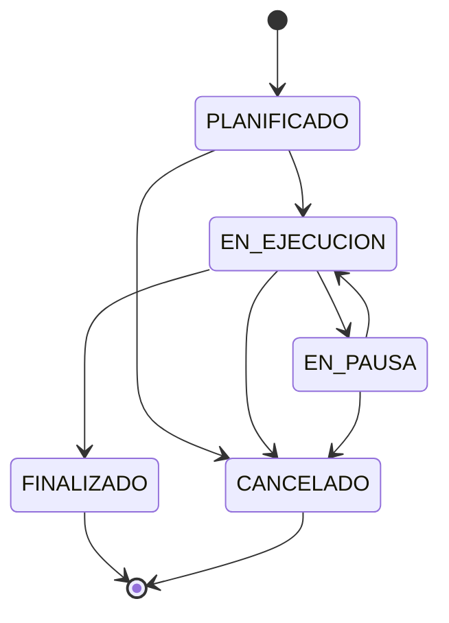

# GUIA MAESTRA — Ejecución y Pruebas EC3

**Proyecto:** Gestor de Tareas Personales / Gestor de Proyectos — Hard Coders (SCRUM Release 1)  
**Repositorio:** `CalebBav234/Hard_Coders_SCRUM_Gestor_de_Tareas_Personales_Release_1`  
**Rama:** `Refactor-E2`  
**Documento:** operativo, exhaustivo y reproducible (no informe académico)  
**Alcance:** ejecución y verificación de EC3 Etapas 1–7 en entorno local controlado  
**Estado de referencia consolidado:** Etapas 1–6 PASS, Etapa 7 base documental generada (pendientes académicos declarados)

> **Regla de oro:** este documento indica *cómo ejecutar y verificar*. Los resultados históricos (E1–E6) se citan solo como referencia trazable; **no** se copian como mediciones nuevas. Toda ejecución actual debe registrarse con fecha, HEAD, entorno, comandos, salida y evidencia.

---

## 1. Propósito, alcance y entregables

### 1.1 Propósito
Guiar al equipo para preparar el entorno, ejecutar verificaciones por etapa (1–7), aplicar técnicas de diseño de pruebas (EP, BVA3, transición de estados, tabla de decisión), correr pruebas automatizadas/integración/E2E, recolectar evidencias y registrar resultados de forma reproducible y auditable.

### 1.2 Alcance funcional
- Proceso principal: `Proyecto → Etapa → Actividad → Tarea → Subtarea`.
- Formularios/controles: proyecto (crear/editar), etapa inline (WBS), actividad inline (WBS), tarea, subtarea, asignación `task_assignment`, creación de usuario `app_user` (Jefe).
- Contratos clave: duración tarea en horas con `step 0.25` → `estimatedDurationMinutes` (min enteros), `allocatedBudgetBob` separado (Bs, DECIMAL 13,2, ≥0), subtareas sin campos de plan V4, `task_assignment.reason` normalizado (default/trim/≤500, V006), US3.1 (“Mis tareas” sin campos plan/finanzas), acceso Jefe-only a creación de usuarios.

### 1.3 Fuera de alcance / exclusiones
- Modificar código fuente, tests, migraciones, dependencias, contratos, endpoints, UI o umbrales (JaCoCo/Vitest) como parte de la ejecución documentada aquí.
- `git commit/push/merge`, instalación innecesaria de Playwright, `docker compose down -v`, borrado de volúmenes o sobrescritura de evidencias históricas.
- Contabilizar `docs/EC3/scripts/e2e_fase1.sh` como Playwright E2E (es API+BD).
- Usar mocks de backend para validar backend; bajar umbrales o hacer exclusiones artificiales; doble conteo de métricas.

### 1.4 Fuentes de verdad y precedencia
1. **Código/config/tests actuales del HEAD** (comportamiento y contratos ejecutables).
2. **Reportes/artefactos generados** (`backend/target/site/jacoco`, `frontend/coverage`, `frontend/playwright-report`, `.last-run.json`).
3. **Guías y diseño EC3** (`docs/EC3/ETAPA_*`, `ETAPA_3_DISENO_PRUEBAS.md`, `FASE1_CORRECCIONES_Y_ENTORNO.md`).
4. **Resultados históricos** (E1–E6) — referencia, no medición nueva.

### 1.5 Entregables y evidencias esperadas
- Registro de ejecución por etapa (fecha, HEAD, entorno, comandos, resultado PASS/FAIL/BLOCKED/SKIPPED/NOT RUN).
- Reportes: JaCoCo, cobertura Vitest, reporte Playwright HTML y `.last-run.json`.
- Evidencias visuales en `docs/EC3/evidencias/{etapa_2,etapa_5,etapa_6}/browser/` (existentes) y nuevas capturas/trazas si se re-ejecuta (sin sobreescribir históricas).
- Plantillas diligenciadas (sección 15).

---

## 2. Restricciones, seguridad y reglas operativas

| Regla | Detalle |
|---|---|
| **Sin secretos** | Nunca registrar contraseñas, tokens, hashes, cookies, `storageState`, ni valores reales de `.env`/credenciales en guías, logs, capturas o commits. Referenciar nombres de variables/perfiles/scripts. |
| **BD y volúmenes** | Prohibido `docker compose down -v` y borrar volúmenes. No `DROP DATABASE` automático en flujos normales. No usar BD compartida/staging/prod para pruebas destructivas. IT debe apuntar a `gestor_tareas_test` (aislada). |
| **No alterar calidad/contratos** | No bajar umbrales, no exclusiones artificiales, no mocks de backend para validar backend, no cambios de migraciones/contratos. |
| **Estados de caso** | Usar solo: `PASS`, `FAIL`, `BLOCKED`, `SKIPPED`, `NOT RUN`. Distinguir *diseño* vs *ejecución* e *histórico* vs *actual*. |
| **Integridad de datos** | Ejecutar scripts E2E API+BD (`e2e_fase1.sh`) solo contra entorno controlado (crea datos en `gestor_tareas`). No limpiar destructivamente datos ajenos. |
| **Usuarios seed** | Existen perfiles seed dev (`jefe`, `encargado1`, `encargado2`, `personal`, `inactivo` en dominio local de desarrollo) definidos en `database/docker/seed-dev-users.sql`; **no reproducir credenciales**. |

---

## 3. Referencias del repositorio (rutas verificadas)

### 3.1 Documentación EC3
- Guías por etapa: `docs/EC3/ETAPA_1_GUIA_PRUEBAS.md` … `docs/EC3/ETAPA_6_GUIA_PRUEBAS.md`
- Diseño: `docs/EC3/ETAPA_3_DISENO_PRUEBAS.md`, `docs/EC3/ETAPA_3_GUIA_PRUEBAS.md`
- Consolidación: `docs/EC3/BASE_DOCUMENTAL_INFORME_EC3.md`, `docs/EC3/FASE1_CORRECCIONES_Y_ENTORNO.md`, `docs/EC3/ANALISIS_EC3.md`, `docs/EC3/DIVISION_TRABAJO_EC3.md`
- Script API+BD (no PW): `docs/EC3/scripts/e2e_fase1.sh`
- Evidencias: `docs/EC3/evidencias/etapa_2/browser/*`, `docs/EC3/evidencias/etapa_5/{EVIDENCIA_EJECUCION.md,browser/E5-01..E5-10.png}`, `docs/EC3/evidencias/etapa_6/{EVIDENCIA_EJECUCION.md,browser/E6-01..E6-10.png}`

### 3.2 Base de datos
- Compose: `docker-compose.yml` (servicio `db`, imagen `postgres:18`, puerto `5432`, contenedor `gestor-tareas-db`)
- Bootstrap: `database/docker/init-dev-db.sql`, seed: `database/docker/seed-dev-users.sql`
- Migraciones: `database/migrations/V001__initial_schema.sql` … `V006__task_assignment_reason.sql`
- Scripts/soporte: `database/scripts/{migrate.ps1,setup-local.ps1,verify-local.ps1,verify_schema.sql}`, `database/README.md`

### 3.3 Backend
- Build/config: `backend/pom.xml`, `backend/src/main/resources/application.yml`
- IT PostgreSQL aislada: `backend/src/test/java/com/hardcoders/taskmanager/integration/PostgresIntegrationTest.java` (usa `gestor_tareas_test`, `ddl-auto: validate`, limpieza `@BeforeEach`)
- Suites: `backend/src/test/java/com/hardcoders/taskmanager/**`

### 3.4 Frontend
- Config: `frontend/package.json`, `frontend/package-lock.json`, `frontend/angular.json`, `frontend/proxy.conf.json`, `frontend/vitest.config.ts`, `frontend/playwright.config.ts`
- E2E specs (Playwright): `frontend/e2e/auth/auth.spec.ts`, `frontend/e2e/tasks/main-flow.spec.ts`, `frontend/e2e/tasks/validations.spec.ts`, `frontend/e2e/users/user-create.spec.ts`, `frontend/e2e/fixtures/helpers.ts`
- Reportes: `frontend/playwright-report/`, `frontend/test-results/.last-run.json`, `frontend/coverage/`

### 3.5 Documentación operativa general
- `README.md`, `TESTING_GUIDE.md`, `.env.example` (plantilla sin secretos reales)

---

## 4. Entorno de referencia y prerrequisitos

### 4.1 Matriz de entorno (referencia verificada en guías/reportes)
| Componente | Referencia | Observación |
|---|---|---|
| SO / shells | Windows 11, PowerShell; Bash disponible para scripts puntuales | Incluir comandos PS y Bash cuando aplique |
| Docker | 28.4.0 | `gestor-tareas-db` (postgres:18), healthy en `:5432` |
| Java / Maven | JDK 21.0.12.1, Maven 3.9.16 | `backend/pom.xml` target Java 21, Spring Boot 4.1.0 |
| Node / npm | Node v24.15.0, npm 11.12.1 | `package.json` declara `packageManager: npm@10.7.0` (registrar divergencia si existe) |
| Frontend stack | Angular 22.1.x, TypeScript ~6.0.2, Vitest 4.1.12, Playwright 1.58.2 (Chromium) | `@angular/build:unit-test` para Vitest con builder Angular |
| Backend stack | Spring Boot 4.1.0, JaCoCo 0.8.15, JUnit/Spring Test | `mvn verify` ejecuta tests + check cobertura |
| PostgreSQL | 18, esquema `task_manager` | Migraciones V001–V006 |
| URLs | Backend `http://localhost:8081`, Frontend `http://localhost:4200` | Proxy `/api -> http://localhost:8081` (`frontend/proxy.conf.json`) |

### 4.2 Prerrequisitos previos a ejecutar
1. Repositorio en `Refactor-E2`, working tree conocido (registrar `git status/HEAD`).
2. Docker daemon activo y contenedor `gestor-tareas-db` healthy (sin recrear volúmenes).
3. Variables de entorno configuradas localmente según `.env.example`/`application.yml` **sin exponer valores**.
4. Dependencias instaladas si se va a ejecutar frontend (`frontend/node_modules` presente); **no** reinstalar Playwright innecesariamente.
5. BD de pruebas de integración `gestor_tareas_test` disponible y con V001–V006 cuando se corran IT backend.

### 4.3 Verificación rápida del estado (sin secretos)

**PowerShell**
```powershell
git branch --show-current
git rev-parse HEAD
git status --short --branch
docker ps --filter "name=gestor-tareas-db"
docker inspect --format "{{.State.Health.Status}}" gestor-tareas-db 2>$null
```

**Bash**
```bash
git branch --show-current
git rev-parse HEAD
git status --short --branch
docker ps --filter "name=gestor-tareas-db"
docker inspect --format '{{.State.Health.Status}}' gestor-tareas-db 2>/dev/null || true
```

---

## 5. Base de datos: preparación, migraciones y reglas

### 5.1 Topología y roles (referencia)
- **DB dev:** `gestor_tareas` (esquema `task_manager`), owner `gestor_tareas_owner`, app `gestor_tareas_app`.
- **DB IT aislada:** `gestor_tareas_test` (obligatoria para `PostgresIntegrationTest`), acceso según configuración de test; limpieza `@BeforeEach`, nunca dev/compartida/staging/prod.
- **Bootstrap/migraciones:** `database/docker/init-dev-db.sql` (aplica y registra V001–V006 en entorno fresh del contenedor), migraciones en `database/migrations/`.

### 5.2 Inicialización y verificación (entorno desechable/controlado)
> Usar solo cuando se disponga de un volumen/entorno dedicado y autorizado. **No ejecutar** `docker compose down -v` sobre datos que deban preservarse.

**PowerShell (arranque contenedor existente / compose)**
```powershell
docker compose up -d db
docker compose exec db pg_isready -U postgres
```

**Bash**
```bash
docker compose up -d db
docker compose exec db pg_isready -U postgres
```

**Aplicar/verificar scripts (según disponibilidad local, sin secretos en comandos versionados):**
- PowerShell: `.\database\scripts\setup-local.ps1`, `.\database\scripts\verify-local.ps1`, `.\database\scripts\migrate.ps1`
- Verificación SQL: `database/scripts/verify_schema.sql` (ejecutar vía `psql` en contenedor/cliente autorizado).

### 5.3 Migraciones V001–V006 (contenido clave)
| Versión | Propósito |
|---|---|
| V001 | Esquema inicial `task_manager` (modelo base), constraints/triggers |
| V002 | Vistas y permisos mínimos para app |
| V003 | Vista archivo/histórico de tareas |
| V004 | Modelo jerárquico proyectos (project→stage→activity→task→subtask), catálogos, `app_user`, `task_assignment` (PK compuesta), historiales, reglas financieras/duración, migración legacy |
| V005 | `sort_order` en `stage/activity/task` + índices (reordenamiento) |
| V006 | `task_assignment.reason varchar(500) NULL` + check (NULL o trim no vacío) |

### 5.4 Datos de prueba
- Seed dev: `database/docker/seed-dev-users.sql` (perfiles de rol; credenciales **no** documentadas).
- `docs/EC3/scripts/e2e_fase1.sh`: crea datos de prueba en `gestor_tareas` vía API+BD; ejecutar solo en entorno controlado y registrar IDs generados en evidencia interna (sin secretos).

---

## 6. Arranque de servicios y precondiciones de ejecución

### 6.1 Backend (puerto 8081)
Config real: `backend/src/main/resources/application.yml` (`server.port: 8081`, `spring.jpa.hibernate.ddl-auto: validate`, schema `task_manager`).

**PowerShell**
```powershell
cd backend
# Configurar variables SPRING_DATASOURCE_* / APP_JWT_SECRET en la sesión local (ver .env.example), sin mostrarlas
mvn spring-boot:run
```

**Bash**
```bash
cd backend
# export SPRING_DATASOURCE_* / APP_JWT_SECRET en entorno local (ver .env.example), sin mostrarlos
mvn spring-boot:run
```

**Criterio de listo:** log de arranque exitoso, aplicación accesible en `http://localhost:8081`, sin errores de validación de esquema.

### 6.2 Frontend (puerto 4200)
Proxy: `frontend/proxy.conf.json` (`/api -> http://localhost:8081`).

**PowerShell**
```powershell
cd frontend
npm start
# alternativa: npx ng serve
```

**Bash**
```bash
cd frontend
npm start
# alternativa: npx ng serve
```

### 6.3 Playwright (reutilizar instalación existente)
No instalar de nuevo salvo necesidad justificada. Navegadores en caché local de usuario (Chromium/headless shell según entorno).

**PowerShell / Bash**
```powershell
cd frontend
npx --no-install playwright test --project=chromium --reporter=list
```
```bash
cd frontend
npx --no-install playwright test --project=chromium --reporter=list
```

---

## 7. Comandos de verificación por tipo de prueba

> Registrar siempre: fecha/hora, HEAD, comando exacto, código de salida, resumen (tests run/pass/fail/skip), rutas de reportes. **No** pegar secretos.

| Objetivo | PowerShell | Bash | Reporte/artefacto |
|---|---|---|---|
| Backend unit/suites (Surefire) | `cd backend; mvn -q test` | `cd backend && mvn -q test` | `backend/target/surefire-reports/` |
| Backend gate cobertura (JaCoCo + verify) | `cd backend; mvn verify` | `cd backend && mvn verify` | `backend/target/site/jacoco/{index.html,jacoco.csv,jacoco.xml}` |
| IT aislada específica | `cd backend; mvn -q "-Dtest=PostgresIntegrationTest" -DfailIfNoTests=false test` | `cd backend && mvn -q -Dtest=PostgresIntegrationTest -DfailIfNoTests=false test` | Surefire reports |
| Frontend Vitest (builder Angular, recomendado) | `cd frontend; npx --no-install ng test --watch=false` | `cd frontend && npx --no-install ng test --watch=false` | Consola; cobertura si se añade `--coverage` |
| Frontend Vitest + cobertura (thresholds) | `cd frontend; npx --no-install ng test --watch=false --coverage` | `cd frontend && npx --no-install ng test --watch=false --coverage` | `frontend/coverage/` |
| Frontend build | `cd frontend; npx --no-install ng build` / `npm run build` | `cd frontend && npx --no-install ng build` / `npm run build` | `frontend/dist/` |
| Typecheck specs (si aplica) | `cd frontend; npx tsc -p tsconfig.spec.json --noEmit` | `cd frontend && npx tsc -p tsconfig.spec.json --noEmit` | Exit code |
| Playwright E2E (Chromium) | `cd frontend; npx --no-install playwright test --project=chromium --reporter=line` | `cd frontend && npx --no-install playwright test --project=chromium --reporter=line` | `frontend/playwright-report/`, `frontend/test-results/` |
| Playwright con HTML report | `cd frontend; npx --no-install playwright test --project=chromium --reporter=line,html` | `cd frontend && npx --no-install playwright test --project=chromium --reporter=line,html` | `frontend/playwright-report/index.html` |
| Playwright UI/report viewer | `npm run test:e2e:ui` / `npm run test:e2e:report` | `npm run test:e2e:ui` / `npm run test:e2e:report` | Interactivo/local |
| E2E API+BD (no Playwright) | `bash docs/EC3/scripts/e2e_fase1.sh` (requiere bash, backend `:8081`, BD dev) | `bash docs/EC3/scripts/e2e_fase1.sh` | Consola (crea datos controlados) |

**Notas:**
- Umbrales backend (`backend/pom.xml`): JaCoCo LINE/BRANCH ≥ 0.85 en `verify`.
- Umbrales frontend (`frontend/vitest.config.ts`): lines/branches/functions/statements ≥ 85.
- `ng test` puede requerir entorno/builder Angular; preferir comandos documentados y verificar que thresholds se evalúan cuando se use `--coverage` según configuración vigente.

---

## 8. Ejecución por etapas (procedimiento, precondiciones, esperados, evidencias)

### Etapa 1 — Correcciones, contratos y entorno (verificación)
- **Objetivo:** confirmar EC3-04 (duración 0.25 h→min, presupuesto separado), EC3-02/03 (`reason` V006), EC3-11/12/13 (bootstrap V001–V006, deps Angular, specs), R2 y US3.1; backend `ddl-auto: validate`.
- **Precondiciones:** BD con V001–V006, backend/frontend configurados, sin `down -v`.
- **Procedimiento:** inspección de código/config + suites backend/frontend + smoke arranque + (opcional controlado) `e2e_fase1.sh`.
- **Resultado esperado (referencia histórica):** backend 328/328 PASS, frontend 297/297 PASS (post-fix), API+BD 21/21 funcionales; gate cobertura global diferido a E6.
- **Estado histórico:** **PASS**. **Evidencia:** `docs/EC3/ETAPA_1_GUIA_PRUEBAS.md`, `docs/EC3/FASE1_CORRECCIONES_Y_ENTORNO.md`.

### Etapa 2 — Formularios y funcionalidades complementarias (A6, BROWSER-01..14)
- **Objetivo:** CREATE `app_user` (Jefe-only, seguro, sin secretos en respuesta), flujos complementarios `task_assignment` y etapa/actividad inline WBS.
- **Precondiciones:** E1 PASS; servicios activos; cuentas seed disponibles (sin exponer credenciales).
- **Procedimiento:** verificación API/UI/BD; escenarios BROWSER-01..14 (navegador real/Playwright MCP o equivalente documentado).
- **Resultado esperado:** 401/403/201 según rol, usuario creado no-jefe/activo, hash no expuesto, login OK, asignación motivo explícito/default y rechazos, WBS inline crea/valida.
- **Estado histórico:** **PASS (14/14 BROWSER)**. **Evidencia:** `docs/EC3/ETAPA_2_GUIA_PRUEBAS.md`, `docs/EC3/evidencias/etapa_2/browser/*`.

### Etapa 3 — Diseño de pruebas (EP, BVA3, estados, decisión)
- **Objetivo:** revisar/completar matrices EP, BVA3, transición de estados, tabla de decisión asignación, CA-ASG/CA-USR y trazabilidad.
- **Precondiciones:** E1–E2 PASS; acceso a código/contratos actuales.
- **Procedimiento:** cotejo contra UI/DTO/dominio/DB; documentar divergencias (DIV-01, DIV-E4-01..03).
- **Resultado esperado:** diseño completo y trazable (sin afirmar ejecución no realizada).
- **Estado histórico:** **PASS (diseño)**. **Evidencia:** `docs/EC3/ETAPA_3_DISENO_PRUEBAS.md`, `docs/EC3/ETAPA_3_GUIA_PRUEBAS.md`.

### Etapa 4 — Pruebas unitarias e integración (PostgreSQL aislada)
- **Objetivo:** ejecutar IT real `PostgresIntegrationTest` en `gestor_tareas_test` (V001–V006, `validate`), cubrir DT-ASG-R1..R10, CA-ASG-01..12, CA-USR-01..10, MIG/compat; consolidar suites BE/FE.
- **Precondiciones:** `gestor_tareas_test` disponible/alineada; variables test configuradas localmente.
- **Comandos clave:** `mvn -Dtest=PostgresIntegrationTest -DfailIfNoTests=false test`, `mvn test`, `npx --no-install ng test --watch=false` (o Vitest equivalente documentado).
- **Resultado esperado (histórico):** IT 25/25, backend 337/337, frontend 297/297 PASS.
- **Estado histórico:** **PASS**. **Evidencia:** `docs/EC3/ETAPA_4_GUIA_PRUEBAS.md`.

### Etapa 5 — Automatización E2E (Playwright)
- **Objetivo:** ejecutar suite Playwright real (Chromium) contra `:4200/:8081/:5432` con datos únicos y sin secretos.
- **Precondiciones:** servicios activos, DB dev disponible, instalación Playwright/navegador ya presente.
- **Suites (14 tests):** `auth/auth.spec.ts` (6), `tasks/main-flow.spec.ts` (1), `tasks/validations.spec.ts` (3), `users/user-create.spec.ts` (4).
- **Resultado esperado (histórico):** 14/14 PASS.
- **Estado histórico:** **PASS**. **Evidencia:** `docs/EC3/ETAPA_5_GUIA_PRUEBAS.md`, `docs/EC3/evidencias/etapa_5/EVIDENCIA_EJECUCION.md`, `frontend/playwright-report/`, `frontend/test-results/.last-run.json`, capturas `docs/EC3/evidencias/etapa_5/browser/E5-01..E5-10.png`.

### Etapa 6 — Cobertura y regresión R1–R9
- **Objetivo:** cumplir gates de cobertura (BE JaCoCo LINE/BRANCH ≥85%, FE thresholds ≥85%) y validar R1–R9.
- **Precondiciones:** servicios/DB operativos; artefactos previos no sobreescritos sin respaldo.
- **Comandos clave:** `mvn verify`, `npx --no-install ng test --watch=false --coverage`, `npx --no-install playwright test --project=chromium --reporter=line`.
- **Resultado esperado (histórico):** `mvn verify` BUILD SUCCESS (376 tests, BRANCH 85.01%, LINE 94.93%), FE 303 tests (Stmts 92.67%, Branch 87.99%, Funcs 86.45%, Lines 93.60%), Playwright 14/14 PASS, R1–R9 PASS.
- **Estado histórico:** **PASS**. **Evidencia:** `docs/EC3/ETAPA_6_GUIA_PRUEBAS.md`, `docs/EC3/evidencias/etapa_6/EVIDENCIA_EJECUCION.md`, `backend/target/site/jacoco/*`, `frontend/coverage/*`, capturas `docs/EC3/evidencias/etapa_6/browser/E6-01..E6-10.png`.

### Etapa 7 — Consolidación documental y expediente
- **Objetivo:** consolidar evidencia verificable E1–E6 en base documental (ANEXO 1), declarar pendientes y mantener trazabilidad.
- **Precondiciones:** E1–E6 PASS y evidencias disponibles.
- **Procedimiento:** contrastar guías/reportes/artefactos/código; no alterar código ni inventar datos; marcar `[PENDIENTE DE COMPLETAR]`, `NO DISPONIBLE`, `BLOCKED/FAIL` según corresponda.
- **Estado histórico:** **INCOMPLETO** (base documental creada; pendientes académicos y algunos ítems de evidencia/trazabilidad). **Evidencia:** `docs/EC3/BASE_DOCUMENTAL_INFORME_EC3.md`, esta guía maestra.

---

## 9. Diseño de pruebas y catálogos (EP, BVA3, estados, decisión, CREATE)

> **Diseño (E3):** especificado y trazado en `docs/EC3/ETAPA_3_DISENO_PRUEBAS.md`. **Ejecución:** parcial/cubierta según E4–E6; cuando no haya traza 1:1 por ID, registrar `NOT RUN` o `NO DISPONIBLE/PARCIAL`.

### 9.1 Partición de equivalencia (EP) — resumen por formulario
| Formulario | Campos/particiones clave | IDs representativos |
|---|---|---|
| Proyecto (crear/editar) | nombre, descripción, encargado, presupuesto, duración min, motivo | `EP-PROY-NOM-*`, `EP-PROY-DESC-*`, `EP-PROY-ENC-*`, `EP-PROY-PRES-*`, `EP-PROY-DUR-*`, `EP-PROY-MOT-*` |
| Etapa inline (WBS) | nombre, descripción, contexto/padre | `EP-ETA-NOM-*`, `EP-ETA-DESC-*`, `EP-ETA-CTX-*` |
| Actividad inline (WBS) | nombre, descripción, contexto/padre | `EP-ACT-NOM-*`, `EP-ACT-DESC-*`, `EP-ACT-CTX-*` |
| Tarea | título, prioridad, actividad padre, presupuesto Bs, duración h→min | `EP-TAR-TIT-*`, `EP-TAR-PRI-*`, `EP-TAR-ACT-*`, `EP-TAR-PRES-*`, `EP-TAR-DUR-*` |
| Subtarea | título, descripción, tarea padre; sin plan propio | `EP-SUB-TIT-*`, `EP-SUB-DESC-*`, `EP-SUB-PAD-*`, `EP-SUB-NOPLAN-01` |
| Asignación (`task_assignment`) | trabajador, actor, self, duplicidad, proyecto, motivo, relaciones | `EP-ASG-WKR-*`, `EP-ASG-ACT-*`, `EP-ASG-SELF-*`, `EP-ASG-DUP-*`, `EP-ASG-PROJ-*`, `EP-ASG-REA-*`, `EP-ASG-REL-*` |
| Usuario (`app_user`) | email, nombres, apellidos, contraseña, rol/tampering | `EP-USR-EMA-*`, `EP-USR-GIV-*`, `EP-USR-FAM-*`, `EP-USR-PWD-*`, `EP-USR-ROL-*` |

### 9.2 BVA3 (n-1, n, n+1) — fronteras principales
| ID | Campo/frontera | Inferior / Límite / Superior (esperado) |
|---|---|---|
| `BVA3-PROY-NOM-LEN-MIN` | Nombre proyecto min efectivo | 0 útil inválido / 1 válido / 2 válido |
| `BVA3-PROY-NOM-LEN-MAX` | Nombre proyecto máx | 159 / 160 / 161 |
| `BVA3-PROY-DESC-LEN-MAX` | Descripción proyecto | 1999 / 2000 / 2001 |
| `BVA3-PROY-PRES-MIN` | Presupuesto BOB mín | -0.01 / 0.00 / 0.01 |
| `BVA3-PROY-PRES-SCALE` | Precisión 2 dec | 1.99 / 1.99 / 1.999 (inválido) |
| `BVA3-PROY-DUR-MIN` | Duración proyecto (min) | -1 / 0 / 1 |
| `BVA3-TAR-TIT-MAX` | Título tarea | 159 / 160 / 161 |
| `BVA3-TAR-PRES-MIN` | Presupuesto tarea | -0.01 / 0.00 / 0.01 |
| `BVA3-TAR-DUR-MIN` | Duración tarea (0.25 h) | -0.25 h / 0 h / 0.25 h |
| `BVA3-TAR-DUR-MAX` | Duración máx minutos | 2,147,483,646 / 2,147,483,647 / 2,147,483,648 |
| `BVA3-ASG-REA-MAX` | Motivo asignación | 499 / 500 / 501 |
| `BVA3-USR-EMA-MAX` | Email usuario | 253 / 254 / 255 |
| `BVA3-USR-GIV-MAX` / `BVA3-USR-FAM-MAX` | Nombres/apellidos | 99 / 100 / 101 |
| `BVA3-USR-PWD-MIN` | Contraseña mín | 7 / 8 / 9 |
| `BVA3-USR-PWD-MAX` | Contraseña máx contractual | 199 / 200 (cond.) / 201 |
| `BVA3-USR-PWD-BCRYPT` | Límite efectivo BCrypt | 71 bytes / 72 bytes / 73 bytes (400 tras FIX-01; antes 500, DIV-E4-01) |
| `BVA3-SUB-TIT-MAX` | Título subtarea | 159 / 160 / 161 |

### 9.3 Transición de estados

**Proyecto (5 estados, 7 transiciones válidas):**


| Grupo | IDs | Cobertura ejecución trazada |
|---|---|---|
| Válidas proyecto | `ST-PROY-01..07` | **NO DISPONIBLE/PARCIAL** (diseño E3) |
| Inválidas/restricciones proyecto | `ST-PROY-08..15` | **NO DISPONIBLE/PARCIAL** |
| Complemento tarea/subtarea | `ST-TAR-01..09` | **PARCIAL** (R9/dominio y regresión indirecta) |

### 9.4 Tabla de decisión — asignación (`POST /api/tasks/{taskId}/assignments`)
| Regla | Condición principal | HTTP esperado | Persistencia | Ejecución (E4) |
|---|---|---:|---|---|
| `DT-ASG-R1` | Camino feliz autorizado/proyecto abierto/worker activo/no self/no dup | 200 | Sí | PASS |
| `DT-ASG-R2` | Actor no autorizado | 403 | No | PASS |
| `DT-ASG-R3` | Proyecto FINALIZADO/CANCELADO | 409 | No | PASS |
| `DT-ASG-R4` | Trabajador inactivo | 400 | No | PASS |
| `DT-ASG-R5` | Autoasignación | 403 | No | PASS |
| `DT-ASG-R6` | Duplicada | 400/409 | No | PASS |
| `DT-ASG-R7` | Tarea inexistente | 404 | No | PASS |
| `DT-ASG-R8` | Trabajador inexistente | 400/404 | No | PASS |
| `DT-ASG-R9` | Relación inconsistente/no visible | 404/400/403 | No | PASS |
| `DT-ASG-R10` | No autenticado | 401 | No | PASS |

### 9.5 Casos CREATE complementarios
| Conjunto | IDs | Ejecución |
|---|---|---|
| `task_assignment` | `CA-ASG-01..12` | PASS (E4) / flujos cubiertos E5 |
| `app_user` | `CA-USR-01..10` | PASS (E4) / flujos cubiertos E2/E5 |

---

## 10. Escenarios BROWSER-01..14 (Etapa 2)

| ID | Escenario | Rol/condición | Resultado esperado | Estado histórico | Evidencia |
|---|---|---|---|---|---|
| BROWSER-01 | Acceso a `/users/new` | Jefe | Formulario accesible | PASS | `evidencias/etapa_2/browser/BROWSER-01-acceso-jefe.png` |
| BROWSER-02 | Creación exitosa de usuario | Jefe | 201/UI éxito, sin secretos, persistencia | PASS | `BROWSER-02-creacion-usuario.png` |
| BROWSER-03 | Validaciones creación usuario | Jefe | Rechazos UI/API sin registros indebidos | PASS | `BROWSER-03-validaciones-usuario.png` |
| BROWSER-04 | Login usuario creado y permisos | Usuario creado | Login OK, sin privilegios de Jefe | PASS | `BROWSER-04-login-usuario-creado.png` |
| BROWSER-05 | Bloqueo creación usuarios | Encargado | 403/redirección, sin persistencia | PASS | `BROWSER-05-bloqueo-encargado.png` |
| BROWSER-06 | Bloqueo creación usuarios | Personal | 403/redirección, sin persistencia | PASS | `BROWSER-06-bloqueo-personal.png` |
| BROWSER-07 | Matriz navegación/permisos | Jefe/Encargado/Personal | Permisos coherentes | PASS | `BROWSER-07-jefe.png`, `BROWSER-07-encargado.png`, `BROWSER-07-personal.png` |
| BROWSER-08 | Asignación con motivo explícito | Autorizado | Persistencia/lectura coherente | PASS | `BROWSER-08-asignacion-motivo.png` |
| BROWSER-09 | Asignación sin motivo (default) | Autorizado | `Asignación de Personal` persistido | PASS | `BROWSER-09-motivo-default.png` |
| BROWSER-10 | Rechazos asignaciones inválidas | Varios | 400/403/404/409 según caso, sin inserciones indebidas | PASS | `BROWSER-10-asignaciones-invalidas.png` |
| BROWSER-11 | Crear etapa inline WBS | Autorizado | Etapa persistida y visible | PASS | `BROWSER-11-creacion-etapa.png` |
| BROWSER-12 | Validar etapa inline | Autorizado | Vacío/espacios/límite rechazados | PASS | `BROWSER-12-validacion-etapa.png` |
| BROWSER-13 | Crear actividad inline WBS | Autorizado | Actividad persistida en etapa correcta | PASS | `BROWSER-13-creacion-actividad.png` |
| BROWSER-14 | Validar actividad inline | Autorizado | Rechazos sin persistencia inválida | PASS | `BROWSER-14-validacion-actividad.png` |

---

## 11. Suite Playwright E2E automatizada (Etapa 5)

| Spec | Tests | Cobertura principal | Estado histórico |
|---|---:|---|---|
| `frontend/e2e/auth/auth.spec.ts` | 6 | Login Jefe/Encargado, credenciales incorrectas, usuario inactivo, guard `/users/new` (Encargado bloqueado, Jefe permitido) | PASS |
| `frontend/e2e/tasks/main-flow.spec.ts` | 1 | Flujo `Proyecto→Etapa→Actividad→Tarea→Subtarea→Asignación`; 1.5 h→90 min, presupuesto 250.50, POST único etapa, reason trim persistido, US3.1 | PASS |
| `frontend/e2e/tasks/validations.spec.ts` | 3 | Duración 0.1 h y decimales presupuesto rechazados UI; API -1/-0.01; asignación default/duplicado/inactivo/501/500; creación proyecto UI | PASS |
| `frontend/e2e/users/user-create.spec.ts` | 4 | Jefe crea usuario (201 sin secretos) + login, duplicado 400/409, password corta UI, Personal sin acceso/403 API | PASS |
| **Total** | **14** | — | **14/14 PASS** |

**Capturas representativas E5:** `docs/EC3/evidencias/etapa_5/browser/E5-01-login-page.png`, `E5-02-login-credenciales-incorrectas.png`, `E5-03-home-jefe-usuarios-menu.png`, `E5-04-users-new-jefe.png`, `E5-05-encargado-sin-acceso-users.png`, `E5-06-wbs-estructura-proyecto.png`, `E5-07-formulario-nueva-etapa-inline.png`, `E5-08-validacion-duracion-025.png`, `E5-09-flujo-principal-wbs-tareas.png`, `E5-10-validacion-presupuesto-decimales.png`.

---

## 12. Regresión R1–R9 (Etapa 6)

| ID | Escenario | Verificación (E6) | Estado histórico |
|---|---|---|---|
| R1 | Búsqueda global insensible a acentos/mayúsculas | E2E + suites consolidadas preservando contratos | PASS |
| R2 | Consistencia unidades duración (0.25 h→min, visualización) | `main-flow`/`validations` + contratos y suites | PASS |
| R3 | Navegación directa y contexto jerárquico | Flujo principal, rutas/WBS, persistencia observable | PASS |
| R4 | Creación jerárquica completa | `main-flow.spec.ts` + E2/E4 | PASS |
| R5 | Creación de etapa con una sola acción (sin POST duplicado) | `main-flow.spec.ts` (POST único/persistencia) | PASS |
| R6 | Persistencia de orden (drag-and-drop/reorder) | Contratos/handlers preservados, suites verdes | PASS |
| R7 | Actualización de contadores al expandir/contraer | Suites FE/E2E estables | PASS |
| R8 | Claridad/consistencia de interfaz y validaciones | Playwright auth/users/tasks/validations | PASS |
| R9 | Fábricas/reglas de dominio (`Project/Task create/restore/reglas`) | Unit tests dominio en `mvn verify` (`ProjectTest`, `TaskTest`) | PASS |

---

## 13. Resultados de referencia (históricos E1–E6, no re-medidos aquí)

| Medición | Resultado | Fuente |
|---|---|---|
| E1 backend / frontend / API+BD | 328/328, 297/297, 21/21 funcionales | `ETAPA_1_GUIA_PRUEBAS.md` |
| E2 navegador | BROWSER-01..14 = 14/14 PASS | `ETAPA_2_GUIA_PRUEBAS.md` |
| E4 IT / BE / FE | 25/25, 337/337, 297/297 | `ETAPA_4_GUIA_PRUEBAS.md` |
| E5 Playwright | 14/14 PASS | `ETAPA_5_GUIA_PRUEBAS.md` |
| E6 BE final | 376 tests, 0/0/0, JaCoCo BRANCH 85.01% (618/727), LINE 94.93% (2714/2859), BUILD SUCCESS | `ETAPA_6_GUIA_PRUEBAS.md`, `backend/target/site/jacoco/*` |
| E6 FE final | 19 archivos / 303 tests, Stmts 92.67%, Branch 87.99%, Funcs 86.45%, Lines 93.60% | `ETAPA_6_GUIA_PRUEBAS.md`, `frontend/coverage/*` |
| E6 Playwright | 14/14 PASS | `ETAPA_6_GUIA_PRUEBAS.md`, `.last-run.json` |

---

## 14. Troubleshooting y manejo de incidencias

| Síntoma | Causa probable | Acción recomendada |
|---|---|---|
| Backend falla al iniciar con validación de esquema | BD sin V001–V006 o drift | Verificar migraciones/tracking en BD controlada; revisar `init-dev-db.sql`/scripts; **no** recrear volúmenes con datos a preservar |
| `PostgresIntegrationTest` falla por conexión/BD | `gestor_tareas_test` inexistente o sin migraciones | Crear/alinear `gestor_tareas_test` con V001–V006 en entorno aislado; confirmar propiedades de test |
| `jacoco:check` falla en `mvn verify` | Ramas/líneas < umbral | No bajar umbrales; añadir/corregir pruebas significativas (E6) y re-medir |
| Vitest/Angular test falla por entorno | Dependencias o builder | Ejecutar desde `frontend` con `npx --no-install ng test --watch=false`; revisar Node/npm y `node_modules`; evitar comandos no compatibles |
| Playwright no encuentra browser | Binarios no instalados en caché local | Instalar solo si es necesario (`npx playwright install chromium`) justificando; preferir reutilización existente |
| E2E flake por contexto/datos | Estado compartido dev | Usar datos únicos por ejecución, auto-wait/locators semánticos, `workers: 1` si corresponde; no usar `waitForTimeout` como práctica habitual |
| `e2e_fase1.sh` crea datos inesperados | Ejecutado en BD dev | Correr solo en entorno controlado y registrar artefactos; no usar en BD compartida |
| Error 401/403 en pruebas manuales | Rol/credenciales/sesión incorrecta | Verificar usuario/rol seed y guards; no exponer credenciales en evidencia |
| Conflicto de versión (412) en operaciones | Concurrencia/estado desactualizado | Releer recurso y reintentar flujo en UI/API con versión actual |

**Registro de incidencias:** documentar ID, fecha/HEAD, entorno, comando, error observable (sin secretos), impacto y estado (`BLOCKED/FAIL` con acción correctiva).

---

## 15. Plantillas, checklists y registro

### 15.1 Plantilla de ejecución de caso/comando
```md
| ID | Etapa/Técnica | Precondiciones | Pasos/Comando | Esperado | Observado | Estado | Evidencia | Fecha/HEAD |
|---|---|---|---|---|---|---|---|---|
| <ID> | <E#/EP/BVA3/ST/DT/CA/R/BROWSER> | <...> | <...> | <...> | <...> | PASS/FAIL/BLOCKED/SKIPPED/NOT RUN | <ruta/log> | <YYYY-MM-DD / sha> |
```

### 15.2 Checklist de ejecución por etapa
- [ ] Rama/HEAD/working tree registrados
- [ ] Entorno y servicios verificados (DB/backend/frontend según aplique)
- [ ] Precondiciones de datos/aislamiento cumplidas (IT en `gestor_tareas_test`, sin `down -v`)
- [ ] Comandos ejecutados con exit code y resumen registrados
- [ ] Reportes/artefactos generados y referenciados
- [ ] Sin secretos en evidencias/logs/capturas
- [ ] Resultado de etapa declarado con evidencia (PASS/FAIL/BLOCKED)
- [ ] Divergencias/limitaciones documentadas

### 15.3 Checklist global de cierre EC3 (ejecución/verificación)
- [ ] E1: contratos EC3-04/02/03/11/12/13, R2, US3.1 verificados
- [ ] E2: BROWSER-01..14 y CREATE `app_user`/flujos complementarios verificados
- [ ] E3: EP/BVA3/estados/decisión/CA trazados al código y divergencias registradas
- [ ] E4: IT PostgreSQL aislada y consolidación BE/FE ejecutadas
- [ ] E5: Playwright 14 escenarios ejecutados y reportados (sin contar `e2e_fase1.sh` como PW)
- [ ] E6: JaCoCo y Vitest thresholds cumplidos, R1–R9 verificados
- [ ] E7: base documental/guía maestra actualizadas, pendientes declarados
- [ ] Estados/transiciones con trazabilidad 1:1 completada o explícitamente `NO DISPONIBLE/PARCIAL`

---

## 16. Divergencias, limitaciones y pendientes conocidos

| ID | Descripción | Impacto | Estado |
|---|---|---|---|
| DIV-01 | Motivo proyecto UI `maxlength=300` vs columna BD 500 | Sin divergencia funcional: el dominio (`Project`) rechaza >300 con 400; solo la columna admite 500 | **Cerrado** |
| DIV-E4-01 | Contraseña 8–200 contractual vs BCrypt efectivo ≤72 bytes | Ahora >72 bytes → 400 en backend y validación UI (FIX-01/FIX-08) | **Corregido** |
| DIV-E4-02 | DT-ASG-R9 resuelto 403/404/400 según visibilidad/política | Tolerancia de resultado documentada | Observado/aceptado en diseño |
| DIV-E4-03 | Variante de comando frontend (`--browsers`) no aplicable en cierto entorno | Usar comandos efectivos documentados | Resuelto por procedimiento |
| HEAD histórico | Guías E1–E6 referencian `10988a31...`; HEAD actual puede diferir (p.ej. `91201f6...`) | Resultados históricos no imputables sin re-ejecución | Declarado |
| Estados 1:1 | Matriz `ST-PROY-01..15`/`ST-TAR-01..09` sin ejecución trazada completa por ID | Cobertura de transición parcial | NO DISPONIBLE/PARCIAL |
| Datos académicos | Portada/entrega informe final | Expediente académico incompleto | Pendiente |
| Capturas por test PW | E5/E6 tienen set representativo, no 14 capturas individuales por caso automatizado | Evidencia visual parcial por escenario | Parcial disponible |

### 16.1 Correcciones aplicadas en la revisión de validación (2026-11-18, rama `Refactor-E2-testing`)
| ID | Corrección | Verificación |
|---|---|---|
| FIX-01 (DIV-E4-01) | Contraseña >72 bytes UTF-8 → **400** `VALIDATION_ERROR` antes de hashear (antes 500) | `UserCommandServiceTest`, IT `passwordBoundaries` (aserción 400), smoke curl 73 bytes → 400 |
| FIX-02 | Motivo de override del Jefe que desborda `task_status_history.reason` (500) → **400** (antes error de BD) | `TaskCommandServiceTest.chiefOverrideReasonMustFitStatusHistoryColumn` |
| FIX-03 | `GET /api/tasks?projectId=X&q=Y` respeta `projectId` (antes caía en búsqueda global) | `TaskSearchRoutingTest` |
| FIX-04 | Cancelar tarea verifica versión → **412** con versión vieja | `TaskCommandServiceTest.cancelRejectsStaleVersion`, smoke curl → 412 |
| FIX-05 | Botón «✎ Editar datos» duplicado eliminado en lista de proyectos | `projects.spec.ts` |
| FIX-06 | Título de tarea ≤160 (crear/editar) y descripción ≤2000 en editor | inspección UI + specs |
| FIX-07 | `console.log` de depuración eliminados en `task-home` | inspección |
| FIX-08 | Formulario de usuario: botón habilitado, marca errores al enviar; validador 72 bytes | `user-form.spec.ts` (nuevo), Playwright `user-create.spec.ts` |
| FIX-09 | E2E `main-flow.spec.ts`: predicado de espera de actividades corregido | Playwright 14/14 |

### 16.2 Limitaciones conocidas no corregidas (comportamiento actual documentado)
| ID | Limitación | Comportamiento esperado según auditoría de código (confirmar con casos LIM de `PLAN_PRUEBAS_VALIDACION_EC3.md`) |
|---|---|---|
| LIM-01 | Crear tarea no valida el tope de presupuesto del proyecto/actividad | Se acepta presupuesto de tarea que excede el disponible |
| LIM-02 | Tareas/subtareas no verifican que el proyecto esté abierto | Se pueden crear/operar en proyecto FINALIZADO/CANCELADO |
| LIM-03 | Motivo del Jefe (override US1.3) no es obligatorio | Se registra «sin motivo indicado» |
| LIM-04 | Completar tarea no exige subtareas cerradas | Tarea pasa a COMPLETADA con subtareas abiertas |
| LIM-05 | `editDetails` de proyecto funciona en proyectos cerrados | Nombre/descripción editables en FINALIZADO/CANCELADO |
| LIM-06 | `task-list`: carga no automática al seleccionar, reorden envía IDs incorrectos, botón sin acción | Requiere acción manual; reorden puede no persistir |
| LIM-07 | Correo duplicado devuelve 400 (no 409) | `VALIDATION_ERROR` 400 |
| LIM-08 | Asignación exitosa devuelve 200 (no 201) | 200 con cuerpo de asignación |

> **Conteo de tests:** las 25 IT de `PostgresIntegrationTest` están **incluidas** en el total del backend (376 en E6; 381 tras FIX-01..04, medido 2026-11-18: BUILD SUCCESS, BRANCH 85.09 %, LINE 94.97 %). No sumarlas por separado en el informe.

---

## 17. Anexos

### 17.1 Índice rápido de evidencias
- `docs/EC3/evidencias/etapa_2/browser/` (BROWSER-01..14 y apoyo)
- `docs/EC3/evidencias/etapa_5/EVIDENCIA_EJECUCION.md`, `docs/EC3/evidencias/etapa_5/browser/E5-01..E5-10.png`
- `docs/EC3/evidencias/etapa_6/EVIDENCIA_EJECUCION.md`, `docs/EC3/evidencias/etapa_6/browser/E6-01..E6-10.png`
- `backend/target/site/jacoco/index.html`
- `frontend/coverage/index.html`
- `frontend/playwright-report/index.html`, `frontend/test-results/.last-run.json`

### 17.2 Comandos mínimos de re-ejecución (resumen)
**PowerShell**
```powershell
# Backend
cd backend; mvn verify

# Frontend cobertura
cd ..\frontend; npx --no-install ng test --watch=false --coverage

# Playwright
npx --no-install playwright test --project=chromium --reporter=line,html
```

**Bash**
```bash
# Backend
cd backend && mvn verify

# Frontend cobertura
cd ../frontend && npx --no-install ng test --watch=false --coverage

# Playwright
npx --no-install playwright test --project=chromium --reporter=line,html
```

### 17.3 Nota final de integridad
Este documento consolida procedimientos y referencias verificables en el repositorio al momento de su elaboración. Cualquier re-ejecución debe producir evidencia propia fechada y asociada al HEAD evaluado. No se incluyen secretos ni se autorizan operaciones destructivas prohibidas.
