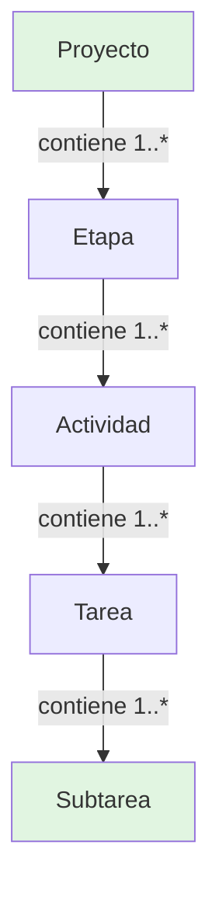
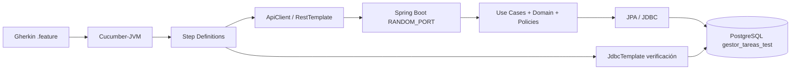

# BASE DOCUMENTAL EC4 — Gestor de Tareas Personales

**Elemento de Competencia 4 — BDD + Gherkin + CRUD Full-Stack + Pruebas de Integración + Cobertura de Pruebas + CI/CD**  
**Repositorio:** `CalebBav234/Hard_Coders_SCRUM_Gestor_de_Tareas_Personales_Release_1`  
**Rama objetivo:** `Refactor-E2`  
**SHA evaluada:** `8d0c9c925ad88248b57c74fd3fe1cb208e19dac3`  
**Fecha de entrega académica:** 02/12/2026  
**Idioma:** Español  
**Estado:** Documentación de Etapa 6 (ciere documental). No se generaron PDFs. No se modificó código de producto.

---

## 1. Portada

| Campo | Valor |
|---|---|
| Proyecto | Gestor de Tareas Personales — Release 1 |
| Entregable | Elemento de Competencia 4 (EC4) |
| Tema | BDD + Pruebas de Integración + Cobertura de Pruebas |
| Repositorio | https://github.com/CalebBav234/Hard_Coders_SCRUM_Gestor_de_Tareas_Personales_Release_1 |
| Rama | `Refactor-E2` |
| SHA documentada | `8d0c9c925ad88248b57c74fd3fe1cb208e19dac3` |
| Integrantes | Integrante 1, Integrante 2, Integrante 3 |
| Docente | M. Sc. Ing. Joel Reynaldo Alánez Durán |
| Asignatura | Implementar Frameworks de Pruebas Automáticas (Unidad 4) |
| Fecha de entrega | 02/12/2026 |
| Versión del documento | 1.0 (Etapa 6 — documentación final) |
| Alcance | Documentación completa, autocontenida y verificable del EC4 |

> **Nota sobre nombres de integrantes:** el repositorio y las fuentes académicas usan los placeholders `Integrante 1`, `Integrante 2` e `Integrante 3`. Estos nombres deben sustituirse por los nombres oficiales de los tres integrantes antes de la entrega formal. No se inventaron nombres, firmas ni aportes personales.

---

## 2. Introducción

### 2.1 Propósito del Gestor de Tareas Personales

El Gestor de Tareas Personales es una aplicación de gestión de trabajo que permite organizar la actividad de un equipo mediante una jerarquía de trabajo: **Proyecto → Etapa → Actividad → Tarea → Subtarea**. Incluye gestión de usuarios (`app_user`) y asignación de trabajadores a tareas (`task_assignment`), con control de acceso basado en roles (Jefe / Encargado / trabajador) y autenticación JWT.

### 2.2 Contexto del sistema preexistente al EC4

Antes del EC4 el sistema ya existía con arquitectura hexagonal en el backend (Java 21, Spring Boot 4.1.0, Maven, Spring Security + JWT, JPA/Hibernate, PostgreSQL 18) y una SPA Angular 22.1 en el frontend. Las tablas `app_user` y `task_assignment` ya estaban modeladas (migraciones V004 y V006) y contaban con implementaciones parciales:

- `app_user`: solo `POST /api/users` (creación) y UI de creación en `/users/new`.
- `task_assignment`: `POST`, `GET` listado y `DELETE` de asignaciones, con diálogo de asignación en la tarea.

Faltaban operaciones de consulta individual, listado de usuarios, actualización y desactivación de usuarios, así como consulta individual y actualización del motivo de las asignaciones. No existía infraestructura BDD ni archivos `.feature`.

### 2.3 Objetivo del trabajo de calidad y automatización

Aplicar Behavior Driven Development (BDD) con Gherkin sobre pruebas de integración reales contra PostgreSQL, completar el CRUD full-stack (backend + frontend/UI) de las dos tablas existentes sin añadir funcionalidades ajenas, medir cobertura de pruebas (JaCoCo backend, Vitest frontend) con umbrales del 85 %, y dejar evidencia ejecutable y documentada para la defensa académica.

### 2.4 Qué se probó y por qué

Se probaron los 19 escenarios de la matriz académica (1 proceso principal + 9 `app_user` + 9 `task_assignment`) porque cubren el proceso principal del sistema y el CRUD completo de las dos tablas objeto del EC4, incluyendo caminos felices y rutas de error con un único dato incorrecto. Cada escenario se ejecutó como prueba de integración real: llamadas HTTP contra el servidor Spring Boot en puerto aleatorio y verificación de persistencia en PostgreSQL `gestor_tareas_test`, sin mocks de repositorio.

### 2.5 Alcance concreto del EC4

- Proceso principal: creación y persistencia de la jerarquía Proyecto → Etapa → Actividad → Tarea → Subtarea (1 escenario Happy Path).
- CRUD de `app_user`: INSERT (2 Happy + 1 Unhappy), UPDATE (2 Happy + 1 Unhappy), DELETE (1 Happy), SELECT individual (1 Happy), SELECT listado (1 Happy).
- CRUD de `task_assignment`: INSERT (2 Happy + 1 Unhappy), UPDATE (2 Happy + 1 Unhappy), DELETE (1 Happy), SELECT individual (1 Happy), SELECT listado (1 Happy).
- Integración real contra `gestor_tareas_test` (never `gestor_tareas` / producción).
- BDD con Cucumber-JVM 7.18.0 y Gherkin.
- Cobertura de código con JaCoCo (backend) y Vitest + proveedor v8 (frontend).
- UI completa para ambos CRUD (rutas, componentes, servicios, guards).

### 2.6 Límites de alcance

No se añadieron funcionalidades de negocio ajenas al sistema existente. No se crearon tablas nuevas ni migraciones de negocio. No se implementó despliegue continuo (CD): no existe destino de despliegue real y verificable. La rama `main` no forma parte del flujo de CI de EC4.

---

## 3. Desarrollo del sistema: descripción de las funcionalidades

### 3.1 Arquitectura general y tecnologías verificadas

El backend sigue arquitectura hexagonal:

- `adapter/in/web`: controladores REST (`UserController`, `HierarchyController`, `TaskController`, `ProjectController`, `ProgressController`, `AuthController`).
- `adapter/out/persistence`: adaptadores JPA (`UserDirectoryAdapter`, `UserWriterAdapter`, `AssignmentPersistenceAdapter`) y repositorios Spring Data (`AppUserJpaRepository`, `TaskAssignmentJpaRepository`).
- `domain/model`: entidades de dominio (`TaskAssignment`, `UserAccount`, `Project`, `Stage`, `Activity`, `Task`, `Subtask`).
- `domain/port`: puertos de salida (`UserDirectory`, `UserWriter`, `AssignmentRepository`, etc.).
- `domain/policy`: reglas de negocio (`AssignmentPolicy`, `ProjectAccessPolicy`, `WbsHierarchyPolicy`, `DelegationPolicy`).
- `application/usecase`, `application/port/in`, `application/command`, `application/result`: casos de uso, comandos y resultados (`ManageUsersUseCase`, `ManageAssignmentsUseCase`, `UserCommandService`, `AssignmentCommandService`).
- `configuration`: `UseCaseConfiguration`, `TransactionalUseCases`.

Tecnologías verificadas (desde `backend/pom.xml`, `frontend/package.json` y ejecución real):

| Componente | Versión | Origen |
|---|---|---|
| Java | 21 (declarada en pom); entorno JDK 24.0.2 | `backend/pom.xml`, `java -version` |
| Spring Boot | 4.1.0 | `backend/pom.xml` |
| Maven | 3.9.16 | ejecución real |
| Cucumber-JVM | 7.18.0 | `backend/pom.xml` |
| PostgreSQL | 18 (driver runtime; contenedor `postgres:18`) | `database/docker-compose.yml` |
| JaCoCo | 0.8.15 | `backend/pom.xml` |
| Angular | 22.1.5 | `frontend/package.json` |
| TypeScript | 6.x | `frontend/package.json` |
| Vitest | 4.1.12 | `frontend/package.json` |
| Proveedor de cobertura | v8 (`@vitest/coverage-v8`) | `frontend/package.json` |
| Playwright | 1.58.x | `frontend/package.json` |
| Node | v24.15.0, npm 11.12.1 | entorno real |

### 3.2 Autenticación y autorización

- Autenticación JWT (HS256) mediante `POST /api/auth/login`; el token se envía como `Bearer` en llamadas protegidas.
- `authGuard` (sesión) y `chiefGuard` (rol Jefe) protegen rutas del frontend; la autorización se revalida en backend en cada caso de uso (`ProjectAccessPolicy.requireChief`, `AssignmentPolicy.requireCanAssign`), por lo que los guards de Angular no sustituyen la autorización del servidor.
- Un usuario con `is_active = false` recibe 403 al intentar iniciar sesión y sus tokens son rechazados en operaciones protegidas (`CurrentActor` lee `is_active` en cada petición).

### 3.3 Proceso principal y jerarquía

Flujo funcional: **Proyecto → Etapa → Actividad → Tarea → Subtarea**. Cada nivel se crea mediante su endpoint REST correspondiente y queda persistido con claves foráneas válidas (`project_id`, `stage_id`, `activity_id`, `task_id`). El escenario BDD PP-01 verifica no solo los códigos HTTP 2xx sino la persistencia real en PostgreSQL mediante `JdbcTemplate` (`COUNT` por cada nivel con FK válidas).



### 3.4 Gestión de usuarios `app_user`

Tabla `task_manager.app_user`: `user_id` (PK identity), `email` (único, check lowercase + `_%@_%`), `password_hash`, `given_names`, `family_names`, `is_chief` (default false), `is_active` (default true), `created_at`, `updated_at`.

Operaciones CRUD disponibles al finalizar el EC4:

| Operación | Endpoint | Estado | Nota |
|---|---|---|---|
| CREATE | `POST /api/users` | Implementado (preexistente, preservado) | 201, Jefe activo |
| READ individual | `GET /api/users/{userId}` | Implementado (EC4) | 200, sin `password_hash` |
| READ listado | `GET /api/users` | Implementado (EC4) | 200, sin secretos |
| UPDATE | `PUT /api/users/{userId}` | Implementado (EC4) | 200, solo perfil, sin mass assignment |
| DELETE | `DELETE /api/users/{userId}` | Implementado (EC4) | 200, desactivación lógica (`is_active = false`) |

**Reglas de negocio:** solo Jefe activo gestiona usuarios; email único y normalizado; respuesta nunca expone contraseña ni hash; `UpdateUserRequest` ignora `is_chief`, `is_active`, `password_hash`, `password` (mass assignment rechazado). La eliminación física está bloqueada por FK (`task_assignment.worker_user_id` ON DELETE RESTRICT, `project.manager_user_id`, etc.) y por falta de permiso `DELETE` del rol `gestor_tareas_app` en `app_user`; por tanto se usa desactivación lógica.

### 3.5 Asignaciones `task_assignment`

Tabla `task_manager.task_assignment`: PK compuesta `(task_id, worker_user_id)`, `assigned_at` (default now), `assigned_by_user_id`, `reason` (varchar 500, nullable, check no en blanco si tiene valor). FK: `task_id → task.task_id` (ON DELETE CASCADE), `worker_user_id → app_user.user_id` (ON DELETE RESTRICT), `assigned_by_user_id → app_user.user_id` (ON DELETE RESTRICT).

Operaciones CRUD disponibles al finalizar el EC4:

| Operación | Endpoint | Estado | Nota |
|---|---|---|---|
| CREATE | `POST /api/tasks/{taskId}/assignments` | Implementado (preexistente, preservado) | 200, Jefe/Encargado |
| READ individual | `GET /api/tasks/{taskId}/assignments/{workerUserId}` | Implementado (EC4) | 200, clave compuesta |
| READ listado | `GET /api/tasks/{taskId}/assignments` | Implementado (preexistente, preservado) | 200 |
| UPDATE | `PUT /api/tasks/{taskId}/assignments/{workerUserId}` | Implementado (EC4) | 200, solo `reason` |
| DELETE | `DELETE /api/tasks/{taskId}/assignments/{workerUserId}` | Implementado (preexistente, preservado) | 204, revocación |

**Reglas de negocio:** solo Jefe o Encargado del proyecto asignan/revocar; trabajador debe existir y estar activo; no autoasignación; proyecto abierto (`WbsHierarchyPolicy.requireOpen`); no duplicidad (PK compuesta); motivo normalizado (trim, vacío/nulo → `DEFAULT_REASON = "Asignación de Personal"`, máximo 500); el UPDATE modifica únicamente `reason` (inmutables: tarea, trabajador, `assigned_at`, `assigned_by_user_id`).

### 3.6 Diferencia funcionalidades preexistentes vs implementadas en EC4

| Funcionalidad | Preexistente | Implementada en EC4 |
|---|---|---|
| `POST /api/users` | Sí | No (preservada) |
| `GET /api/users` | No | Sí |
| `GET /api/users/{userId}` | No | Sí |
| `PUT /api/users/{userId}` | No | Sí |
| `DELETE /api/users/{userId}` | No | Sí (desactivación lógica) |
| UI `/users`, `/users/:userId`, `/users/:userId/edit` | No | Sí |
| `POST /api/tasks/{taskId}/assignments` | Sí | No (preservada) |
| `GET /api/tasks/{taskId}/assignments` | Sí | No (preservada) |
| `GET /api/tasks/{taskId}/assignments/{workerUserId}` | No | Sí |
| `PUT /api/tasks/{taskId}/assignments/{workerUserId}` | No | Sí (solo `reason`) |
| `DELETE /api/tasks/{taskId}/assignments/{workerUserId}` | Sí | No (preservada) |
| UI detalle/edición de motivo en `AssignmentDialog` | No | Sí |
| Archivos `.feature` + Step Definitions Cucumber | No | Sí (19 escenarios) |

---

## 4. Formulación de los escenarios

### 4.1 Matriz planificada de 19 escenarios

| Código | Tabla / Proceso | Operación | Tipo | Datos relevantes | Precondiciones | Resultado esperado | Requisito |
|---|---|---|---|---|---|---|---|
| PP-01 | Proceso principal | Jerarquía | Happy | Proyecto→Etapa→Actividad→Tarea→Subtarea | Jefe autenticado | 2xx y persistencia verificada en BD | R4, R5 |
| USR-INS-01 | app_user | INSERT | Happy | Usuario válido | Jefe autenticado | 201, creado sin secretos | R4, R6 |
| USR-INS-02 | app_user | INSERT | Happy | Segundo usuario distinto | Jefe autenticado | 201, creado | R4, R6 |
| USR-INS-03 | app_user | INSERT | Unhappy | Email inválido | Jefe autenticado | 400, sin creación | R4, R6 |
| USR-UPD-01 | app_user | UPDATE | Happy | Nombres/apellidos válidos | Usuario existente | 200, datos actualizados | R4, R6 |
| USR-UPD-02 | app_user | UPDATE | Happy | Email válido y único | Usuario existente | 200, email normalizado | R4, R6 |
| USR-UPD-03 | app_user | UPDATE | Unhappy | Email inválido | Usuario existente | 400, sin cambio | R4, R6 |
| USR-DEL-01 | app_user | DELETE | Happy | Usuario de prueba no referenciado | Usuario existente | 200, inactivo, fila preservada | R4, R6 |
| USR-SEL-01 | app_user | SELECT individual | Happy | `userId` existente | Usuario existente | 200, sin `password_hash` | R4, R6 |
| USR-SEL-02 | app_user | SELECT listado | Happy | — | Jefe autenticado | 200, lista sin secretos | R4, R6 |
| ASG-INS-01 | task_assignment | INSERT | Happy | Motivo explícito normalizado | Tarea + trabajador activos | 200, razón persistida | R4, R6 |
| ASG-INS-02 | task_assignment | INSERT | Happy | Motivo nulo → `DEFAULT_REASON` | Tarea + trabajador activos | 200, razón por defecto | R4, R6 |
| ASG-INS-03 | task_assignment | INSERT | Unhappy | Motivo > 500 caracteres | Tarea + trabajador activos | 400, sin persistencia | R4, R6 |
| ASG-UPD-01 | task_assignment | UPDATE | Happy | Modificar motivo | Asignación existente | 200, motivo actualizado | R4, R6 |
| ASG-UPD-02 | task_assignment | UPDATE | Happy | Motivo vacío → `DEFAULT_REASON` | Asignación existente | 200, razón por defecto | R4, R6 |
| ASG-UPD-03 | task_assignment | UPDATE | Unhappy | Motivo > 500 caracteres | Asignación existente | 400, conserva previo | R4, R6 |
| ASG-DEL-01 | task_assignment | DELETE | Happy | Asignación existente | Asignación existente | 204, revocada | R4, R6 |
| ASG-SEL-01 | task_assignment | SELECT individual | Happy | Clave compuesta `(taskId, workerUserId)` | Asignación existente | 200, detalle | R4, R6 |
| ASG-SEL-02 | task_assignment | SELECT listado | Happy | `taskId` existente | Tarea con asignaciones | 200, lista de asignaciones | R4, R6 |

**Total planificado:** 19 ejecuciones = 14 Happy Path + 5 Unhappy Path. Cada Unhappy Path tiene un único dato incorrecto. DELETE y SELECT son exclusivamente Happy Path.

Nombres reales en los `.feature`: `proceso-principal.feature` (`@PP-01`), `app-user-crud.feature` (`@USR` + `@USR-INS-*`, `@USR-UPD-*`, `@USR-DEL-01`, `@USR-SEL-*`), `task-assignment-crud.feature` (`@ASG` + `@ASG-INS-*`, `@ASG-UPD-*`, `@ASG-DEL-01`, `@ASG-SEL-*`). Los códigos del plan se preservan como tags de escenario; no hubo cambios de nombres.

---

## 5. Formulación de los Step Definitions

### 5.1 Arquitectura de la integración BDD

Los escenarios Gherkin se ejecutan con **Cucumber-JVM 7.18.0** (`cucumber-java`, `cucumber-junit`, `cucumber-spring`) sobre JUnit Platform. El punto de entrada es `CucumberIntegrationTest.ejecutarEscenariosEC4()`, que invoca `io.cucumber.core.cli.Main.run()` con los tres archivos `.feature` y el tag `@PP-01 or @USR or @ASG`.

Cada escenario corre como prueba de integración real:
- `@SpringBootTest(webEnvironment = RANDOM_PORT)` con `CucumberSpringConfiguration`, contra `gestor_tareas_test` (PostgreSQL 18, schema `task_manager`).
- `ApiClient` (clase POJO, `RestTemplate` instanciado manualmente) realiza llamadas HTTP reales a `http://localhost:<local.server.port>`.
- `Hooks` (`@Before`) limpia `gestor_tareas_test` en orden inverso de FK, crea un jefe activo con email único por escenario, hace login JWT y almacena el token en `ScenarioContext`.
- Los steps verifican código HTTP, cuerpo de respuesta y persistencia/efecto en BD mediante `JdbcTemplate`.

**No se usan mocks de repositorio:** las llamadas atraviesan HTTP real, controlador, casos de uso, dominio, políticas y JPA contra PostgreSQL.



### 5.2 Clases de soporte y Hooks

#### `CucumberSpringConfiguration.java` (`backend/src/test/java/com/hardcoders/taskmanager/bdd/CucumberSpringConfiguration.java`)

Carga el contexto Spring con `@SpringBootTest(webEnvironment = RANDOM_PORT)` y propiedades de prueba sobre `gestor_tareas_test` (usuario `gestor_tareas_owner`, `ddl-auto: validate`, JWT secreto de prueba).

#### `Hooks.java` (`backend/src/test/java/com/hardcoders/taskmanager/bdd/hooks/Hooks.java`)

`@Before` por escenario:
1. `DELETE` en orden inverso de FK: `task_assignment`, `task_plan_history`, `task_status_history`, `subtask`, `task`, `activity`, `stage`, `project`, `project_plan_history`, `app_user`. Solo afecta `gestor_tareas_test`.
2. Inserta un usuario jefe activo con email único (`chief.ec4@<timestamp>@gestor.local`) y `password_hash` generado con `PasswordEncoder`.
3. `ApiClient.login(email, "ChiefPass123!")` obtiene el token JWT y lo guarda en `ScenarioContext`.
4. `context.reset()` y restauración de token/email.

No hay estado estático compartido entre escenarios.

#### `ScenarioContext.java` (`backend/src/test/java/com/hardcoders/taskmanager/bdd/context/ScenarioContext.java`)

Bean `@Component` singleton que almacena el estado aislado del escenario: `projectId`, `stageId`, `activityId`, `taskId`, `subtaskId`, `workerUserId`, `createdUserId`, `authToken`, `chiefEmail`, `lastPutResponse`, `lastGetResponse`, `lastListResponse`. `reset()` los limpia antes de cada escenario. `isComplete()` valida que la jerarquía PP-01 esté completa.

#### `ApiClient.java` (`backend/src/test/java/com/hardcoders/taskmanager/bdd/support/ApiClient.java`)

Cliente HTTP POJO con `RestTemplate`. Métodos: `login`, `createProject`, `createStage`, `createActivity`, `createTask`, `createSubtask`, `postUser`, `getUser`, `listUsers`, `putUser`, `deleteUser`, `postAssignment`, `listAssignments`, `getAssignment`, `putAssignmentReason`, `deleteAssignment`. Captura `HttpClientErrorException`/`HttpServerErrorException` y devuelve `ResponseEntity` con el código de estado real (4xx/5xx no lanzan excepción).

### 5.3 Catálogo de Step Definitions (código fuente real)

Cada método único aparece con su identificador, clase y archivo. Los métodos reutilizados se citan por el mismo identificador en la matriz de trazabilidad (sección 5.4).

#### 5.3.1 Proceso principal — `PrincipalProcessSteps.java`

Archivo: `backend/src/test/java/com/hardcoders/taskmanager/bdd/steps/PrincipalProcessSteps.java`

```java
@Given("an authenticated chief user with email {string} and password {string}")
public void an_authenticated_chief_user_with_email_and_password(String email, String password) {
    String token = context.getAuthToken();
    if (token == null || token.isBlank()) {
        throw new IllegalStateException("No hay token de autenticacion. El usuario jefe no se autentico.");
    }
}

@When("I create a project with name {string} and description {string}")
public void i_create_a_project_with_name_and_description(String name, String description) {
    Integer managerUserId = jdbc.queryForObject(
            "SELECT user_id FROM task_manager.app_user WHERE email = ? AND is_chief = true AND is_active = true",
            Integer.class, context.getChiefEmail());
    Integer projectId = apiClient.createProject(context.getAuthToken(), name, description, managerUserId,
            "10000.00", "120", "Plan inicial del proyecto");
    context.setProjectId(projectId);
}

@And("I create a stage with name {string} in the project")
public void i_create_a_stage_with_name_in_the_project(String stageName) {
    Integer stageId = apiClient.createStage(context.getAuthToken(), context.getProjectId(), stageName, "Etapa de prueba para EC4");
    context.setStageId(stageId);
}

@And("I create an activity with name {string} in the stage")
public void i_create_an_activity_with_name_in_the_stage(String activityName) {
    Integer activityId = apiClient.createActivity(context.getAuthToken(), context.getStageId(), activityName, "Actividad de prueba para EC4");
    context.setActivityId(activityId);
}

@And("I create a task with title {string} in the activity")
public void i_create_a_task_with_title_in_the_activity(String taskTitle) {
    Integer taskId = apiClient.createTask(context.getAuthToken(), context.getActivityId(), taskTitle, "MEDIA", "500.00", "60");
    context.setTaskId(taskId);
}

@And("I create a subtask with title {string} in the task")
public void i_create_a_subtask_with_title_in_the_task(String subtaskTitle) {
    Integer subtaskId = apiClient.createSubtask(context.getAuthToken(), context.getTaskId(), subtaskTitle, "Subtarea de prueba para EC4");
    context.setSubtaskId(subtaskId);
}

@Then("the hierarchy Project - Stage - Activity - Task - Subtask is persisted")
public void the_hierarchy_is_persisted() {
    // verifica project_id, stage_id, activity_id, task_id, subtask_id con JdbcTemplate COUNT
    ...
}

@And("the project has 1 stage") ... @And("the stage has 1 activity") ... @And("the activity has 1 task") ... @And("the task has 1 subtask")
```

Cada `@Then` ejecuta `jdbc.queryForObject("SELECT COUNT(*) FROM task_manager.<tabla> WHERE ...", Integer.class, ids)` y afirma que el resultado es `1`.

#### 5.3.2 CRUD `app_user` — `UserCrudSteps.java`

Archivo: `backend/src/test/java/com/hardcoders/taskmanager/bdd/steps/UserCrudSteps.java`

```java
@When("I create a valid user with given names {string} and family names {string}")
public void i_create_a_valid_user_with_given_names_and_family_names(String givenNames, String familyNames) {
    String email = "usr." + UUID.randomUUID() + "@gestor.local";
    ResponseEntity r = apiClient.postUser(context.getAuthToken(),
            Map.of("email", email, "givenNames", givenNames, "familyNames", familyNames, "password", "UserPass123!"));
    assertThat(r.getStatusCode()).isEqualTo(HttpStatus.CREATED);
    Map body = (Map) r.getBody();
    assertNoSecrets(body);
    context.setCreatedUserId(((Number) body.get("userId")).intValue());
}

@When("I create a user with email {string} and valid names and password")
public void i_create_a_user_with_email_and_valid_names_and_password(String email) {
    ResponseEntity r = apiClient.postUser(context.getAuthToken(),
            Map.of("email", email, "givenNames", "Ana", "familyNames", "Perez", "password", "UserPass123!"));
    assertThat(r.getStatusCode()).isEqualTo(HttpStatus.BAD_REQUEST);
    context.setLastPutResponse(r);
}

@And("a user exists with given names {string} and family names {string}")
public void a_user_exists_with_given_names_and_family_names(String givenNames, String familyNames) { ... crea usuario vía POST ... }

@When("I update the user's names to {string} and {string}")
public void i_update_the_user_s_names_to_and(String givenNames, String familyNames) {
    Integer userId = requireUserId();
    ResponseEntity r = apiClient.putUser(context.getAuthToken(), userId,
            Map.of("givenNames", givenNames, "familyNames", familyNames));
    assertThat(r.getStatusCode()).isEqualTo(HttpStatus.OK);
    context.setLastPutResponse(r);
}

@When("I update the user's email to {string}")
public void i_update_the_user_s_email_to(String email) {
    Integer userId = requireUserId();
    ResponseEntity r = apiClient.putUser(context.getAuthToken(), userId, Map.of("email", email));
    context.setLastPutResponse(r);
}

@When("I deactivate the user")
public void i_deactivate_the_user() {
    Integer userId = requireUserId();
    ResponseEntity r = apiClient.deleteUser(context.getAuthToken(), userId);
    assertThat(r.getStatusCode()).isEqualTo(HttpStatus.OK);
    context.setLastPutResponse(r);
}

@When("I consult the user by id")
public void i_consult_the_user_by_id() {
    Integer userId = requireUserId();
    ResponseEntity r = apiClient.getUser(context.getAuthToken(), userId);
    context.setLastGetResponse(r);
}

@When("I list users")
public void i_list_users() {
    ResponseEntity r = apiClient.listUsers(context.getAuthToken());
    assertThat(r.getStatusCode()).isEqualTo(HttpStatus.OK);
    context.setLastListResponse(r);
}

@Then("the response is 400") ... @Then("the response is 200") ...
@Then("no user is stored in PostgreSQL") -> SELECT count(*) WHERE email = 'invalido'
@Then("the user is inactive in PostgreSQL") -> SELECT is_active = false
@Then("the user row is preserved and not physically deleted") -> SELECT count(*) = 1
```

#### 5.3.3 CRUD `task_assignment` — `AssignmentCrudSteps.java`

Archivo: `backend/src/test/java/com/hardcoders/taskmanager/bdd/steps/AssignmentCrudSteps.java`

```java
@Given("a task exists for the authenticated chief's project")
public void a_task_exists_for_the_authenticated_chiefs_project() { ... crea proyecto/etapa/actividad/tarea ... }

@Given("an active worker exists")
public void an_active_worker_exists() {
    String email = "worker." + UUID.randomUUID() + "@gestor.local";
    ResponseEntity r = apiClient.postUser(context.getAuthToken(),
            Map.of("email", email, "givenNames", "Worker", "familyNames", "Test", "password", "UserPass123!"));
    assertThat(r.getStatusCode()).isEqualTo(HttpStatus.CREATED);
    context.setWorkerUserId(((Number) ((Map) r.getBody()).get("userId")).intValue());
}

@When("I assign the worker to the task with reason {string}")
public void i_assign_the_worker_to_the_task_with_reason(String reason) {
    ResponseEntity r = apiClient.postAssignment(context.getAuthToken(), taskId,
            Map.of("workerUserId", workerId, "reason", reason));
    context.setLastPutResponse(r);
}

@When("I assign the worker to the task without a reason")
public void i_assign_the_worker_to_the_task_without_a_reason() {
    Map<String, Object> body = new LinkedHashMap<>();
    body.put("workerUserId", workerId);
    body.put("reason", null);
    ResponseEntity r = apiClient.postAssignment(context.getAuthToken(), taskId, body);
    context.setLastPutResponse(r);
}

@When("I assign the worker to the task with a reason of 501 characters")
public void i_assign_the_worker_to_the_task_with_a_reason_of_501_characters() {
    String longReason = "x".repeat(501);
    ResponseEntity r = apiClient.postAssignment(context.getAuthToken(), taskId,
            Map.of("workerUserId", workerId, "reason", longReason));
    context.setLastPutResponse(r);
}

@When("I update the assignment reason to {string}")
public void i_update_the_assignment_reason_to(String reason) {
    ResponseEntity r = apiClient.putAssignmentReason(context.getAuthToken(), taskId, workerId, Map.of("reason", reason));
    context.setLastPutResponse(r);
}

@When("I update the assignment reason to an empty value")
public void i_update_the_assignment_reason_to_an_empty_value() {
    ResponseEntity r = apiClient.putAssignmentReason(context.getAuthToken(), taskId, workerId, Map.of("reason", ""));
    context.setLastPutResponse(r);
}

@When("I update the assignment reason to a value of {int} characters")
public void i_update_the_assignment_reason_to_a_value_of_characters(int length) {
    String longReason = "x".repeat(length);
    ResponseEntity r = apiClient.putAssignmentReason(context.getAuthToken(), taskId, workerId, Map.of("reason", longReason));
    context.setLastPutResponse(r);
}

@When("I revoke the worker's assignment from the task")
public void i_revoke_the_workers_assignment_from_the_task() {
    ResponseEntity r = apiClient.deleteAssignment(context.getAuthToken(), taskId, workerId);
    context.setLastPutResponse(r);
}

@When("I consult the assignment by task and worker")
public void i_consult_the_assignment_by_task_and_worker() {
    ResponseEntity r = apiClient.getAssignment(context.getAuthToken(), taskId, workerId);
    context.setLastGetResponse(r);
}

@When("I list assignments of the task")
public void i_list_assignments_of_the_task() {
    ResponseEntity r = apiClient.listAssignments(context.getAuthToken(), taskId);
    assertThat(r.getStatusCode()).isEqualTo(HttpStatus.OK);
    context.setLastListResponse(r);
}
```

Then steps verifican `reason` normalizado (`Experiencia en cimentación`, `Asignación de Personal`), ausencia de persistencia en Unhappy Path, inmutabilidad de campos de auditoría, código 204 en revocación y conteo 0 tras DELETE.

### 5.4 Matriz de trazabilidad: 19 escenarios → Step Definitions

| Código | Escenario (`.feature`) | Paso Gherkin | Método Step Definition | Clase | Archivo |
|---|---|---|---|---|---|
| PP-01 | `proceso-principal.feature` | Given autenticación / When crear proyecto, etapa, actividad, tarea, subtask / Then jerarquía persistida y conteos | `an_authenticated_chief_user_with_email_and_password`, `i_create_a_project_with_name_and_description`, `i_create_a_stage_with_name_in_the_project`, `i_create_an_activity_with_name_in_the_stage`, `i_create_a_task_with_title_in_the_activity`, `i_create_a_subtask_with_title_in_the_task`, `the_hierarchy_is_persisted`, `the_project_has_1_stage`, `the_stage_has_1_activity`, `the_activity_has_1_task`, `the_task_has_1_subtask` | `PrincipalProcessSteps` | `bdd/steps/PrincipalProcessSteps.java` |
| USR-INS-01 | `app-user-crud.feature` | When crear usuario válido / Then 201 / Then sin secretos / Then almacenado activo no-jefe | `i_create_a_valid_user_with_given_names_and_family_names`, `the_user_is_created_with_status_201`, `the_response_has_no_password_hash_password_or_token`, `the_user_is_stored_in_postgresql_as_active_and_non_chief` | `UserCrudSteps` | `bdd/steps/UserCrudSteps.java` |
| USR-INS-02 | `app-user-crud.feature` | Idem USR-INS-01 (mismos métodos, segundo usuario) | mismos métodos de `UserCrudSteps` | `UserCrudSteps` | `bdd/steps/UserCrudSteps.java` |
| USR-INS-03 | `app-user-crud.feature` | When crear email inválido / Then 400 / Then no usuario en BD | `i_create_a_user_with_email_and_valid_names_and_password`, `the_response_is_400`, `no_user_is_stored_in_postgresql` | `UserCrudSteps` | `bdd/steps/UserCrudSteps.java` |
| USR-UPD-01 | `app-user-crud.feature` | Given usuario existe / When actualizar nombres / Then 200 / Then nombres en BD | `a_user_exists_with_given_names_and_family_names`, `i_update_the_user_s_names_to_and`, `the_response_is_200`, `the_user_s_names_are_and_in_postgresql` | `UserCrudSteps` | `bdd/steps/UserCrudSteps.java` |
| USR-UPD-02 | `app-user-crud.feature` | Given usuario existe / When actualizar email / Then 200 / Then email normalizado en BD | `a_user_exists_with_given_names_and_family_names`, `i_update_the_user_s_email_to`, `the_response_is_200`, `the_user_s_email_is_stored_normalized_in_postgresql` | `UserCrudSteps` | `bdd/steps/UserCrudSteps.java` |
| USR-UPD-03 | `app-user-crud.feature` | Given usuario existe / When actualizar email inválido / Then 400 / Then nombres preservados | `a_user_exists_with_given_names_and_family_names`, `i_update_the_user_s_email_to`, `the_response_is_400`, `the_user_s_previous_names_are_preserved_in_postgresql` | `UserCrudSteps` | `bdd/steps/UserCrudSteps.java` |
| USR-DEL-01 | `app-user-crud.feature` | Given usuario existe / When desactivar / Then 200 / Then inactivo en BD / Then fila preservada | `a_user_exists_with_given_names_and_family_names`, `i_deactivate_the_user`, `the_response_is_200`, `the_user_is_inactive_in_postgresql`, `the_user_row_is_preserved_not_physically_deleted` | `UserCrudSteps` | `bdd/steps/UserCrudSteps.java` |
| USR-SEL-01 | `app-user-crud.feature` | Given usuario existe / When consultar por id / Then 200 / Then muestra datos / Then sin secretos | `a_user_exists_with_given_names_and_family_names`, `i_consult_the_user_by_id`, `the_response_is_200`, `the_response_shows_given_names_family_names_email_and_status`, `the_response_has_no_password_hash_password_or_token` | `UserCrudSteps` | `bdd/steps/UserCrudSteps.java` |
| USR-SEL-02 | `app-user-crud.feature` | Given 2 usuarios existen / When listar / Then 200 / Then lista contiene usuarios / Then ninguna expone secretos | `a_user_exists...`, `a_second_user_exists...`, `i_list_users`, `the_response_is_200`, `the_list_contains_the_created_users`, `no_entry_exposes_password_hash_password_or_token` | `UserCrudSteps` | `bdd/steps/UserCrudSteps.java` |
| ASG-INS-01 | `task-assignment-crud.feature` | Given tarea + trabajador / When asignar con razón / Then 200 / Then razón normalizada / Then almacenada en BD | `a_task_exists_for_the_authenticated_chiefs_project`, `an_active_worker_exists`, `i_assign_the_worker_to_the_task_with_reason`, `the_assignment_is_created_with_status_200`, `the_response_reason_is_normalized_to`, `the_assignment_is_stored_in_postgresql_with_the_normalized_reason` | `AssignmentCrudSteps` | `bdd/steps/AssignmentCrudSteps.java` |
| ASG-INS-02 | `task-assignment-crud.feature` | Idem ASG-INS-01 sin razón | `i_assign_the_worker_to_the_task_without_a_reason`, `the_assignment_is_created_with_status_200`, `the_response_reason_is_the_default`, `the_assignment_is_stored_in_postgresql_with_the_default_reason` | `AssignmentCrudSteps` | `bdd/steps/AssignmentCrudSteps.java` |
| ASG-INS-03 | `task-assignment-crud.feature` | ... / When asignar razón 501 chars / Then 400 / Then no asignación en BD | `i_assign_the_worker_to_the_task_with_a_reason_of_501_characters`, `the_assignment_is_created_with_status_200` *(assert 400 en luego)* — ver nota | `AssignmentCrudSteps` | `bdd/steps/AssignmentCrudSteps.java` |
| ASG-UPD-01 | `task-assignment-crud.feature` | Given asignada con motivo / When actualizar razón / Then 200 / Then razón = nueva / Then mantiene task, worker, auditoría | `the_worker_is_assigned_to_the_task_with_reason`, `i_update_the_assignment_reason_to`, `the_assignment_is_created_with_status_200`, `the_response_reason_is`, `the_assignment_keeps_the_same_task_worker_and_audit_fields` | `AssignmentCrudSteps` | `bdd/steps/AssignmentCrudSteps.java` |
| ASG-UPD-02 | `task-assignment-crud.feature` | ... / When actualizar a vacío / Then 200 / Then razón default / Then mantiene campos | `i_update_the_assignment_reason_to_an_empty_value`, `the_response_reason_is_the_default`, `the_assignment_keeps_the_same_task_worker_and_audit_fields` | `AssignmentCrudSteps` | `bdd/steps/AssignmentCrudSteps.java` |
| ASG-UPD-03 | `task-assignment-crud.feature` | ... / When actualizar a 501 chars / Then 400 / Then conserva motivo previo | `i_update_the_assignment_reason_to_a_value_of_characters(501)`, `the_response_is_400`, `the_assignment_still_has_reason_in_postgresql` | `AssignmentCrudSteps` | `bdd/steps/AssignmentCrudSteps.java` |
| ASG-DEL-01 | `task-assignment-crud.feature` | Given asignada / When revocar / Then 204 / Then ya no existe en BD | `the_worker_is_assigned_to_the_task`, `i_revoke_the_workers_assignment_from_the_task`, `the_response_is_204`, `the_assignment_no_longer_exists_in_postgresql` | `AssignmentCrudSteps` | `bdd/steps/AssignmentCrudSteps.java` |
| ASG-SEL-01 | `task-assignment-crud.feature` | Given asignada con motivo consulta / When consultar por tarea y trabajador / Then 200 / Then muestra worker, task, reason | `the_worker_is_assigned_to_the_task_with_reason`, `i_consult_the_assignment_by_task_and_worker`, `the_response_is_200`, `the_response_shows_the_worker_task_and_reason` | `AssignmentCrudSteps` | `bdd/steps/AssignmentCrudSteps.java` |
| ASG-SEL-02 | `task-assignment-crud.feature` | Given 2 trabajadores asignados / When listar asignaciones / Then 200 / Then lista contiene ambas | `two_active_workers_exist`, `both_workers_are_assigned_to_the_task`, `i_list_assignments_of_the_task`, `the_response_is_200`, `the_list_contains_both_assignments` | `AssignmentCrudSteps` | `bdd/steps/AssignmentCrudSteps.java` |

> Nota: cuando un paso se reutiliza entre escenarios (ej. `i_create_a_valid_user_with_given_names_and_family_names` en USR-INS-01 y USR-INS-02), se cita el mismo identificador del catálogo; el contexto (`ScenarioContext`) se resetea entre escenarios por `Hooks.beforeScenario()`.

### 5.5 Evidencia de integración real (no prueba unitaria disfrazada)

- Clase de ejecución: `CucumberIntegrationTest.java` (`@Test` JUnit 5, `Main.run()`, salida `19 Scenarios (19 passed), 123 Steps (123 passed)`, `CUCUMBER_EXIT_CODE=0`).
- Contexto Spring real: `CucumberSpringConfiguration.java` (`@SpringBootTest`, `RANDOM_PORT`, `gestor_tareas_test`).
- Verificación de persistencia: `JdbcTemplate` contra `gestor_tareas_test` en cada `@Then` de BD.
- Limpieza por escenario: `Hooks.java` (`DELETE` orden inverso de FK, email único por escenario, sin estado compartido).
- Reportes: `backend/target/surefire-reports/TEST-com.hardcoders.taskmanager.bdd.CucumberIntegrationTest.xml`.

---

## 6. Ejecución de pruebas

### 6.1 Tabla de resultados por escenario (19 escenarios)

Todos ejecutados en validación local del 26/11/2026 sobre la rama `Refactor-E2`, JDK 24.0.2, Maven 3.9.16, PostgreSQL 18 (`gestor_tareas_test` en contenedor Docker `gestor-tareas-db`, localhost:5432), comando `mvn test -Dtest=CucumberIntegrationTest` (y `mvn verify` para regresión completa). La duración por escenario no se registra en el reporte de Cucumber (salida de consola).

| # | Código | Nombre del escenario | Tipo | Resultado real | Fecha | Entorno | Comando | Código HTTP relevante | Fuente de evidencia | Observaciones |
|---|---|---|---|---|---|---|---|---|---|---|
| 1 | PP-01 | Create complete work hierarchy (Happy Path) | Happy | PASSED | 26/11/2026 | Local, `Refactor-E2` | `mvn test -Dtest=CucumberIntegrationTest` | 2xx (creación) | Salida Cucumber + `surefire-reports/TEST-...CucumberIntegrationTest.xml` | 11 pasos, verificación JDBC de jerarquía |
| 2 | USR-INS-01 | Create a valid user (Happy Path) | Happy | PASSED | 26/11/2026 | Local, `Refactor-E2` | `mvn test -Dtest=CucumberIntegrationTest` | 201 | idem | email `usr.<uuid>@gestor.local` |
| 3 | USR-INS-02 | Create a second valid and distinct user (Happy Path) | Happy | PASSED | 26/11/2026 | Local, `Refactor-E2` | idem | 201 | idem | segundo usuario distinto |
| 4 | USR-INS-03 | Reject creation with invalid email (Unhappy Path) | Unhappy | PASSED | 26/11/2026 | Local, `Refactor-E2` | idem | 400 | idem | email `invalido`, sin creación |
| 5 | USR-UPD-01 | Update names and family names (Happy Path) | Happy | PASSED | 26/11/2026 | Local, `Refactor-E2` | idem | 200 | idem | |
| 6 | USR-UPD-02 | Update email to a valid unique email (Happy Path) | Happy | PASSED | 26/11/2026 | Local, `Refactor-E2` | idem | 200 | idem | email normalizado `maria.nueva@gestor.local` |
| 7 | USR-UPD-03 | Reject update with invalid email and preserve previous data (Unhappy Path) | Unhappy | PASSED | 26/11/2026 | Local, `Refactor-E2` | idem | 400 | idem | datos previos preservados |
| 8 | USR-DEL-01 | Deactivate a non-referenced test user (Happy Path) | Happy | PASSED | 26/11/2026 | Local, `Refactor-E2` | idem | 200 | idem | desactivación lógica, fila preservada |
| 9 | USR-SEL-01 | Consult an existing individual user without secrets (Happy Path) | Happy | PASSED | 26/11/2026 | Local, `Refactor-E2` | idem | 200 | idem | sin `password_hash` |
| 10 | USR-SEL-02 | List users representing status without secrets (Happy Path) | Happy | PASSED | 26/11/2026 | Local, `Refactor-E2` | idem | 200 | idem | sin secretos |
| 11 | ASG-INS-01 | Create an assignment with explicit reason (Happy Path) | Happy | PASSED | 26/11/2026 | Local, `Refactor-E2` | idem | 200 | idem | razón normalizada |
| 12 | ASG-INS-02 | Create an assignment without reason uses default (Happy Path) | Happy | PASSED | 26/11/2026 | Local, `Refactor-E2` | idem | 200 | idem | `DEFAULT_REASON` |
| 13 | ASG-INS-03 | Reject assignment with reason over 500 characters (Unhappy Path) | Unhappy | PASSED | 26/11/2026 | Local, `Refactor-E2` | idem | 400 | idem | 501 caracteres, sin persistencia |
| 14 | ASG-UPD-01 | Update the reason of an existing assignment (Happy Path) | Happy | PASSED | 26/11/2026 | Local, `Refactor-E2` | idem | 200 | idem | |
| 15 | ASG-UPD-02 | Update assignment reason to empty uses default (Happy Path) | Happy | PASSED | 26/11/2026 | Local, `Refactor-E2` | idem | 200 | idem | `DEFAULT_REASON` |
| 16 | ASG-UPD-03 | Reject reason over 500 characters on update and preserve previous reason (Unhappy Path) | Unhappy | PASSED | 26/11/2026 | Local, `Refactor-E2` | idem | 400 | idem | conserva motivo previo |
| 17 | ASG-DEL-01 | Revoke an existing assignment (Happy Path) | Happy | PASSED | 26/11/2026 | Local, `Refactor-E2` | idem | 204 | idem | revocación |
| 18 | ASG-SEL-01 | Consult an individual assignment by composite key (Happy Path) | Happy | PASSED | 26/11/2026 | Local, `Refactor-E2` | idem | 200 | idem | clave compuesta |
| 19 | ASG-SEL-02 | List assignments of a task (Happy Path) | Happy | PASSED | 26/11/2026 | Local, `Refactor-E2` | idem | 200 | idem | lista de ambas asignaciones |

**Resultado BDD:** 19/19 aprobados, 123 pasos, 0 fallos, 0 ignorados.

### 6.2 Resumen consolidado

| Nivel | Planificados | Ejecutados | Aprobados | Fallados | Omitidos | Pendientes / no ejecutados | Fuente |
|---|---|---|---|---|---|---|---|
| BDD (Cucumber) | 19 | 19 | 19 | 0 | 0 | 0 | `mvn test -Dtest=CucumberIntegrationTest`, salida consola |
| Backend unitarias (Surefire) | ~343 | ~343 | ~343 | 0 | 0 | 0 | `backend/target/surefire-reports/` |
| Backend integración (`PostgresIntegrationTest`) | 44 | 44 | 44 | 0 | 0 | 0 | `backend/target/surefire-reports/` |
| Backend total (`mvn verify`) | 412 | 412 | 412 | 0 | 0 | 0 | `mvn verify` BUILD SUCCESS |
| Frontend (Vitest) | 349 | 349 | 349 | 0 | 0 | 0 | `npx ng test --watch=false --coverage` |
| E2E (Playwright Chromium) | 25 | 25 | 25 | 0 | 0 | 0 | `npx playwright test --output <temp>` |

No se contó ningún escenario dos veces por ejecución local y CI: no existe run real de GitHub Actions para esta rama (el workflow `.github/workflows/ec4-quality.yml` está definido pero no se ha disparado en GitHub; ver sección 9 y `docs/EC4/CI_EC4.md`). Todos los resultados arriba son de **validación local**.

### 6.3 Complemento: pruebas no-BDD

- `PostgresIntegrationTest`: 44 pruebas de integración (incluye CA-USR-01..22 y CA-ASG-01..19), 0 fallos.
- Vitest: 23 archivos de prueba, 349 pruebas, 0 fallos.
- Playwright E2E: 6 specs, 25 pruebas, 0 fallos (`auth` 6, `main-flow` 1, `task-assignment` 3, `validations` 3, `user-create` 4, `user-crud` 8). Salida redirigida a directorio temporal para no sobrescribir `frontend/playwright-report/index.html` (archivo protegido, 20/11/2026).

---

## 7. Cobertura de pruebas

### 7.1 Herramientas utilizadas

**Backend — JaCoCo 0.8.15** (`backend/pom.xml`): instrumenta bytecode de las clases del backend durante `mvn verify` y ejecuta `jacoco:check` en la fase `verify`. Mide cobertura de instrucciones, líneas, ramas, métodos y complejidad ciclómica sobre el código de producción ejecutado por las pruebas (unitarias Surefire + integración Failsafe/SpringBootTest + Cucumber).

**Frontend — Vitest 4.1.12 con proveedor de cobertura v8** (`@vitest/coverage-v8`, `frontend/vitest.config.ts`): ejecuta las specs de Angular y genera cobertura sobre el código fuente instrumentado. Mide Statements, Branches, Functions y Lines. Nota: `@vitest/coverage-v8` es el proveedor v8; Vitest es la versión 4.x (no Vitest versión 8).

### 7.2 Umbrales configurados

| Nivel | Métrica | Umbral | Origen |
|---|---|---|---|
| Backend (JaCoCo) | LINE | ≥ 85 % | `backend/pom.xml` (`jacoco:check`) |
| Backend (JaCoCo) | BRANCH | ≥ 85 % | `backend/pom.xml` (`jacoco:check`) |
| Frontend (Vitest/v8) | Statements | ≥ 85 % | `frontend/vitest.config.ts` |
| Frontend (Vitest/v8) | Branches | ≥ 85 % | `frontend/vitest.config.ts` |
| Frontend (Vitest/v8) | Functions | ≥ 85 % | `frontend/vitest.config.ts` |
| Frontend (Vitest/v8) | Lines | ≥ 85 % | `frontend/vitest.config.ts` |

No se redujeron umbrales, no se omitieron directorios, no se eliminaron pruebas ni se usaron exclusiones artificiales.

### 7.3 Resultados reales (fecha y SHA del reporte)

Los reportes se generaron en la validación local del **26/11/2026** sobre la rama `Refactor-E2` (estado de código equivalente a HEAD `8d0c9c925ad88248b57c74fd3fe1cb208e19dac3`, Etapas 1–5 integradas). Los directorios `backend/target/` y `frontend/coverage/` están en `.gitignore` (no se modificaron archivos rastreados).

**Backend — JaCoCo (verificado sumando `backend/target/site/jacoco/jacoco.csv`, 167 clases):**

| Métrica | Cubiertas | Total | Porcentaje | Umbral | Estado |
|---|---:|---:|---:|---:|---|
| LINE | 2820 | 2964 | 95,14 % | ≥ 85 % | CUMPLE |
| BRANCH | 642 | 753 | 85,26 % | ≥ 85 % | CUMPLE |
| INSTRUCTION | — | — | ~92,58 % | informativo | — |

Salida de `mvn verify`: `jacoco:check` → "All coverage checks have been met."

Reportes: `backend/target/site/jacoco/index.html`, `backend/target/site/jacoco/jacoco.csv`, `backend/target/site/jacoco/jacoco.xml`, `backend/target/jacoco.exec`.

**Frontend — Vitest / proveedor v8 (verificado sumando `frontend/coverage/gestor-tareas/coverage-final.json`, 28 archivos):**

| Métrica | Cubiertas | Total | Porcentaje | Umbral | Estado |
|---|---:|---:|---:|---:|---|
| Statements | 3760 | 4045 | 92,95 % | ≥ 85 % | CUMPLE |
| Branches | 1127 | 1273 | 88,53 % | ≥ 85 % | CUMPLE |
| Functions | 567 | 649 | 87,37 % | ≥ 85 % | CUMPLE |
| Lines | — | — | 94,05 % | ≥ 85 % | CUMPLE |

Reportes: `frontend/coverage/gestor-tareas/index.html`, `frontend/coverage/gestor-tareas/coverage-final.json`, `frontend/coverage/gestor-tareas/clover.xml`.

Todas las métricas de backend y frontend superan los umbrales del 85 %.

### 7.4 Capturas de pantalla de cobertura

**BLOQUEO:** No fue posible crear capturas auténticas de los reportes HTML de JaCoCo ni de Vitest. Las herramientas de navegador disponibles bloquean el protocolo `file://` (no se puede abrir `backend/target/site/jacoco/index.html` ni `frontend/coverage/gestor-tareas/index.html` directamente), y no se levantó un servidor HTTP local para servirlos (evitar modificar el entorno ni instalar software). Por tanto no existen `docs/EC4/evidencias/cobertura/jacoco-resumen.png` ni `vitest-resumen.png`.

En su lugar, se referencean los reportes de origen completos:
- JaCoCo: `../../backend/target/site/jacoco/index.html` (y `jacoco.csv`, `jacoco.xml`)
- Vitest: `../../frontend/coverage/gestor-tareas/index.html` (y `coverage-final.json`, `clover.xml`)

Los valores numéricos arriba se extrajeron directamente de esos archivos (`jacoco.csv` y `coverage-final.json`) y coinciden con los reportados en `docs/EC4/IMPLEMENTACION_EC4_BITACORA.md` (Etapa 4) y `docs/EC4/REPORTE_REGRESION_EC4.md`. Si el equipo lo solicita, la institución podrá convertir las rutas a capturas manualmente. No se generaron gráficos ficticios ni imágenes decorativas.

**Cobertura de código vs cantidad de pruebas:** la cobertura mide fracción de código de producción ejecutado por las pruebas, no el número de pruebas. Ejemplo: el backend tiene 412 pruebas y JaCoCo reporta LINE 95,14 % / BRANCH 85,26 %; el frontend tiene 349 pruebas Vitest y cobertura Statements 92,95 % / Lines 94,05 %. Tener muchas pruebas no implica cobertura alta, y viceversa.

---

## 8. Conclusiones y lecciones aprendidas

### 8.1 Conclusiones técnicas (hechos verificables)

- Los 19 escenarios BDD planificados se ejecutaron y aprobaron (19/19, 123 pasos, 0 fallos) como pruebas de integración reales contra API Spring Boot y PostgreSQL `gestor_tareas_test`.
- El CRUD completo de `app_user` y `task_assignment` quedó implementado en backend y frontend, respetando el requisito de no añadir funcionalidades ajenas.
- La cobertura supera los umbrales del 85 % en backend (JaCoCo LINE 95,14 %, BRANCH 85,26 %) y frontend (Vitest Statements 92,95 %, Branches 88,53 %, Functions 87,37 %, Lines 94,05 %).
- Las 412 pruebas de backend y 349 de frontend, y las 25 pruebas E2E de Playwright, pasaron sin fallos en la validación local del 26/11/2026.
- La desactivación lógica (`is_active = false`) de usuarios fue necesaria porque el rol de aplicación no tiene permiso `DELETE` en `app_user` y existen FK con ON DELETE RESTRICT.
- BDD/Gherkin permitió acordar el comportamiento de los CRUD antes de la ejecución y ejecutarlo como automatización verificable.
- No existe run real de GitHub Actions para esta rama: el workflow `.github/workflows/ec4-quality.yml` está definido y validado sintácticamente, pero no se ha disparado en GitHub (pendiente de integración remota).

### 8.2 Lecciones aprendidas

- Cucumber-JVM es el framework BDD adecuado para este stack (Java 21 + Spring Boot); ReqnRoll es para C# y no aplica.
- Una prueba de integración real requiere servidor arrancado (`@SpringBootTest RANDOM_PORT`), HTTP real y base de datos aislada (`gestor_tareas_test`); los mocks de repositorio no demuestran integración.
- El aislamiento de datos por escenario (limpieza de BD en `@Before`, emails únicos) evita filtraciones de información entre escenarios.
- La cobertura de código es una métrica útil pero insuficiente por sí sola: umbrales cumplidos no garantizan que se hayan probado todos los requisitos de negocio.
- Los guards del frontend (Angular) no sustituyen la autorización en backend; cada caso de uso revalida permisos y reglas de dominio.

### 8.3 Reflexiones personales

**[REFLEXIÓN PERSONAL A VALIDAR POR EL INTEGRANTE]** Este bloque está reservado para que cada integrante registre su experiencia subjetiva durante el EC4 (dificultades encontradas, cómo se resolvieron, trabajo en equipo, limitaciones pendientes). No hay evidencia objetiva en el historial para atribuir experiencias individuales; cada integrante debe completar y validar este apartado antes de la entrega.

### 8.4 Limitaciones pendientes

- Capturas de pantalla de los reportes de cobertura JaCoCo y Vitest no generadas (bloqueo `file://` documentado en sección 7.4).
- Pipeline de GitHub Actions definido pero no ejecutado en GitHub (sin run real verificable).
- Validación de navegador real vía Playwright MCP no disponible en esta sesión (bitacora Etapa 3, BLOCKED); las pruebas E2E sí se ejecutaron con Playwright Test (25/25).
- Datos de prueba acumulados en `gestor_tareas_test` (emails únicos, sin colisiones; limpieza manual opcional).

---

## 9. Anexos

### 9.1 Repositorio y versión

| Ítem | Valor |
|---|---|
| URL del repositorio | https://github.com/CalebBav234/Hard_Coders_SCRUM_Gestor_de_Tareas_Personales_Release_1 |
| Rama | `Refactor-E2` |
| SHA documentada | `8d0c9c925ad88248b57c74fd3fe1cb208e19dac3` |
| Fecha del SHA | 2026-11-26 14:15:10 -0400 |
| Estado de trabajo | Limpio (`git status --short --branch`: `## Refactor-E2...origin/Refactor-E2`, sin cambios sin commit) |
| PDFs generados | Ninguno (entregable documental en Markdown) |
| Modificaciones de producto | Ninguna (solo documentación `.md` creada en esta etapa) |

### 9.2 Enlaces a archivos fuente (relativos desde `docs/EC4/`)

| Artefacto | Ruta relativa |
|---|---|
| Feature proceso principal | `../../backend/src/test/resources/features/ec4/proceso-principal.feature` |
| Feature CRUD `app_user` | `../../backend/src/test/resources/features/ec4/app-user-crud.feature` |
| Feature CRUD `task_assignment` | `../../backend/src/test/resources/features/ec4/task-assignment-crud.feature` |
| Step Definitions PP-01 | `../../backend/src/test/java/com/hardcoders/taskmanager/bdd/steps/PrincipalProcessSteps.java` |
| Step Definitions `app_user` | `../../backend/src/test/java/com/hardcoders/taskmanager/bdd/steps/UserCrudSteps.java` |
| Step Definitions `task_assignment` | `../../backend/src/test/java/com/hardcoders/taskmanager/bdd/steps/AssignmentCrudSteps.java` |
| Hooks | `../../backend/src/test/java/com/hardcoders/taskmanager/bdd/hooks/Hooks.java` |
| ApiClient | `../../backend/src/test/java/com/hardcoders/taskmanager/bdd/support/ApiClient.java` |
| ScenarioContext | `../../backend/src/test/java/com/hardcoders/taskmanager/bdd/context/ScenarioContext.java` |
| CucumberIntegrationTest | `../../backend/src/test/java/com/hardcoders/taskmanager/bdd/CucumberIntegrationTest.java` |
| CucumberSpringConfiguration | `../../backend/src/test/java/com/hardcoders/taskmanager/bdd/CucumberSpringConfiguration.java` |
| Workflow CI | `../../.github/workflows/ec4-quality.yml` |
| Migraciones DB | `../../database/migrations/` |
| README | `../../README.md` |

### 9.3 Enlaces a reportes de ejecución y cobertura

| Reporte | Ruta relativa desde `docs/EC4/` | Tipo |
|---|---|---|
| JaCoCo index | `../../backend/target/site/jacoco/index.html` | HTML (local, gitignorado) |
| JaCoCo CSV | `../../backend/target/site/jacoco/jacoco.csv` | CSV (local, gitignorado) |
| JaCoCo XML | `../../backend/target/site/jacoco/jacoco.xml` | XML (local, gitignorado) |
| Surefire reports | `../../backend/target/surefire-reports/` | XML por clase (local, gitignorado) |
| Cucumber test report | `../../backend/target/surefire-reports/TEST-com.hardcoders.taskmanager.bdd.CucumberIntegrationTest.xml` | XML (local, gitignorado) |
| Vitest coverage index | `../../frontend/coverage/gestor-tareas/index.html` | HTML (local, gitignorado) |
| Vitest coverage JSON | `../../frontend/coverage/gestor-tareas/coverage-final.json` | JSON (local, gitignorado) |
| Vitest clover | `../../frontend/coverage/gestor-tareas/clover.xml` | XML (local, gitignorado) |
| Playwright report (histórico, preservado) | `../../frontend/playwright-report/index.html` | HTML (20/11/2026, no regenerado) |

> Los reportes de `target/` y `coverage/` son artefactos locales de la validación del 26/11/2026, no versionados en Git (`.gitignore`). No existen links a runs de GitHub Actions porque el workflow no se ha disparado en GitHub.

### 9.4 Documentación relacionada (docs/EC4/)

- `BASELINE_EC4.md` — auditoría, línea base e infraestructura BDD (Etapa 0 y 1).
- `IMPLEMENTACION_EC4_BITACORA.md` — decisiones, cambios y resultados por etapa (Etapas 1 a 5).
- `REPORTE_REGRESION_EC4.md` — resultados de integración y regresión (Etapa 4).
- `CI_EC4.md` — configuración del pipeline GitHub Actions (Etapa 5).
- `INFORME_FINAL_EC4.md` — informe consolidado del equipo.
- `informes/INFORME_EC4_INTEGRANTE_{1,2,3}.md` — informes individuales.
- `evidencias/README.md` — índice de evidencias.

### 9.5 Glosario

| Término | Significado |
|---|---|
| BDD | Behavior Driven Development; especificación de comportamiento con Gherkin |
| Gherkin | Lenguaje de pasos Given/When/Then en archivos `.feature` |
| Cucumber-JVM | Framework BDD para Java |
| Step Definition | Método Java que implementa un paso Gherkin |
| JaCoCo | Herramienta de cobertura de código para Java |
| Vitest | Framework de pruebas y cobertura para frontend (Vite) |
| Proveedor v8 | `@vitest/coverage-v8`, proveedor de cobertura basado en v8 (no es Vitest v8) |
| `gestor_tareas_test` | Base de datos de integración aislada (never producción) |
| Desactivación lógica | `is_active = false` en lugar de borrado físico de usuario |
| Clave compuesta | PK formada por `(task_id, worker_user_id)` en `task_assignment` |
| Mass assignment | Asignación masiva no autorizada de campos mediante request |
| RANDOM_PORT | Puerto aleatorio del servidor Spring Boot en pruebas de integración |

### 9.6 Referencias técnicas de apoyo (industriales, no académicas)

- Cucumber Gherkin: https://cucumber.io/docs/gherkin/reference/
- Cucumber Better Gherkin: https://cucumber.io/docs/bdd/better-gherkin/
- Martin Fowler, Practical Test Pyramid: https://martinfowler.com/articles/practical-test-pyramid.html
- Spring Boot Testing: https://docs.spring.io/spring-boot/reference/testing/spring-boot-applications.html
- JaCoCo Maven: https://www.jacoco.org/jacoco/trunk/doc/maven.html
- Angular Testing: https://angular.dev/guide/testing
- Playwright Best Practices: https://playwright.dev/docs/best-practices
- GitHub Actions secure use: https://docs.github.com/en/actions/reference/security/secure-use
- OWASP REST Security: https://cheatsheetseries.owasp.org/cheatsheets/REST_Security_Cheat_Sheet.html

Estas referencias son de apoyo industrial y no desplazan el Anexo 2 ni atribuyen requisitos al docente.

### 9.7 Preguntas para la defensa (dos por integrante)

**Integrante 1 — BDD, proceso principal, integración, calidad y CI**

1. P: ¿Por qué eligieron Cucumber-JVM y no ReqnRoll?  
   R: El backend es Java 21 + Spring Boot; ReqnRoll es para C#. Cucumber-JVM es compatible con el stack existente (JUnit Platform, Spring Test) y no requiere migrar el backend. Soporte: `backend/pom.xml` (cucumber-java/junit/spring 7.18.0) y `docs/EC4/IMPLEMENTACION_EC4_BITACORA.md` (decisión de diseño).

2. P: ¿Cómo garantizan que las pruebas de integración son reales y no unitarias con mocks?  
   R: Usan `@SpringBootTest(webEnvironment = RANDOM_PORT)`, `RestTemplate` contra el servidor real, `JdbcTemplate` contra PostgreSQL `gestor_tareas_test`, y limpian los datos entre escenarios sin mocks de repositorio. Soporte: `CucumberSpringConfiguration.java`, `Hooks.java`, `JdbcTemplate` en `PrincipalProcessSteps.java`, `UserCrudSteps.java`, `AssignmentCrudSteps.java`.

**Integrante 2 — CRUD `app_user`, seguridad, UI, pruebas**

1. P: ¿Cómo manejan la eliminación de usuarios dado que `task_assignment` tiene FK `ON DELETE RESTRICT`?  
   R: Se valida que no existan asignaciones vigentes ni referencias antes de eliminar; se usa un usuario de prueba no referenciado. Se prefiere desactivación lógica (`is_active = false`) porque el rol de aplicación no tiene permiso `DELETE` en `app_user`. Soporte: `UserWriter.deactivate`, `UserController.DELETE /api/users/{userId}`, `docs/EC4/IMPLEMENTACION_EC4_BITACORA.md` (decisión DELETE), escenario USR-DEL-01.

2. P: ¿Cómo evitan exponer el hash de contraseña en la UI y en las respuestas?  
   R: Los DTOs de respuesta (`UserResponse`) excluyen `password_hash`; las pruebas BDD verifican que la respuesta no contenga claves sensibles (`doesNotContain("password", "passwordHash", "password_hash", "token")`). Soporte: `UserCrudSteps.the_response_has_no_password_hash_password_or_token`, `UserResponse`, `USR-SEL-01` / `USR-SEL-02`.

**Integrante 3 — CRUD `task_assignment`, clave compuesta, reglas, UI, pruebas**

1. P: ¿Cómo funciona la clave compuesta de `task_assignment` y qué operación se actualiza?  
   R: La PK es `(task_id, worker_user_id)`. El `PUT` actualiza únicamente el campo `reason` (máximo 500, normalizado, valor predeterminado `Asignación de Personal`); no se modifica tarea, trabajador, fecha ni asignador. Soporte: `AssignmentCrudSteps.the_assignment_keeps_the_same_task_worker_and_audit_fields`, `TaskAssignment.normalizeReason`, `AssignmentPersistenceAdapter.updateReason`, escenarios ASG-SEL-01 / ASG-UPD-01..03.

2. P: ¿Qué reglas de autorización aplican a las asignaciones?  
   R: Solo el Encargado del proyecto o el Jefe pueden asignar/revocar (`AssignmentPolicy.requireCanAssign`); el trabajador debe existir y estar activo; no se permite autoasignación (`requireNotSelf`); el proyecto debe estar abierto (`WbsHierarchyPolicy.requireOpen`). Soporte: `AssignmentPolicy`, `ManageAssignmentsUseCase`, escenario ASG-INS-01 y E2E 403 para actor no autorizado.

---
*Fin de la BASE DOCUMENTAL EC4.*
