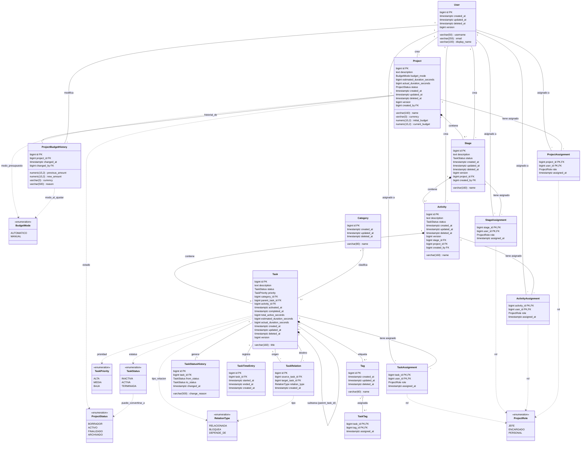

# Inspección del modelo ampliado — Gestor de Proyectos de Construcción

**Fecha de auditoría:** 2026-09-20
**Rama activa:** `develop` (sin cambios locales no documentados)
**Motor de BD:** PostgreSQL 18 (declarado en `database/migrations/V001__initial_schema.sql:1`, `docker-compose.yml:4`)
**Backend:** Spring Boot 4.1.0, Java 21 (declarado en `backend/pom.xml:10`, `backend/pom.xml:21`)
**ORM:** Spring Data JPA con consultas nativas (`backend/.../repository/TaskRepository.java`)
**DDL auto:** `validate` (`.env.example:12`) — la aplicación no genera ni modifica DDL
**Frontend:** Angular 22, TypeScript 6.0

---

## 1. Diagnóstico breve del modelo actual y evidencia

### 1.1 Esquema desplegado vs. modelo esperado por el código

| Aspecto | Esquema versionado (SQL) | Modelo esperado por código | Coincide |
|---|---|---|---|
| Tablas | 7 tablas en `task_manager` (V001) | `Task` entity mapea `tasks` | Sí |
| Vistas | 4 vistas (V002+V003) | `TaskRepository` consulta `v_tasks`, `v_task_history` | Sí |
| Triggers | 3 triggers (V001) | No reflejados en código Java | OK (son de BD) |
| Usuarios | **No existe tabla `users`** | No hay entity `User` | Ambos coinciden: no existe |
| Proyectos/Etapa/Actividad | **No existen** | **No existen** | Ambos coinciden: no existen |
| Presupuesto | **No existe** | **No existe** | Ambos coinciden: no existe |
| Duraciones prolongadas | `total_active_seconds` (segundos) + `task_time_entries` | No hay campos de estimación | **Discrepancia**: existe tiempo activo pero sin estimación |

### 1.2 Archivos/objetos revisados con evidencia concreta

#### Migraciones (orden cronológico)

| Archivo | Contenido | Símbolo |
|---|---|---|
| `database/migrations/V001__initial_schema.sql` | Esquema inicial: 7 tablas, índices, restricciones, triggers, funciones | **EXISTENTE VERIFICADO** |
| `database/migrations/V002__views_and_permissions.sql` | 4 vistas (`v_tasks`, `v_pending_tasks`, `v_task_history`, `v_task_archive`) + permisos para rol `gestor_tareas_app` | **EXISTENTE VERIFICADO** |
| `database/migrations/V003__task_archive.sql` | Vista `v_task_archive` para tareas terminadas/eliminadas | **EXISTENTE VERIFICADO** |

#### Entidades JPA

| Archivo | Mapeo | Símbolo |
|---|---|---|
| `backend/.../entity/Task.java` | Mapea `task_manager.tasks`; PK `id` (`IDENTITY`); `@Version` en `version`; 16 campos | **EXISTENTE VERIFICADO** |
| `backend/.../entity/TaskRelation.java` | Mapea `task_manager.task_relations`; PK `id`; FK `source_task_id`, `target_task_id` | **EXISTENTE VERIFICADO** |
| **No existe** `Project.java`, `Stage.java`, `Activity.java`, `User.java` | — | **PROPUESTA NUEVA** |

#### DTOs y contratos del backend

| Archivo | Contrato | Símbolo |
|---|---|---|
| `backend/.../dto/CreateTaskRequest.java` | `title`, `priority`, `categoryName`, `parentTaskId` | **EXISTENTE VERIFICADO** |
| `backend/.../dto/UpdateTaskRequest.java` | `title`, `description`, `priority`, `version` (solo campos editables) | **EXISTENTE VERIFICADO** |
| `backend/.../dto/TaskResponse.java` | 15 campos incluyendo `effectiveActiveSeconds` | **EXISTENTE VERIFICADO** |
| `backend/.../controller/TaskController.java` | Endpoints: CRUD, activate/complete/reopen/pause, relations, category | **EXISTENTE VERIFICADO** |
| `backend/.../controller/CategoryController.java` | `GET /api/categories` | **EXISTENTE VERIFICADO** |

#### Repositorios

| Archivo | Evidencia | Símbolo |
|---|---|---|
| `backend/.../repository/TaskRepository.java` | Consultas nativas sobre `v_tasks` y `v_task_history`; columnas como `Instant` (PgJDBC) | **EXISTENTE VERIFICADO** |
| `backend/.../repository/CategoryRepository.java` | CRUD visible sobre `categories`; insert/upsert por nombre | **EXISTENTE VERIFICADO** |
| `backend/.../repository/TaskRelationRepository.java` | `JpaRepository` + `findBySourceTaskId` + `existsBySourceTaskIdAndTargetTaskIdAndRelationType` | **EXISTENTE VERIFICADO** |

#### Frontend

| Archivo | Contrato | Símbolo |
|---|---|---|
| `frontend/.../core/models/task.ts` | Interfaz `Task` con 16 campos; `TaskStatus`, `TaskPriority`, `RelationType` como tipos | **EXISTENTE VERIFICADO** |
| `frontend/.../core/services/task.service.ts` | HTTP a `/api/tasks`; métodos: list, create, activate, complete, reopen, pause, update, changeCategory, relations | **EXISTENTE VERIFICADO** |
| `frontend/.../features/tasks/task-list/task-list.html` | UI: tarjetas, subtareas (1 nivel), activar/pausar/completar/reabrir, búsqueda, historial | **EXISTENTE VERIFICADO** |
| `frontend/.../features/tasks/task-home/task-home.html` | Formulario creación + lista + editor/creador subtareas | **EXISTENTE VERIFICADO** |
| `frontend/.../features/tasks/task-history/task-history.ts` | Lista historial con timeline de eventos y búsqueda | **EXISTENTE VERIFICADO** |

#### Vistas SQL

| Objeto | Definición | Símbolo |
|---|---|---|
| `task_manager.v_tasks` | SELECT sobre `tasks` LEFT JOIN `categories`, LATERAL `task_tags`, calcula `effective_active_seconds` | **EXISTENTE VERIFICADO** |
| `task_manager.v_pending_tasks` | Filtra `v_tasks` por `status IN ('INACTIVA','ACTIVA')` | **EXISTENTE VERIFICADO** |
| `task_manager.v_task_history` | `task_status_history` JOIN `tasks` | **EXISTENTE VERIFICADO** |
| `task_manager.v_task_archive` | Tareas `TERMINADA` o `deleted_at IS NOT NULL` con `effective_active_seconds` congelado en `deleted_at` | **EXISTENTE VERIFICADO** |

### 1.3 Cobertura y limitaciones

**Cobertura verificada:**
- Estados de tarea (`INACTIVA`, `ACTIVA`, `TERMINADA`) con constraint CHECK `ck_tasks_status`
- Transiciones de estado con trigger `trg_tasks_status_history` (auto-registro)
- Ciclos de subtareas prevenidos por trigger `trg_tasks_prevent_parent_cycle` y CHECK `ck_tasks_not_own_parent`
- Borrado lógico (`deleted_at`) con vistas que filtran
- Bloqueo optimista (`version` con `@Version`)
- Tiempo activo: `total_active_seconds` + `task_time_entries` (entradas con `started_at`/`ended_at`)
- Categorías con unicidad activa (`uq_categories_name_active_ci`)
- Relaciones entre tareas (`task_relations` con unicidad compuesta)
- Permisos por rol `gestor_tareas_app` (V002)

**Limitaciones detectadas:**
1. **No existe tabla de usuarios** — el modelo actual es "personal" sin identidad per-user. Para el gestor de proyectos se requiere `users`.
2. **No existe jerarquía proyecto→etapa→actividad** — las tareas son planas con autorreferencia de 1 nivel (limitado por `InvalidParentTaskException` en `TaskService.java:57-59`).
3. **No existe presupuesto ni historial de ajustes** — no hay tabla ni campo de presupuesto en ningún archivo revisado.
4. **No existe duración estimada** — `total_active_seconds` y `task_time_entries` miden tiempo transcurrido pero no hay `estimated_duration` ni `actual_duration` separados.
5. **Sin acceso a BD en esta inspección** — no se ejecutó `verify_schema.sql` contra una instancia real; el diagnóstico se basa exclusivamente en archivos del repositorio (V001-V003, entidades, DTOs, servicios, controladores, frontend).
6. **El cronómetro en vivo (`task_time_entries` con `started_at`/`ended_at`)** es el mecanismo actual de medición; el requisito exige sustituirlo por un registro de duración para tareas prolongadas.

### 1.4 Discrepancias entre esquema desplegado, versionado y modelo esperado

| Discrepancia | Esquema versionado | Modelo esperado por código | Decisión de diseño |
|---|---|---|---|
| No hay `users` | No existe tabla | No existe entity | Se crea `users` nueva (no hay alternativa para roles) |
| Jerarquía plana | Solo `tasks` con `parent_task_id` | No hay entity `Activity` | Se crean `project`, `stage`, `activity`; `tasks` mantiene `parent_task_id` para subtareas |
| Sin presupuesto | No hay columna/campo | No hay campo | Se crea `project` con presupuesto + `project_budget_history` |
| Sin estimación | `total_active_seconds` = tiempo real acumulado | No hay estimación | Se añade `estimated_duration_seconds` + `actual_duration_seconds` a `tasks` |
| Transición de datos | Tareas existentes sin `activity_id` | Requiere FK a actividad | `activity_id` nullable durante transición; requisito progresivo |

---

## 2. Decisiones de ampliación, supuestos pendientes y matriz de permisos

### 2.1 Decisiones de diseño

| ID | Decisión | Justificación |
|---|---|---|
| D-01 | Reutilizar `tasks` para el nivel "Tarea" de la jerarquía (nivel 4), con subtareas vía `parent_task_id` (nivel 5) | Existe la autorrelación y las FK; no crear duplicado de tarea |
| D-02 | Crear `project`, `stage`, `activity` como entidades nuevas con PK `bigint IDENTITY` | No existen en el modelo; siguen convención de nombres y tipos del repositorio |
| D-03 | Relación 1:N: `project`→`stage`→`activity`→`task` con FK obligatoria en el hijo | Cada hijo pertenece a exactamente un padre según requisito |
| D-04 | Mantener `parent_task_id` para subtareas (autorreferencia en `tasks`), relajando la restricción de profundidad 1 | El requisito dice "subtarea" como nivel 5; la autorrelación existente es adecuada |
| D-05 | Crear tabla `users` nueva (no existe identidad per-user) | No hay alternativa; todos los roles (JEFE, ENCARGADO, PERSONAL) requieren persona |
| D-06 | Resolver N:N (usuario↔proyecto, etc.) mediante tablas asociativas con PK compuesta y FK dobles | Evita `entity_type/entity_id` genérico; integridad referencial verificable |
| D-07 | Moneda por proyecto: `currency varchar(3)` en `project` (ISO 4217) | Requisito explícito: "Define una moneda por proyecto" |
| D-08 | Presupuesto como `numeric(15,2)`: 15 dígitos, 2 decimales (hasta 999,999,999,999.99) | Precisión exacta para dinero; sin float/double |
| D-09 | Duraciones en segundos (`bigint`): `estimated_duration_seconds`, `actual_duration_seconds` | Coherente con `total_active_seconds` existente; uniforme y explícito |
| D-10 | Modo presupuestario `budget_mode`: `AUTOMATICO` (default) o `MANUAL` | Regla de ajuste automático vs. manual según requisito |
| D-11 | Historial de presupuesto solo-aditivo con FK `changed_by`→`users` | Trazabilidad sin borrados; correcciones generan nuevo registro |
| D-12 | Estados de proyecto: `BORRADOR` (default), `ACTIVO`, `FINALIZADO`, `ARCHIVADO` | Permite proyecto nuevo sin etapas (BORRADOR) |
| D-13 | `created_by` en `project`, `stage`, `activity` para autoría de registro | Distingue pertenencia al proyecto, asignación de trabajo y autoría |
| D-14 | Mantener `task_time_entries` y `total_active_seconds` para compatibilidad; nuevos campos `estimated_duration_seconds` y `actual_duration_seconds` como fuente de verdad para duraciones | Conserva historial del cronómetro; nuevos campos para trabajo prolongado |
| D-15 | `activity_id` en `tasks` nullable durante transición | Las tareas antiguas no tienen actividad; se exige progresivamente |

### 2.2 Supuestos pendientes (requieren validación de negocio)

| ID | Supuesto | Consecuencia si no se valida |
|---|---|---|
| S-01 | **Un JEFE por proyecto, varios ENCARGADOS posibles, varios PERSONAL posibles** | Si el negocio permite múltiples JEFE, el modelo ya lo soporta (ProjectAssignment con rol) |
| S-02 | **El personal solo puede actuar sobre tareas donde está asignado** (crear subtareas no concede permisos adicionales) | Requiere validación en servicio; no verificable sin BD |
| S-03 | **Asignación a descendiente hereda acceso del ancestro** (acceso heredado + directo) | Requiere validación en servicio |
| S-04 | **Modo AUTOMÁTICO: `estimacion_vigente_nueva = max(estimacion_vigente_anterior, tiempo_completado_actual)`** | Interpretación explícita del requisito; requiere validación |
| S-05 | **Edición manual autorizada cambia a MANUAL; para volver a AUTOMÁTICO se requiere acción explícita** | Interpretación de "si no fue cambiado" |
| S-06 | **El tiempo completado del proyecto incluye solo tareas TERMINADA con duración registrada**; desconocido ≠ 0 | Evita contabilizar sin dato |
| S-07 | **Tiempo inclusivo de la tarea padre**: el total del proyecto suma duraciones de tareas TERMINADA sin duplicar subtareas | Evita doble conteo |
| S-08 | **Moneda ISO 4217 por proyecto** (default EUR) | Si el negocio necesita múltiples monedas, requiere tabla de conversión (no solicitada) |
| S-09 | **`users.username` único, `email` opcional y único** | Convención estándar; sin evidencia en repositorio |
| S-10 | **Las operaciones de completar/recalcular son atómicas en una transacción** (Spring `@Transactional` como el servicio actual) | Sin BD no se verifica concurrencia |

### 2.3 Matriz de permisos

| Acción | JEFE | ENCARGADO | PERSONAL | Mecanismo |
|---|:---:|:---:|:---:|---|
| Crear proyecto | ✓ (S-01) | | | Servicio + restricción FK project→assignment(JEFE/ENCARGADO) |
| Ajustar presupuesto (modo AUTOMÁTICO) | ✓ (S-01) | ✓ (S-01) | | Servicio verifica modo ≠ MANUAL y rol |
| Cambiar modo a MANUAL | ✓ (S-01) | ✓ (S-01) | | Servicio: cualquier edición manual autorizada cambia modo |
| Crear etapa/actividad | | ✓ | | FK stage/activity→project + assignment(ENCARGADO) |
| Asignar personal a etapa/actividad | | ✓ | | Tabla asignación + verificación de pertenencia a proyecto |
| Crear tarea (en actividad) | | ✓ | | FK task→activity + assignment |
| Crear subtarea | | ✓ | ✓ | FK task→task (parent_task_id); límite de profundidad TBD |
| Marcar tarea/subtarea como completada | | ✓ | ✓ | Lifecycle ACTIVA→TERMINADA con verificación de asignación |
| Editar título/descripción/prioridad | | ✓ | ✓ (propio) | UpdateTaskRequest existente + verificación de asignación |
| Ver tareas del proyecto | ✓ | ✓ | ✓ | Asignación a proyecto (cualquier rol) o propiedad |
| Ajustar presupuesto en modo MANUAL | ✓ | | | Solo JEFE (S-01) |
| Devolver AUTOMÁTICO desde MANUAL | ✓ (S-01) | | | Acción explícita (S-05) |

**Leyenda:** ✓ = permitido; (S-XX) = depende de supuesto documentado; vacío = no permitido.

---

## 3. Diagrama de clases de dominio

 Código completo en `docs/modelado/gestor-proyectos-clases.mmd`:



**Notas del diagrama de clases:**
- **Composición (`*--`)**: Project→Stage→Activity→Task representa dependencia existencial (un nivel no existe sin su padre).
- **Agregación (`o--`)**: Category→Task y Tag→TaskTag son relaciones débiles (la categoría/tag puede existir sin tareas).
- **Atributos derivados** (marcados para calcular, no necesariamente almacenar): `actual_duration_seconds` de un proyecto, acumulado de actividad/etapa.
- **Operaciones de negocio relevantes** (propuestas en documentación, no como métodos de entidad): `completeWithDuration`, `recalculateProjectTime`, `adjustBudget`, `autoIncreaseBudget`.

---

## 4. Diagrama entidad–relación físico

 Código completo en `docs/modelado/gestor-proyectos-er.mmd`:

```mermaid
erDiagram

    %% ==========================================
    %% CATEGORIA
    %% ==========================================
    CATEGORY ||--o{ TASK : "clasifica (1:N)"
    CATEGORY {
        bigint id PK
        varchar(80) name UK
        timestamptz created_at NOT NULL
        timestamptz updated_at NOT NULL
        timestamptz deleted_at
    }

    %% ==========================================
    %% ETIQUETAS
    %% ==========================================
    TAG ||--o{ TASK_TAG : "asignada (N:N via)"
    TAG {
        bigint id PK
        varchar(60) name UK
        timestamptz created_at NOT NULL
        timestamptz updated_at NOT NULL
        timestamptz deleted_at
    }

    %% ==========================================
    %% PROYECTO
    %% ==========================================
    PROJECT ||--o{ STAGE : "contiene (1:N)"
    PROJECT ||--o{ ACTIVITY : "contiene via etapa (1:N)"
    PROJECT ||--o{ PROJECT_ASSIGNMENT : "asigna (1:N)"
    PROJECT ||--o{ PROJECT_BUDGET_HISTORY : "historial (1:N)"
    USER ||--o{ PROJECT : "crea (1:N)"
    PROJECT {
        bigint id PK
        varchar(160) name NOT NULL
        text description
        varchar(3) currency NOT NULL DEFAULT 'EUR'
        numeric(15,2) initial_budget NOT NULL DEFAULT 0
        numeric(15,2) current_budget NOT NULL DEFAULT 0
        varchar(12) budget_mode NOT NULL DEFAULT 'AUTOMATICO'
        bigint estimated_duration_seconds NOT NULL DEFAULT 0
        bigint actual_duration_seconds NOT NULL DEFAULT 0
        varchar(16) status NOT NULL DEFAULT 'BORRADOR'
        timestamptz created_at NOT NULL
        timestamptz updated_at NOT NULL
        timestamptz deleted_at
        bigint version NOT NULL DEFAULT 0
        bigint created_by FK NOT NULL
    }

    %% ==========================================
    %% ETAPA
    %% ==========================================
    STAGE ||--o{ ACTIVITY : "contiene (1:N)"
    STAGE ||--o{ STAGE_ASSIGNMENT : "asigna personal (1:N)"
    USER ||--o{ STAGE_ASSIGNMENT : "asignado (1:N)"
    PROJECT ||--o{ STAGE : "depende (N:1)"
    STAGE {
        bigint id PK
        varchar(160) name NOT NULL
        text description
        varchar(16) status NOT NULL DEFAULT 'INACTIVA'
        timestamptz created_at NOT NULL
        timestamptz updated_at NOT NULL
        timestamptz deleted_at
        bigint version NOT NULL DEFAULT 0
        bigint project_id FK NOT NULL
        bigint created_by FK NOT NULL
    }

    %% ==========================================
    %% ACTIVIDAD
    %% ==========================================
    ACTIVITY ||--o{ TASK : "contiene (1:N)"
    ACTIVITY ||--o{ ACTIVITY_ASSIGNMENT : "asigna personal (1:N)"
    USER ||--o{ ACTIVITY_ASSIGNMENT : "asignado (1:N)"
    STAGE ||--o{ ACTIVITY : "depende (N:1)"
    PROJECT ||--o{ ACTIVITY : "depende via etapa (N:1)"
    ACTIVITY {
        bigint id PK
        varchar(160) name NOT NULL
        text description
        varchar(16) status NOT NULL DEFAULT 'INACTIVA'
        timestamptz created_at NOT NULL
        timestamptz updated_at NOT NULL
        timestamptz deleted_at
        bigint version NOT NULL DEFAULT 0
        bigint stage_id FK NOT NULL
        bigint project_id FK NOT NULL
        bigint created_by FK NOT NULL
    }

    %% ==========================================
    %% TAREA (EXISTENTE - NIVEL 4 EN JERARQUIA)
    %% ==========================================
    TASK ||--o{ TASK : "subtarea via parent_task_id (1:N)"
    TASK ||--o{ TASK_TAG : "tiene (1:N)"
    TASK ||--o{ TASK_STATUS_HISTORY : "genera (1:N)"
    TASK ||--o{ TASK_TIME_ENTRY : "registra (1:N)"
    TASK ||--o{ TASK_RELATION : "origen (1:N)"
    TASK ||--o{ TASK_RELATION : "destino (1:N)"
    TASK ||--o{ TASK_ASSIGNMENT : "asigna personal (1:N)"
    USER ||--o{ TASK_ASSIGNMENT : "asignado (1:N)"
    ACTIVITY ||--o{ TASK : "depende (N:1)"
    CATEGORY ||--o{ TASK : "clasifica (N:1)"
    TASK {
        bigint id PK
        varchar(160) title NOT NULL
        text description
        varchar(16) status NOT NULL DEFAULT 'INACTIVA'
        varchar(8) priority NOT NULL DEFAULT 'MEDIA'
        bigint category_id FK
        bigint parent_task_id FK
        bigint activity_id FK
        timestamptz activated_at
        timestamptz completed_at
        bigint total_active_seconds NOT NULL DEFAULT 0
        bigint estimated_duration_seconds NOT NULL DEFAULT 0
        bigint actual_duration_seconds NOT NULL DEFAULT 0
        timestamptz created_at NOT NULL
        timestamptz updated_at NOT NULL
        timestamptz deleted_at
        bigint version NOT NULL DEFAULT 0
    }

    %% ==========================================
    %% TAGS ASIGNADAS A TAREAS (N:N)
    %% ==========================================
    TASK_TAG {
        bigint task_id PK,FK NOT NULL
        bigint tag_id PK,FK NOT NULL
        timestamptz assigned_at NOT NULL
    }

    %% ==========================================
    %% RELACIONES ENTRE TAREAS (N:N)
    %% ==========================================
    TASK ||--o{ TASK_RELATION : "origen (1:N)"
    TASK ||--o{ TASK_RELATION : "destino (1:N)"
    TASK_RELATION {
        bigint id PK
        bigint source_task_id FK NOT NULL
        bigint target_task_id FK NOT NULL
        varchar(20) relation_type NOT NULL DEFAULT 'RELACIONADA'
        timestamptz created_at NOT NULL
    }

    %% ==========================================
    %% HISTORIAL DE ESTADOS
    %% ==========================================
    TASK ||--o{ TASK_STATUS_HISTORY : "genera (1:N)"
    TASK_STATUS_HISTORY {
        bigint id PK
        bigint task_id FK NOT NULL
        varchar(16) from_status
        varchar(16) to_status NOT NULL
        varchar(500) change_reason
        timestamptz changed_at NOT NULL
    }

    %% ==========================================
    %% ENTRADAS DE TIEMPO
    %% ==========================================
    TASK ||--o{ TASK_TIME_ENTRY : "registra (1:N)"
    TASK_TIME_ENTRY {
        bigint id PK
        bigint task_id FK NOT NULL
        timestamptz started_at NOT NULL
        timestamptz ended_at
        timestamptz created_at NOT NULL
    }

    %% ==========================================
    %% USUARIO
    %% ==========================================
    USER ||--o{ PROJECT_ASSIGNMENT : "asignado (1:N)"
    USER ||--o{ STAGE_ASSIGNMENT : "asignado (1:N)"
    USER ||--o{ ACTIVITY_ASSIGNMENT : "asignado (1:N)"
    USER ||--o{ TASK_ASSIGNMENT : "asignado (1:N)"
    USER ||--o{ PROJECT_BUDGET_HISTORY : "modifica (1:N)"
    USER ||--o{ PROJECT : "crea (1:N)"
    USER ||--o{ STAGE : "crea (1:N)"
    USER ||--o{ ACTIVITY : "crea (1:N)"
    USER {
        bigint id PK
        varchar(50) username NOT NULL
        varchar(255) email
        varchar(100) display_name NOT NULL
        timestamptz created_at NOT NULL
        timestamptz updated_at NOT NULL
        timestamptz deleted_at
        bigint version NOT NULL DEFAULT 0
    }

    %% ==========================================
    %% ASIGNACIONES N:N RESUELTAS (Tablas intermedias)
    %% ==========================================
    PROJECT_ASSIGNMENT {
        bigint project_id PK,FK NOT NULL
        bigint user_id PK,FK NOT NULL
        varchar(12) role NOT NULL
        timestamptz assigned_at NOT NULL
    }
    PROJECT ||--|{ PROJECT_ASSIGNMENT : "tiene asignado (1:N)"
    USER ||--|{ PROJECT_ASSIGNMENT : "tiene asignacion (1:N)"

    STAGE_ASSIGNMENT {
        bigint stage_id PK,FK NOT NULL
        bigint user_id PK,FK NOT NULL
        varchar(12) role NOT NULL
        timestamptz assigned_at NOT NULL
    }
    STAGE ||--|{ STAGE_ASSIGNMENT : "tiene asignado (1:N)"
    USER ||--|{ STAGE_ASSIGNMENT : "tiene asignacion (1:N)"

    ACTIVITY_ASSIGNMENT {
        bigint activity_id PK,FK NOT NULL
        bigint user_id PK,FK NOT NULL
        varchar(12) role NOT NULL
        timestamptz assigned_at NOT NULL
    }
    ACTIVITY ||--|{ ACTIVITY_ASSIGNMENT : "tiene asignado (1:N)"
    USER ||--|{ ACTIVITY_ASSIGNMENT : "tiene asignacion (1:N)"

    TASK_ASSIGNMENT {
        bigint task_id PK,FK NOT NULL
        bigint user_id PK,FK NOT NULL
        varchar(12) role NOT NULL
        timestamptz assigned_at NOT NULL
    }
    TASK ||--|{ TASK_ASSIGNMENT : "tiene asignado (1:N)"
    USER ||--|{ TASK_ASSIGNMENT : "tiene asignacion (1:N)"

    %% ==========================================
    %% HISTORIAL DE PRESUPUESTO
    %% ==========================================
    PROJECT_BUDGET_HISTORY {
        bigint id PK
        bigint project_id FK NOT NULL
        numeric(15,2) previous_amount NOT NULL
        numeric(15,2) new_amount NOT NULL
        varchar(3) currency NOT NULL
        timestamptz changed_at NOT NULL
        bigint changed_by FK NOT NULL
        varchar(500) reason
    }
    PROJECT ||--|{ PROJECT_BUDGET_HISTORY : "historial (1:N)"
    USER ||--|{ PROJECT_BUDGET_HISTORY : "modifica (1:N)"
```

**Notas del diagrama ER:**
- Las tablas intermedias (PROJECT_ASSIGNMENT, etc.) resuelven relaciones N:N con FKs dobles y PK compuesta.
- `PROJECT ||--|{ PROJECT_ASSIGNMENT` significa: un proyecto tiene muchas asignaciones (obligatorio en ambos lados).
- Las vistas (`v_tasks`, `v_pending_tasks`, `v_task_history`, `v_task_archive`) son objetos derivados, no tablas base; no aparecen en el ER físico.
- Los triggers (`trg_tasks_prevent_parent_cycle`, `trg_tasks_status_history`, `trg_*_updated_at`) son objetos de comportamiento, no tablas.

---

## 5. Tabla de relaciones

### 5.1 Jerarquía funcional

| Origen | Destino | Relación lógica | Mín. origen | Máx. origen | Mín. dest. | Máx. dest. | FK / Tabla intermedia | Regla |
|---|---|---|---|---|---|---|---|---|
| Project | Stage | 1:N contiene | 1 | 1 | 0 | * | `stage.project_id` FK→project | Una etapa pertenece a exactamente un proyecto (FK obligatoria) |
| Stage | Activity | 1:N contiene | 1 | 1 | 0 | * | `activity.stage_id` FK→stage | Una actividad pertenece a exactamente una etapa |
| Activity | Task | 1:N contiene | 1 | 1 | 0 | * | `task.activity_id` FK→activity | Una tarea pertenece a exactamente una actividad (nullable en transición) |
| Task | Task | 1:N subtarea (autorreferencia) | 0 | 1 | 0 | * | `task.parent_task_id` FK→task | Subtarea tiene tarea padre; se permite profundidad N (restringir en servicio) |

### 5.2 Clasificación y etiquetado

| Origen | Destino | Relación lógica | Mín. origen | Máx. origen | Mín. dest. | Máx. dest. | FK / Tabla intermedia | Regla |
|---|---|---|---|---|---|---|---|---|
| Category | Task | 1:N clasifica | 1 | 1 | 0 | * | `task.category_id` FK→category | Categoría opcional por tarea |
| Task | Tag | N:N etiqueta | 0 | * | 0 | * | `task_tags` (PK compuesta: task_id, tag_id) | Resolución N:N mediante tabla intermedia con unicidad (task_id, tag_id) |

### 5.3 Relaciones entre tareas

| Origen | Destino | Relación lógica | Mín. origen | Máx. origen | Mín. dest. | Máx. dest. | FK / Tabla intermedia | Regla |
|---|---|---|---|---|---|---|---|---|
| Task | Task | N:N relación | 0 | * | 0 | * | `task_relations` (PK: id; UK: source_task_id, target_task_id, relation_type) | Tipo: RELACIONADA, BLOQUEA, DEPENDE_DE; auto-referencia prohibida (source ≠ target) |

### 5.4 Auditoría y tiempo

| Origen | Destino | Relación lógica | Mín. origen | Máx. origen | Mín. dest. | Máx. dest. | FK / Tabla intermedia | Regla |
|---|---|---|---|---|---|---|---|---|
| Task | TaskStatusHistory | 1:N genera | 1 | 1 | 0 | * | `task_status_history.task_id` FK→task | Solo adición; correcciones generan nuevo registro |
| Task | TaskTimeEntry | 1:N registra | 1 | 1 | 0 | * | `task_time_entry.task_id` FK→task | Entrada de tiempo del cronómetro (existente); máximo 1 abierta por tarea (UK parcial) |

### 5.5 Usuarios y asignaciones

| Origen | Destino | Relación lógica | Mín. origen | Máx. origen | Mín. dest. | Máx. dest. | FK / Tabla intermedia | Regla |
|---|---|---|---|---|---|---|---|---|
| User | Project | 1:N crea | 1 | 1 | 0 | * | `project.created_by` FK→user | Usuario que crea el proyecto |
| User | ProjectAssignment | 1:N asignado | 1 | 1 | 0 | * | `project_assignment` PK: (project_id, user_id) | Un usuario tiene un rol por proyecto |
| Project | ProjectAssignment | 1:N tiene asignado | 1 | 1 | 0 | * | `project_assignment` PK: (project_id, user_id) | Un proyecto tiene asignados usuarios con rol JEFE/ENCARGADO |
| User | StageAssignment | 1:N asignado | 1 | 1 | 0 | * | `stage_assignment` PK: (stage_id, user_id) | Personal asignado a una etapa |
| Stage | StageAssignment | 1:N tiene asignado | 1 | 1 | 0 | * | `stage_assignment` PK: (stage_id, user_id) | Una etapa tiene personal asignado |
| User | ActivityAssignment | 1:N asignado | 1 | 1 | 0 | * | `activity_assignment` PK: (activity_id, user_id) | Personal asignado a una actividad |
| Activity | ActivityAssignment | 1:N tiene asignado | 1 | 1 | 0 | * | `activity_assignment` PK: (activity_id, user_id) | Una actividad tiene personal asignado |
| User | TaskAssignment | 1:N asignado | 1 | 1 | 0 | * | `task_assignment` PK: (task_id, user_id) | Personal asignado a una tarea |
| Task | TaskAssignment | 1:N tiene asignado | 1 | 1 | 0 | * | `task_assignment` PK: (task_id, user_id) | Una tarea tiene personal asignado |

### 5.6 Presupuesto

| Origen | Destino | Relación lógica | Mín. origen | Máx. origen | Mín. dest. | Máx. dest. | FK / Tabla intermedia | Regla |
|---|---|---|---|---|---|---|---|---|
| Project | ProjectBudgetHistory | 1:N historial | 1 | 1 | 0 | * | `project_budget_history.project_id` FK→project | Solo adición; trazabilidad completa |
| User | ProjectBudgetHistory | 1:N modifica | 1 | 1 | 0 | * | `project_budget_history.changed_by` FK→user | Quién realizó el ajuste |

### 5.7 Reglas de integridad destacadas

| Regla | Tipo de garantía | Mecanismo |
|---|---|---|
| Una tarea no puede ser su propia padre | BD | Trigger `trg_tasks_prevent_parent_cycle` (EXISTENTE) + CHECK `ck_tasks_not_own_parent` (EXISTENTE) |
| Estados de transición válidos | BD | CHECK `ck_tasks_status` + CHECK `ck_tasks_state_timestamps` (EXISTENTE) |
| Una tarea con subtareas visibles no se elimina | BD + Servicio | CHECK a través de `existsByParentTaskIdAndDeletedAtIsNull` en servicio |
| Asignación a descendiente pertenece al mismo proyecto | Servicio | Validación de recorrido de ancestros (project_id de task = project_id de asignación) |
| Presupuesto solo-aditivo | BD + Servicio | INSERT-only en `project_budget_history`; corregir con nuevo registro |
| Concurrencia en ajustes de presupuesto | BD | FK + `version` optimista en `project` (propuesto) |
| Una persona tiene un rol por proyecto | BD | PK compuesta en `project_assignment` (project_id, user_id) |
| Relación N:N entre tareas única | BD | UK en `task_relations(source_task_id, target_task_id, relation_type)` (EXISTENTE) |

---

## 6. Diccionario de campos nuevos/modificados

### 6.1 Campos nuevos en tablas existentes

#### `tasks` (Task.java → tabla `task_manager.tasks`)

| Campo | Tipo SQL | Tipo Java | Nulabilidad | Unidad/Moneda | Default | Restricciones | Justificación |
|---|---|---|---|---|---|---|---|
| `activity_id` | `bigint` (FK→activities.id) | `Long` | NULLABLE | — | NULL | FK, CHECK (en transición: nullable, futuro NOT NULL) | Pertenencia a actividad; transición gradual |
| `estimated_duration_seconds` | `bigint` | `Long` | NOT NULL | segundos | 0 | CHECK (≥ 0) | Duración estimada de trabajo prolongado |
| `actual_duration_seconds` | `bigint` | `Long` | NOT NULL | segundos | 0 | CHECK (≥ 0) | Duración real acumulada de tareas completadas |

**Campos existentes conservados en `tasks`** (inventario breve): `id`, `title`, `description`, `status`, `priority`, `category_id`, `parent_task_id`, `activated_at`, `completed_at`, `total_active_seconds`, `created_at`, `updated_at`, `deleted_at`, `version`. Todos conservados sin modificación.

#### `project` (nueva tabla `task_manager.project`)

| Campo | Tipo SQL | Tipo Java | Nulabilidad | Unidad/Moneda | Default | Restricciones | Justificación |
|---|---|---|---|---|---|---|---|
| `id` | `bigint GENERATED BY DEFAULT AS IDENTITY` | `Long` | NOT NULL | — | — | PK | Identificador único |
| `name` | `varchar(160)` | `String` | NOT NULL | — | — | CHECK (≥1, ≤160) | Nombre del proyecto |
| `description` | `text` | `String` | NULLABLE | — | NULL | CHECK (≤4000) | Descripción |
| `currency` | `varchar(3)` | `String` | NOT NULL | ISO 4217 | 'EUR' | CHECK (3 caracteres) | Moneda del proyecto |
| `initial_budget` | `numeric(15,2)` | `BigDecimal` | NOT NULL | moneda del proyecto | 0.00 | CHECK (≥ 0) | Presupuesto inicial |
| `current_budget` | `numeric(15,2)` | `BigDecimal` | NOT NULL | moneda del proyecto | 0.00 | CHECK (≥ 0) | Presupuesto vigente (fuente de verdad) |
| `budget_mode` | `varchar(12)` | `String` | NOT NULL | — | 'AUTOMATICO' | CHECK (AUTOMATICO, MANUAL) | Modo de ajuste de presupuesto |
| `estimated_duration_seconds` | `bigint` | `Long` | NOT NULL | segundos | 0 | CHECK (≥ 0) | Estimación total de duración |
| `actual_duration_seconds` | `bigint` | `Long` | NOT NULL | segundos | 0 | CHECK (≥ 0) | Tiempo completado acumulado |
| `status` | `varchar(16)` | `String` | NOT NULL | — | 'BORRADOR' | CHECK (BORRADOR, ACTIVO, FINALIZADO, ARCHIVADO) | Estado del proyecto |
| `created_at` | `timestamptz` | `Instant` | NOT NULL | — | CURRENT_TIMESTAMP | — | Fecha de creación |
| `updated_at` | `timestamptz` | `Instant` | NOT NULL | — | CURRENT_TIMESTAMP | Trigger `trg_*_updated_at` | Última modificación |
| `deleted_at` | `timestamptz` | `Instant` | NULLABLE | — | NULL | CHECK (≥ created_at) | Borrado lógico |
| `version` | `bigint` | `Long` | NOT NULL | — | 0 | CHECK (≥ 0) | Bloqueo optimista |
| `created_by` | `bigint` | `Long` | NOT NULL | — | — | FK→users.id | Autoría del registro |

### 6.2 Tablas nuevas

#### `users` (nueva tabla `task_manager.users`)

| Campo | Tipo SQL | Tipo Java | Nulabilidad | Unidad/Moneda | Default | Restricciones | Justificación |
|---|---|---|---|---|---|---|---|
| `id` | `bigint GENERATED BY DEFAULT AS IDENTITY` | `Long` | NOT NULL | — | — | PK | Identificador único |
| `username` | `varchar(50)` | `String` | NOT NULL | — | — | UNIQUE, CHECK (≥1) | Nombre de usuario |
| `email` | `varchar(255)` | `String` | NULLABLE | — | NULL | UNIQUE (cuando no nulo) | Email opcional |
| `display_name` | `varchar(100)` | `String` | NOT NULL | — | — | CHECK (≥1) | Nombre visible |
| `created_at` | `timestamptz` | `Instant` | NOT NULL | — | CURRENT_TIMESTAMP | — | Fecha de creación |
| `updated_at` | `timestamptz` | `Instant` | NOT NULL | — | CURRENT_TIMESTAMP | Trigger | Última modificación |
| `deleted_at` | `timestamptz` | `Instant` | NULLABLE | — | NULL | CHECK (≥ created_at) | Borrado lógico |
| `version` | `bigint` | `Long` | NOT NULL | — | 0 | CHECK (≥ 0) | Bloqueo optimista |

#### `project_budget_history` (nueva tabla `task_manager.project_budget_history`)

| Campo | Tipo SQL | Tipo Java | Nulabilidad | Unidad/Moneda | Default | Restricciones | Justificación |
|---|---|---|---|---|---|---|---|
| `id` | `bigint GENERATED BY DEFAULT AS IDENTITY` | `Long` | NOT NULL | — | — | PK | Identificador único |
| `project_id` | `bigint` | `Long` | NOT NULL | — | — | FK→project.id, NOT NULL | Proyecto afectado |
| `previous_amount` | `numeric(15,2)` | `BigDecimal` | NOT NULL | moneda del proyecto | — | CHECK (≥ 0) | Importe anterior |
| `new_amount` | `numeric(15,2)` | `BigDecimal` | NOT NULL | moneda del proyecto | — | CHECK (≥ 0) | Importe nuevo |
| `currency` | `varchar(3)` | `String` | NOT NULL | ISO 4217 | — | CHECK (3 caracteres) | Moneda del ajuste (duplicada para trazabilidad histórica) |
| `changed_at` | `timestamptz` | `Instant` | NOT NULL | — | CURRENT_TIMESTAMP | — | Fecha/hora del ajuste |
| `changed_by` | `bigint` | `Long` | NOT NULL | — | — | FK→users.id | Responsable del ajuste |
| `reason` | `varchar(500)` | `String` | NULLABLE | — | NULL | CHECK (≤500) | Motivo del ajuste |

#### Tablas asociativas (resumen)

| Tabla | PK | FK | Atributos adicionales | Resolución N:N |
|---|---|---|---|---|
| `project_assignment` | (project_id, user_id) | project_id→project, user_id→users | role (ProjectRole), assigned_at | JEFE/ENCARGADO por proyecto |
| `stage_assignment` | (stage_id, user_id) | stage_id→stage, user_id→users | role (ProjectRole), assigned_at | PERSONAL por etapa |
| `activity_assignment` | (activity_id, user_id) | activity_id→activity, user_id→users | role (ProjectRole), assigned_at | PERSONAL por actividad |
| `task_assignment` | (task_id, user_id) | task_id→task, user_id→users | role (ProjectRole), assigned_at | PERSONAL por tarea |
| `task_tags` | (task_id, tag_id) | task_id→task, tag_id→tags | assigned_at | Etiquetas por tarea |

**Convención de nombres**: todas las tablas asociativas siguen el patrón `{entity}_assignment` o `{entity}_tags` del repositorio existente (`task_tags`).

---

## 7. Trazabilidad para inspección

### 7.1 Presupuesto

| Requisito | Elementos del modelo | Regla de integridad/permiso | Caso de verificación |
|---|---|---|---|
| Presupuesto ajustable por proyecto | `project.current_budget`, `project.budget_mode` | FK→project; CHECK≥0; modo AUTOMATICO/MANUAL | Crear proyecto con presupuesto 10000 EUR; ajustar a 12000 → verificar `current_budget` y nuevo registro en `project_budget_history` |
| Historial de modificaciones | `project_budget_history` | INSERT-only; FK→project, FK→user; trazabilidad al archivar | Ajustar presupuesto 3 veces → verificar 3 registros con anterior, nuevo, responsable, motivo |
| Fuente de verdad del importe vigente | `project.current_budget` | Almacenado junto al historial; coherencia en misma transacción (REPEATABLE_READ) | Insertar ajuste y actualizar `current_budget` en una transacción atómica |
| Creación del presupuesto inicial | Primer registro en `project_budget_history` con `previous_amount = 0` | `previous_amount` es 0 en la creación; `new_amount` es el presupuesto inicial | Crear proyecto con presupuesto 50000 → verificar primer historial: prev=0, new=50000 |
| Ajuste automático al superar estimación | `project.budget_mode = AUTOMATICO`; regla en servicio | `current_budget = max(current_budget, tiempo_completado)`; preservar original | Estimación 100h, completado 110h → presupuesto sube a 110h automáticamente |
| Modo MANUAL no sobrescribe | `project.budget_mode = MANUAL` | No cambiar `current_budget` automáticamente; calcular desviación | Estimación manual 120h, completado 130h → mantener 120h, registrar desviación |
| Moneda por proyecto | `project.currency` en `project` y `project_budget_history` | Sin conversión implícita; CHECK 3 caracteres ISO | Proyecto en EUR no puede sumar con USD sin conversión explícita |

### 7.2 Tiempos y duraciones

| Requisito | Elementos del modelo | Regla de integridad/permiso | Caso de verificación |
|---|---|---|---|
| Cada tarea distingue duración estimada y real | `task.estimated_duration_seconds`, `task.actual_duration_seconds` | Ambos NOT NULL DEFAULT 0; CHECK≥0 | Tarea con estimación 8h (28800s) y real 10h (36000s) |
| Completar no convierte estimación en real | Servicio: `complete()` suma a `total_active_seconds`, no a `actual_duration_seconds` | Actualizar `actual_duration_seconds` solo al cerrar con registro válido | Completar tarea → `total_active_seconds` se actualiza, `actual_duration_seconds` queda como estimación hasta registro explícito |
| Unidad base uniforme | `bigint` segundos en ambos campos y `total_active_seconds` | Nombre explícito: `_seconds` | Formato `HH:MM:SS` en UI usa `TimeFormatPipe` con segundos |
| Tipo para duraciones largas | `bigint` (hasta 9.2 × 10^18 segundos ≈ 292 mil millones de años) | Sin overflow práctico | Tarea de 10000 horas = 36000000 segundos (bien dentro de bigint) |
| Total del proyecto acumulado | `project.actual_duration_seconds` | Suma de `task.actual_duration_seconds` de tareas TERMINADA; atómico en transacción | Completar tarea de 10h en proyecto → total del proyecto aumenta en 10h |
| Política inclusiva del padre | Servicio: `actual_duration_seconds` del padre incluye acumulado de hijos | Evita duplicar tiempo entre tarea y subtareas | Tarea padre 5h + subtarea 3h = total 5h (no 8h); subtarea contabiliza dentro de la padre |
| Duración desconocida | Política: no se contabiliza; no se convierte en 0 | Validación en servicio; documentar en registro | Tarea sin `actual_duration_seconds` registrada no suma al total del proyecto |
| Recalcular al completar/reabrir | Servicio recalcula al completar, reabrir o corregir duración | Operaciones atómicas en `@Transactional`; `version` optimista | Completar → recalcular → reabrir → recalcular: sin duplicados |

### 7.3 Jerarquía

| Requisito | Elementos del modelo | Regla de integridad/permiso | Caso de verificación |
|---|---|---|---|
| Proyecto → Etapa → Actividad → Tarea → Subtarea | FK encadenados: stage.project_id, activity.stage_id, task.activity_id, task.parent_task_id | FK obligatorias (nullable en transición para activity_id) | Crear proyecto → etapa → actividad → tarea → subtarea: cada uno con FK válido |
| Impedir autorreferencias | Trigger `trg_tasks_prevent_parent_cycle` + CHECK `ck_tasks_not_own_parent` | BD (EXISTENTE) | Tarea A no puede tener parent_task_id = A |
| Impedir ciclos | Trigger recursivo `trg_tasks_prevent_parent_cycle` | BD (EXISTENTE) | A→B→C→A es imposible |
| Asociaciones entre proyectos distintos | FK obligatoria al padre implica mismo proyecto | Servicio verifica que activity→stage→project y task→activity tengan mismo project_id | Tarea de proyecto X no puede tener subtarea de proyecto Y |
| Profundidad no permitida | Servicio: restricción configurable | Documentar límite máximo (sugerido: 5 niveles totales) | Subtarea de subtarea permitida solo hasta nivel 5 |
| Estados de borrador | `project.status = 'BORRADOR'` permite crear sin etapas | Cardinalidad de almacenamiento ≠ condición de activación | Proyecto BORRADOR sin etapas es válido |
| Transición de registros antiguos | `task.activity_id` nullable | FK opcional durante transición; requisito progresivo | Tareas antiguas sin actividad pueden existir; nuevas requieren actividad |

### 7.4 Asignaciones y roles

| Requisito | Elementos del modelo | Regla de integridad/permiso | Caso de verificación |
|---|---|---|---|
| JEFE, ENCARGADO, PERSONAL son responsabilidades | `ProjectRole` enum; `project_assignment.role` | No subclases de usuario; tabla asociativa | Un usuario puede ser JEFE en proyecto A y ENCARGADO en proyecto B |
| Distinguir rol global de responsabilidad por proyecto | `project_assignment` con (user_id, project_id, role) | PK compuesta: un rol por usuario por proyecto | Usuario U en proyecto P solo tiene un rol |
| Varias asignaciones posibles | Tablas separadas por nivel | Cada tabla con PK específica del nivel | Un usuario puede estar asignado a etapa E y actividad A del mismo proyecto |
| Asignación a descendiente hereda acceso | Servicio: validación de recorrido | La asignación más específica + herencia desde ancestros | Personal asignado a proyecto puede ver todas las etapas |
| Personal solo actúa sobre trabajo permitido | Tablas de asignación + validación en servicio | Crear subtarea no concede permisos adicionales | Personal sin asignación directa a actividad no puede crear subtarea |
| Matriz de permisos | Documentada en sección 2.3 | Servicio verifica rol + modo + asignación | JEFE puede ajustar presupuesto; PERSONAL no |

### 7.5 Preservación del flujo actual

| Requisito | Elementos del modelo | Regla de integridad/permiso | Caso de verificación |
|---|---|---|---|
| Estados reales compatibles | `task.status` (INACTIVA/ACTIVA/TERMINADA) sin cambios | CHECK `ck_tasks_status` (EXISTENTE) | Activar → Completar → Reabrir sigue funcionando |
| Completar/reabrir | `TaskService.complete()`, `TaskService.reopen()` sin cambios | Sin modificación al servicio existente | Completar acumula segundos; reabrir limpia `completed_at` |
| Historial de estados | `task_status_history` trigger (EXISTENTE) | Trigger (EXISTENTE) | Cada cambio de estado genera registro |
| Búsqueda | `TaskRepository.findSummariesBySearchPattern` (EXISTENTE) | Consulta nativa (EXISTENTE) | Búsqueda por título/descripción funciona |
| Filtros | `v_pending_tasks`, `v_tasks` (EXISTENTES) | Vistas (EXISTENTES) | Filtros por estado funcionan |
| Prioridades y categorías | `task.priority`, `task.category_id`, `categories` | Sin cambios | ALTA/MEDIA/BAJA y categorías funcionan |
| Subtareas | `task.parent_task_id` (EXISTENTE) | Trigger anti-ciclo (EXISTENTE) | Crear subtarea funciona |
| Propiedad | `task.created_by` (propongo para nuevas entidades) | FK→users | Proyecto/etapa/actividad tienen creador |
| Datos de tiempo históricos | `task_time_entries`, `total_active_seconds` (EXISTENTES) | Sin modificación | Cronómetro en vivo sigue funcionando |

---

## 8. Propuesta breve de evolución compatible

### 8.1 Cambios aditivos (no modifican lo existente)

1. Crear tabla `users` con campos de identidad.
2. Crear tabla `project` con presupuesto, modo y estado.
3. Crear tablas `stage`, `activity` con FK a sus padres.
4. Crear tabla `project_budget_history` (solo adición).
5. Crear tablas asociativas: `project_assignment`, `stage_assignment`, `activity_assignment`, `task_assignment`.
6. Añadir columnas `activity_id`, `estimated_duration_seconds`, `actual_duration_seconds` a `tasks`.
7. Añadir columna `created_by` a `project`, `stage`, `activity`.
8. Crear vistas derivadas: `v_projects`, `v_stages`, `v_activities`, `v_project_budget_history`.
9. Añadir índices para nuevas FKs.

### 8.2 Tratamiento de registros antiguos

| Tabla | Tratamiento | Justificación |
|---|---|---|
| `tasks` existentes | `activity_id = NULL` hasta que se asigne actividad | Sin actividad no hay jerarquía posible; requisito progresivo |
| `tasks` existentes | `estimated_duration_seconds = 0`, `actual_duration_seconds = 0` | Sin dato de duración; no asumir duración |
| `parent_task_id` existente | Sin cambios | Subtareas existentes siguen funcionando |
| `categories`, `tags` | Sin cambios | Reutilizados tal cual |
| `task_relations` | Sin cambios | Relaciones entre tareas coexisten con jerarquía |
| `task_time_entries` | Sin cambios | Historial del cronómetro conservado; nuevos campos coexisten |

### 8.3 Contratos/vistas afectadas

| Contrato | Impacto | Acción |
|---|---|---|
| `TaskResponse` (DTO) | Nuevos campos: `activityId`, `estimatedDurationSeconds`, `actualDurationSeconds` | Extender DTO (campos opcionales para no romper frontend existente) |
| `CreateTaskRequest` (DTO) | Nuevo campo: `activityId` | Extender DTO (nullable) |
| `Task` interfaz frontend | Nuevos campos opcionales | Agregar propiedades opcionales |
| `GET /api/tasks` | Sigue devolviendo desde `v_tasks` | Vista `v_tasks` extensible con JOIN a `activities` |
| `TaskRepository` | Consultas nativas necesitan adaptación | Actualizar `SUMMARY_COLUMNS` para incluir nuevos campos |
| Endpoints existentes | Sin modificación | Nuevos endpoints para proyectos/etapas/actividades/presupuesto |
| `TaskService` | Métodos existentes sin cambios | Nuevos métodos para lógica de proyecto/presupuesto |
| `v_tasks` | Requiere extensión para JOIN a `activities` | Vista ampliada; backcompatible |
| `TaskStatusHistory` | Sin cambios | Trigger existente sigue operativo |

### 8.4 Secuencia de futuras migraciones (no ejecutar)

| Versión | Descripción | Contenido |
|---|---|---|
| V004 | Identidad y proyecto base | Crear `users`, `project`; añadir `created_by` a `project`; `project_assignment`; índices |
| V005 | Jerarquía completa | Crear `stage`, `activity`; añadir `activity_id` a `tasks`; `stage_assignment`, `activity_assignment`; FK a `tasks` |
| V006 | Presupuesto y duraciones | Crear `project_budget_history`; añadir `estimated_duration_seconds`, `actual_duration_seconds` a `tasks`; vistas `v_projects`, `v_stages`, `v_activities` |
| V007 | Asignaciones y refinamiento | Crear `task_assignment`; índices para nuevas FKs; vistas presupuestarias |

### 8.5 Recuperación ante fallos

- **Migración fallida**: las migraciones son versionadas por `database_schema_migrations`; si V004 falla a mitad de ejecución, se corrige el SQL y se reaplica (las DDL en PostgreSQL son transaccionales excepto `CREATE DATABASE`).
- **Rollback**: no se contempla rollback automático; las correcciones generan nueva migración (solo adición).
- **Datos inconsistentes transitorios**: durante la ventana entre V005 y V006, las tareas pueden tener `activity_id = NULL`; el servicio debe manejarlo (validación progresiva).
- **Concurrencia en presupuesto**: usar `version` optimista en `project` (Spring `@Version`) + transacción `REPEATABLE_READ` para el ajuste.

---

## 9. Resultado real de validación y cuestiones de negocio pendientes

### 9.1 Validación de diagramas

| Diagrama | Archivo | Método | Resultado |
|---|---|---|---|
| classDiagram | `docs/modelado/gestor-proyectos-clases.mmd` | Revisión estática (script Node.js) | **Aprobada**: 22 clases definidas, sin referencias fantasma |
| erDiagram | `docs/modelado/gestor-proyectos-er.mmd` | Revisión estática (script Node.js) | **Aprobada**: 16 entidades definidas, sin referencias fantasma |
| Renderizado Mermaid CLI | Ambos | `mmdc` (Mermaid CLI) | **No disponible** en el entorno de inspección |
| Renderizado en frontend | Ambos | Angular Mermaid component | **No verificado** |

**Resultado**: Revisión estática aprobada; renderizado no verificado. Los diagramas usan sintaxis estándar Mermaid v10 compatible con `@mermaid/cli`.

### 9.2 Coherencia entre ambos diagramas

| Verificación | Resultado |
|---|---|
| Todas las entidades del ER existen como clases en el class diagram | ✓ (16 entidades ER → 16+6 clases en class diagram, incluyendo enumeraciones) |
| Todas las PK/FK del ER tienen correspondencia en atributos del class diagram | ✓ |
| Las cardinalidades del ER son consistentes con las multiplicidades del class diagram | ✓ |
| Los tipos SQL del ER coinciden con los tipos del class diagram (adaptados al dominio) | ✓ (bigint → Long, varchar → String, numeric → BigDecimal, timestamptz → Instant) |
| Las tablas intermedias del ER (N:N resueltas) aparecen como clases asociativas en el class diagram | ✓ |

### 9.3 Cuestiones de negocio pendientes

| ID | Cuestión | Impacto si no se resuelve |
|---|---|---|
| Q-01 | ¿Puede haber más de un JEFE por proyecto? | Define si ProjectAssignment permite múltiples registros con rol JEFE para el mismo proyecto |
| Q-02 | ¿Puede un usuario ser ENCARGADO de varios proyectos simultáneamente? | Modelo lo permite; verificar si el negocio lo restringe |
| Q-03 | ¿Cuál es la profundidad máxima de subtareas? | Documenté 5 niveles totales como sugerencia; requiere definición de negocio |
| Q-04 | ¿Quién puede crear proyectos? | Propuse JEFE y ENCARGADO (S-01); requiere validación |
| Q-05 | ¿Cómo se registra la duración real de una tarea? | Propuse campos explícitos + registro manual; el cronómetro en vivo coexiste |
| Q-06 | ¿Qué ocurre si una subtarea se completa pero su padre sigue abierta? | Tiempo de la subtarea se contabiliza en el total del padre (política inclusiva, S-07) |
| Q-07 | ¿Cuándo se exige `activity_id` obligatorio? | Transición gradual; requiere decisión de migración |
| Q-08 | ¿Cómo se maneja la concurrencia en ajustes de presupuesto? | Propuse `@Version` + REPEATABLE_READ; requiere validación de arquitectura |
| Q-09 | ¿El presupuesto puede ser negativo tras ajuste? | CHECK ≥ 0 en BD; prohibido |
| Q-10 | ¿Qué ocurre con las tareas existentes al migrar a proyectos? | `activity_id = NULL` durante transición; asignación posterior |


