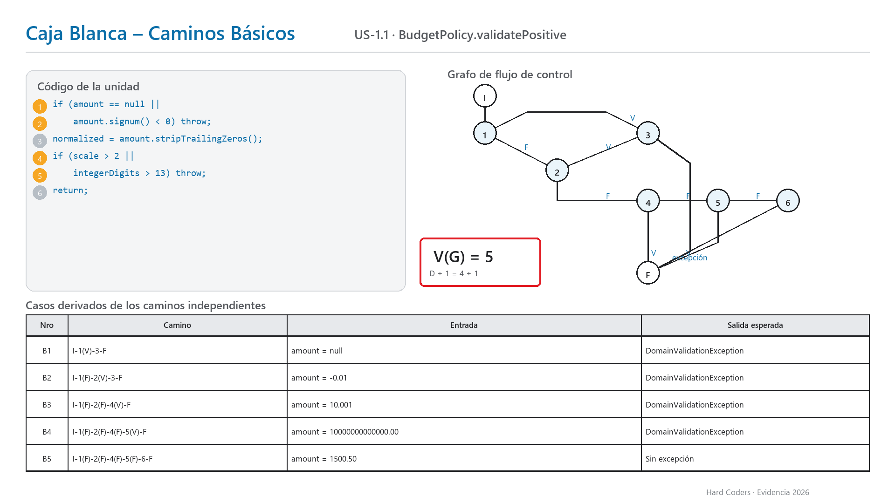
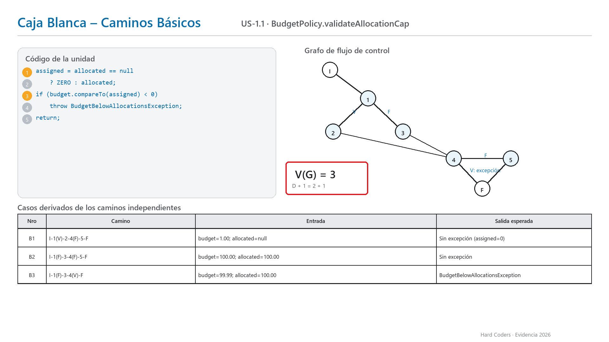
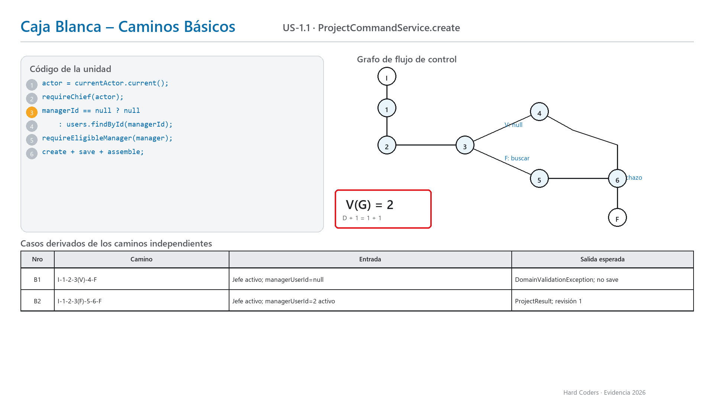
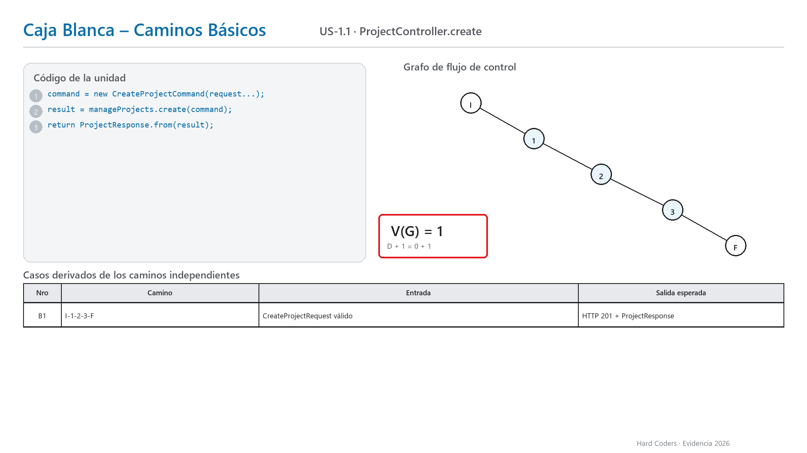
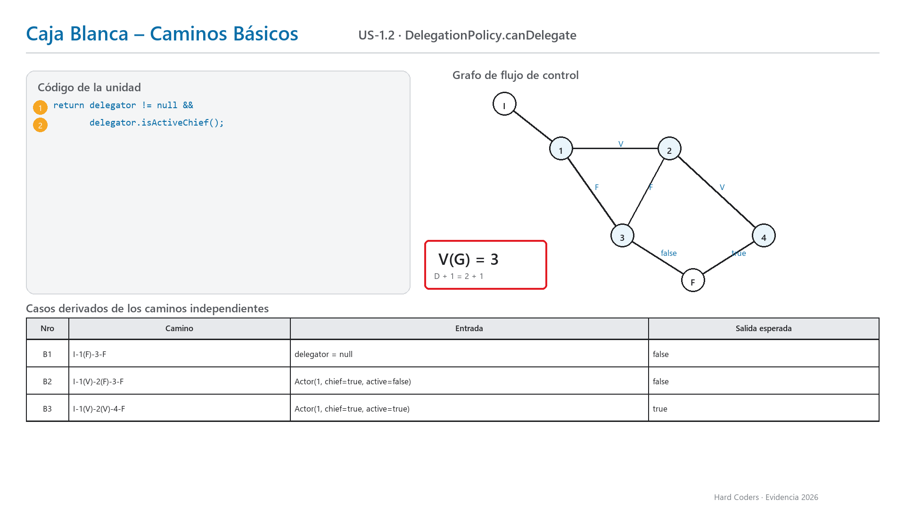
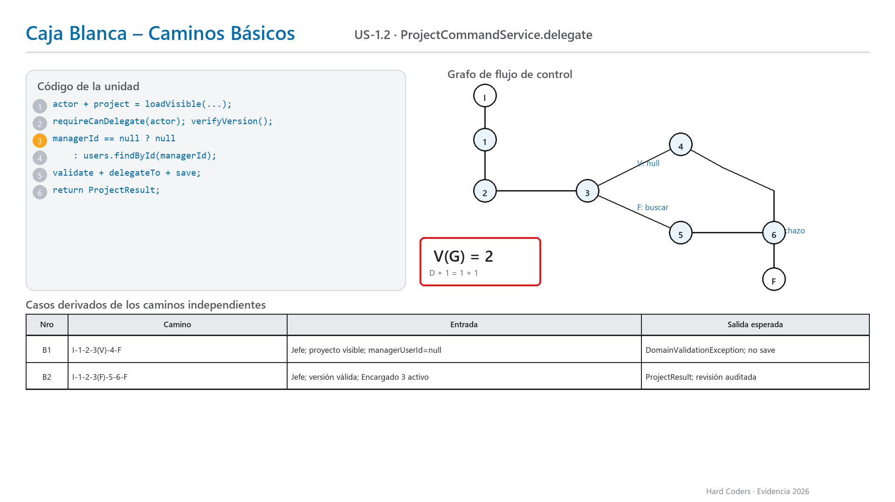
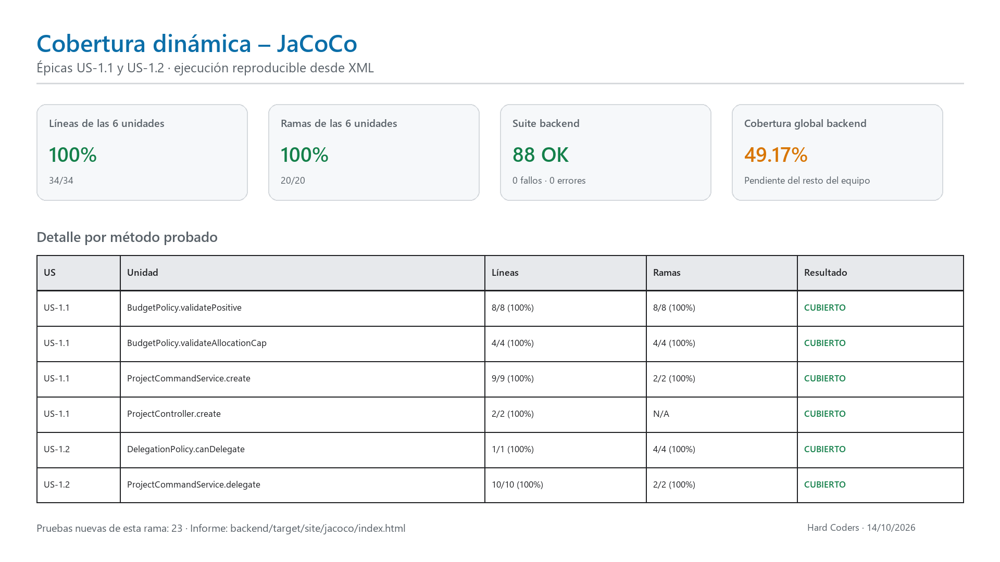

# Evidencia de pruebas unitarias — US-1.1 y US-1.2

## 1. Alcance y criterio académico

Este trabajo cubre las historias **US-1.1 Lifecycle/Budget** y **US-1.2 Delegation** de la
Épica 1 descritas en `.kilo/plans/hexagonal_restructure_plan.md`. Las diapositivas y el
entregable del docente se usaron como material de referencia; no se trataron como instrucciones
para modificar el sistema.

La estrategia combina:

- prueba dinámica de caja blanca con grafos de flujo de control;
- complejidad ciclomática `V(G) = D + 1` y caminos básicos independientes;
- JUnit 5 y AssertJ para las aserciones;
- Mockito para aislar los puertos de la arquitectura hexagonal;
- MockMvc para probar el adaptador HTTP sin servidor ni base de datos;
- JaCoCo para cobertura dinámica e importación posterior en SonarQube;
- SonarQube para análisis estático, complementario a las pruebas dinámicas.

## 2. Corrección frente al borrador del plan

El borrador indicaba `V(G)=4` para `BudgetPolicy.validatePositive` y proponía una entrada
“NaN”. El código real usa `BigDecimal`, tipo que no representa NaN, y contiene cuatro decisiones
atómicas por cortocircuito:

1. `amount == null`;
2. `amount.signum() < 0`;
3. `scale > MAX_SCALE`;
4. `integerDigits > MAX_INTEGER_DIGITS`.

Por tanto, el cálculo correcto es `V(G) = 4 + 1 = 5`. Los cinco caminos y sus entradas se
derivaron del código compilado actual. La misma regla se aplicó a
`DelegationPolicy.canDelegate`: el operador `&&` evalúa dos condiciones y produce `V(G)=3`,
no `V(G)=1`.

## 3. Trazabilidad de unidades y complejidad

| Historia | Unidad real | Decisiones D | V(G) | Caminos básicos | Clase de prueba |
|---|---|---:|---:|---:|---|
| US-1.1 | `BudgetPolicy.validatePositive` | 4 | 5 | 5 | `BudgetPolicyBasicPathTest` |
| US-1.1 | `BudgetPolicy.validateAllocationCap` | 2 | 3 | 3 | `BudgetPolicyBasicPathTest` |
| US-1.1 | `ProjectCommandService.create` | 1 | 2 | 2 | `ProjectCommandServiceUnitTest` |
| US-1.1 | `ProjectController.create` | 0 | 1 | 1 | `ProjectControllerTest` |
| US-1.2 | `DelegationPolicy.canDelegate` | 2 | 3 | 3 | `DelegationPolicyBasicPathTest` |
| US-1.2 | `ProjectCommandService.delegate` | 1 | 2 | 2 | `ProjectCommandServiceUnitTest` |

El cálculo es **intraprocedimental**: cuenta las decisiones escritas dentro de cada método. Las
excepciones producidas por políticas llamadas desde el servicio se validan como resultados, pero
no se vuelven a contar como decisiones del método llamador.

## 4. Láminas de caja blanca

Las imágenes siguen el formato visual de la práctica: código numerado a la izquierda, grafo con
ramas V/F, recuadro de V(G) y tabla `Nro | Camino | Entrada | Salida esperada`.

### US-1.1









### US-1.2





## 5. Implementación de las pruebas

### 5.1 Políticas de dominio

Cada camino básico tiene un test nombrado y trazable. Ejemplo de camino inválido:

```java
assertThatThrownBy(() -> BudgetPolicy.validatePositive(new BigDecimal("10.001")))
        .isInstanceOf(DomainValidationException.class);
```

Ejemplo de camino válido de delegación:

```java
assertThat(DelegationPolicy.canDelegate(new Actor(1, true, true))).isTrue();
```

### 5.2 Caso de uso con mocks

`ProjectCommandServiceUnitTest` simula `ProjectRepository`, `UserDirectory` y `CurrentActor`.
Así prueba solo la orquestación de la capa de aplicación y verifica que un caso rechazado no
persista nada:

```java
assertThatThrownBy(() -> service.create(commandSinManager))
        .isInstanceOf(DomainValidationException.class);
verify(projects, never()).save(any());
```

En el camino exitoso se captura el agregado enviado al puerto y se comprueba la revisión de
auditoría. No se levanta Spring ni PostgreSQL.

### 5.3 Adaptador HTTP

`ProjectControllerTest` usa MockMvc en modo `standaloneSetup` y un mock de
`ManageProjectsUseCase`. Se verifican el `201 Created`, el mapeo JSON → comando y el rechazo
`400 Bad Request` antes de invocar el caso de uso.

## 6. Resultado reproducible

Comando ejecutado el **14/10/2026**:

```powershell
cd backend
mvn clean verify
```

Resultado:

| Métrica | Resultado |
|---|---:|
| Pruebas backend totales | 88 |
| Pruebas nuevas de esta rama | 23 |
| Exitosas | 88 |
| Fallos | 0 |
| Errores | 0 |
| Omitidas | 0 |
| Estado Maven | `BUILD SUCCESS` |

Los reportes fuente quedan en:

- `backend/target/surefire-reports/` — ejecución JUnit;
- `backend/target/site/jacoco/index.html` — informe HTML navegable;
- `backend/target/site/jacoco/jacoco.xml` — informe importable por SonarQube.

## 7. Cobertura



| Unidad | Líneas | Ramas |
|---|---:|---:|
| `BudgetPolicy.validatePositive` | 8/8 = 100 % | 8/8 = 100 % |
| `BudgetPolicy.validateAllocationCap` | 4/4 = 100 % | 4/4 = 100 % |
| `ProjectCommandService.create` | 9/9 = 100 % | 2/2 = 100 % |
| `ProjectController.create` | 2/2 = 100 % | N/A, no decide |
| `DelegationPolicy.canDelegate` | 1/1 = 100 % | 4/4 = 100 % |
| `ProjectCommandService.delegate` | 10/10 = 100 % | 2/2 = 100 % |
| **Total de las seis unidades asignadas** | **34/34 = 100 %** | **20/20 = 100 %** |

La cobertura global del backend es **49,17 % de líneas**. Esto no invalida el 100 % del alcance
asignado, pero sí significa que el equipo todavía no alcanza el mínimo global de 70 % solicitado
por el entregable. Las historias de los demás integrantes deben aportar sus pruebas; no se ocultó
código ni se infló el porcentaje mediante exclusiones.

## 8. Integración con SonarQube

Se agregó JaCoCo 0.8.15 al ciclo Maven y se configuró:

```properties
sonar.coverage.jacoco.xmlReportPaths=backend/target/site/jacoco/jacoco.xml
```

El SonarQube local respondió `UP` en la versión `26.9.0.129388`. El escaneo de esta rama se
publicó correctamente con `ANALYSIS SUCCESSFUL` y `EXECUTION SUCCESS`; el importador confirmó
la lectura de un informe JaCoCo XML.

El Quality Gate global quedó en **Failed**, no por fallos de JUnit, sino por dos condiciones del
proyecto: 48 issues en código nuevo y cobertura de código nuevo de 40,6 %, inferior al 80 %
configurado. SonarQube reportó 54 issues totales (7 de Reliability y 47 de Maintainability),
2,11 % de duplicación y 0 Security Hotspots. La cobertura de SonarQube abarca el conjunto de
código nuevo del backend y frontend; no contradice el 100 % medido por JaCoCo en las seis
unidades específicamente asignadas.

Evidencias capturadas:

- [Overview y Quality Gate](evidencias/sonarqube/01-sonarqube-overview.png)
- [Issues y distribución por severidad](evidencias/sonarqube/02-sonarqube-issues.png)
- [Coverage en código nuevo](evidencias/sonarqube/03-sonarqube-coverage-new-code.png)
- [Complejidad](evidencias/sonarqube/04-sonarqube-complexity.png)
- [Cobertura de BudgetPolicy](evidencias/sonarqube/05-budget-policy-coverage.png)
- [Cobertura de DelegationPolicy](evidencias/sonarqube/06-delegation-policy-coverage.png)
- [Cobertura de ProjectCommandService](evidencias/sonarqube/07-project-command-service-coverage.png)
- [Cobertura de ProjectController](evidencias/sonarqube/08-project-controller-coverage.png)

SonarQube analiza bugs, vulnerabilidades, hotspots, code smells, duplicación y complejidad. La
cobertura no la calcula Sonar por sí solo: importa el XML producido por JaCoCo.

## 9. Texto breve listo para el informe del equipo

> Para US-1.1 y US-1.2 se aplicó prueba dinámica de caja blanca a seis unidades de dominio,
> aplicación y entrada HTTP. A partir de sus grafos de flujo se calcularon complejidades entre
> V(G)=1 y V(G)=5 y se derivaron los caminos básicos. Se implementaron 23 pruebas nuevas con
> JUnit 5, AssertJ, Mockito y MockMvc. La suite completa ejecutó 88 pruebas sin fallos ni errores.
> JaCoCo registró 100 % de líneas (34/34) y ramas (20/20) en las seis unidades asignadas. La
> cobertura global del backend quedó en 49,17 %, por lo que el resto del equipo debe cubrir sus
> historias para alcanzar el mínimo global de 70 %. SonarQube importó el XML JaCoCo y relacionó
> la cobertura dinámica con sus hallazgos estáticos; el Quality Gate global quedó pendiente por
> cobertura del código nuevo e issues ajenos al alcance de estas seis unidades.

## 10. Archivos relevantes

- `backend/src/test/java/com/hardcoders/taskmanager/domain/policy/BudgetPolicyBasicPathTest.java`
- `backend/src/test/java/com/hardcoders/taskmanager/domain/policy/DelegationPolicyBasicPathTest.java`
- `backend/src/test/java/com/hardcoders/taskmanager/application/usecase/ProjectCommandServiceUnitTest.java`
- `backend/src/test/java/com/hardcoders/taskmanager/adapter/in/web/project/ProjectControllerTest.java`
- `backend/pom.xml`
- `sonar-project.properties`
- `docs/pruebas-unitarias/scripts/generar_grafos_ciclomaticos.py`
- `docs/pruebas-unitarias/scripts/generar_evidencia_cobertura.py`

