# Evidencia de pruebas unitarias — US1.3 y US2.1

## 1. Alcance y criterio de prueba

Este informe reúne la evidencia de las historias **US1.3 — Override de estados de tarea** y **US2.1 — Aislamiento y scoping de proyectos**.

- **US1.3**: el Jefe de proyecto puede ejecutar (iniciar, pausar, completar, reabrir) tareas ajenas a su responsabilidad, salvo que estén asignadas a otro trabajador, registrando el motivo del override en el historial (AC-US1.3-01). El Personal solo actúa sobre el trabajo que le está asignado.
- **US2.1**: las consultas de proyectos se resuelven en el servidor filtrando por el actor activo: el Jefe ve todo, el Encargado solo los que dirige y el Personal no ve nada (ni siquiera confirma la existencia de proyectos ajenos). El acceso de escritura y el parseo de estados siguen la misma matriz de visibilidad.

El alcance comprende las políticas de dominio (`CompletionPolicy`, `ProjectAccessPolicy`), los servicios de aplicación (`TaskCommandService`, `ProjectQueryService`, `ProjectCommandService`) y el soporte de parsing de estados, junto con el control de concurrencia y los errores de API.

La evidencia combina:

- pruebas unitarias de dominio y aplicación;
- pruebas de controladores;
- grafos de flujo de control y cálculo de complejidad ciclomática `V(G) = D + 1`;
- cobertura dinámica JaCoCo;
- análisis estático SonarQube con el XML de JaCoCo importado (análisis global del proyecto).

Las pruebas son locales y no requieren levantar el frontend ni conectar con la base de datos del proyecto; los adaptadores de persistencia se prueban con dobles de prueba.

## 2. Trazabilidad de unidades y complejidad

Los grafos se elaboraron a partir del flujo intraprocedimental de cada método. El cálculo es intraprocedimental: considera las decisiones del método mostrado (`if`, operandos de `||`/`&&`, ternarias y bloques `catch`), sin volver a contar las decisiones internas de los métodos que este invoca. `V(G) = D + 1`, donde `D` es el número de decisiones de rama.

| Historia | Unidad | Decisiones `D` | `V(G)` | Caminos básicos representados |
|---|---|---:|---:|---:|
| US1.3 | `CompletionPolicy.canComplete` | 4 | 5 | 5 |
| US1.3 | `CompletionPolicy.requireCanComplete` | 1 | 2 | 2 |
| US1.3 | `TaskCommandService.transition` | 2 | 3 | 3 |
| US1.3 | `TaskCommandService.overrideReason` | 2 | 3 | 3 |
| US1.3 | `TaskCommandService.load` | 3 | 4 | 4 |
| US2.1 | `ProjectAccessPolicy.canView` | 4 | 5 | 5 |
| US2.1 | `ProjectAccessPolicy.requireChief` | 2 | 3 | 3 |
| US2.1 | `ProjectAccessPolicy.requireCanEditDetails` | 1 | 2 | 2 |
| US2.1 | `ProjectQueryService.listProjects` | 2 | 3 | 3 |
| US2.1 | `ProjectQueryService.loadVisible` | 0 | 1 | 1 |
| US2.1 | `ProjectCommandService.parseStatus` | 2 | 3 | 3 |

### US1.3 — Grafos (Override de estados)

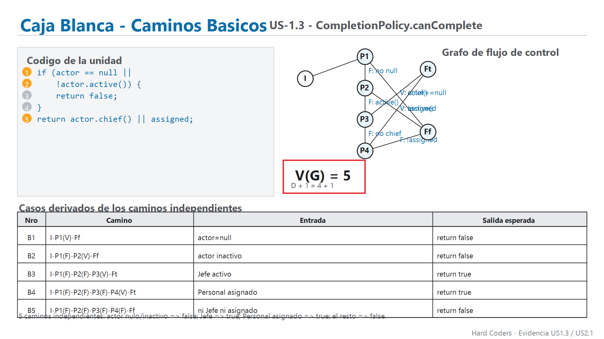

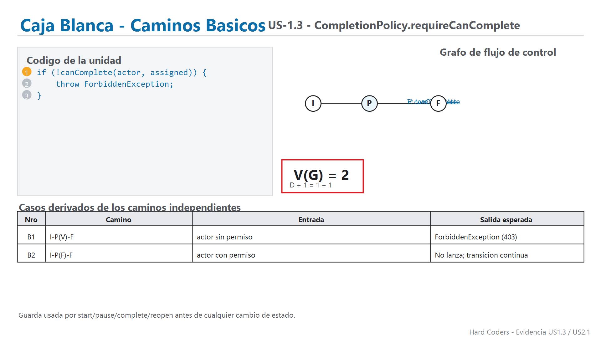

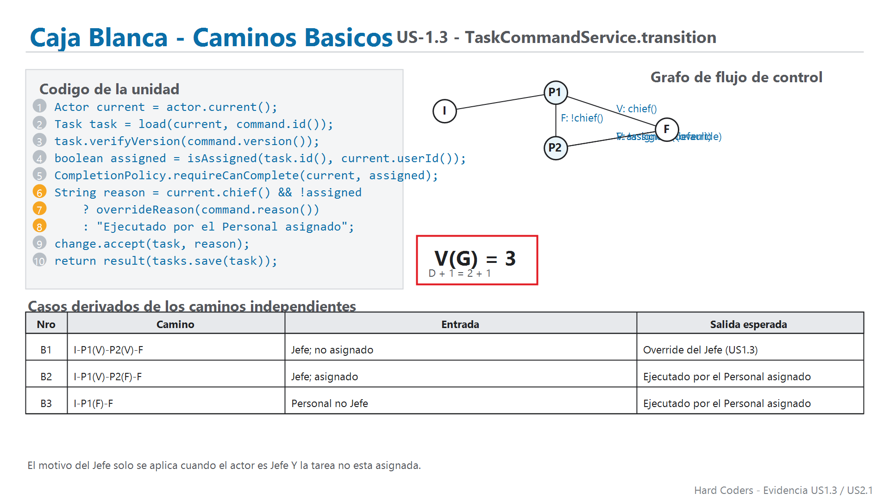

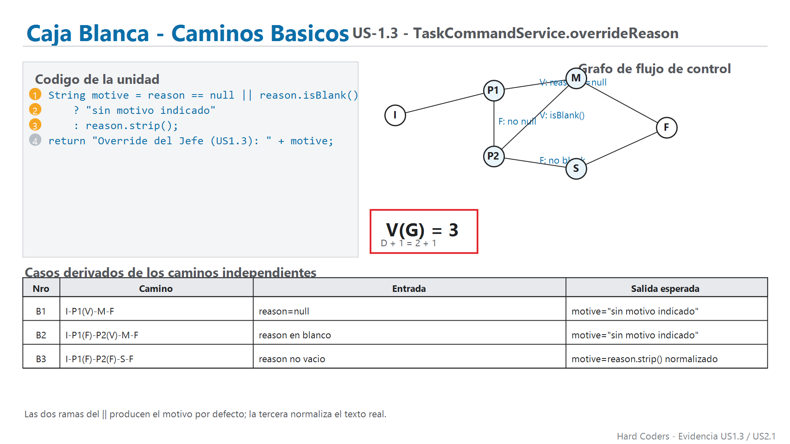

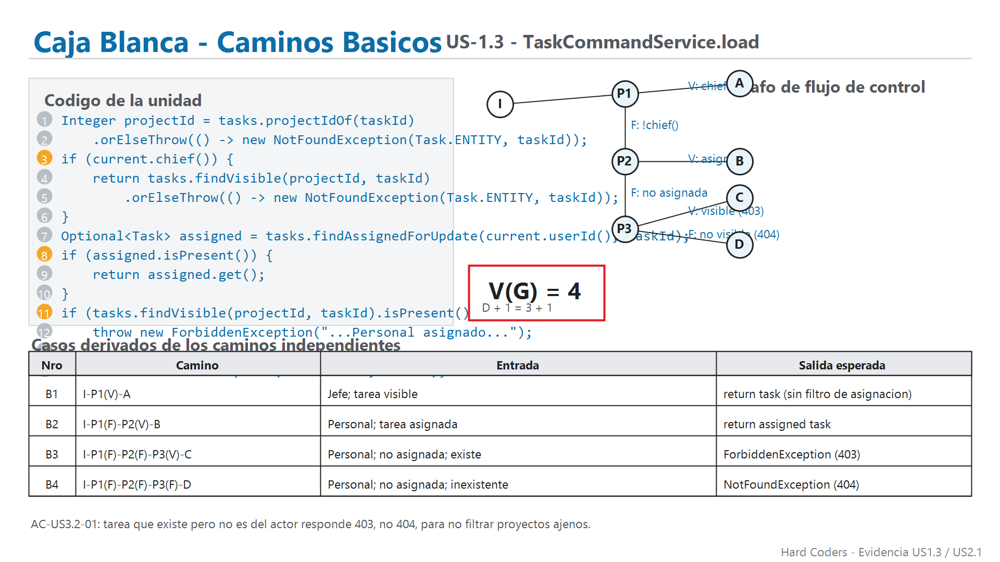

### US2.1 — Grafos (Aislamiento y scoping)

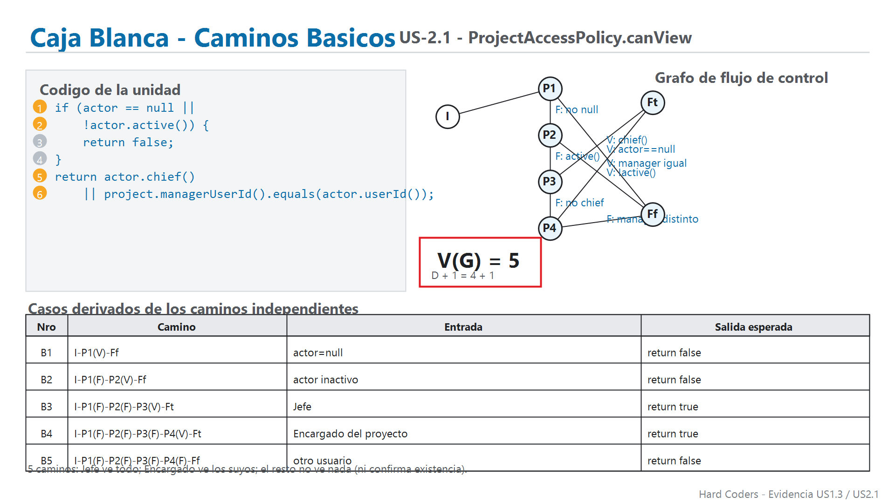

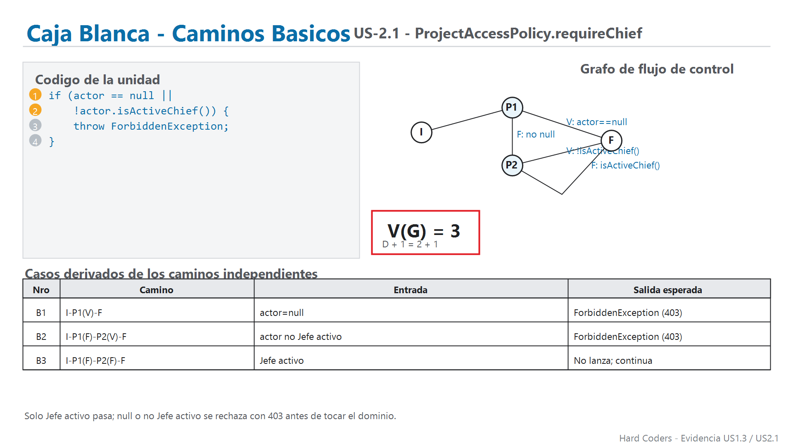

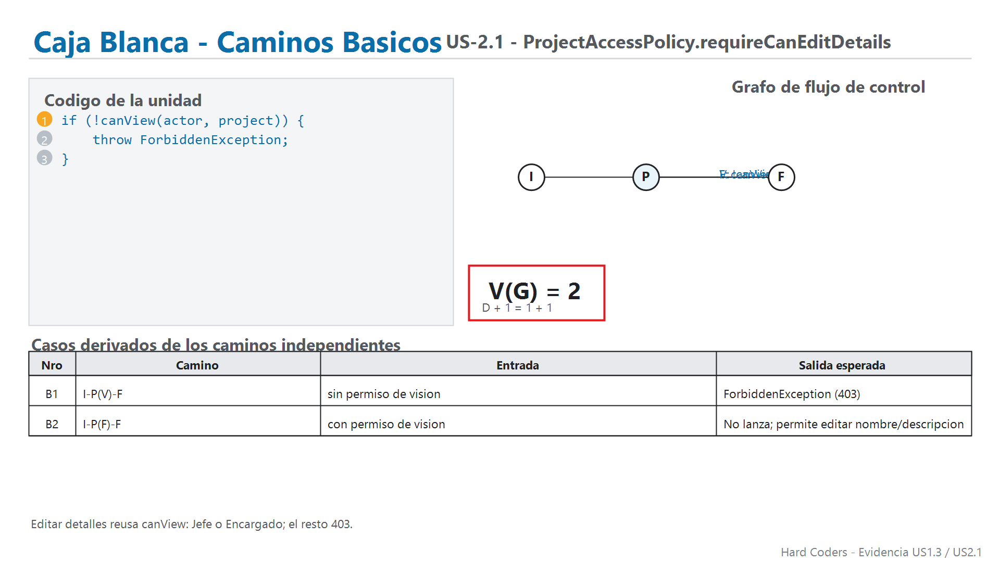

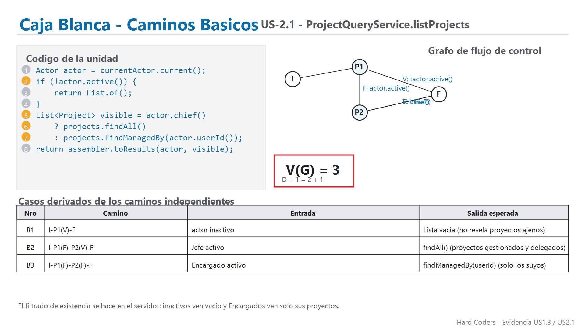

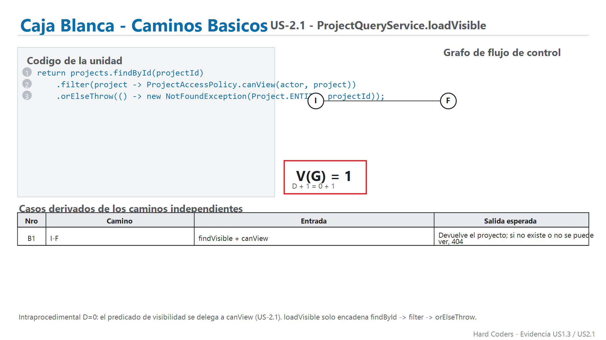

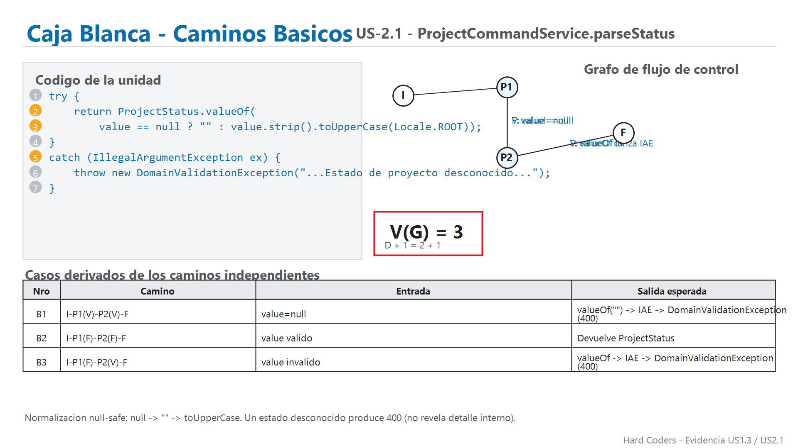

## 4. Implementación de las pruebas

Las clases de prueba enfocadas en estas historias reúnen **35 pruebas**:

| Clase de prueba | Pruebas | Aspectos comprobados |
|---|---:|---|
| `CompletionPolicyBasicPathTest` | 7 | Todos los caminos básicos de `canComplete`: actor nulo, inactivo, Jefe, Personal asignado y el caso de rechazo vía `requireCanComplete`. |
| `TaskCommandServiceOverrideTest` | 9 | Transición de Jefe con override (motivo normalizado y por defecto), Personal asignado y no asignado, `403` de acceso, `412` de versión y `404` de tarea inexistente. |
| `ProjectAccessPolicyTest` | 10 | `canView` (Jefe, Encargado, activo, nulo, inactivo), `requireChief` (Jefe activo vs el resto) y `requireCanEditDetails` (Permitir/403). |
| `ProjectQueryServiceScopingTest` | 9 | `listProjects` por tipo de actor (inactivo→vacío, Jefe→todo, Encargado→delegados), `loadVisible` (existe/visible, no visible→404) y `parseStatus` (válido, nulo, inválido → 400). |
| **Total enfocado** | **35** | |

En particular, las pruebas de US1.3 verifican que el override del Jefe registra el motivo (`"Override del Jefe (US1.3): <motivo>"`) y que se rechaza con `403` cuando la tarea no es asignada al Personal, con `412` ante conflicto de versión y con `404` cuando la tarea no existe. Las pruebas de US2.1 verifican que el Encargado no ve proyectos ajenos (filtrado en servidor), que el `404` se mantiene tanto para proyectos inexistentes como para ajenos (no se revela existencia) y que un estado desconocido produce `400`.

## 5. Resultado reproducible

La verificación de Maven se ejecutó con **Java 24.0.2** y **Apache Maven 3.9.16** el **15/10/2026** (el proyecto targets Java 21):

```powershell
cd backend
mvn clean verify
```

El comando terminó con `BUILD SUCCESS`. El resumen de Surefire registra:

| Métrica | Resultado |
|---|---:|
| Pruebas de la suite backend | 227 |
| Fallos | 0 |
| Errores | 0 |
| Omitidas | 0 |
| Pruebas de las clases enfocadas en US1.3/US2.1 | 35 |

Los informes de ejecución quedan en `backend/target/surefire-reports/`; el HTML y XML de cobertura quedan en `backend/target/site/jacoco/`.

## 6. Cobertura JaCoCo

La siguiente imagen resume la cobertura de los métodos seleccionados para las dos historias. El resultado de cada método se considera **CUBIERTO** cuando no quedan líneas ni ramas instrumentadas sin cubrir; **PARCIAL** indica que quedó al menos una línea o rama pendiente.

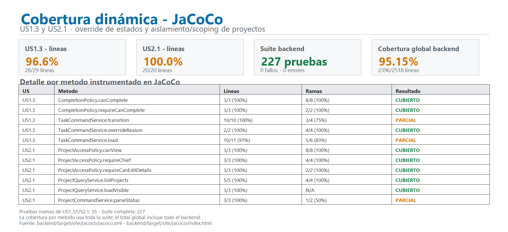

| Alcance de métodos seleccionados | Líneas cubiertas | Resultado |
|---|---:|---|
| US1.3 | 28/29 | 96,55 % |
| US2.1 | 20/20 | 100 % |
| Backend completo | 2396/2518 | 95,15 % |

El porcentaje global del backend (95,15 %) incluye todo el código del proyecto, no solo US1.3/US2.1; por eso la cobertura específica de las unidades seleccionadas puede diferir del total global.

Detalle por método (JaCoCo dinámico):

| Unidad | Líneas | Ramas | Resultado |
|---|---:|---:|---|
| `CompletionPolicy.canComplete` | 3/3 (100 %) | 8/8 (100 %) | Cubierto |
| `CompletionPolicy.requireCanComplete` | 3/3 (100 %) | 2/2 (100 %) | Cubierto |
| `TaskCommandService.transition` | 10/10 (100 %) | 3/4 (75 %) | Parcial |
| `TaskCommandService.overrideReason` | 2/2 (100 %) | 4/4 (100 %) | Cubierto |
| `TaskCommandService.load` | 10/11 (90,9 %) | 5/6 (83,3 %) | Parcial |
| `ProjectAccessPolicy.canView` | 3/3 (100 %) | 8/8 (100 %) | Cubierto |
| `ProjectAccessPolicy.requireChief` | 3/3 (100 %) | 4/4 (100 %) | Cubierto |
| `ProjectAccessPolicy.requireCanEditDetails` | 3/3 (100 %) | 2/2 (100 %) | Cubierto |
| `ProjectQueryService.listProjects` | 5/5 (100 %) | 4/4 (100 %) | Cubierto |
| `ProjectQueryService.loadVisible` | 3/3 (100 %) | 0/0 (n/a) | Cubierto |
| `ProjectCommandService.parseStatus` | 3/3 (100 %) | 1/2 (50 %) | Parcial |

Los métodos parciales reflejan ramas asociadas a caminos de error menos frecuentes: `transition` deja una rama de combinación actor/assigned sin ejercer; `load` no cubre una de las ramas de la segunda condición de visibilidad; `parseStatus` no ejerce la rama de `IllegalArgumentException` para el caso válido de la segunda entrada de la tupla (`value` no nulo y estado válido). Son decisiones de caminos secundarios, no de las rutas principales de US1.3/US2.1.

### Cobertura por archivo (JaCoCo)

| Archivo | Líneas |
|---|---:|
| `CompletionPolicy.java` | 6/6 = 100 % |
| `ProjectAccessPolicy.java` | 9/9 = 100 % |
| `ProjectQueryService.java` | 21/21 = 100 % |
| `ProjectCommandService.java` | 51/51 = 100 % |
| `TaskCommandService.java` | 104/110 = 94,5 % |

## 7. Integración y resultados de SonarQube

El análisis se ejecutó con SonarQube Community Build local, proyecto `hard-coders-gestor-tareas`. El escáner importó el XML de JaCoCo. Como indica la evidencia `evidencias/sonarqube/`, el Quality Gate es **Passed** a nivel global del repositorio (proyecto completo, no por historia): 2 issues abiertos, 2,0 % de duplicación y 50,4 % de cobertura global del proyecto.

La cobertura mostrada por SonarQube a nivel global (`backend/src` 68,1 %, `frontend/src` 0,0 %) y las capturas de `Overview`, `Issues` y `Coverage` son métricas del repositorio entero; no son exclusivas de US1.3/US2.1. La cobertura por archivo (JaCoCo) de las clases seleccionadas se presenta en la tabla de la sección 6. Las capturas de referencia del análisis global disponibles son:

- [Overview y Quality Gate global](evidencias/sonarqube/us22-23-01-Overview.png)
- [Issues globales](evidencias/sonarqube/us22-23-02-Issues.png)
- [Cobertura global por directorio](evidencias/sonarqube/us22-23-03-Coverage.png)
- [Complejidad ciclomática global](evidencias/sonarqube/us22-23-04-Cyclomatic-Complexity.png)

## 8. Alcance pendiente de las pruebas

Las evidencias prueban las rutas y reglas específicas indicadas, pero no equivalen a una prueba integral de todos los criterios de aceptación:

- `TaskCommandService.transition` incluye la ruta de override del Jefe y la del Personal; la rama parcial que JaCoCo reporta corresponde a la combinación de actor/assigned menos ejercida en este bloque, no a un caso de criterio ausente.
- `ProjectCommandService.parseStatus` verifica los tres caminos básicos representados (nulo, válido e inválido → 400); la rama parcial indica una de las dos salidas del ternary sin ejercer en profundidad, no una regla omitida.
- `TaskCommandService.load` cubre las 4 rutas básicas (Jefe, Personal asignado, 403 y 404); la rama residual está en un subcaso de la segunda condición.
- Las pruebas de scoping verifican el filtrado en servidor para `listProjects` y `loadVisible`, pero no ejercen por separado cada variante de proyecto delegado vs. propio a través de todos los adaptadores de la cadena de consulta.

Estas limitaciones se registran para no atribuir a la suite resultados que no demuestra. La cobertura parcial visible en JaCoCo confirma que quedan ramas o líneas sin ejecutar en algunos métodos.

## 9. Texto breve para el informe del equipo

> Para US1.3 (Override) y US2.1 (Isolation/Scoping) se prepararon grafos de flujo de control para 11 métodos y pruebas automatizadas en dominio y aplicación. La suite backend registró 227 pruebas con cero fallos, errores u omisiones; 35 pertenecen a las clases de prueba enfocadas en este bloque. JaCoCo midió 28/29 líneas (96,55 %) en los métodos seleccionados de US1.3 y 20/20 (100 %) en los de US2.1; la cobertura global del backend fue 95,15 %. SonarQube importó el informe JaCoCo y mostró un Quality Gate global aprobado.

## 10. Archivos fuente y evidencia

- `backend/src/test/java/com/hardcoders/taskmanager/domain/policy/CompletionPolicyBasicPathTest.java`
- `backend/src/test/java/com/hardcoders/taskmanager/application/usecase/TaskCommandServiceOverrideTest.java`
- `backend/src/test/java/com/hardcoders/taskmanager/domain/policy/ProjectAccessPolicyTest.java`
- `backend/src/test/java/com/hardcoders/taskmanager/application/usecase/ProjectQueryServiceScopingTest.java`
- `backend/src/main/java/com/hardcoders/taskmanager/domain/policy/CompletionPolicy.java`
- `backend/src/main/java/com/hardcoders/taskmanager/domain/policy/ProjectAccessPolicy.java`
- `backend/src/main/java/com/hardcoders/taskmanager/application/usecase/TaskCommandService.java`
- `backend/src/main/java/com/hardcoders/taskmanager/application/usecase/ProjectQueryService.java`
- `backend/src/main/java/com/hardcoders/taskmanager/application/usecase/ProjectCommandService.java`
- `backend/target/site/jacoco/jacoco.xml`
- `docs/pruebas-unitarias/scripts/generar_grafos_us13_us21.py`
- `docs/pruebas-unitarias/scripts/renderizar_grafos_ciclomaticos_us13_us21.ps1`
- `docs/pruebas-unitarias/scripts/generar_evidencia_cobertura_us13_us21.py`
- `docs/pruebas-unitarias/scripts/renderizar_evidencia_cobertura_us13_us21.ps1`
