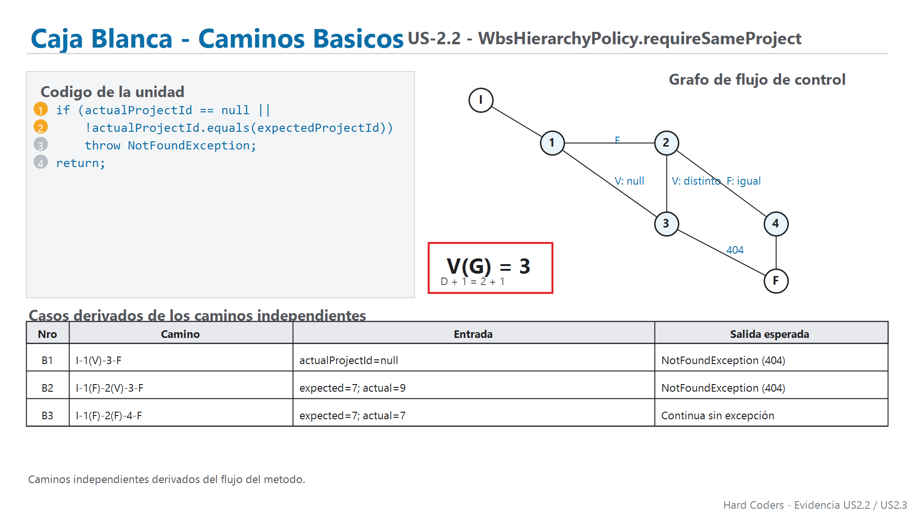
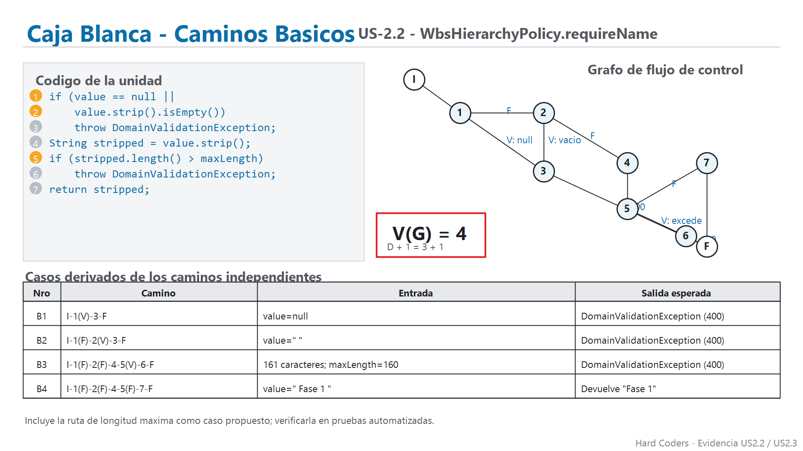
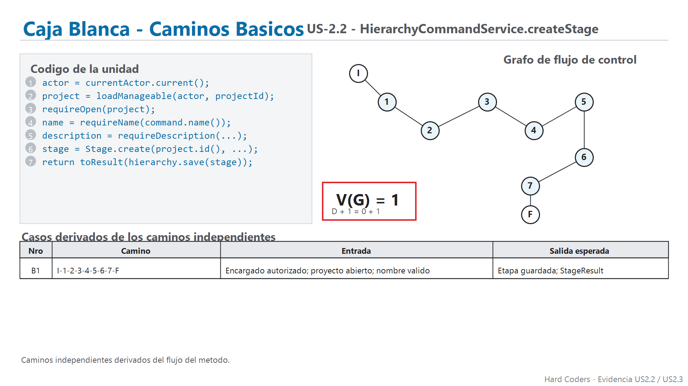
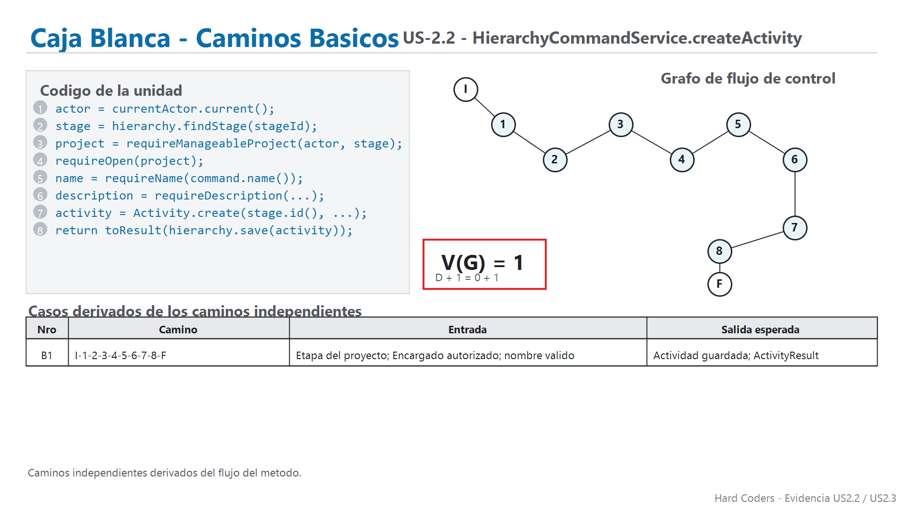
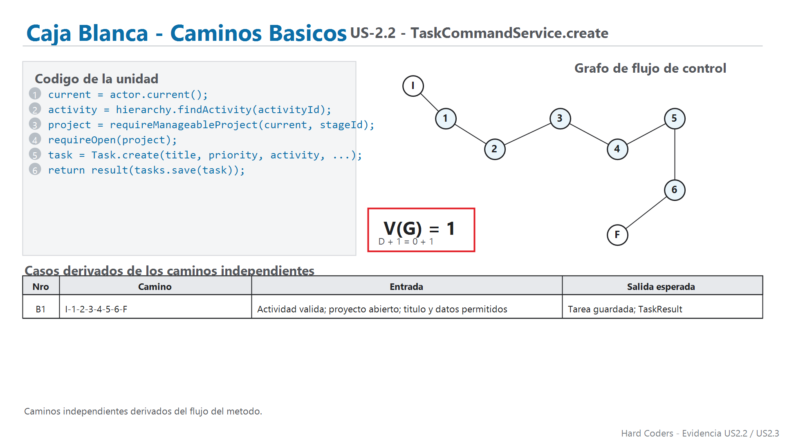
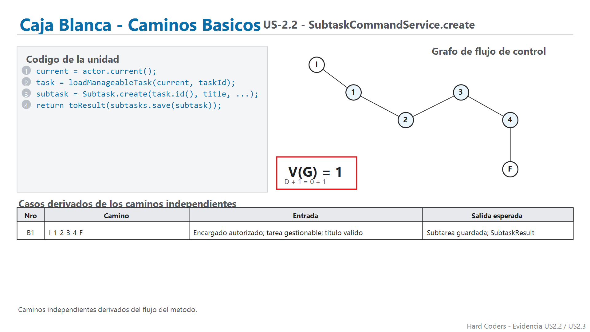
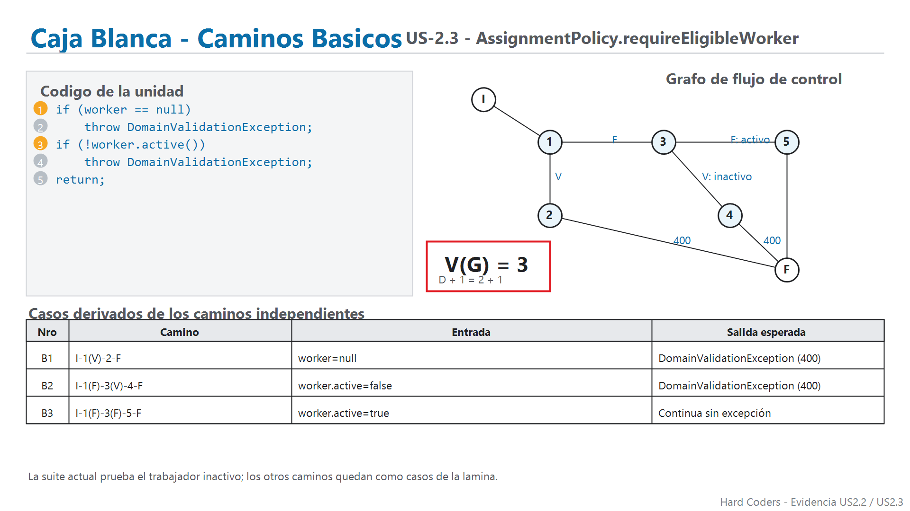
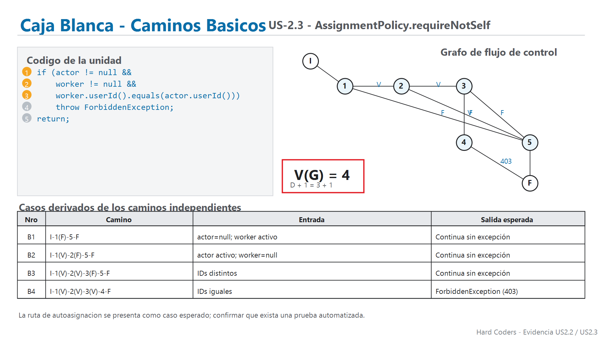
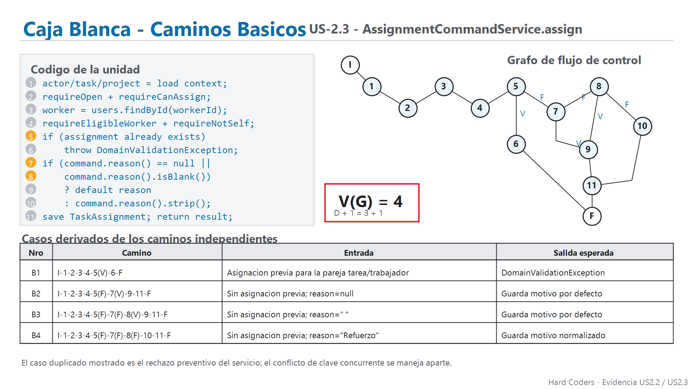
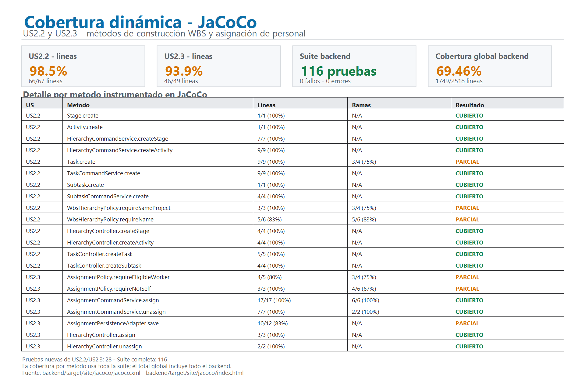

# Evidencia de pruebas unitarias — US2.2 y US2.3

## 1. Alcance y criterio de prueba

Este informe reúne la evidencia de las historias **US2.2 — WBS Building** y **US2.3 — Personal Allocation engine**. El alcance comprende la construcción y consulta de la jerarquía de etapas, actividades, tareas y subtareas, así como la asignación y retiro de personal en tareas.

La evidencia combina:

- pruebas unitarias de dominio y aplicación;
- pruebas de controladores y adaptadores de persistencia;
- grafos de flujo de control y cálculo de complejidad ciclomática `V(G) = D + 1`;
- cobertura dinámica JaCoCo;
- análisis estático SonarQube con el XML de JaCoCo importado.

Las pruebas automatizadas son locales y no requieren levantar el frontend ni conectar con la base de datos del proyecto. Los adaptadores de persistencia se prueban con dobles de prueba.

## 2. Trazabilidad de unidades y complejidad

Los grafos se elaboraron a partir del flujo de los métodos indicados. El cálculo es intraprocedimental: considera las decisiones del método mostrado, sin volver a contar las decisiones internas de métodos que este invoca.

| Historia | Unidad | Decisiones `D` | `V(G)` | Caminos básicos representados |
|---|---|---:|---:|---:|
| US2.2 | `WbsHierarchyPolicy.requireSameProject` | 2 | 3 | 3 |
| US2.2 | `WbsHierarchyPolicy.requireName` | 3 | 4 | 4 |
| US2.2 | `HierarchyCommandService.createStage` | 0 | 1 | 1 |
| US2.2 | `HierarchyCommandService.createActivity` | 0 | 1 | 1 |
| US2.2 | `TaskCommandService.create` | 0 | 1 | 1 |
| US2.2 | `SubtaskCommandService.create` | 0 | 1 | 1 |
| US2.3 | `AssignmentPolicy.requireEligibleWorker` | 2 | 3 | 3 |
| US2.3 | `AssignmentPolicy.requireNotSelf` | 3 | 4 | 4 |
| US2.3 | `AssignmentCommandService.assign` | 3 | 4 | 4 |

### US2.2 — Grafos













### US2.3 — Grafos







## 3. Implementación de las pruebas

Las clases de prueba enfocadas en estas historias reúnen **28 pruebas**:

| Clase de prueba | Pruebas | Aspectos comprobados |
|---|---:|---|
| `HierarchyCommandServiceCoverageTest` | 5 | Creación y actualización de etapas y actividades, normalización de texto, nombres inválidos, proyecto desconocido o cerrado, permisos, versiones y transiciones de estado. |
| `HierarchyQueryServiceTest` | 5 | Consulta de jerarquía, tareas, subtareas y asignados; respuestas ante proyecto o elementos inexistentes y acceso de proyecto no autorizado. |
| `HierarchyControllerTest` | 2 | Mapeo de rutas de jerarquía y asignaciones a respuestas; creación de etapa y actividad devuelve `201 Created`. |
| `TaskControllerTest` | 2 | Mapeo de rutas de lectura y escritura de tareas, subtareas, historial y actividad. |
| `HierarchyPersistenceAdapterTest` | 2 | Búsqueda y persistencia de etapas y actividades existentes y nuevas. |
| `SubtaskPersistenceAdapterCoverageTest` | 4 | Búsquedas, filtros y persistencia de subtareas. |
| `AssignmentCommandServiceCoverageTest` | 5 | Asignación, motivo predeterminado o normalizado, rechazo de duplicado e inactivo, permisos de asignación y retiro. |
| `AssignmentPersistenceAdapterTest` | 3 | Búsqueda por clave compuesta, consulta por tarea/trabajador y persistencia/retiro. |
| **Total enfocado** | **28** | |

En particular, las pruebas de US2.3 verifican que el servicio rechaza una asignación duplicada antes de persistirla, excluye cuentas inactivas del listado asignable, prohíbe operaciones a un actor sin permiso y permite retirar una asignación existente.

## 4. Resultado reproducible

La verificación de Maven se ejecutó con Java 21 y Apache Maven 3.10.0 el **15/10/2026**:

```powershell
cd backend
mvn clean verify
```

El comando terminó con `BUILD SUCCESS`. El resumen de Surefire disponible para esa ejecución registra:

| Métrica | Resultado |
|---|---:|
| Pruebas de la suite backend | 116 |
| Fallos | 0 |
| Errores | 0 |
| Omitidas | 0 |
| Pruebas de las clases enfocadas en US2.2/US2.3 | 28 |

Los informes de ejecución quedan en `backend/target/surefire-reports/`; el HTML y XML de cobertura quedan en `backend/target/site/jacoco/`.

## 5. Cobertura JaCoCo

La siguiente imagen resume la cobertura de los métodos seleccionados para las dos historias. El resultado de cada método se considera **CUBIERTO** cuando no quedan líneas ni ramas instrumentadas sin cubrir; **PARCIAL** indica que quedó al menos una línea o rama pendiente.



| Alcance de métodos seleccionados | Líneas cubiertas | Resultado |
|---|---:|---|
| US2.2 | 66/67 | 98,5 % |
| US2.3 | 46/49 | 93,9 % |
| Backend completo | 1749/2518 | 69,46 % |

El porcentaje global del backend incluye código fuera de estas historias. Por ello, el 69,46 % global no es el porcentaje de cobertura específico de US2.2 o US2.3.

La imagen marca como parciales algunos métodos concretos: `Task.create`, `WbsHierarchyPolicy.requireSameProject`, `WbsHierarchyPolicy.requireName`, `AssignmentPolicy.requireEligibleWorker`, `AssignmentPolicy.requireNotSelf` y `AssignmentPersistenceAdapter.save`. En cambio, los métodos de creación de etapa/actividad/tarea/subtarea y `AssignmentCommandService.assign` aparecen cubiertos según el criterio de la imagen.

## 6. Integración y resultados de SonarQube

El análisis se ejecutó con SonarQube Community Build local, proyecto `hard-coders-gestor-tareas`. El escáner confirmó el análisis exitoso e importó el XML de JaCoCo. Las capturas se tomaron el **15/10/2026**.

El `Overview` muestra métricas **globales del proyecto**: Quality Gate `Passed`, 2 issues abiertos, 2,0 % de duplicación y 50,4 % de cobertura global. En la vista de cobertura por árbol, SonarQube muestra `backend/src` con 68,1 % y `frontend/src` con 0,0 %. La vista de complejidad muestra 1.745 de complejidad ciclomática y 497 de complejidad cognitiva para el proyecto. Estas cifras no son exclusivas de US2.2 y US2.3.

La vista global de `Issues` muestra dos incidencias: una en `ProjectCommandService.java` y otra en `frontend/src/app/features/projects/projects.spec.ts`. No corresponden a los archivos específicos documentados en estas dos historias. Las capturas de código de las clases seleccionadas muestran cero issues asociados a esos archivos.

SonarQube muestra estas coberturas por archivo:

| Archivo | Cobertura mostrada |
|---|---:|
| `WbsHierarchyPolicy.java` | 84,6 % |
| `HierarchyCommandService.java` | 98,0 % |
| `TaskCommandService.java` | 86,2 % |
| `SubtaskCommandService.java` | 66,2 % |
| `HierarchyController.java` | 100 % |
| `AssignmentPolicy.java` | 83,3 % |
| `AssignmentCommandService.java` | 98,7 % |
| `AssignmentPersistenceAdapter.java` | 95,3 % |

Estas cifras son de **archivo completo** en SonarQube y no deben confundirse con la suma de métodos seleccionados que presenta el resumen JaCoCo. SonarQube importa la cobertura dinámica de JaCoCo; la cobertura no se obtiene únicamente del análisis estático.

### Capturas SonarQube

- [Overview y Quality Gate global](evidencias/sonarqube/us22-23-01-Overview.png)
- [Issues globales](evidencias/sonarqube/us22-23-02-Issues.png)
- [Cobertura global por directorio](evidencias/sonarqube/us22-23-03-Coverage.png)
- [Complejidad ciclomática global](evidencias/sonarqube/us22-23-04-Cyclomatic-Complexity.png)
- [Complejidad cognitiva global](evidencias/sonarqube/us22-23-05-Cognitive-Complexity.png)
- [WbsHierarchyPolicy](evidencias/sonarqube/us22-23-06-wbshierarchypolicy.java.png)
- [HierarchyCommandService](evidencias/sonarqube/us22-23-07-hierarchycommandservice.java.png)
- [TaskCommandService](evidencias/sonarqube/us22-23-08-taskcommandservice.java.png)
- [SubtaskCommandService](evidencias/sonarqube/us22-23-09-subtaskcommandservice.java.png)
- [HierarchyController](evidencias/sonarqube/us22-23-10-hierarchycontroller.java.png)
- [AssignmentPolicy](evidencias/sonarqube/us22-23-11-assignmentpolicy.java.png)
- [AssignmentCommandService](evidencias/sonarqube/us22-23-12-assignmentcommandservice.java.png)
- [AssignmentPersistenceAdapter](evidencias/sonarqube/us22-23-13-assignmentpersistenceadapter.java.png)

## 7. Alcance pendiente de las pruebas

Las evidencias prueban rutas y reglas específicas, pero no equivalen a una prueba integral de todos los criterios de aceptación:

- El rechazo de nombres vacíos se verifica en la capa de servicio; la prueba del controlador confirma la respuesta `201` en el caso válido, pero no comprueba por HTTP el `400` de nombre vacío.
- Se prueban accesos de consulta a proyectos inexistentes, ajenos o inactivos como `NotFoundException`; no se demuestra aquí cada variante de padre de otra jerarquía/proyecto en una operación de escritura.
- La suite verifica el rechazo de un trabajador inactivo y de una asignación duplicada por la regla del servicio. No verifica la respuesta HTTP `409` ante una colisión concurrente de la clave compuesta.
- El método `AssignmentPolicy.requireNotSelf` aparece en el código y en el grafo, pero las pruebas listadas no ejercitan explícitamente la ruta de autoasignación ni verifican `403` para ese caso.
- No se encontró en estas pruebas una comprobación específica del `403` de acceso de un hermano tras reasignación, ni una verificación del criterio sobre campos financieros.
- Las rutas de longitud máxima del nombre y autoasignación señaladas en los grafos deben entenderse como caminos representados; no se presentan como casos automatizados ejecutados.

Estas limitaciones se registran para no atribuir a la suite resultados que no demuestra. La cobertura parcial visible en JaCoCo también confirma que todavía quedan ramas o líneas sin ejecutar en algunos métodos.

## 8. Texto breve para el informe del equipo

> Para US2.2 y US2.3 se prepararon grafos de flujo de control para nueve métodos y pruebas automatizadas en dominio, aplicación, controladores y persistencia. La suite backend registró 116 pruebas con cero fallos, errores u omisiones; 28 pertenecen a las clases de prueba enfocadas en este bloque. JaCoCo midió 66/67 líneas (98,5 %) en los métodos seleccionados de US2.2 y 46/49 (93,9 %) en los de US2.3. La cobertura global del backend fue 69,46 %. SonarQube importó el informe JaCoCo y mostró un Quality Gate global aprobado, cobertura global de 50,4 % y dos incidencias en archivos ajenos a las clases seleccionadas. Las métricas globales se distinguen de las coberturas por archivo; los casos de autoasignación, acceso de hermano tras reasignación y respuesta HTTP 409 requieren evidencia automatizada adicional.

## 9. Archivos fuente y evidencia

- `backend/src/test/java/com/hardcoders/taskmanager/application/usecase/HierarchyCommandServiceCoverageTest.java`
- `backend/src/test/java/com/hardcoders/taskmanager/application/usecase/HierarchyQueryServiceTest.java`
- `backend/src/test/java/com/hardcoders/taskmanager/application/usecase/AssignmentCommandServiceCoverageTest.java`
- `backend/src/test/java/com/hardcoders/taskmanager/adapter/in/web/task/HierarchyControllerTest.java`
- `backend/src/test/java/com/hardcoders/taskmanager/adapter/in/web/task/TaskControllerTest.java`
- `backend/src/test/java/com/hardcoders/taskmanager/adapter/out/persistence/HierarchyPersistenceAdapterTest.java`
- `backend/src/test/java/com/hardcoders/taskmanager/adapter/out/persistence/SubtaskPersistenceAdapterCoverageTest.java`
- `backend/src/test/java/com/hardcoders/taskmanager/adapter/out/persistence/AssignmentPersistenceAdapterTest.java`
- `backend/target/site/jacoco/jacoco.xml`
- `docs/pruebas-unitarias/scripts/generar_grafos_us22_us23.py`
- `docs/pruebas-unitarias/scripts/generar_evidencia_cobertura_us22_us23.py`
