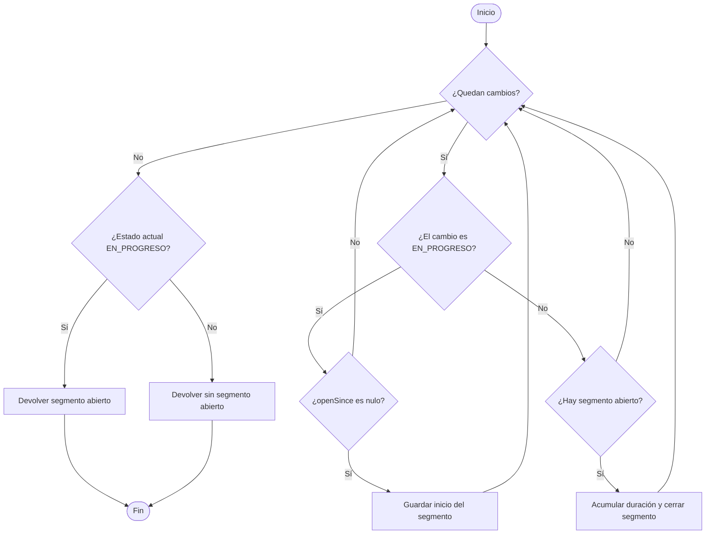
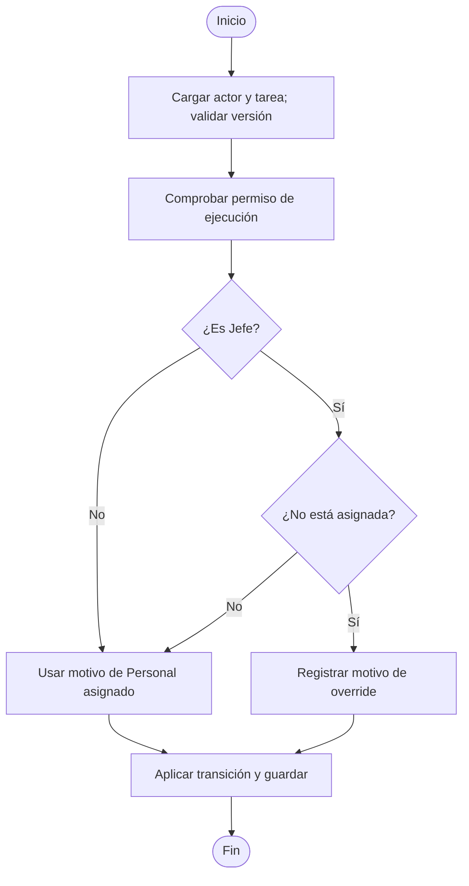
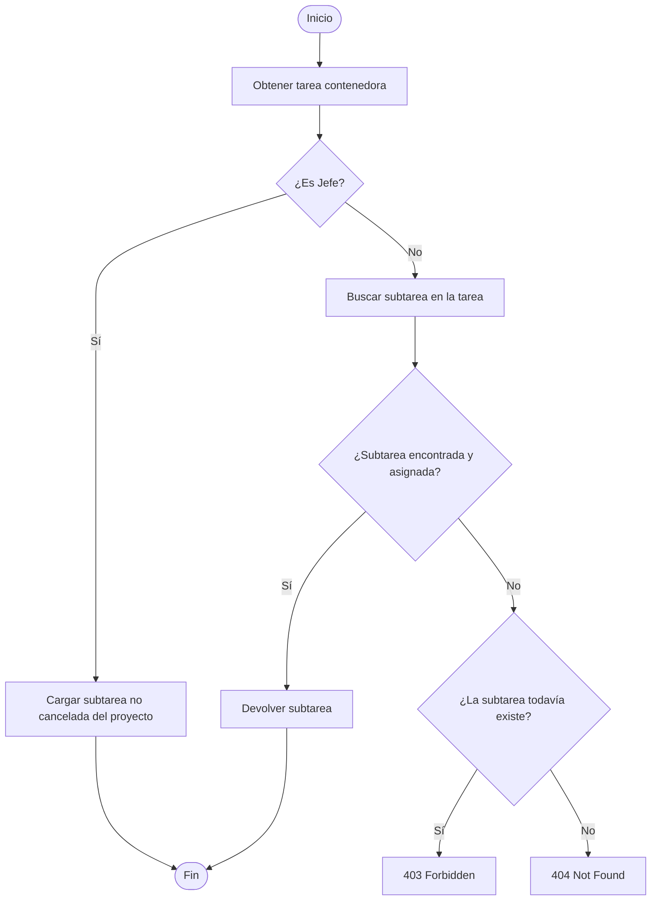
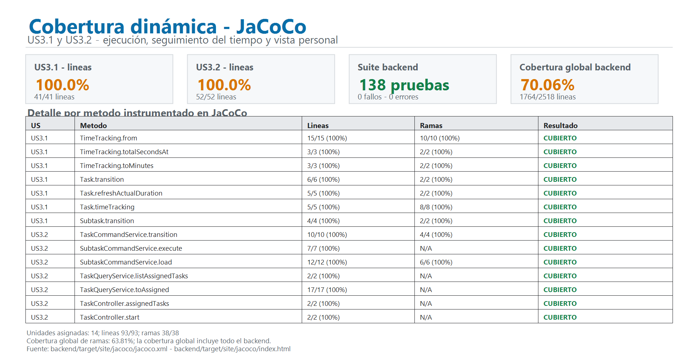

# Evidencia de pruebas unitarias — US-3.1 y US-3.2

## 1. Alcance y criterio de prueba

Este informe cubre **US-3.1 — Execution and Time Tracking** y **US-3.2 — Personal View and Self-Service Execution**. Se probaron las transiciones de tareas y subtareas, el cálculo de tiempo de las tareas desde su historial de estados y las restricciones de acceso y proyección del Personal.

La estrategia combina:

- JUnit 5 y AssertJ para pruebas de dominio y aplicación;
- Mockito para aislar los puertos de salida;
- MockMvc para verificar rutas, respuestas JSON y traducción de excepciones HTTP;
- grafos de flujo de control y caminos básicos independientes;
- JaCoCo para cobertura de líneas y ramas;
- SonarQube como consumidor del XML JaCoCo y analizador estático complementario.

Las pruebas son locales: no requieren iniciar Angular ni conectarse a PostgreSQL. En V4, el tiempo trabajado se deriva del historial de estados de la **tarea**. Las subtareas tienen ciclo de vida, pero V4 no persiste un historial de tiempo propio para ellas.

## 2. Trazabilidad y complejidad ciclomática

Se calculó la complejidad intraprocedimental como `V(G) = D + 1`. Cada condición atómica de cortocircuito (`&&`, `||`), condición de bucle, `if` y expresión condicional cuenta como una decisión. No se suman las decisiones internas de políticas, repositorios ni métodos invocados.

| Historia | Unidad | Decisiones D | V(G) | Caminos básicos |
|---|---|---:|---:|---:|
| US-3.1 | `TimeTracking.from` | 5 | 6 | 6 |
| US-3.1 | `TimeTracking.totalSecondsAt` | 1 | 2 | 2 |
| US-3.1 | `TimeTracking.toMinutes` | 1 | 2 | 2 |
| US-3.1 | `Task.transition` | 1 | 2 | 2 |
| US-3.1 | `Task.refreshActualDuration` | 1 | 2 | 2 |
| US-3.1 | `Task.timeTracking` | 4 | 5 | 5 |
| US-3.2 | `TaskCommandService.transition` | 2 | 3 | 3 |
| US-3.1 | `Subtask.transition` | 1 | 2 | 2 |
| US-3.2 | `SubtaskCommandService.execute` | 0 | 1 | 1 |
| US-3.2 | `SubtaskCommandService.load` | 3 | 4 | 4 |
| US-3.2 | `TaskQueryService.listAssignedTasks` | 0 | 1 | 1 |
| US-3.2 | `TaskQueryService.toAssigned` | 0 | 1 | 1 |
| US-3.2 | `TaskController.assignedTasks` | 0 | 1 | 1 |
| US-3.2 | `TaskController.start` | 0 | 1 | 1 |

Las rutas del controlador son lineales: la autorización y las respuestas de error se producen en el caso de uso y en `GlobalExceptionHandler`, no como decisiones adicionales en el método del controlador.

### Grafos de flujo de control

#### `TimeTracking.from` — D=5, V(G)=6



#### `TaskCommandService.transition` — D=2, V(G)=3



#### `SubtaskCommandService.load` — D=3, V(G)=4



### Caminos básicos, entradas y salidas esperadas

| Unidad | Camino | Entrada / condición | Salida esperada |
|---|---|---|---|
| `TimeTracking.from` | B1 | Lista vacía; estado final `PENDIENTE` | 0 segundos, sin segmento abierto |
| `TimeTracking.from` | B2 | Lista vacía; estado final `EN_PROGRESO` | 0 segundos; sin inicio deducible del historial |
| `TimeTracking.from` | B3 | Un cambio a `EN_PROGRESO`; estado final en progreso | El segmento abierto comienza en `changedAt` |
| `TimeTracking.from` | B4 | Primer cambio no progresivo; estado final pendiente | No se acumula tiempo y no se abre segmento |
| `TimeTracking.from` | B5 | Inicio y luego pausa | Se cierra y acumula el intervalo transcurrido |
| `TimeTracking.from` | B6 | Dos entradas progresivas consecutivas en historial sintético | Se conserva el primer inicio; el segundo no reinicia el segmento |
| `TimeTracking.totalSecondsAt` | B1 | `currentSegmentStart == null` | Devuelve solo los segundos cerrados |
| `TimeTracking.totalSecondsAt` | B2 | Segmento abierto | Suma su duración; si `now` es anterior al inicio, no añade tiempo negativo |
| `TimeTracking.toMinutes` | B1 | `seconds <= 0` | `null`, pues no hubo trabajo |
| `TimeTracking.toMinutes` | B2 | 1, 60 o 61 segundos | 1, 1 y 2 minutos; redondeo positivo hacia arriba |
| `Task.transition` | B1 | Estado igual al esperado | Cambia de estado y registra el evento |
| `Task.transition` | B2 | Estado distinto del esperado | `InvalidStatusTransitionException`; conserva el estado |
| `Task.refreshActualDuration` | B1 | Tiempo acumulado positivo | Actualiza minutos reales redondeados |
| `Task.refreshActualDuration` | B2 | No hay segundos trabajados | No reemplaza los minutos reales con un valor nulo |
| `Task.timeTracking` | B1 | Historial con segundos acumulados | Devuelve el tiempo derivado del historial |
| `Task.timeTracking` | B2 | Historial sin segundos; segmento actual abierto | Devuelve tracking sin usar el respaldo legado |
| `Task.timeTracking` | B3 | Sin tiempo en historial; `actualDurationMinutes == null` | No aplica respaldo |
| `Task.timeTracking` | B4 | Sin tiempo en historial; duración guardada igual a cero | No aplica respaldo |
| `Task.timeTracking` | B5 | Sin segmentos en historial; duración guardada positiva | Conserva minutos migrados como segundos (`minutos × 60`) |
| `TaskCommandService.transition` | B1 | Personal asignado inicia una tarea | Transición guardada con motivo de Personal asignado |
| `TaskCommandService.transition` | B2 | Jefe ejecuta una tarea que sí está asignada | Transición permitida sin motivo de override |
| `TaskCommandService.transition` | B3 | Jefe ejecuta una tarea no asignada | Transición permitida; el historial identifica el override |
| `Subtask.transition` | B1 | Estado coincide con el esperado | Transición de la subtarea |
| `Subtask.transition` | B2 | Estado no coincide con el esperado | `InvalidStatusTransitionException` |
| `SubtaskCommandService.execute` | B1 | Actor autorizado, subtarea y versión válidas | Aplica y persiste la acción solicitada |
| `SubtaskCommandService.load` | B1 | Actor Jefe; subtarea abierta en el proyecto | Devuelve la subtarea |
| `SubtaskCommandService.load` | B2 | Personal con asignación vigente a la tarea | Devuelve la subtarea |
| `SubtaskCommandService.load` | B3 | Personal sin asignación; subtarea aún existente | `ForbiddenException` (403), sin persistencia |
| `SubtaskCommandService.load` | B4 | El elemento deja de existir durante la lectura | `NotFoundException` (404) |
| `TaskQueryService.listAssignedTasks` | B1 | Consulta del actor autenticado | Devuelve solo sus tareas asignadas |
| `TaskQueryService.toAssigned` | B1 | Tarea asignada con datos financieros internos | Proyección de ejecución, sin presupuesto ni duración estimada |
| `TaskController.assignedTasks` | B1 | `GET /api/tasks/assigned` | `200 OK` con la vista personal sin propiedades financieras |
| `TaskController.start` | B1 | `POST /api/tasks/{id}/start` y JSON válido | `200 OK` con la tarea en progreso |

Los caminos B1–B6 de `TimeTracking.from` aíslan cada resultado de decisión, incluidos el caso de lista vacía y las dos ramas internas del procesamiento de eventos. B6 es un historial sintético para probar la defensa del algoritmo ante entradas repetidas; las transiciones válidas del agregado no generan por sí solas dos inicios consecutivos.

## 3. Implementación de las pruebas

Las tres clases nuevas reúnen **22 pruebas**:

| Clase de prueba | Pruebas | Aspectos verificados |
|---|---:|---|
| `ExecutionTimeTrackingTest` | 6 | Inicio, pausa, completar, reabrir; minutos acumulados entre segmentos; redondeo; tiempo futuro/negativo; historial legado; transiciones inválidas de tarea y subtarea. |
| `PersonalExecutionUseCaseTest` | 11 | Personal asignado y no asignado, override del Jefe, subtareas y asignación de la tarea contenedora, 403/404 de dominio, persistencia, proyección personal y exclusión de propiedades financieras. |
| `PersonalExecutionControllerTest` | 5 | `200`, JSON inválido `400`, acceso prohibido `403`, recurso inexistente `404`, transición inválida `409`; cuerpo de respuesta y ausencia de campos financieros. |
| **Total nuevo** | **22** | |

MockMvc monta `TaskController` en modo aislado y registra `GlobalExceptionHandler`. Mockito sustituye los puertos de entrada/salida, de modo que estas verificaciones no inician servidor ni base de datos.

## 4. Resultado reproducible

Verificación realizada el **15/10/2026** con Java **21.0.12.1** y Maven **3.9.9**:

```powershell
cd backend
mvn clean verify
```

Resultado de Surefire:

| Métrica | Resultado |
|---|---:|
| Pruebas backend totales | 138 |
| Pruebas nuevas de US-3.1 / US-3.2 | 22 |
| Fallos | 0 |
| Errores | 0 |
| Omitidas | 0 |
| Pruebas pasadas | 138/138 (100 %) |
| Estado Maven | `BUILD SUCCESS` |

Los resultados JUnit están en `backend/target/surefire-reports/`. La cobertura HTML y XML está en `backend/target/site/jacoco/` (`index.html` y `jacoco.xml`).
La suite completa pasó sin fallos, errores ni omisiones. En el alcance de US-3.1 y US-3.2, las 14 unidades seleccionadas alcanzaron 100 % de cobertura de líneas y ramas.

## 5. Cobertura JaCoCo

La cobertura de los métodos seleccionados para estas historias fue:

| Alcance | Líneas cubiertas | Ramas cubiertas |
|---|---:|---:|
| 14 unidades de dominio, aplicación y controlador seleccionadas | 93/93 (100 %) | 38/38 (100 %) |
| Backend completo | 1764/2518 (70,06 %) | 358/561 (63,81 %) |

El porcentaje global incluye código ajeno a US-3.1/US-3.2. El reporte JaCoCo indica cobertura completa de los métodos seleccionados; los porcentajes globales no deben atribuirse únicamente a estas historias.

## 6. Integración con SonarQube

`backend/pom.xml` configura JaCoCo 0.8.15 para producir el informe durante `mvn clean verify`. El proyecto importa el XML mediante:

```properties
sonar.coverage.jacoco.xmlReportPaths=backend/target/site/jacoco/jacoco.xml
```

Flujo para reproducir el análisis:

```powershell
cd backend
mvn clean verify
cd ..
.\scripts\sonar\Invoke-SonarScan.ps1 -Token 'TOKEN_CREADO_EN_SONARQUBE'
```

La configuración y preparación del servidor están documentadas en [docs/sonarqube.md](../sonarqube.md). **No se ejecutó un escaneo SonarQube como parte de esta verificación**; por tanto, este informe no atribuye Quality Gate, issues ni métricas de análisis estático a estas pruebas. Las capturas enlazadas son evidencias visuales disponibles en el repositorio, no una afirmación de que se haya ejecutado un nuevo análisis en esta verificación. JaCoCo genera la cobertura dinámica; SonarQube la importa y presenta junto con sus métricas estáticas.

### Evidencias SonarQube

| # | Evidencia |
|---:|---|
| 1 | [us31-32-01-Overview.png](evidencias/sonarqube/us31-32-01-Overview.png) |
| 2 | [us31-32-02-Issues.png](evidencias/sonarqube/us31-32-02-Issues.png) |
| 3 | [us31-32-03-timetracking.java.png](evidencias/sonarqube/us31-32-03-timetracking.java.png) |
| 4 | [us31-32-04-taskcommandservice.java.png](evidencias/sonarqube/us31-32-04-taskcommandservice.java.png) |
| 5 | [us31-32-05-subtaskcommandservice.java.png](evidencias/sonarqube/us31-32-05-subtaskcommandservice.java.png) |
| 6 | [us31-32-06-task.java.png](evidencias/sonarqube/us31-32-06-task.java.png) |
| 7 | [us31-32-07-subtask.java.png](evidencias/sonarqube/us31-32-07-subtask.java.png) |
| 8 | [us31-32-08-taskqueryservice.java.png](evidencias/sonarqube/us31-32-08-taskqueryservice.java.png) |
| 9 | [us31-32-09-taskcontroller.java.png](evidencias/sonarqube/us31-32-09-taskcontroller.java.png) |

La evidencia 10 solicitada, `us31-32-10-subtaskcontroller.java.png`, no está presente en `docs/pruebas-unitarias/evidencias/sonarqube/` y por ello no se puede enlazar a un archivo existente.

## 7. Evidencias visuales

El generador de grafos produce una lámina por cada unidad y lista sus caminos básicos independientes:

| Historia | Unidad | Evidencia |
|---|---|---|
| US-3.1 | `TimeTracking.from` | [PNG](evidencias/grafos/US31-01-TimeTracking-from.png) |
| US-3.1 | `TimeTracking.totalSecondsAt` | [PNG](evidencias/grafos/US31-02-TimeTracking-totalSecondsAt.png) |
| US-3.1 | `TimeTracking.toMinutes` | [PNG](evidencias/grafos/US31-03-TimeTracking-toMinutes.png) |
| US-3.1 | `Task.transition` | [PNG](evidencias/grafos/US31-04-Task-transition.png) |
| US-3.1 | `Task.refreshActualDuration` | [PNG](evidencias/grafos/US31-05-Task-refreshActualDuration.png) |
| US-3.1 | `Task.timeTracking` | [PNG](evidencias/grafos/US31-06-Task-timeTracking.png) |
| US-3.1 | `Subtask.transition` | [PNG](evidencias/grafos/US31-07-Subtask-transition.png) |
| US-3.2 | `TaskCommandService.transition` | [PNG](evidencias/grafos/US32-01-TaskCommandService-transition.png) |
| US-3.2 | `SubtaskCommandService.execute` | [PNG](evidencias/grafos/US32-02-SubtaskCommandService-execute.png) |
| US-3.2 | `SubtaskCommandService.load` | [PNG](evidencias/grafos/US32-03-SubtaskCommandService-load.png) |
| US-3.2 | `TaskQueryService.listAssignedTasks` | [PNG](evidencias/grafos/US32-04-TaskQueryService-listAssignedTasks.png) |
| US-3.2 | `TaskQueryService.toAssigned` | [PNG](evidencias/grafos/US32-05-TaskQueryService-toAssigned.png) |
| US-3.2 | `TaskController.assignedTasks` | [PNG](evidencias/grafos/US32-06-TaskController-assignedTasks.png) |
| US-3.2 | `TaskController.start` | [PNG](evidencias/grafos/US32-07-TaskController-start.png) |

Resumen visual de cobertura:



Los scripts reproducibles están en `docs/pruebas-unitarias/scripts/`.

## 8. Archivos relevantes

- `backend/src/test/java/com/hardcoders/taskmanager/domain/model/ExecutionTimeTrackingTest.java`
- `backend/src/test/java/com/hardcoders/taskmanager/application/usecase/PersonalExecutionUseCaseTest.java`
- `backend/src/test/java/com/hardcoders/taskmanager/adapter/in/web/task/PersonalExecutionControllerTest.java`
- `backend/src/main/java/com/hardcoders/taskmanager/domain/model/TimeTracking.java`
- `backend/src/main/java/com/hardcoders/taskmanager/application/usecase/TaskCommandService.java`
- `backend/src/main/java/com/hardcoders/taskmanager/application/usecase/SubtaskCommandService.java`
- `backend/src/main/java/com/hardcoders/taskmanager/application/usecase/TaskQueryService.java`
- `backend/src/main/java/com/hardcoders/taskmanager/adapter/in/web/task/TaskController.java`
- `backend/target/site/jacoco/jacoco.xml`
- `sonar-project.properties`
