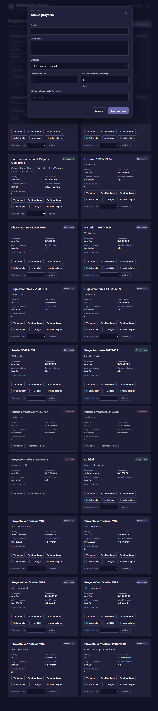
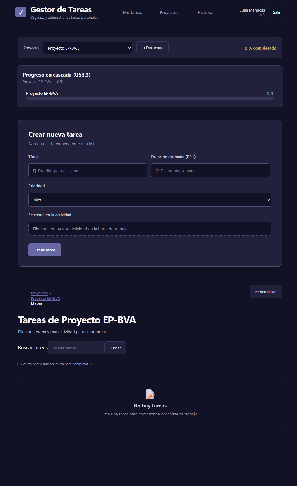
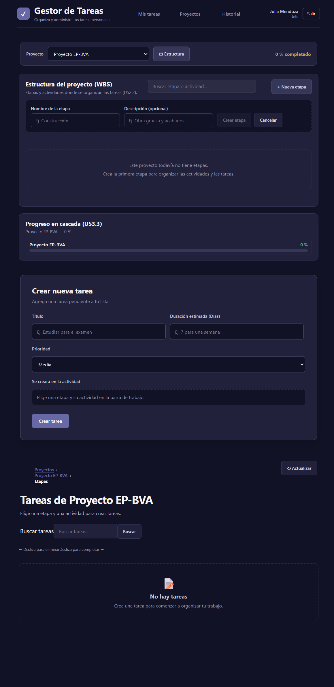
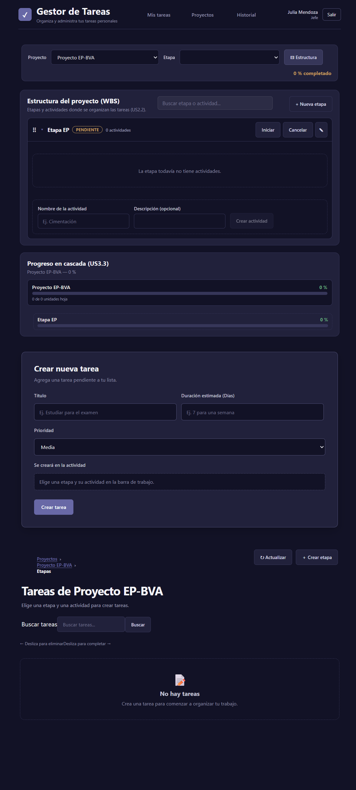

# PORTADA

**Institución:** [Nombre de la institución] *(campo editable — a completar por el equipo)*

**Asignatura:** Gestión de Calidad de Sistemas

**Docente:** M. Sc. Ing. Joel Reynaldo Alánez Durán

**Título:** Trabajo Asíncrono — Identificación de Formularios, Atributos, Reglas de Validación y Diseño de Casos de Prueba EP / BVA

**Proyecto:** SCRUM Gestor de Tareas Personales Release 1

**Equipo:** Hard Coders

**Integrantes:**
1. Caleb Mario Baving Auza
2. Edson Lamas Alcocer
3. Cesar Cadiz Rivero
4. Dagner Ariel Flores
5. Leonardo Köller Mejia
6. _Integrante adicional (a completar)_
7. _Integrante adicional (a completar)_

**Fecha:** 06 de noviembre de 2026

**Entregable:** `Trabajo_Asincrono_06-11-2026_Formularios_EP_BVA.md`

**Rama analizada:** `Refactor-E2`

---

# ÍNDICE

- [PORTADA](#portada)
- [ÍNDICE](#índice)
- [1. Introducción](#1-introducción)
- [2. Descripción general del sistema](#2-descripción-general-del-sistema)
- [3. Identificación de los cuatro formularios](#3-identificación-de-los-cuatro-formularios)
- [4. Formulario 1 — Proyecto](#4-formulario-1---proyecto)
- [5. Formulario 2 — Etapa](#5-formulario-2---etapa)
- [6. Formulario 3 — Actividad](#6-formulario-3---actividad)
- [7. Formulario 4 — Tarea](#7-formulario-4---tarea)
- [8. Conclusiones](#8-conclusiones)
- [9. Referencias técnicas y fuentes de análisis](#9-referencias-técnicas-y-fuentes-de-análisis)

---

# 1. Introducción

El presente documento presenta el análisis de los formularios del sistema **SCRUM Gestor de Tareas Personales Release 1**, desarrollado por el equipo **Hard Coders**, sobre la rama `Refactor-E2` del repositorio. El propósito es identificar exactamente cuatro formularios que participan en el proceso principal de gestión jerárquica de la aplicación, documentar sus atributos y reglas de validación reales (frontend Angular, backend Java/Spring Boot y base de datos PostgreSQL), y diseñar casos de prueba aplicando las técnicas de caja negra **Partición de Equivalencias (EP)** y **Análisis de Valores Límite (BVA de tres valores)**.

El análisis se fundamenta exclusivamente en la implementación real del código fuente de la rama `Refactor-E2`. No se inventan campos, restricciones, mensajes de error ni reglas de negocio. Cuando un atributo no presenta una validación explícita, se declara como tal. El documento cubre los puntos 1, 2.a y 2.b de la actividad. Queda excluido expresamente el punto 2.c (combinaciones Pairwise), así como la generación de archivos Excel, Word o PDF.

# 2. Descripción general del sistema

## 2.1. Qué gestiona la aplicación

La aplicación es un gestor de tareas personales con enfoque SCRUM que permite organizar el trabajo en una jerarquía de varios niveles:

**Proyecto → Etapa → Actividad → Tarea → Subtarea**

Un **Proyecto** es la entidad raíz (tiene nombre, descripción, encargado, presupuesto, duración estimada y estado). Dentro de un proyecto se crean **Etapas**, que representan fases del proyecto. Cada etapa contiene **Actividades** (mostradas en la interfaz como "categorías" de las tareas). Cada actividad agrupa **Tareas**, y una tarea puede tener **Subtareas**.

## 2.2. Proceso principal

El flujo principal del gestor SCRUM es:

1. El Jefe crea un **Proyecto** (asigna Encargado, presupuesto y duración estimada).
2. Dentro del proyecto se definen **Etapas** (estructura WBS).
3. Dentro de cada etapa se crean **Actividades**.
4. Dentro de cada actividad se crean **Tareas** (con título, prioridad, duración estimada y presupuesto asignado).
5. Opcionalmente, una tarea puede desglosarse en **Subtareas**.

Los formularios analizados cubren los cuatro primeros niveles de esta jerarquía (Proyecto, Etapa, Actividad, Tarea), que son los que inician y estructuran el trabajo.

## 2.3. Entidades que participan

Las entidades del modelo de dominio (V004) implicadas son: `Project`, `Stage` (Etapa), `Activity` (Actividad), `Task` (Tarea) y `Subtask` (Subtarea), además de `AppUser` (usuarios), catálogos de estado (`project_status`, `work_status`) y prioridad (`task_priority`), e historiales de plan y de estado.

## 2.4. Tecnologías reales

- **Frontend:** Angular (v22), TypeScript, formularios reactivos (`FormBuilder`, `Validators`) y template-driven (`ngModel`), servicios HTTP con proxy a `http://localhost:8081`.
- **Backend:** Java, Spring Boot 4.1.0, Spring Data JPA, Jakarta Validation, arquitectura hexagonal (puertos y adaptadores), casos de uso, políticas de dominio.
- **Base de datos:** PostgreSQL 18, esquema `task_manager`, migraciones V001–V004.

# 3. Identificación de los cuatro formularios

Se seleccionaron exactamente cuatro formularios, todos reales y presentes en la rama `Refactor-E2`, que corresponden a los cuatro niveles del proceso principal (Proyecto → Etapa → Actividad → Tarea).

| N.º | Formulario | Función | Entidad relacionada | Justificación |
| --- | ---------- | ------- | ------------------- | ------------- |
| 1 | Proyecto | Crear un proyecto y editar sus datos básicos (nombre, descripción) | `Project` | Es la entidad raíz del proceso SCRUM; todo lo demás depende de un proyecto existente. |
| 2 | Etapa | Crear y editar una etapa dentro de un proyecto (panel WBS) | `Stage` | Nivel 2 de la jerarquía; agrupa actividades y es requisito para crear tareas. |
| 3 | Actividad | Crear y editar una actividad dentro de una etapa (panel WBS) | `Activity` | Nivel 3 de la jerarquía; es la "categoría" a la que pertenece una tarea. |
| 4 | Tarea | Crear una tarea (o subtarea) dentro de una actividad | `Task` | Nivel 4 de la jerarquía; es la unidad de trabajo ejecutable del gestor. |

**Nota sobre la implementación:** Los formularios de **Proyecto** y **Tarea** son modales/páginas independientes (`app-project-form`, `app-task-form`). Los formularios de **Etapa** y **Actividad** se implementan como formularios en línea dentro del panel WBS (`app-wbs-panel`), no como modales independientes; no obstante, son formularios reales con campos de entrada, validación de cliente y llamadas de creación/edición al backend.

## 3.1. Capturas reales de los cuatro formularios

A continuación se presentan las capturas obtenidas de la aplicación en ejecución (backend Spring Boot en el puerto 8081, frontend Angular en el puerto 4200, PostgreSQL en el puerto 5432, rama `Refactor-E2`).

### Figura 1. Formulario de Proyecto (creación)

*Figura 1. Formulario de creación de proyectos del Gestor SCRUM (modal "Nuevo proyecto" desde la lista de proyectos).*

### Figura 2. Formulario de Tarea (creación)

*Figura 2. Formulario de creación de tarea en la vista del proyecto (sección "Crear nueva tarea").*

### Figura 3. Formulario de Etapa (creación, panel WBS)

*Figura 3. Formulario en línea de creación de etapa dentro del panel WBS del proyecto.*

### Figura 4. Formulario de Actividad (creación, panel WBS)

*Figura 4. Formulario en línea de creación de actividad dentro de una etapa desplegada del panel WBS.*

---

# 4. Formulario 1 — Proyecto

## 4.1. Descripción del formulario

El formulario **Proyecto** (`app-project-form`) permite crear un nuevo proyecto (solo el Jefe, US1.1) o editar el nombre y la descripción de un proyecto existente (Jefe o Encargado). En modo edición no se muestran el presupuesto ni el Encargado, pues tienen flujos propios (revisión del plan y delegación) con historial. Al crear, se registra una revisión inicial del plan con el motivo indicado.

## 4.2. Captura de pantalla

*Figura 1. Formulario de creación de proyectos del Gestor SCRUM.*

## 4.3. Identificación de atributos y reglas de validación

| N.º | Nombre del atributo | Descripción o propósito | Tipo de dato / Formato esperado | Reglas de validación |
| --- | ------------------- | ----------------------- | ------------------------------- | -------------------- |
| 1 | Nombre (`name`) | Nombre del proyecto; identifica el proyecto en el sistema. | Texto (cadena), no vacío, sin solo espacios en blanco. | Obligatorio. Longitud máxima 160 caracteres. No puede consistir solo de espacios (`pattern /\S/`). Backend: `@NotBlank`, `@Size(max=160)`, `WorkText.title()`. DB: `project.name varchar(160) NOT NULL`, `CHECK (char_length(btrim(name)) >= 1)`. |
| 2 | Descripción (`description`) | Detalle opcional del proyecto. | Texto multilínea, opcional. | Opcional. Longitud máxima 2000 caracteres. Si va en blanco se guarda como `null`. Backend: `@Size(max=2000)`, `WorkText.description()`. DB: `project.description varchar(2000)` nullable. |
| 3 | Encargado (`managerUserId`) | Usuario que dirigirá el proyecto (debe ser un encargado elegible/activo). | Identificador numérico (lista de selección). El valor `0` es un placeholder deshabilitado ("Selecciona un encargado"). | Obligatorio en creación. Debe ser ≥ 1 (`Validators.min(1)`). Debe corresponder a un usuario existente y elegible. Backend: `@NotNull Integer managerUserId`. DB: `project.manager_user_id integer NOT NULL FK → app_user(user_id)`. |
| 4 | Presupuesto (`budgetBob`) | Presupuesto inicial del proyecto en bolivianos (Bs). | Número decimal (moneda BOB), formato con hasta 2 decimales. | Obligatorio. Mayor o igual a 0. Máximo 13 dígitos enteros y 2 decimales (`@Digits(integer=13, fraction=2)`). Frontend: `type="number" min="0" step="0.01"`, `pattern /^\d{1,13}(\.\d{1,2})?$/`. Backend: `@NotNull`, `@DecimalMin("0.00")`, `BudgetPolicy.validatePositive()` (no nulo, no negativo, ≤13 enteros, ≤2 decimales). DB: `project.budget_bob numeric(15,2) NOT NULL DEFAULT 0.00`, `CHECK (budget_bob >= 0 AND budget_bob <> 'NaN')`. |
| 5 | Duración estimada (`estimatedDurationMinutes`) | Duración estimada del proyecto, en minutos. | Número entero (minutos), ≥ 0. | Obligatorio. Mayor o igual a 0. Frontend: `type="number" min="0" step="1"`, `pattern /^\d+$/`. Backend: `@NotNull`, `@PositiveOrZero`, `@Max(Integer.MAX_VALUE)`, `BudgetPolicy.validateDuration()` (≥ 0). DB: `project.estimated_duration_minutes integer NOT NULL DEFAULT 0`, `CHECK (estimated_duration_minutes >= 0)`. |
| 6 | Motivo del plan inicial (`reason`) | Motivo de la revisión inicial del plan; queda en el historial del plan. | Texto, opcional. | Opcional. Longitud máxima 300 caracteres. Si va en blanco se usa "Plan inicial". Backend: `@Size(max=300)`, `requiredReason()` / `reasonOrDefault()`. Se persiste en `project_plan_history.reason varchar(500) NOT NULL`. |

**Atributos no editables (automáticos / de solo lectura) en este formulario:** `id` (`project_id`, PK autogenerada), `status` (estado del proyecto, se asigna `PLANIFICADO` al crear; no es campo de entrada), `created_by_user_id` (usuario que crea, del token de autenticación), `created_at`, `updated_at`, `version` (bloqueo optimista), `allocatedBudgetBob` (presupuesto asignado a tareas, calculado, default 0), `currentRevision` (número de revisión). Estos no se presentan como campos de entrada al usuario.

## 4.4. Reglas de negocio entre atributos y restricciones de negocio

- Al crear un proyecto, el estado inicial es `PLANIFICADO` y se registra la revisión 1 del plan (`Project.create()`).
- El `managerUserId` debe referenciar un usuario activo y elegible (`eligibleManagers()`); de lo contrario la operación no procede.
- El presupuesto no puede ser negativo (`INV-FIN-01`) y no puede quedar por debajo del total ya asignado a las tareas (`INV-FIN-03`, `BudgetPolicy.validateAllocationCap()`), aunque en el formulario de creación el asignado inicia en 0.
- En modo edición no se pueden modificar presupuesto ni encargado (tienen flujos propios: plan-form y delegation-dialog).
- El campo `reason` es independiente del nombre y descripción; si se omite, se asigna el valor por defecto "Plan inicial".
- El nombre y la descripción se sanitizan con `WorkText.title()` / `WorkText.description()` (trim y validación de longitud).

## 4.5. Casos de prueba — Partición de Equivalencias (EP)

| ID | Atributo | Clase de equivalencia | Tipo de clase | Valor de prueba | Resultado esperado | Justificación |
| -- | -------- | --------------------- | ------------- | --------------- | ------------------ | ------------- |
| PROY-EP-001 | Nombre | Texto no vacío, ≤ 160 caracteres, con al menos un carácter no espacio | Válida | "Proyecto EP-BVA" | Aceptado; se crea el proyecto | Cumple obligatoriedad, longitud y patrón. |
| PROY-EP-002 | Nombre | Vacío o solo espacios en blanco | Inválida | "" (vacío) | Rechazado; error "El nombre es obligatorio" | Violación de `@NotBlank` / `WorkText.title`. |
| PROY-EP-003 | Nombre | Texto que supera los 160 caracteres | Inválida | cadena de 161 caracteres | Rechazado; error "máximo 160 caracteres" | Violación de `@Size(max=160)` y `CHECK` de BD. |
| PROY-EP-004 | Descripción | Texto ≤ 2000 caracteres o vacío/null | Válida | "Descripción de prueba" (o vacío) | Aceptado; descripción guardada o null | Opcional, dentro del límite. |
| PROY-EP-005 | Descripción | Texto que supera los 2000 caracteres | Inválida | cadena de 2001 caracteres | Rechazado; error "máximo 2000 caracteres" | Violación de `@Size(max=2000)`. |
| PROY-EP-006 | Encargado | ID de encargado existente y activo (≥ 1) | Válida | ID de un encargado válido (p. ej. 12) | Aceptado; proyecto asignado al encargado | `@NotNull` y FK válida a `app_user`. |
| PROY-EP-007 | Encargado | Sin selección (valor 0, placeholder) | Inválida | 0 | Rechazado; error "Elige quién dirigirá el proyecto" | `Validators.min(1)`; `managerUserId < 1` bloquea el envío. |
| PROY-EP-008 | Encargado | ID de usuario inexistente | Inválida | 999999 | Rechazado; error de backend / FK no válida | No existe `app_user` con ese ID. |
| PROY-EP-009 | Presupuesto | Decimal ≥ 0, hasta 13 enteros y 2 decimales | Válida | 1000.00 | Aceptado; presupuesto guardado | `@DecimalMin("0.00")`, `@Digits(13,2)`, `CHECK budget_bob >= 0`. |
| PROY-EP-010 | Presupuesto | Valor negativo | Inválida | -50.00 | Rechazado; error "no puede ser negativo" | `@DecimalMin("0.00")` y `BudgetPolicy.validatePositive`. |
| PROY-EP-011 | Presupuesto | Más de 13 dígitos enteros | Inválida | 10000000000000.00 (14 enteros) | Rechazado; error "13 enteros y 2 decimales" | `@Digits(integer=13)` y `CHECK` de BD. |
| PROY-EP-012 | Presupuesto | Más de 2 decimales | Inválida | 10.005 | Rechazado; error de formato | `pattern` y `@Digits(fraction=2)`. |
| PROY-EP-013 | Duración estimada | Entero ≥ 0 (minutos) | Válida | 60 | Aceptado; duración guardada | `@PositiveOrZero`, `CHECK >= 0`. |
| PROY-EP-014 | Duración estimada | Entero negativo | Inválida | -10 | Rechazado; error "no puede ser negativa" | `@PositiveOrZero`, `validateDuration()`. |
| PROY-EP-015 | Duración estimada | Valor no entero | Inválida | 1.5 | Rechazado; error de formato | `pattern /^\d+$/` solo permite enteros. |
| PROY-EP-016 | Motivo (reason) | Texto ≤ 300 caracteres o vacío | Válida | "Motivo de prueba" (o vacío) | Aceptado; si vacío, "Plan inicial" | `@Size(max=300)`, `reasonOrDefault()`. |
| PROY-EP-017 | Motivo (reason) | Texto que supera los 300 caracteres | Inválida | cadena de 301 caracteres | Rechazado; error "máximo 300 caracteres" | `@Size(max=300)` y `CHECK reason` de historial. |

## 4.6. Casos de prueba — Análisis de Valores Límite (BVA)

Se aplica BVA con **tres valores por límite** (justo debajo, en el límite, justo encima) a los atributos con frontera numérica o de longitud definida. Los atributos categóricos y de selección se cubren mediante EP (no tienen orden natural).

| ID | Atributo | Límite evaluado | Valor de prueba | Posición respecto al límite | Resultado esperado |
| -- | -------- | --------------- | --------------- | --------------------------- | ------------------ |
| PROY-BVA-001 | Nombre (longitud) | Longitud máxima = 160 | 159 caracteres | Justo debajo del máximo | Aceptado (≤ 160). |
| PROY-BVA-002 | Nombre (longitud) | Longitud máxima = 160 | 160 caracteres | En el límite máximo | Aceptado (igual a 160). |
| PROY-BVA-003 | Nombre (longitud) | Longitud máxima = 160 | 161 caracteres | Justo encima del máximo | Rechazado (> 160). |
| PROY-BVA-004 | Nombre (longitud) | Longitud mínima = 1 (no vacío) | 0 caracteres (vacío) | Justo debajo del mínimo | Rechazado (obligatorio). |
| PROY-BVA-005 | Nombre (longitud) | Longitud mínima = 1 | 1 carácter | En el límite mínimo | Aceptado (mínimo válido). |
| PROY-BVA-006 | Nombre (longitud) | Longitud mínima = 1 | 2 caracteres | Justo encima del mínimo | Aceptado (> 1). |
| PROY-BVA-007 | Descripción (longitud) | Longitud máxima = 2000 | 1999 caracteres | Justo debajo del máximo | Aceptado (≤ 2000). |
| PROY-BVA-008 | Descripción (longitud) | Longitud máxima = 2000 | 2000 caracteres | En el límite máximo | Aceptado (igual a 2000). |
| PROY-BVA-009 | Descripción (longitud) | Longitud máxima = 2000 | 2001 caracteres | Justo encima del máximo | Rechazado (> 2000). |
| PROY-BVA-010 | Presupuesto (valor) | Mínimo = 0 | -0.01 | Justo debajo del mínimo | Rechazado (< 0). |
| PROY-BVA-011 | Presupuesto (valor) | Mínimo = 0 | 0.00 | En el límite mínimo | Aceptado (>= 0). |
| PROY-BVA-012 | Presupuesto (valor) | Mínimo = 0 | 0.01 | Justo encima del mínimo | Aceptado (> 0). |
| PROY-BVA-013 | Presupuesto (valor) | Máximo = 9999999999999.99 (13 enteros, 2 decimales) | 9999999999999.98 | Justo debajo del máximo | Aceptado (dentro de 13 enteros). |
| PROY-BVA-014 | Presupuesto (valor) | Máximo = 9999999999999.99 | 9999999999999.99 | En el límite máximo | Aceptado (igual al máximo). |
| PROY-BVA-015 | Presupuesto (valor) | Máximo = 9999999999999.99 | 10000000000000.00 | Justo encima del máximo | Rechazado (14 dígitos enteros > 13). |
| PROY-BVA-016 | Duración estimada (valor) | Mínimo = 0 minutos | -1 minuto | Justo debajo del mínimo | Rechazado (< 0). |
| PROY-BVA-017 | Duración estimada (valor) | Mínimo = 0 minutos | 0 minutos | En el límite mínimo | Aceptado (>= 0). |
| PROY-BVA-018 | Duración estimada (valor) | Mínimo = 0 minutos | 1 minuto | Justo encima del mínimo | Aceptado (> 0). |
| PROY-BVA-019 | Duración estimada (valor) | Máximo = Integer.MAX_VALUE | Integer.MAX_VALUE - 1 | Justo debajo del máximo | Aceptado (dentro del rango int). |
| PROY-BVA-020 | Duración estimada (valor) | Máximo = Integer.MAX_VALUE | Integer.MAX_VALUE | En el límite máximo | Aceptado (igual al máximo). |
| PROY-BVA-021 | Duración estimada (valor) | Máximo = Integer.MAX_VALUE | Integer.MAX_VALUE + 1 | Justo encima del máximo | Rechazado (desbordamiento de `int` / fuera de rango). |
| PROY-BVA-022 | Motivo (longitud) | Longitud máxima = 300 | 299 caracteres | Justo debajo del máximo | Aceptado (≤ 300). |
| PROY-BVA-023 | Motivo (longitud) | Longitud máxima = 300 | 300 caracteres | En el límite máximo | Aceptado (igual a 300). |
| PROY-BVA-024 | Motivo (longitud) | Longitud máxima = 300 | 301 caracteres | Justo encima del máximo | Rechazado (> 300). |

**Nota:** El límite superior de la duración (`Integer.MAX_VALUE`) es teórico; en la práctica el frontend no impide escribirlo pero el valor se envía como `Integer`. El atributo `managerUserId` es una lista de selección (sin orden numérico para BVA) y se cubre mediante EP.

---

# 5. Formulario 2 — Etapa

## 5.1. Descripción del formulario

El formulario **Etapa** (`app-wbs-panel`, sección "FORMULARIO NUEVA ETAPA" y "EDICIÓN DE ETAPA") permite crear una nueva etapa dentro de un proyecto y editar el nombre y la descripción de una etapa existente. Es parte del panel WBS (Estructura del proyecto). Una etapa nueva se crea en estado `PENDIENTE` y pertenece al proyecto indicado por el contexto (`projectId`).

## 5.2. Captura de pantalla

*Figura 3. Formulario en línea de creación de etapa dentro del panel WBS del proyecto.*

## 5.3. Identificación de atributos y reglas de validación

| N.º | Nombre del atributo | Descripción o propósito | Tipo de dato / Formato esperado | Reglas de validación |
| --- | ------------------- | ----------------------- | ------------------------------- | -------------------- |
| 1 | Nombre de la etapa (`name`) | Nombre de la etapa; identifica la fase dentro del proyecto. | Texto, no vacío, ≤ 160 caracteres. | Obligatorio. No puede estar en blanco. Longitud máxima 160. Backend: `@NotBlank`, `@Size(max=160)`, `WorkText.title()`. DB: `stage.name varchar(160) NOT NULL`, `CHECK (char_length(btrim(name)) >= 1)`. |
| 2 | Descripción (`description`) | Detalle opcional de la etapa. | Texto, opcional, ≤ 2000 caracteres. | Opcional. Longitud máxima 2000. Si va en blanco se guarda como `null`. Backend: `@Size(max=2000)`, `WorkText.description()`. DB: `stage.description varchar(2000)` nullable. |
| 3 | Proyecto (`projectId`) | Proyecto al que pertenece la etapa (relación padre). | Identificador numérico (FK). No es campo de entrada; viene del contexto del proyecto abierto. | Obligatorio implícito. Debe referenciar un proyecto existente. Backend: `CreateStageCommand(projectId, ...)`. DB: `stage.project_id integer NOT NULL FK → project(project_id) ON DELETE CASCADE`. |
| 4 | Estado (`workStatus`) | Estado de la etapa (PENDIENTE, EN_PROGRESO, COMPLETADA, CANCELADA). | Enumeración/catálogo. Derivado: al crear se asigna `PENDIENTE`. | No es campo de entrada en el formulario de creación/edición de nombre/descripción. Se gestiona mediante botones de transición de estado. DB: `stage.work_status_id NOT NULL FK → work_status(work_status_id)`. |

**Atributos no editables (automáticos):** `id` (`stage_id`, PK autogenerada), `projectId` (FK de contexto, no se edita en este formulario), `created_at`, `updated_at`, `version`. El estado inicial `PENDIENTE` se asigna automáticamente al crear (`Stage.create()`).

## 5.4. Reglas de negocio entre atributos y restricciones de negocio

- Una etapa debe pertenecer a un proyecto existente (`fk_stage_project`). Si el proyecto no existe, el backend responde 404.
- Al crear, la etapa queda en estado `PENDIENTE` (`WorkStatus.PENDIENTE`).
- Las transiciones de estado siguen el ciclo de vida de `WorkStatus` (PENDIENTE ⇄ EN_PROGRESO → COMPLETADA → EN_PROGRESO, y CANCELADA).
- El nombre se sanitiza con `WorkText.title()` (trim, no vacío, ≤ 160).
- La versión (`version`) se envía en las actualizaciones para bloqueo optimista (412 si hay choque de versión).

## 5.5. Casos de prueba — Partición de Equivalencias (EP)

| ID | Atributo | Clase de equivalencia | Tipo de clase | Valor de prueba | Resultado esperado | Justificación |
| -- | -------- | --------------------- | ------------- | --------------- | ------------------ | ------------- |
| ETAP-EP-001 | Nombre | Texto no vacío, ≤ 160 caracteres | Válida | "Etapa EP" | Aceptado; etapa creada | `@NotBlank`, `@Size(max=160)`, `CHECK name >= 1`. |
| ETAP-EP-002 | Nombre | Vacío o solo espacios | Inválida | "" | Rechazado; "El nombre de la etapa es obligatorio" | `@NotBlank` / `WorkText.title`. |
| ETAP-EP-003 | Nombre | Texto > 160 caracteres | Inválida | 161 caracteres | Rechazado; "máximo 160 caracteres" | `@Size(max=160)`, `CHECK` de BD. |
| ETAP-EP-004 | Descripción | Texto ≤ 2000 o vacío/null | Válida | "Descripción etapa" | Aceptado; descripción guardada o null | `@Size(max=2000)`, opcional. |
| ETAP-EP-005 | Descripción | Texto > 2000 caracteres | Inválida | 2001 caracteres | Rechazado; "máximo 2000 caracteres" | `@Size(max=2000)`. |
| ETAP-EP-006 | Proyecto | ID de proyecto existente | Válida | ID de proyecto válido (p. ej. 23) | Aceptado; etapa asociada al proyecto | FK `stage.project_id → project`. |
| ETAP-EP-007 | Proyecto | ID de proyecto inexistente | Inválida | 999999 | Rechazado; 404 / proyecto no disponible | FK inválida; backend valida pertenencia. |

## 5.6. Casos de prueba — Análisis de Valores Límite (BVA)

| ID | Atributo | Límite evaluado | Valor de prueba | Posición respecto al límite | Resultado esperado |
| -- | -------- | --------------- | --------------- | --------------------------- | ------------------ |
| ETAP-BVA-001 | Nombre (longitud) | Longitud máxima = 160 | 159 caracteres | Justo debajo del máximo | Aceptado (≤ 160). |
| ETAP-BVA-002 | Nombre (longitud) | Longitud máxima = 160 | 160 caracteres | En el límite máximo | Aceptado (igual a 160). |
| ETAP-BVA-003 | Nombre (longitud) | Longitud máxima = 160 | 161 caracteres | Justo encima del máximo | Rechazado (> 160). |
| ETAP-BVA-004 | Nombre (longitud) | Longitud mínima = 1 | 0 caracteres (vacío) | Justo debajo del mínimo | Rechazado (obligatorio). |
| ETAP-BVA-005 | Nombre (longitud) | Longitud mínima = 1 | 1 carácter | En el límite mínimo | Aceptado (mínimo válido). |
| ETAP-BVA-006 | Nombre (longitud) | Longitud mínima = 1 | 2 caracteres | Justo encima del mínimo | Aceptado (> 1). |
| ETAP-BVA-007 | Descripción (longitud) | Longitud máxima = 2000 | 1999 caracteres | Justo debajo del máximo | Aceptado (≤ 2000). |
| ETAP-BVA-008 | Descripción (longitud) | Longitud máxima = 2000 | 2000 caracteres | En el límite máximo | Aceptado (igual a 2000). |
| ETAP-BVA-009 | Descripción (longitud) | Longitud máxima = 2000 | 2001 caracteres | Justo encima del máximo | Rechazado (> 2000). |

**Justificación de BVA no aplicado:** `projectId` y `workStatus` son relaciones/enumeración sin frontera numérica natural en este formulario; se evalúan mediante EP (ETAP-EP-006, ETAP-EP-007). No se inventan límites numéricos para estos atributos.

---

# 6. Formulario 3 — Actividad

## 6.1. Descripción del formulario

El formulario **Actividad** (`app-wbs-panel`, sección "FORMULARIO NUEVA ACTIVIDAD" y "EDICIÓN DE ACTIVIDAD") permite crear una nueva actividad dentro de una etapa y editar el nombre y la descripción de una actividad existente. En la interfaz se muestra como la "categoría" de la tarea. Una actividad nueva se crea en estado `PENDIENTE` y pertenece a la etapa indicada por el contexto (`stageId`).

## 6.2. Captura de pantalla

*Figura 4. Formulario en línea de creación de actividad dentro de una etapa desplegada del panel WBS.*

## 6.3. Identificación de atributos y reglas de validación

| N.º | Nombre del atributo | Descripción o propósito | Tipo de dato / Formato esperado | Reglas de validación |
| --- | ------------------- | ----------------------- | ------------------------------- | -------------------- |
| 1 | Nombre de la actividad (`name`) | Nombre de la actividad; se muestra como categoría de las tareas. | Texto, no vacío, ≤ 160 caracteres. | Obligatorio. No puede estar en blanco. Longitud máxima 160. Backend: `@NotBlank`, `@Size(max=160)`, `WorkText.activityName()`. DB: `activity.name varchar(160) NOT NULL`, `CHECK (char_length(btrim(name)) >= 1)`. |
| 2 | Descripción (`description`) | Detalle opcional de la actividad. | Texto, opcional, ≤ 2000 caracteres. | Opcional. Longitud máxima 2000. Si va en blanco se guarda como `null`. Backend: `@Size(max=2000)`, `WorkText.description()`. DB: `activity.description varchar(2000)` nullable. |
| 3 | Etapa (`stageId`) | Etapa a la que pertenece la actividad (relación padre). | Identificador numérico (FK). No es campo de entrada; viene del contexto de la etapa desplegada. | Obligatorio implícito. Debe referenciar una etapa existente. Backend: `CreateActivityCommand(stageId, ...)`. DB: `activity.stage_id NOT NULL FK → stage(stage_id) ON DELETE CASCADE`. |
| 4 | Estado (`workStatus`) | Estado de la actividad (PENDIENTE, EN_PROGRESO, COMPLETADA, CANCELADA). | Enumeración/catálogo. Derivado: al crear se asigna `PENDIENTE`. | No es campo de entrada en el formulario de nombre/descripción. DB: `activity.work_status_id NOT NULL FK → work_status`. |

**Atributos no editables (automáticos):** `id` (`activity_id`, PK autogenerada), `stageId` (FK de contexto), `created_at`, `updated_at`, `version`. El estado inicial `PENDIENTE` se asigna automáticamente (`Activity.create()`).

## 6.4. Reglas de negocio entre atributos y restricciones de negocio

- Una actividad debe pertenecer a una etapa existente (`fk_activity_stage`). Si la etapa no existe, el backend responde 404.
- Al crear, la actividad queda en estado `PENDIENTE`.
- El nombre "Sin categoría" es un valor especial (`Activity.UNCATEGORIZED`) usado para tareas sin categoría; no se crea por este formulario como tal, pero el dominio lo reconoce.
- Las transiciones de estado siguen el ciclo de vida de `WorkStatus`.
- La versión se envía en actualizaciones para bloqueo optimista (412 si hay choque).

## 6.5. Casos de prueba — Partición de Equivalencias (EP)

| ID | Atributo | Clase de equivalencia | Tipo de clase | Valor de prueba | Resultado esperado | Justificación |
| -- | -------- | --------------------- | ------------- | --------------- | ------------------ | ------------- |
| ACT-EP-001 | Nombre | Texto no vacío, ≤ 160 caracteres | Válida | "Actividad EP" | Aceptado; actividad creada | `@NotBlank`, `@Size(max=160)`, `CHECK name >= 1`. |
| ACT-EP-002 | Nombre | Vacío o solo espacios | Inválida | "" | Rechazado; "El nombre de la actividad es obligatorio" | `@NotBlank` / `WorkText.activityName`. |
| ACT-EP-003 | Nombre | Texto > 160 caracteres | Inválida | 161 caracteres | Rechazado; "máximo 160 caracteres" | `@Size(max=160)`, `CHECK` de BD. |
| ACT-EP-004 | Descripción | Texto ≤ 2000 o vacío/null | Válida | "Descripción actividad" | Aceptado; descripción guardada o null | `@Size(max=2000)`, opcional. |
| ACT-EP-005 | Descripción | Texto > 2000 caracteres | Inválida | 2001 caracteres | Rechazado; "máximo 2000 caracteres" | `@Size(max=2000)`. |
| ACT-EP-006 | Etapa | ID de etapa existente | Válida | ID de etapa válida (p. ej. 5) | Aceptado; actividad asociada a la etapa | FK `activity.stage_id → stage`. |
| ACT-EP-007 | Etapa | ID de etapa inexistente | Inválida | 999999 | Rechazado; 404 / etapa no disponible | FK inválida; backend valida pertenencia. |

## 6.6. Casos de prueba — Análisis de Valores Límite (BVA)

| ID | Atributo | Límite evaluado | Valor de prueba | Posición respecto al límite | Resultado esperado |
| -- | -------- | --------------- | --------------- | --------------------------- | ------------------ |
| ACT-BVA-001 | Nombre (longitud) | Longitud máxima = 160 | 159 caracteres | Justo debajo del máximo | Aceptado (≤ 160). |
| ACT-BVA-002 | Nombre (longitud) | Longitud máxima = 160 | 160 caracteres | En el límite máximo | Aceptado (igual a 160). |
| ACT-BVA-003 | Nombre (longitud) | Longitud máxima = 160 | 161 caracteres | Justo encima del máximo | Rechazado (> 160). |
| ACT-BVA-004 | Nombre (longitud) | Longitud mínima = 1 | 0 caracteres (vacío) | Justo debajo del mínimo | Rechazado (obligatorio). |
| ACT-BVA-005 | Nombre (longitud) | Longitud mínima = 1 | 1 carácter | En el límite mínimo | Aceptado (mínimo válido). |
| ACT-BVA-006 | Nombre (longitud) | Longitud mínima = 1 | 2 caracteres | Justo encima del mínimo | Aceptado (> 1). |
| ACT-BVA-007 | Descripción (longitud) | Longitud máxima = 2000 | 1999 caracteres | Justo debajo del máximo | Aceptado (≤ 2000). |
| ACT-BVA-008 | Descripción (longitud) | Longitud máxima = 2000 | 2000 caracteres | En el límite máximo | Aceptado (igual a 2000). |
| ACT-BVA-009 | Descripción (longitud) | Longitud máxima = 2000 | 2001 caracteres | Justo encima del máximo | Rechazado (> 2000). |

**Justificación de BVA no aplicado:** `stageId` y `workStatus` son relación/enumeración sin frontera numérica natural en este formulario; se evalúan mediante EP (ACT-EP-006, ACT-EP-007). No se inventan límites numéricos.

---

# 7. Formulario 4 — Tarea

## 7.1. Descripción del formulario

El formulario **Tarea** (`app-task-form`) permite crear una nueva tarea (o subtarea, si se indica `parentTaskId`) dentro de una actividad. Muestra los campos Título, Duración estimada (días), Prioridad (solo para tareas no subtarea) y la actividad destino (categoría). El título es obligatorio; la actividad debe estar seleccionada (contexto) o la creación se bloquea con el error "Elige una etapa y su actividad en la barra de trabajo antes de crear la tarea".

## 7.2. Captura de pantalla

*Figura 2. Formulario de creación de tarea en la vista del proyecto (sección "Crear nueva tarea").*

## 7.3. Identificación de atributos y reglas de validación

| N.º | Nombre del atributo | Descripción o propósito | Tipo de dato / Formato esperado | Reglas de validación |
| --- | ------------------- | ----------------------- | ------------------------------- | -------------------- |
| 1 | Título (`title`) | Título de la tarea; identifica la tarea. | Texto, no vacío, ≤ 160 caracteres. | Obligatorio. Frontend: error si `title.trim() === ''` al enviar. Backend: `@NotBlank`, `@Size(max=160)`, `WorkText.title()`. DB: `task.title varchar(160) NOT NULL`, `CHECK (char_length(btrim(title)) >= 1)`. |
| 2 | Duración estimada (`estimatedDays` → `estimatedDurationMinutes`) | Duración estimada de la tarea. La UI muestra días; el backend guarda minutos. | Número entero (días en UI), ≥ 0. Opcional: si está vacío o ≤ 0 se envía 0 minutos. | Opcional. Mayor o igual a 0. Frontend: `type="number" min="0"`. Backend: `@PositiveOrZero`, `BudgetPolicy.validateDuration()` (≥ 0). DB: `task.estimated_duration_minutes integer NOT NULL DEFAULT 0`, `CHECK >= 0`. |
| 3 | Prioridad (`priority`) | Prioridad de la tarea. | Lista de opciones: ALTA, MEDIA, BAJA. Por defecto MEDIA. | Obligatorio implícito (tiene valor por defecto MEDIA). Backend: `@Pattern(ALTA\|MEDIA\|BAJA)`, `TaskPriority.parseOrDefault()` (default MEDIA si vacío/inválido lanza excepción si no coincide). DB: `task.task_priority_id NOT NULL FK → task_priority(task_priority_id)`. |
| 4 | Actividad (`activityId`) | Actividad ("categoría") a la que pertenece la tarea. | Identificador numérico (FK), proviene del contexto (etapa y actividad seleccionadas). | Obligatorio. Si es nulo en una tarea raíz, la creación se bloquea con error de frontend. Backend: `@NotNull Integer activityId`. DB: `task.activity_id NOT NULL FK → activity(activity_id) ON DELETE CASCADE`. |

**Atributos no editables / no expuestos en este formulario:** `id` (`task_id`, PK autogenerada), `activity_id` (FK de contexto), `status` (se asigna `PENDIENTE` al crear), `created_at`, `updated_at`, `version`, `allocatedBudgetBob` (este formulario lo envía siempre como `0`; no es editable por el usuario aquí), `actualDurationMinutes` (null), campos de finalización (`completed_at`, `completed_by_user_id`).

**Nota de trazabilidad:** En `task-form.ts:414-422` el método `crearTarea()` envía `allocatedBudgetBob = 0` (hardcodeado) y `duration` (estimada en minutos). El DTO `CreateTaskRequest` acepta `allocatedBudgetBob`, pero esta pantalla de creación de tarea no lo expone al usuario.

## 7.4. Reglas de negocio entre atributos y restricciones de negocio

- Una tarea debe pertenecer a una actividad existente (`fk_task_activity`). Si `activityId` es nulo en una tarea raíz, el frontend bloquea el envío.
- El `activityId` debe referenciar una actividad real; de lo contrario el backend rechaza la operación (FK / 404).
- Al crear, la tarea queda en estado `PENDIENTE` y se registra la revisión 1 del plan (`Task.create()`).
- La prioridad por defecto es `MEDIA` si no se especifica.
- El presupuesto asignado (`allocatedBudgetBob`) cuenta para el tope de presupuesto del proyecto (`AC-US1.1-04`), aunque en este formulario se envía como 0.
- Una tarea puede tener subtareas (`parentTaskId`); las subtareas no tienen prioridad ni duración propias en V4.

## 7.5. Casos de prueba — Partición de Equivalencias (EP)

| ID | Atributo | Clase de equivalencia | Tipo de clase | Valor de prueba | Resultado esperado | Justificación |
| -- | -------- | --------------------- | ------------- | --------------- | ------------------ | ------------- |
| TAR-EP-001 | Título | Texto no vacío, ≤ 160 caracteres | Válida | "Estudiar para el examen" | Aceptado; tarea creada | `@NotBlank`, `@Size(max=160)`, `CHECK title >= 1`. |
| TAR-EP-002 | Título | Vacío o solo espacios | Inválida | "" | Rechazado; "El título es obligatorio" | Validación frontend `title.trim() === ''` y `@NotBlank`. |
| TAR-EP-003 | Título | Texto > 160 caracteres | Inválida | 161 caracteres | Rechazado; "máximo 160 caracteres" | `@Size(max=160)`, `CHECK` de BD. |
| TAR-EP-004 | Duración estimada | Entero ≥ 0 (días/minutos) | Válida | 7 | Aceptado; duración guardada (convertida a minutos) | `@PositiveOrZero`, `min="0"`. |
| TAR-EP-005 | Duración estimada | Entero negativo | Inválida | -3 | Rechazado; "no puede ser negativa" | `@PositiveOrZero`, `validateDuration()`. |
| TAR-EP-006 | Duración estimada | Vacío / sin valor (se envía 0) | Válida | (vacío) | Aceptado; duración = 0 minutos | `estimatedDays && estimatedDays > 0 ? ... : 0`. |
| TAR-EP-007 | Prioridad | ALTA, MEDIA o BAJA | Válida | "ALTA" (o MEDIA, BAJA) | Aceptado; prioridad guardada | `@Pattern(ALTA\|MEDIA\|BAJA)`, catálogo `task_priority`. |
| TAR-EP-008 | Prioridad | Valor fuera del catálogo | Inválida | "URGENTE" | Rechazado; "debe ser ALTA, MEDIA o BAJA" | `@Pattern`, `TaskPriority.parseOrDefault()`. |
| TAR-EP-009 | Actividad | ID de actividad existente | Válida | ID de actividad válida (p. ej. 9) | Aceptado; tarea asociada a la actividad | `@NotNull`, FK `task.activity_id → activity`. |
| TAR-EP-010 | Actividad | Sin selección (nulo) en tarea raíz | Inválida | null / 0 | Rechazado; "Elige una etapa y su actividad" | `activityId === null` bloquea el envío en frontend. |
| TAR-EP-011 | Actividad | ID de actividad inexistente | Inválida | 999999 | Rechazado; 404 / actividad no disponible | FK inválida. |

## 7.6. Casos de prueba — Análisis de Valores Límite (BVA)

| ID | Atributo | Límite evaluado | Valor de prueba | Posición respecto al límite | Resultado esperado |
| -- | -------- | --------------- | --------------- | --------------------------- | ------------------ |
| TAR-BVA-001 | Título (longitud) | Longitud máxima = 160 | 159 caracteres | Justo debajo del máximo | Aceptado (≤ 160). |
| TAR-BVA-002 | Título (longitud) | Longitud máxima = 160 | 160 caracteres | En el límite máximo | Aceptado (igual a 160). |
| TAR-BVA-003 | Título (longitud) | Longitud máxima = 160 | 161 caracteres | Justo encima del máximo | Rechazado (> 160). |
| TAR-BVA-004 | Título (longitud) | Longitud mínima = 1 | 0 caracteres (vacío) | Justo debajo del mínimo | Rechazado (obligatorio). |
| TAR-BVA-005 | Título (longitud) | Longitud mínima = 1 | 1 carácter | En el límite mínimo | Aceptado (mínimo válido). |
| TAR-BVA-006 | Título (longitud) | Longitud mínima = 1 | 2 caracteres | Justo encima del mínimo | Aceptado (> 1). |
| TAR-BVA-007 | Duración estimada (valor) | Mínimo = 0 | -1 | Justo debajo del mínimo | Rechazado (< 0). |
| TAR-BVA-008 | Duración estimada (valor) | Mínimo = 0 | 0 | En el límite mínimo | Aceptado (>= 0). |
| TAR-BVA-009 | Duración estimada (valor) | Mínimo = 0 | 1 | Justo encima del mínimo | Aceptado (> 0). |

**Justificación de BVA no aplicado:** La prioridad es una lista categórica (ALTA/MEDIA/BAJA) sin orden numérico para BVA; se evalúa mediante EP (TAR-EP-007, TAR-EP-008). La actividad es una relación (FK) sin frontera numérica; se evalúa mediante EP (TAR-EP-009 a TAR-EP-011). No se define un límite máximo numérico explícito para la duración en este formulario más allá de `Integer.MAX_VALUE` del backend; se cubre el límite mínimo (0) que es el aplicable en la UI (`min="0"`).

---

# 8. Conclusiones

- La identificación correcta de los atributos es fundamental porque cada atributo determina una o más clases de equivalencia y, cuando tiene una frontera, los valores límite a probar. En este sistema la precisión provino de leer el código real (`Validators`, anotaciones Jakarta, políticas de dominio y restricciones `CHECK` de PostgreSQL), no de suposiciones.
- Documentar validaciones reales evita diseñar pruebas para reglas que no existen. Por ejemplo, en el formulario de Tarea el presupuesto asignado no es editable por el usuario (se envía siempre como `0`), por lo que no se diseñaron casos EP/BVA sobre un presupuesto de tarea introducido por el usuario.
- La Partición de Equivalencias reduce pruebas redundantes: agrupa valores que el sistema trata de forma equivalente (por ejemplo, cualquier texto de 1 a 160 caracteres es una única clase válida para el nombre), evitando probar cada longitud por separado.
- El Análisis de Valores Límite permite evaluar valores próximos a las fronteras donde es más probable que fallen las validaciones (máximo, máximo + 1, mínimo - 1, mínimo, mínimo + 1), usando siempre tres valores por límite como exige la técnica.
- Los aspectos más relevantes del sistema fueron: la jerarquía Proyecto → Etapa → Actividad → Tarea con claves foráneas obligatorias, las reglas financieras de `BudgetPolicy` (presupuesto ≥ 0, 13 enteros y 2 decimales, no inferior al asignado), los límites de texto de `WorkText` (160 / 2000 / 300 caracteres) y la distinción entre formularios modales (Proyecto, Tarea) y formularios en línea del panel WBS (Etapa, Actividad).
- Todos los atributos, reglas, casos EP y BVA de este documento se trazaron a la implementación real de la rama `Refactor-E2` (rutas de archivos indicadas en cada sección y en el punto 9). No se desarrolló el punto 2.c (Pairwise) ni se generaron archivos Excel, Word o PDF.

# 9. Referencias técnicas y fuentes de análisis

Todas las reglas de validación se extrajeron de la implementación real de la rama `Refactor-E2`. Rutas relevantes:

**Frontend (Angular/TypeScript):**
- `frontend/src/app/features/projects/project-form/project-form.ts` — formulario de proyecto, validadores (`Validators.required`, `maxLength`, `pattern`, `min`) y método `save()`.
- `frontend/src/app/features/projects/project-form/project-form.html` — campos de entrada del proyecto (`name`, `description`, `managerUserId`, `budgetBob`, `estimatedDurationMinutes`, `reason`).
- `frontend/src/app/features/tasks/task-form/task-form.ts` — formulario de tarea (`title`, `estimatedDays`, `selectedPriority`, `activityId`, `crearTarea()`).
- `frontend/src/app/features/tasks/task-form/task-form.html` — campos de entrada de la tarea.
- `frontend/src/app/features/tasks/wbs/wbs-panel.ts` — formularios en línea de etapa y actividad (`createStage`, `saveStage`, `createActivity`, `saveActivity`).
- `frontend/src/app/features/tasks/wbs/wbs-panel.html` — campos de etapa (`#wbs-new-stage-name`, `#wbs-new-stage-description`) y actividad (`#wbs-new-activity-name-*`, `#wbs-new-activity-description-*`).
- `frontend/src/app/core/models/project.ts` — interfaz `Project`, `CreateProjectRequest`, `formatBob`, `formatMinutes`.
- `frontend/src/app/core/models/task.ts` — interfaz de vista de tarea.
- `frontend/src/app/core/models/api.ts` — DTOs de contrato HTTP (`CreateStageBody`, `CreateActivityBody`, `CreateTaskBody`, `CreateProjectRequest` implícito, `StageDto`, `ActivityDetailDto`, `TaskDto`).

**Backend (Java / Spring Boot):**
- `backend/src/main/java/com/hardcoders/taskmanager/adapter/in/web/project/ProjectRequests.java` — `CreateProjectRequest` (`@NotBlank`, `@Size`, `@NotNull`, `@DecimalMin`, `@Digits`, `@PositiveOrZero`).
- `backend/src/main/java/com/hardcoders/taskmanager/adapter/in/web/project/ProjectController.java` — endpoints `POST /api/projects` y `PUT /api/projects/{id}`.
- `backend/src/main/java/com/hardcoders/taskmanager/adapter/in/web/task/HierarchyRequests.java` — `CreateStageRequest`, `CreateActivityRequest` (`@NotBlank`, `@Size`).
- `backend/src/main/java/com/hardcoders/taskmanager/adapter/in/web/task/HierarchyController.java` — endpoints de etapas y actividades (`POST /api/projects/{id}/stages`, `POST /api/stages/{id}/activities`).
- `backend/src/main/java/com/hardcoders/taskmanager/adapter/in/web/task/TaskRequests.java` — `CreateTaskRequest` (`@NotNull activityId`, `@NotBlank @Size title`, `@Pattern priority`, `@DecimalMin @Digits allocatedBudgetBob`, `@PositiveOrZero estimatedDurationMinutes`).
- `backend/src/main/java/com/hardcoders/taskmanager/adapter/in/web/task/TaskController.java` — endpoint `POST /api/tasks`.
- `backend/src/main/java/com/hardcoders/taskmanager/domain/model/Project.java` — `create()`, `editDetails()`, validaciones de nombre/descripción/motivo.
- `backend/src/main/java/com/hardcoders/taskmanager/domain/model/Stage.java` — `create()`, `edit()`.
- `backend/src/main/java/com/hardcoders/taskmanager/domain/model/Activity.java` — `create()`, `edit()`.
- `backend/src/main/java/com/hardcoders/taskmanager/domain/model/Task.java` — `create()`, `edit()`, `replan()`.
- `backend/src/main/java/com/hardcoders/taskmanager/domain/model/WorkText.java` — `TITLE_MAX = 160`, `DESCRIPTION_MAX = 2000`, reglas de título/descripción.
- `backend/src/main/java/com/hardcoders/taskmanager/domain/policy/BudgetPolicy.java` — `MAX_INTEGER_DIGITS = 13`, `MAX_SCALE = 2`, `validatePositive()`, `validateDuration()`, `validateAllocationCap()`.
- `backend/src/main/java/com/hardcoders/taskmanager/domain/model/TaskPriority.java` — `ALTA`, `MEDIA`, `BAJA`, `parseOrDefault()`.
- `backend/src/main/java/com/hardcoders/taskmanager/domain/model/WorkStatus.java` — estados `PENDIENTE`, `EN_PROGRESO`, `COMPLETADA`, `CANCELADA`.

**Base de datos (PostgreSQL):**
- `database/migrations/V004__project_management_model.sql` — tablas `project`, `stage`, `activity`, `task`, `subtask` con columnas, tipos, `NOT NULL`, `DEFAULT`, `CHECK` y claves foráneas (líneas 183–295, 216–232, 237–253, 258–295).
- `database/migrations/V001__initial_schema.sql` — esquema y triggers iniciales (contexto del modelo previo).

**Nota de alcance:** Este documento cubre únicamente los puntos 1, 2.a y 2.b. No se generaron combinaciones Pairwise (punto 2.c), ni archivos Excel, Word ni PDF. Las capturas de pantalla son imágenes reales obtenidas de la aplicación en ejecución y se almacenan en `entregables/trabajo_asincrono_2026-11-06/capturas/`.
